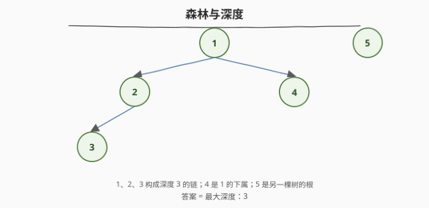
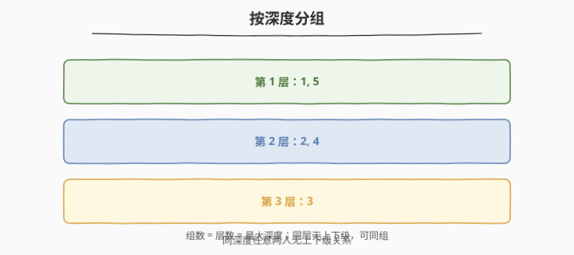

# Codeforces 115A Party 题解

## 1. 题目概述

- **题目链接**：https://codeforces.com/problemset/problem/115/A
- **比赛来源**：Codeforces Beta Round 87 (Div. 1 Only) · Problem A（UTC 2011-09-15）
- **难度**：900
- **标签**：DFS、图论、树
- **评测类型**：普通
- **限制**：时间 3 s / 内存 256 MB

**题意**：$n$ 个员工，每人至多一个直接上司 $p_i$（$p_i=-1$ 表示没有上司）。关系无环，所以构成一片**森林**（每个员工指向自己的上司，上司是根方向的父节点）。要把所有人分成若干组，要求**同一组里不存在"一个人是另一个人的上级"**（上级 = 沿着上司链可达）。求最少组数。

**约束**：

- $n\le2000$：$O(n^2)$ 求深度也完全够。
- 无环保证是森林，不会出现链上的环。
- "上级"是传递关系：直接或间接上司都算。

## 2. 示例与观察

官方样例 1（输入 / 输出原样）：

```text
输入：
5
-1
1
2
1
-1

输出：
3
```

**样例走查**：关系是 $1\to$（无上司），$2\to1$，$3\to2\to1$，$4\to1$，$5$（无上司）。深度：1 号 1 层，2 号 2 层，3 号 3 层，4 号 2 层，5 号 1 层。题面给的方案：

- 第 1 组：{1}
- 第 2 组：{2,4}
- 第 3 组：{3,5}

同一组内没有上下级 ✓，共 3 组。

**观察 1**：一条"上司链"上的任意两人都有上下级关系，所以**同一条链上的人必须分到不同组** → 答案 ≥ 最大链长（森林的最大深度）。

**观察 2**：把**同一深度**的人放在一组即可：同深度的两人不可能有上下级关系（上下级深度必不同）✓ → 答案 ≤ 最大深度。

两条合起来：**答案 = 森林的最大深度**。



## 3. 解题思路

### 3.1 朴素做法与瓶颈

$n\le2000$，直接对每个人沿上司链往上数到根，取最大值，$O(n^2)$ 足够。

### 3.2 核心观察：分层



按"到根的距离"分层：第 $k$ 层 = 深度为 $k$ 的员工。则

- 同层任意两人无上下级关系（否则深度不同），可以同组 ✓；
- 每条链上的人深度两两不同，必须分属不同组 ✓。

所以最少组数 = 层数 = 最大深度 ✓。

### 3.3 算法流程

1. 读入 $p_i$；
2. 对每个 $i$：沿 $p$ 往上走，计深度，直到 $-1$；
3. 输出最大深度。

### 3.4 样例走查

深度序列 $1,2,3,2,1$ → 最大值 3 ✓。

自造样例（标注"自造"）：

| 输入 | 输出 | 说明 |
|------|------|------|
| `1` / `-1` | 1 | 单人 |
| `3` / `-1` / `-1` / `-1` | 1 | 全无上司，同组 |
| `3` / `-1` / `1` / `2` | 3 | 一条链 |
| `4` / `-1` / `1` / `1` / `2` | 3 | 两层分叉 |

## 4. 正确性证明

**引理 1（同深度无上下级）**：若 $A$ 是 $B$ 的上级，则 $\mathrm{depth}(A) < \mathrm{depth}(B)$；因此同深度的两人不可能有上下级关系。

**证明**：上级关系沿父链传递，每走一步深度减 1 ✓。∎

**引理 2（下界）**：组数 ≥ 最大深度 $D$。

**证明**：取一条长度 $D$ 的链 $v_D\to v_{D-1}\to\dots\to v_1$；链上任意两人都有上下级关系（引理 1 的逆否：深度不同且在同一链上 ⇒ 一个是另一个的上级），所以这 $D$ 人必须两两不同组 → 组数 ≥ $D$ ✓。∎

**引理 3（上界）**：按深度分组，组数 $=D$ 且合法。

**证明**：同组同深度，由引理 1 无上下级关系 ✓。∎

**定理**：最少组数 $=D$，算法输出正确。

**证明**：由引理 2、3 上下界相同；算法求的正是 $D$ ✓。∎

## 5. 复杂度分析

- **时间**：$O(n\cdot D)\le O(n^2)$（$n\le2000$）。
- **空间**：$O(n)$。
- **与时限的关系**：实测 $n=2000$ 时 C++ 端到端 $5.8$ ms。

## 6. 参考代码

### C++17

```cpp
#include <bits/stdc++.h>
using namespace std;

int main() {
    int n;
    if (!(cin >> n)) return 0;
    vector<int> p(n + 1);
    for (int i = 1; i <= n; ++i) cin >> p[i];
    // 答案 = 森林的最大深度（每层的人可以放进同一组，同一条链上的人必须分开）
    int best = 0;
    for (int i = 1; i <= n; ++i) {
        int d = 1, cur = i;
        while (p[cur] != -1) { cur = p[cur]; ++d; }
        best = max(best, d);
    }
    cout << best << '\n';
    return 0;
}
```

### Python3

```python
import sys


def main() -> None:
    data = sys.stdin.buffer.read().split()
    n = int(data[0])
    p = [0] * (n + 1)
    for i in range(1, n + 1):
        p[i] = int(data[i])
    best = 0
    for i in range(1, n + 1):
        d = 1
        cur = i
        while p[cur] != -1:
            cur = p[cur]
            d += 1
        if d > best:
            best = d
    sys.stdout.write(str(best) + "\n")


main()
```

两份代码都只用标准库，可原样提交。

## 7. 边界情况与易错点

1. **深度从 1 开始**：只有一个人时答案是 1，不是 0。
2. **多棵树**：森林里每棵树的深度都要算，取全局最大。
3. **"上级"是传递的**：不要只看直接上司。
4. **无环**：题面保证，所以沿父链一定能到 $-1$。
5. **同深度可以同组**：这是上界的关键，别把它漏掉。
6. **多测**：单组输入。

## 8. 验证记录

- **编译环境与命令**：本机无 GNU `g++`，用 `Apple clang 21.0.0` + 仓库自带 `codeforces/tools/include/bits/stdc++.h` 兼容头（`clang++ -std=c++17 -O2 -I codeforces/tools/include`）编译；Python 为 `Python 3.9.6`。
- **官方样例**：1 / 1 通过（`3`）。
- **额外测试**：250 组随机森林（$n\le12$，随机父节点保证无环）与"记忆化递归求深度"的独立实现比对，**250 / 250 全部一致**。
- **最大约束性能**：$n=2000$ 的深链时 C++ 端到端 10 次平均 $5.8$ ms、Python $17.0$ ms。
- **图片校验**：两张 SVG（`cf115a_depth.svg`、`cf115a_layers.svg`）通过 `xml.etree.ElementTree.parse`，文本块估算未越出 `viewBox`。
- **公式校验**：KaTeX（`throwOnError: true`）渲染无报错。
- **复核状态**：verified。

## 相关题目与扩展

- [Codeforces 115B Lawnmower](https://codeforces.com/problemset/problem/115/B)：同场 B 题。
- [Codeforces 116A Tram](https://codeforces.com/problemset/problem/116/A)：同一场 Div.2 的 A 题。
- [Codeforces 161D Distance in Tree](https://codeforces.com/problemset/problem/161/D)：树上计数。
- [LeetCode 104. 二叉树的最大深度](https://leetcode.cn/problems/maximum-depth-of-binary-tree/)：深度。
- [LeetCode 1379. 找出克隆二叉树中的相同节点](https://leetcode.cn/problems/find-a-corresponding-node-of-a-binary-tree-cloned-tree/)：树遍历。

**延伸思考**：

1. **如果允许"同组可以有上下级但限制层差"**：变成图着色/区间问题。
2. **如果上司关系有环**：题面保证无环，否则"上级"无定义。
3. **如果要求输出分组方案**：按深度分桶即可。
4. **如果 $n$ 到 $10^6$**：需要 $O(n)$ 的拓扑/记忆化而不是 $O(n^2)$。
