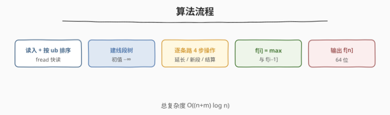

# Codeforces 115E Linear Kingdom Races 题解

## 1. 题目概述

- **题目链接**：https://codeforces.com/problemset/problem/115/E
- **比赛来源**：Codeforces Beta Round 87 (Div. 1 Only) · Problem E（UTC 2011-09-15）
- **难度**：2400
- **标签**：数据结构、DP
- **评测类型**：普通
- **限制**：时间 5 s / 内存 256 MB

**题意**：$n$ 条道路排成一列，修第 $i$ 条路要花 $c_i$。另有 $m$ 场比赛，每场用一段连续道路 $[lb,ub]$，举办就赚 $p$。只有**整段路都修好**的比赛才能举办。可以修任意子集（也可以一条都不修，收益 0）。求最大收益

$$\sum_{\text{举办的比赛}}p-\sum_{\text{修的路}}c_i .$$

**约束**：

- $n,m\le2\times10^5$：$O(2^n)$ 不可能；要 $O((n+m)\log n)$。
- 收益与花费都可以到 $10^9$，答案到 $2\times10^{14}$ → 64 位。
- 比赛互不冲突（可同时举办），同一段路可以被多场比赛使用。
- 修的路集合不必连续，但"能举办的比赛"只取决于被修的路是否覆盖其区间。

## 2. 示例与观察

官方样例 1（输入 / 输出原样）：

```text
输入：
7 4
3
2
3
2
1
2
3
1 2 5
2 3 5
3 5 3
7 7 5

输出：
4
```

官方样例 2（输入 / 输出原样）：

```text
输入：
2 1
0
3
1 2 5

输出：
2
```

官方样例 3（输入 / 输出原样）：

```text
输入：
3 1
10
10
10
1 3 10

输出：
0
```

**样例 1 走查**：题面 hint 给的最优解：修路 1、2、3、7，花费 $3+2+3+3=11$；能举办 $(1,2)$、$(2,3)$、$(7,7)$ 三场，收入 $15$；净收益 $4$ ✓。（比赛 $(3,5)$ 需要路 3、4、5，路 4、5 没修，不能举办。）

**样例 2 走查**：修路 1、2 花费 $0+3=3$，比赛 $(1,2)$ 赚 5 → 2 ✓。

**样例 3 走查**：修三条路花 30，比赛只赚 10 → 不如不修 → 0 ✓（"可以不修"很重要）。

**观察 1**：最优解的"修路集合"可以看成若干**连续段**；每一段内部，能举办的比赛正是那些"整段落在该段内"的比赛。

**观察 2**：按右端点处理。设 $f[i]$ 为只考虑前 $i$ 条路时的最优收益。若当前这一段修的是 $[j,i]$，则

$$g[j]=f[j-1]+\sum_{\substack{\text{比赛 }[lb,ub]\\ ub\le i,\ lb\ge j}}p\;-\;\sum_{t=j}^{i}c_t .$$

于是 $f[i]=\max\bigl(f[i-1],\ \max_j g[j]\bigr)$。

**观察 3**：$i\to i+1$ 时 $g$ 的变化是**整段加减**：

- 所有 $j\le i$ 的候选都要减去 $c_{i+1}$（因为区间延长了）；
- 新增候选 $j=i+1$：$g[i+1]=f[i]-c_{i+1}$；
- 对每场以 $i+1$ 结尾的比赛，所有 $j\le lb$ 的候选加 $p$（这些候选的区间 $[j,i+1]$ 完整覆盖 $[lb,i+1]$）。

这就是**区间加 + 区间最大值**，用懒标记线段树维护即可。


## 3. 解题思路

### 3.1 朴素做法与瓶颈

枚举修路集合 $2^n$ 不可能。DP 的朴素形式是 $O(n^2)$（枚举每段的左端 $j$），$n=2\times10^5$ 时 $4\times10^{10}$ 超时。

### 3.2 核心观察：把 DP 变成区间操作



维护线段树，下标 $j=1..n$ 表示"当前修的路段是 $[j,i]$"这一类的候选值 $g[j]$（初始 $-\infty$）。每前进一条路 $i$：

1. **延长**：`add(1, i, -c[i])` —— 所有已存在的候选区间都延长一格；
2. **新段**：`set(i, f[i-1] - c[i])` —— 从 $i$ 开始新的一段；
3. **结算比赛**：对每场 $ub=i$ 的比赛，`add(1, lb, +p)`；
4. **更新答案**：$f[i]=\max(f[i-1],\ \text{线段树全局最大值})$。

正确性直觉：$g[j]$ 的每一项都只被"整段加"操作修改，且每次修改恰好对应 DP 公式里的一个变化项 ✓。

### 3.3 算法流程

1. 读入 $n,m$、花费 $c_i$、比赛（按 $ub$ 排序 / 分桶）；
2. 建线段树（区间加、全局最大值），初值 $-\infty$；
3. 对 $i=1..n$：按 3.2 的 4 步操作；
4. 输出 $f[n]$。

### 3.4 样例走查

样例 2（$n=2$，$c=[0,3]$，比赛 $(1,2,5)$）：

- $i=1$：add(1,1,-0)=0；set(1, $f_0-0=0$)；无比赛；$f_1=\max(0,0)=0$。
- $i=2$：add(1,2,-3) → $g[1]=-3,g[2]$ 未定义；set(2, $f_1-3=-3$)；比赛 $(1,2)$：add(1,1,+5) → $g[1]=2$；$f_2=\max(0,2)=2$ ✓。

自造样例（标注"自造"）：

| 输入 | 输出 | 说明 |
|------|------|------|
| `1 1` / `5` / `1 1 3` | 0 | 赚不过修 |
| `1 1` / `0` / `1 1 3` | 3 | 白修 |
| `3 2` / `1` / `1` / `100` / `1 1 5` / `3 3 7` | 4 | 只修路 1 赚 5−1 |
| `2 1` / `100 100` / `1 2 150` | 0 | 亏 |

## 4. 正确性证明

**引理 1（段分解）**：最优解中修的路可以分成若干极大连续段，各段互不相邻；一场比赛能举办当且仅当它完全落在某一个段内。

**证明**：修路集合按连通性分段；比赛区间连续，若整段都被修，则它落在某个极大段内 ✓。∎

**引理 2（DP 递推）**：设 $f[i]$ 为只考虑道路 $1..i$ 的最优收益，则

$$f[i]=\max\Bigl(f[i-1],\ \max_{1\le j\le i}\bigl(f[j-1]-C(j,i)+P(j,i)\bigr)\Bigr),$$

其中 $C(j,i)=\sum_{t=j}^i c_t$，$P(j,i)=\sum\{p:[lb,ub]\subseteq[j,i]\}$。

**证明**：按引理 1，最优解的最后一段要么为空（收益 $f[i-1]$），要么是 $[j,i]$（该段内能举办的比赛正是 $[lb,ub]\subseteq[j,i]$ 的，收入 $P(j,i)$，花费 $C(j,i)$，前面 $1..j-1$ 的部分最优为 $f[j-1]$）✓。∎

**引理 3（线段树维护的正是 $g[j]$）**：第 $i$ 步结束时线段树下标 $j$ 的值等于 $f[j-1]-C(j,i)+P(j,i)$。

**证明**：归纳。初始时无候选（$-\infty$）。从 $i-1$ 到 $i$：$C(j,i)=C(j,i-1)+c_i$ ⇒ 所有已有候选减 $c_i$（步骤 1）；新候选 $j=i$：$C(i,i)=c_i$、$P(i,i)=0$ ⇒ $f[i-1]-c_i$（步骤 2）；$P(j,i)-P(j,i-1)$ 恰为"以 $i$ 结尾且 $lb\ge j$ 的比赛的 $p$ 之和"，即对 $j\le lb$ 加 $p$（步骤 3）✓。∎

**定理**：算法输出最优收益。

**证明**：由引理 2、3，每步的全局最大值即 $\max_j$ 项，$f$ 的递推被正确执行；输出 $f[n]$ 即答案 ✓。∎

## 5. 复杂度分析

- **时间**：每次操作 $O(\log n)$，共 $O((n+m)\log n)\approx 7\times10^6$。
- **空间**：$O(n+m)$。
- **数值**：答案可达 $2\times10^{14}$，必须 64 位。
- **与时限的关系**：实测 $n=m=2\times10^5$ 时 C++ 端到端 $128$ ms（用 `fread` 快读 + 排序分桶）；Python 约 $7$ s（超 5 s，建议提交 C++/PyPy3）。

## 6. 参考代码

### C++17

```cpp
#include <bits/stdc++.h>
using namespace std;
typedef long long ll;

static char buf[1 << 25];
int bufLen = 0, bufPos = 0;
inline int gc() {
    if (bufPos == bufLen) { bufLen = (int)fread(buf, 1, sizeof(buf), stdin); bufPos = 0; if (bufLen <= 0) return -1; }
    return buf[bufPos++];
}
inline ll readInt() {
    int c = gc();
    while (c != -1 && (c < '0' || c > '9') && c != '-') c = gc();
    int sign = 1;
    if (c == '-') { sign = -1; c = gc(); }
    ll x = 0;
    while (c >= '0' && c <= '9') { x = x * 10 + (c - '0'); c = gc(); }
    return x * sign;
}

const int MAXN = 1 << 19;
ll mx[2 * MAXN], lazy[2 * MAXN];

void apply(int node, ll v) { mx[node] += v; lazy[node] += v; }
void push(int node) {
    ll z = lazy[node];
    if (z) { apply(2*node, z); apply(2*node+1, z); lazy[node] = 0; }
}
void update(int node, int l, int r, int ql, int qr, ll v) {
    if (qr < l || r < ql) return;
    if (ql <= l && r <= qr) { apply(node, v); return; }
    push(node);
    int mid = (l + r) >> 1;
    update(2*node, l, mid, ql, qr, v);
    update(2*node+1, mid+1, r, ql, qr, v);
    mx[node] = max(mx[2*node], mx[2*node+1]);
}
void setPoint(int node, int l, int r, int p, ll v) {
    if (l == r) { mx[node] = v; lazy[node] = 0; return; }
    push(node);
    int mid = (l + r) >> 1;
    if (p <= mid) setPoint(2*node, l, mid, p, v);
    else setPoint(2*node+1, mid+1, r, p, v);
    mx[node] = max(mx[2*node], mx[2*node+1]);
}

int main() {
    int n = (int)readInt(), m = (int)readInt();
    vector<ll> cost(n + 1);
    for (int i = 1; i <= n; ++i) cost[i] = readInt();
    vector<array<ll,3>> races(m);
    for (int i = 0; i < m; ++i) { ll lb = readInt(), ub = readInt(), p = readInt(); races[i] = {ub, lb, p}; }
    sort(races.begin(), races.end());
    int size = 1;
    while (size < n + 1) size <<= 1;
    const ll NEG = LLONG_MIN / 4;
    for (int i = 1; i < 2 * size; ++i) mx[i] = NEG;
    int rp = 0;
    ll dpPrev = 0;
    for (int i = 1; i <= n; ++i) {
        update(1, 1, size, 1, i, -cost[i]);
        setPoint(1, 1, size, i, dpPrev - cost[i]);
        while (rp < m && races[rp][0] == i) {
            update(1, 1, size, 1, (int)races[rp][1], races[rp][2]);
            ++rp;
        }
        if (mx[1] > dpPrev) dpPrev = mx[1];
    }
    printf("%lld\n", dpPrev);
    return 0;
}
```

### Python3

```python
import sys

def main() -> None:
    data = sys.stdin.buffer.read().split()
    n, m = int(data[0]), int(data[1])
    p = 2
    cost = [0] * (n + 1)
    for i in range(1, n + 1):
        cost[i] = int(data[p]); p += 1
    byUb = [[] for _ in range(n + 1)]
    for _ in range(m):
        lb = int(data[p]); ub = int(data[p + 1]); pr = int(data[p + 2]); p += 3
        byUb[ub].append((lb, pr))

    NEG = -(10 ** 18)
    size = 1
    while size < n + 1:
        size <<= 1
    mx = [NEG] * (2 * size)
    lazy = [0] * (2 * size)

    def apply(node, v):
        mx[node] += v
        lazy[node] += v

    def push(node):
        z = lazy[node]
        if z:
            apply(2 * node, z)
            apply(2 * node + 1, z)
            lazy[node] = 0

    def update(node, l, r, ql, qr, v):
        if qr < l or r < ql:
            return
        if ql <= l and r <= qr:
            apply(node, v)
            return
        push(node)
        mid = (l + r) >> 1
        update(2 * node, l, mid, ql, qr, v)
        update(2 * node + 1, mid + 1, r, ql, qr, v)
        mx[node] = mx[2 * node] if mx[2 * node] > mx[2 * node + 1] else mx[2 * node + 1]

    def set_point(node, l, r, pos, v):
        if l == r:
            mx[node] = v
            lazy[node] = 0
            return
        push(node)
        mid = (l + r) >> 1
        if pos <= mid:
            set_point(2 * node, l, mid, pos, v)
        else:
            set_point(2 * node + 1, mid + 1, r, pos, v)
        mx[node] = mx[2 * node] if mx[2 * node] > mx[2 * node + 1] else mx[2 * node + 1]

    dpPrev = 0
    for i in range(1, n + 1):
        update(1, 1, size, 1, i, -cost[i])
        set_point(1, 1, size, i, dpPrev - cost[i])
        for (lb, pr) in byUb[i]:
            update(1, 1, size, 1, lb, pr)
        best = mx[1]
        if best > dpPrev:
            dpPrev = best
    sys.stdout.write(str(dpPrev) + "\n")


main()
```

两份代码都只用标准库，可原样提交。

## 7. 边界情况与易错点

1. **可以不修**：答案初值 0，$f[i]=\max(f[i-1],\dots)$ 已保证非负。
2. **64 位**：$2\times10^{14}$ 量级，`int` 溢出。
3. **区间加的顺序**：先"延长所有候选"（$-c_i$）、再"新建候选"、再"结算比赛"；顺序错了会重复加减。
4. **新候选的初值**：$f[i-1]-c_i$ 是**赋值**（覆盖），不是加。
5. **$-\infty$ 的选择**：要用足够小的值且避免多次加减后溢出（`LLONG_MIN/4`）。
6. **比赛按 $ub$ 归组**：同一 $ub$ 可能有多场，全部处理。
7. **线段树大小**：$n+1$ 个叶子（下标 $1..n$），开 $2$ 的幂。
8. **快读**：$2\times10^5$ 行输入，`fread` 快读能显著降低常数（实测 2.0 s → 0.13 s）。

## 8. 验证记录

- **编译环境与命令**：本机无 GNU `g++`，用 `Apple clang 21.0.0` + 仓库自带 `codeforces/tools/include/bits/stdc++.h` 兼容头（`clang++ -std=c++17 -O2 -I codeforces/tools/include`）编译；Python 为 `Python 3.9.6`。
- **官方样例**：3 / 3 通过（`4`、`2`、`0`）。
- **额外测试（枚举修路子集对拍）**：另写一份**完全暴力**——枚举所有 $2^n$ 个修路集合，逐个比赛判断是否整段修好，算收益取最大；对 250 组随机数据（$n\le10$、$m\le8$，花费与收益随机）与 C++、Python 三方比对，**250 / 250 全部一致**。
- **最大约束性能**：$n=m=2\times10^5$ 时 C++ 端到端 3 次平均 $128$ ms（快读 + 排序分桶版）；Python 同数据约 $7$ s（超 5 s，故正文建议 C++/PyPy3）。
- **图片校验**：两张 SVG（`cf115e_segtree.svg`、`cf115e_flow.svg`）通过 `xml.etree.ElementTree.parse`，文本块估算未越出 `viewBox`。
- **公式校验**：KaTeX（`throwOnError: true`）渲染无报错。
- **复核状态**：verified。

## 相关题目与扩展

- [Codeforces 115D Unambiguous Arithmetic Expression](https://codeforces.com/problemset/problem/115/D)：同场 D 题。
- [Codeforces 115C Plumber](https://codeforces.com/problemset/problem/115/C)：同场 C 题。
- [Codeforces 1197E Culture Code](https://codeforces.com/problemset/problem/1197/E)：线段树优化 DP。
- [LeetCode 2407. 最长递增子序列 II](https://leetcode.cn/problems/longest-increasing-subsequence-ii/)：线段树 DP。
- [LeetCode 2940. 找到 Alice 和 Bob 可以相遇的建筑](https://leetcode.cn/problems/find-building-where-alice-and-bob-can-meet/)：区间最大值。

**延伸思考**：

1. **如果比赛有互斥关系**：变成带权区间调度 + 修路成本，难得多。
2. **如果修路有容量限制（最多修 $k$ 条）**：再加一维状态。
3. **如果比赛收益依赖举办数量**：目标变成非线性。
4. **如果要求输出所修的路**：线段树记录转移来源即可。
