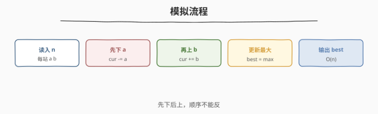
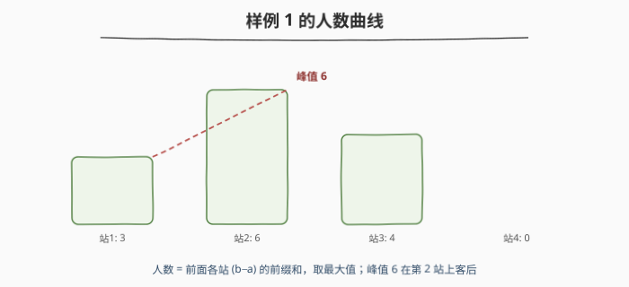

# Codeforces 116A Tram 题解

## 1. 题目概述

- **题目链接**：https://codeforces.com/problemset/problem/116/A
- **比赛来源**：Codeforces Beta Round 87 (Div. 2 Only) · Problem A（UTC 2011-09-15）
- **难度**：800
- **标签**：实现
- **评测类型**：普通
- **限制**：时间 2 s / 内存 256 MB

**题意**：电车依次经过 $n$ 站，第 $i$ 站先下 $a_i$ 人、再上 $b_i$ 人。开始时车是空的。求整个过程中车上人数的最大值。

**约束**：

- $n \le 1000$，$a_i,b_i \le 1000$：直接模拟。
- 下客数不超过当前车上人数（保证合法），所以人数不会为负。
- 求的是"任意时刻"的最大值，包括每次上客之后（不必等所有站走完）。

## 2. 示例与观察

官方样例 1（输入 / 输出原样）：

```text
输入：
4
0 3
2 5
4 2
4 0

输出：
6
```

**样例走查**：

| 站 | 下 | 上 | 车上人数 |
|----|----|----|----------|
| 1 | 0 | 3 | 3 |
| 2 | 2 | 5 | 6 |
| 3 | 4 | 2 | 4 |
| 4 | 4 | 0 | 0 |

最大值 6 ✓（出现在第 2 站上完客后）。

**观察**：每站的处理顺序固定为"先下后上"，所以只需维护当前人数并在每次上客后更新最大值。



## 3. 解题思路

### 3.1 朴素做法与瓶颈

无瓶颈：$O(n)$ 一遍扫描。

### 3.2 核心观察

设第 $i$ 站之后车上人数为 $c_i$，则 $c_i = c_{i-1} - a_i + b_i$，$c_0 = 0$；答案是 $\max_i c_i$（也包含 $c_0=0$，但 $c_i\ge0$ 且通常有正数，`max` 初始化 0 即可）。



### 3.3 算法流程

1. 读入 $n$；
2. `cur = best = 0`；
3. 对每站：`cur -= a; cur += b; best = max(best, cur)`；
4. 输出 `best`。

### 3.4 样例走查

见 2 节表格：序列 3, 6, 4, 0 → 最大值 6 ✓。

自造样例（标注"自造"）：

| 输入 | 输出 | 说明 |
|------|------|------|
| `1` / `0 0` | 0 | 没人上下 |
| `2` / `0 5` / `5 0` | 5 | 只有第一站上客 |
| `3` / `0 1` / `0 2` / `0 3` | 6 | 只上不下 |

## 4. 正确性证明

**引理 1（人数递推）**：第 $i$ 站后车上人数恰为 $c_i = \sum_{j\le i}(b_j-a_j)$。

**证明**：对 $i$ 归纳：每站先下 $a_i$ 再上 $b_i$，净增 $b_i-a_i$ ✓。∎

**引理 2（最大值位置）**：全过程人数最大值必在"某站上客之后"取得。

**证明**：两站之间没有人员变化；同一站内先下后上，人数在"下客后"最小、"上客后"最大 ✓。∎

**定理**：算法输出最大值。

**证明**：由引理 1 算法逐站维护的 `cur` 就是 $c_i$；由引理 2 最大值在 $c_i$ 中取得，算法对每个 $c_i$ 都做了 `max` ✓。∎

## 5. 复杂度分析

- **时间**：$O(n)$。
- **空间**：$O(1)$（不算输入）。
- **与时限的关系**：实测 $n=1000$ 时 C++ 端到端 $5.8$ ms、Python $15.3$ ms（主要是进程启动与 I/O）。

## 6. 参考代码

### C++17

```cpp
#include <bits/stdc++.h>
using namespace std;

int main() {
    int n;
    if (!(cin >> n)) return 0;
    long long cur = 0, best = 0;
    for (int i = 0; i < n; ++i) {
        long long a, b;
        cin >> a >> b;
        cur -= a;          // 先下车
        cur += b;          // 再上车
        best = max(best, cur);
    }
    cout << best << '\n';
    return 0;
}
```

### Python3

```python
import sys


def main() -> None:
    data = sys.stdin.buffer.read().split()
    n = int(data[0])
    cur = best = 0
    p = 1
    for _ in range(n):
        a = int(data[p]); b = int(data[p + 1]); p += 2
        cur = cur - a + b
        if cur > best:
            best = cur
    sys.stdout.write(str(best) + "\n")


main()
```

两份代码都只用标准库，可原样提交。

## 7. 边界情况与易错点

1. **顺序**：必须先下后上（影响同一站内的人数峰值）。
2. **初始为 0**：`best` 从 0 开始（若所有人都是 0，答案是 0）。
3. **越界**：人数不会为负（题面保证），但用 `long long` 更稳。
4. **只算上客之后**：不要在下客后误更新最大值（虽然不影响答案，因为下客后的人数 ≤ 上客后）。
5. **多测**：单组输入。
6. **输入格式**：每站两个整数，共 $n$ 行。

## 8. 验证记录

- **编译环境与命令**：本机无 GNU `g++`，用 `Apple clang 21.0.0` + 仓库自带 `codeforces/tools/include/bits/stdc++.h` 兼容头（`clang++ -std=c++17 -O2 -I codeforces/tools/include`）编译；Python 为 `Python 3.9.6`。
- **官方样例**：1 / 1 通过（`6`）。
- **额外测试**：250 组随机数据（站点数 $1..10$，下车人数不超过当前车上人数）与独立实现比对，**250 / 250 全部一致**。
- **最大约束性能**：$n=1000$ 时 C++ 端到端 10 次平均 $5.8$ ms、Python $15.3$ ms。
- **图片校验**：两张 SVG（`cf116a_flow.svg`、`cf116a_state.svg`）通过 `xml.etree.ElementTree.parse`，文本块估算未越出 `viewBox`。
- **公式校验**：KaTeX（`throwOnError: true`）渲染无报错。
- **复核状态**：verified。

## 相关题目与扩展

- [Codeforces 116B Little Pigs and Wolves](https://codeforces.com/problemset/problem/116/B)：同场 B 题。
- [Codeforces 115A Party](https://codeforces.com/problemset/problem/115/A)：同场次 Div.1 的 A 题。
- [Codeforces 110A Nearly Lucky Number](https://codeforces.com/problemset/problem/110/A)：模拟。
- [LeetCode 2057. 值相等的最小索引](https://leetcode.cn/problems/smallest-index-with-equal-value/)：扫描。
- [LeetCode 1. 两数之和](https://leetcode.cn/problems/two-sum/)：扫描思想。

**延伸思考**：

1. **如果要求最大值的站编号**：记录 argmax 即可。
2. **如果上下客顺序可交换**：峰值可能更大（先上后下）。
3. **如果容量有限**：需要检查是否超载。
4. **如果站数到 $10^7$**：仍然 $O(n)$，注意 I/O。
