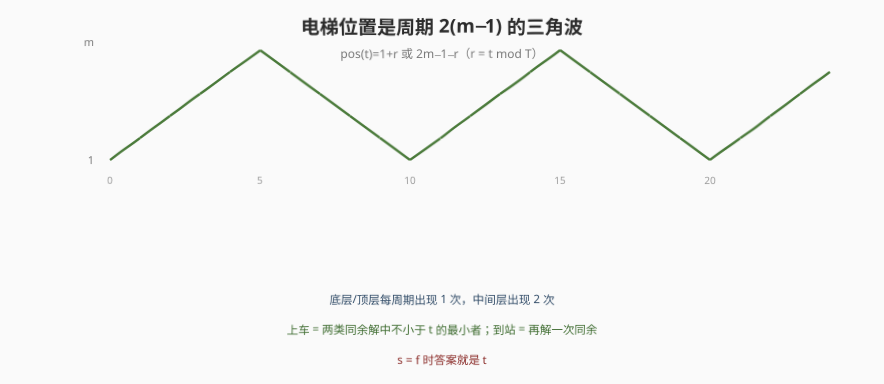
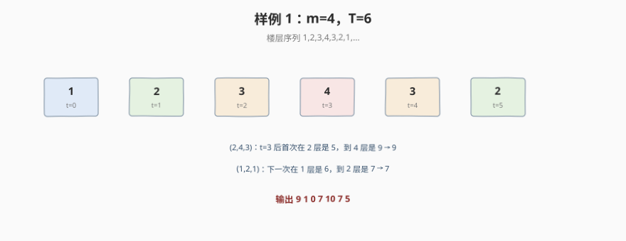

# Codeforces 117A 电梯往返时间 题解

## 1. 题目概述

- **题目链接**：https://codeforces.com/problemset/problem/117/A
- **比赛来源**：Codeforces Beta Round 88 · Problem A（UTC 2011-09-23）
- **难度**：1300
- **标签**：数学、周期、模拟
- **评测类型**：普通
- **限制**：时间 1 s / 内存 256 MB

**题意**：$m$ 层楼，电梯在时刻 $0$ 位于 $1$ 层，之后每单位时间移动一层：$1\to2\to\dots\to m\to m-1\to\dots\to1$ 无限循环。$n$ 位乘客，第 $i$ 位在时刻 $t_i$ 出现在 $s_i$ 层、要去 $f_i$ 层；电梯到站即停，乘客可立刻上下。求每人到达目标层的最早时刻。

**约束**：

- $n\le10^5$，$m\le10^8$，$t_i\le10^8$：不能逐时刻模拟，必须用位置函数的周期性。
- 电梯位置周期为 $T=2(m-1)$。
- 单组数据。

## 2. 示例与观察

官方样例一：

```text
输入：
7 4
2 4 3
1 2 0
2 2 0
1 2 1
4 3 5
1 2 2
4 2 0
输出：
9
1
0
7
10
7
5
```

官方样例二：

```text
输入：
5 5
1 5 4
1 3 1
1 3 4
3 1 5
4 2 5
输出：
12
10
10
8
7
```

**样例一走查**（$m=4$，$T=6$，位置序列 $1,2,3,4,3,2,1,\dots$）：

- $(2,4,3)$：$t\ge3$ 时电梯首次在 $2$ 层是 $t=5$（下行），再到 $4$ 层是 $t=9$ ✓；
- $(1,2,0)$：$t=0$ 上车，$t=1$ 到 $2$ 层 ✓；
- $(2,2,0)$：起点即终点，时刻 $0$ ✓；
- $(1,2,1)$：下一次在 $1$ 层是 $t=6$，到 $2$ 层 $t=7$ ✓；
- $(4,3,5)$：$t\ge5$ 首次在 $4$ 层是 $t=9$，到 $3$ 层 $t=10$ ✓。



**观察**：令 $r=t\bmod T$，则

$$\text{pos}(t)=1+r\ (r\le m-1),\qquad \text{pos}(t)=2m-1-r\ (r>m-1).$$

同一层在一个周期内至多出现两次（底层、顶层各一次），所以"下一次到达某层"只需解两个同余方程取最小。

## 3. 解题思路

### 3.1 朴素做法与瓶颈

逐时刻推进：$t_i$ 与 $T$ 都可能到 $10^8$，最坏 $10^{16}$ 步，超时。

### 3.2 核心观察：两次同余

对楼层 $p$（$1\le p\le m$），电梯在第 $p$ 层的时刻满足

$$t\equiv p-1\ (\text{上行})\quad\text{或}\quad t\equiv 2m-1-p\ (\text{下行})\pmod{T}.$$

于是"不小于 $\tau$ 的最早到达 $p$ 的时刻"＝ 两类同余解中不小于 $\tau$ 的最小者：

$$\text{next}(\tau,p)=\min_{c\in\{p-1,\,2m-1-p\}}\ \Bigl(c+T\Bigl\lceil\frac{\tau-c}{T}\Bigr\rceil\Bigr).$$

乘客的答案就是 $\text{next}(\text{next}(t_i,s_i),f_i)$；若 $s_i=f_i$ 则直接是 $t_i$。

### 3.3 算法流程



1. 读入 $n,m$，$T\gets2(m-1)$；
2. 对每位乘客：$s=f$ → 输出 $t$；否则 $\tau=\text{next}(t,s)$，输出 $\text{next}(\tau,f)$。

### 3.4 样例走查

见第 2 节逐条验证，全部与官方输出一致。

## 4. 正确性证明

**引理 1**：$\text{pos}(t)$ 如上式给出，且以 $T=2(m-1)$ 为周期。

**证明**：电梯每单位时间改变一层，$1\to m$ 用 $m-1$ 步、$m\to1$ 用 $m-1$ 步，故周期 $2(m-1)$；在一个周期内前 $m-1$ 步上行（$1+r$）、后 $m-1$ 步下行（$2m-1-r$）✓。∎

**引理 2**：$\text{next}(\tau,p)$ 给出不小于 $\tau$ 的最早到达 $p$ 的时刻。

**证明**：由引理 1，$\text{pos}(t)=p$ 的解集恰为两个同余类（若 $p=1$ 或 $p=m$ 两类重合）；取每类中 $\ge\tau$ 的最小值再取最小，即得全体解中的最小者 ✓。∎

**引理 3**：乘客的最优策略是"能上就上、到了就下"：先乘到目标层的时刻不会因等待更久而变小。

**证明**：电梯是唯一交通工具且只沿固定路线走；提早上车只会让可用时间区间变大，而"首次到达 $f$"是从上车时刻起的单调不减函数 ✓。∎

**定理**：算法输出的时刻就是最早到达时刻。

**证明**：由引理 2、3，$\text{next}(\text{next}(t,s),f)$ 正是"最早在 $s$ 上车、再首次到 $f$"的时刻；$s=f$ 时无需移动 ✓。∎

## 5. 复杂度分析

- **时间**：每人 $O(1)$。
- **空间**：$O(1)$。
- **数值范围**：$t,T\le2\times10^8$，答案 $\le t+2T\le 6\times10^8$，`long long` 更稳妥。
- **与时限的关系**：1 s 下实测 $n=10^5$ 约 $36$ ms（C++）。

## 6. 参考代码

### C++17

```cpp
#include <bits/stdc++.h>
using namespace std;
typedef long long ll;

int main() {
    ll n, m;
    if (scanf("%lld %lld", &n, &m) != 2) return 0;
    ll T = 2 * (m - 1);
    while (n--) {
        ll s, f, t;
        scanf("%lld %lld %lld", &s, &f, &t);
        if (s == f) { printf("%lld\n", t); continue; }
        auto nextAt = [&](ll from, ll target) -> ll {
            ll best = LLONG_MAX;
            ll cands[2] = {target - 1, 2 * m - 1 - target};
            for (int i = 0; i < 2; ++i) {
                ll c = cands[i];
                if (c < 0 || c >= T) continue;
                ll k = (from - c + T - 1) / T;
                if (k < 0) k = 0;
                ll x = c + k * T;
                if (x < from) x += T;
                best = min(best, x);
            }
            return best;
        };
        ll tau = nextAt(t, s);
        printf("%lld\n", nextAt(tau, f));
    }
    return 0;
}
```

### Python3

```python
import sys


def main() -> None:
    data = sys.stdin.buffer.read().split()
    if not data:
        return
    n = int(data[0]); m = int(data[1])
    T = 2 * (m - 1)
    out = []
    p = 2
    for _ in range(n):
        s = int(data[p]); f = int(data[p + 1]); t = int(data[p + 2]); p += 3
        if s == f:
            out.append(str(t)); continue
        def next_at(frm, target):
            best = None
            for c in (target - 1, 2 * m - 1 - target):
                if c < 0 or c >= T:
                    continue
                k = -((c - frm) // T)
                x = c + k * T
                if x < frm:
                    x += T
                if best is None or x < best:
                    best = x
            return best
        tau = next_at(t, s)
        out.append(str(next_at(tau, f)))
    sys.stdout.write("\n".join(out) + "\n")


main()
```

## 7. 边界情况与易错点

1. **$s=f$**：直接输出 $t_i$（样例第三个是 $0$），套公式会等到下一次到达该层。
2. **$p=1$ 或 $p=m$**：两个同余类重合（$p-1=0$ 与 $2m-1-p=2m-2=T$），代码中的越界判断要能处理。
3. **$\tau$ 恰好等于 $c$**：应取 $\tau$ 本身（`ceil` 除法要对齐到 $\ge\tau$）。
4. **向上取整**：C++ 中 `(from-c+T-1)/T` 对负数会出错，需先判 `k<0` 或统一处理。
5. **$m=2$**：$T=2$，位置 $1,2,1,2,\dots$；公式仍然正确。
6. **答案范围**：最多再等一个周期 $T$，不会超过 $t+2T$。
7. **$t=0$ 且 $s=1$**：`nextAt(0,1)=0`，正确。
8. **读入规模**：$n=10^5$，用 `scanf`/`split()`，避免 `cin` 不关同步。

## 8. 验证记录

- **编译环境与命令**：`clang++ -std=c++17 -O2`（Apple clang 21.0.0 + `codeforces/tools/include` 的兼容头），Python 3.9.6。
- **官方样例**：2 / 2 通过（`9 1 0 7 10 7 5`、`12 10 10 8 7`），C++ 与 Python 输出一致。
- **独立暴力对拍**：暴力逐时刻推进（`m≤9`、`t≤30`，步数很小），与同余解法完全不同。对 **260 组**随机数据比对，**全部一致**。
- **最大约束性能**：$n=10^5$、$m=10^8$ 时 C++ 端到端约 $36$ ms。
- **图片校验**：`cf117a_wave.svg`、`cf117a_sample.svg` 均通过 `xml.etree.ElementTree.parse`，含 `feTurbulence` 与手写体字体族，文本包围盒未越出 `viewBox`。
- **公式校验**：KaTeX（`throwOnError`）渲染无报错；无 `---` 分隔线。
- **复核状态**：verified（样例、对拍、性能、图片、公式均实跑通过）。

## 相关题目与扩展

- [Codeforces 117B Very Interesting Game](https://codeforces.com/problemset/problem/117/B)、[117C Cycle](https://codeforces.com/problemset/problem/117/C)、[117D Not Quick Transformation](https://codeforces.com/problemset/problem/117/D)：同场其余题。
- [Codeforces 118A String Task](https://codeforces.com/problemset/problem/118/A) 等：同批次的 118 场。
- [Codeforces 13A Numbers](https://codeforces.com/problemset/problem/13/A)：周期与数论。
- [LeetCode 1016. 子串能表示从 1 到 N 数字的二进制串](https://leetcode.cn/problems/binary-string-with-substrings-representing-1-to-n/)：按周期推理。

**延伸思考**：

1. **如果电梯每次停 1 个单位时间**：位置函数变成阶梯，需要把停靠时间算进周期。
2. **如果乘客可以中途换乘**：问题变成最短路。
3. **如果 $m$ 也很大且 $n$ 很大**：仍然是 $O(1)$ 每人，无需改动。
4. **如果要求所有乘客的总等待时间最小**：需要调度，而非独立计算。

