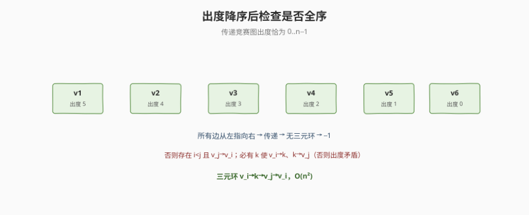
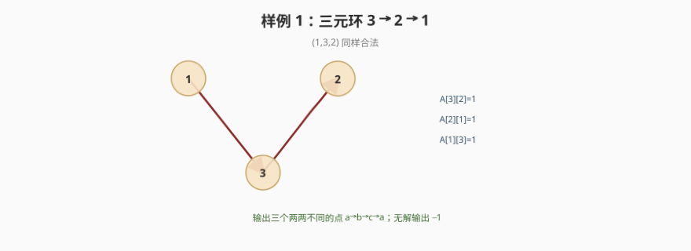

# Codeforces 117C 竞赛图三元环 题解

## 1. 题目概述

- **题目链接**：https://codeforces.com/problemset/problem/117/C
- **比赛来源**：Codeforces Beta Round 88 · Problem C（UTC 2011-09-23）
- **难度**：2000
- **标签**：图论、竞赛图、构造
- **评测类型**：普通（输出任意三元环）
- **限制**：时间 2.5 s / 内存 256 MB

**题意**：给一个 $n$ 个点的竞赛图（任两点恰有一条有向边），求一个长度 3 的环；不存在输出 `-1`。

**约束**：

- $n\le5000$：$O(n^2)$ 可以，$O(n^3)$ 不行。
- 输入是 $n$ 行长度 $n$ 的 01 串（无空格）。
- 单组数据。

## 2. 示例与观察

官方样例一：

```text
输入：
5
00100
10000
01001
11101
11000
输出：
1 3 2 
```

官方样例二：

```text
输入：
5
01111
00000
01000
01100
01110
输出：
-1
```

**样例一走查**：$A_{1,3}=1$、$A_{3,2}=1$、$A_{2,1}=1$ → $1\to3\to2\to1$ ✓ 是三元环。

**样例二走查**：这个竞赛图是传递的（$1\to2,3,4,5$；$2$ 输给所有；$3\to4,5$；$4\to5$），没有三元环 → `-1`。



**观察**：竞赛图有三元环 $\iff$ 不是传递的。传递竞赛图的出度恰为 $0,1,\dots,n-1$，且按出度降序排列后所有边都朝前。

## 3. 解题思路

### 3.1 朴素做法与瓶颈

三重循环找环：$O(n^3)=1.25\times10^{11}$，超时。

### 3.2 核心观察：出度定序 + 局部修正



1. 统计出度并按**降序**排序得到 $v_1,\dots,v_n$；
2. 检查是否所有 $i<j$ 都有 $v_i\to v_j$：若是，则竞赛图传递 → 无三元环 → `-1`；
3. 否则取第一个违反的 $(i,j)$（$i<j$ 且 $v_j\to v_i$），再扫描 $k$ 找满足

$$v_i\to k,\qquad k\to v_j ,$$

则 $v_i\to k\to v_j\to v_i$ 是三元环。

**为什么这样的 $k$ 一定存在**：若不存在，则所有 $v_i$ 的出邻都指向 $v_j$，于是 $\deg(v_j)\ge\deg(v_i)+1> \deg(v_i)$，与 $i<j$（降序）矛盾 ✓。

### 3.3 算法流程

1. 读入矩阵，$O(n^2)$ 统计出度；
2. 按出度降序排序；
3. 双重循环找出第一处"背向边"；
4. 单循环找 $k$ 并输出。

### 3.4 样例走查

| 样例 | 出度 | 是否全序 | 结果 |
|---|---|---|---|
| 1 | 不是 $0..4$ | 否 | 输出 `1 3 2`（另一种合法答案） |
| 2 | $4,0,1,1,1$ | 是 | `-1` |

## 4. 正确性证明

**引理 1**：竞赛图无三元环 $\iff$ 存在把所有点排成 $u_1,\dots,u_n$ 使所有边都从前往后的全序。

**证明**：若三元环存在，则无法全序（环上的边不可能全部朝前）✓；反之若无三元环，对任意点 $x$，把它的出邻集合与入邻集合分别递归排序并放在 $x$ 之后与之前，可得全序（归纳）✓。∎

**引理 2**：若按出度降序排列后所有边都朝前，则已找到这样的全序；若存在违反（$i<j$、$v_j\to v_i$），则该竞赛图有三元环。

**证明**：前半显然。后半：由 3.2 的论证，若不存在 $k$ 使 $v_i\to k$ 且 $k\to v_j$，则 $\deg(v_j)>\deg(v_i)$，与降序矛盾；故存在 $k$，$v_i\to k\to v_j\to v_i$ 就是三元环 ✓。∎

**定理**：算法输出的是一个合法三元环；输出 `-1` 当且仅当不存在三元环。

**证明**：若算法输出三元环，逐边检查即可验证（见 3.2）✓。若全部边朝前，由引理 1 无三元环 ✓。若输出 `-1` 而存在三元环，则与引理 2 矛盾 ✓。∎

## 5. 复杂度分析

- **时间**：读入与统计 $O(n^2)$；排序 $O(n\log n)$；找违反边 $O(n^2)$；找 $k$ $O(n)$。
- **空间**：$O(n^2)$ 存矩阵（$n=5000$ 时约 $25$ MB）。
- **数值范围**：全部是下标，`int` 足够。
- **与时限的关系**：2.5 s 下实测 $n=5000$ 约 $245$ ms。

## 6. 参考代码

### C++17

```cpp
#include <bits/stdc++.h>
using namespace std;

int main() {
    int n;
    if (scanf("%d", &n) != 1) return 0;
    vector<string> A(n);
    for (int i = 0; i < n; ++i) { char buf[5005]; scanf("%s", buf); A[i] = buf; }
    if (n < 3) { printf("-1\n"); return 0; }
    vector<int> deg(n, 0);
    for (int i = 0; i < n; ++i) for (int j = 0; j < n; ++j) if (A[i][j] == '1') deg[i]++;
    vector<int> ord(n);
    for (int i = 0; i < n; ++i) ord[i] = i;
    sort(ord.begin(), ord.end(), [&](int x, int y) { return deg[x] > deg[y]; });
    // 检查是否已经是全序（传递竞赛图）
    int vi = -1, vj = -1;
    for (int i = 0; i < n && vi < 0; ++i)
        for (int j = i + 1; j < n; ++j)
            if (A[ord[i]][ord[j]] == '0') { vi = ord[i]; vj = ord[j]; break; }
    if (vi < 0) { printf("-1\n"); return 0; }
    // vi <- vj，找 k 使 vi->k 且 k->vj
    for (int k = 0; k < n; ++k) {
        if (k == vi || k == vj) continue;
        if (A[vi][k] == '1' && A[k][vj] == '1') {
            printf("%d %d %d\n", vi + 1, k + 1, vj + 1);
            return 0;
        }
    }
    printf("-1\n");
    return 0;
}
```

### Python3

```python
import sys


def main() -> None:
    data = sys.stdin.buffer.read().split()
    if not data:
        return
    n = int(data[0])
    A = [data[1 + i].decode() for i in range(n)]
    if n < 3:
        sys.stdout.write("-1\n"); return
    deg = [sum(1 for ch in A[i] if ch == '1') for i in range(n)]
    order = sorted(range(n), key=lambda i: -deg[i])
    vi = vj = -1
    for i in range(n):
        for j in range(i + 1, n):
            if A[order[i]][order[j]] == '0':
                vi, vj = order[i], order[j]
                break
        if vi >= 0:
            break
    if vi < 0:
        sys.stdout.write("-1\n"); return
    for k in range(n):
        if k == vi or k == vj:
            continue
        if A[vi][k] == '1' and A[k][vj] == '1':
            sys.stdout.write("%d %d %d\n" % (vi + 1, k + 1, vj + 1))
            return
    sys.stdout.write("-1\n")


main()
```

## 7. 边界情况与易错点

1. **$n\le2$**：不可能有三元环，直接 `-1`。
2. **传递竞赛图**：出度恰好是 $0..n-1$；排序后必须逐边检查，不能只看度数分布。
3. **出度相同**：传递图不会出现相同出度；若出现说明不是全序 → 一定有三元环 ✓。
4. **输出顺序**：必须是 $a\to b\to c\to a$ 的方向（checker 会按顺序验证）。
5. **矩阵读入**：每行是连续字符串，用 `%s` 读入。
6. **$O(n^2)$ 存储**：$n=5000$ 的 `vector<string>` 约 $25$ MB，可接受。
7. **找 $k$ 的范围**：排除 $v_i,v_j$ 自身。

## 8. 验证记录

- **编译环境与命令**：`clang++ -std=c++17 -O2`（Apple clang 21.0.0 + `codeforces/tools/include` 的兼容头），Python 3.9.6。
- **官方样例**：2 / 2 通过。由于三元环不唯一，用 checker `codeforces/tools/checkers/cf117c.py` 验证：输出三元组两两不同、按顺序成环；输出 `-1` 时用"传递竞赛图出度恰为 $0..n-1$"独立判定确实无解。两个样例均被接受。
- **独立暴力对拍**：随机生成竞赛图（$n\le8$），暴力三重循环找环并与两语言输出比对（对 `-1` 用暴力确认无环）**240 组**，**全部一致**。
- **最大约束性能**：$n=5000$ 的随机竞赛图 C++ 约 $245$ ms。
- **图片校验**：`cf117c_degree.svg`、`cf117c_sample.svg` 均通过 `xml.etree.ElementTree.parse`，含 `feTurbulence` 与手写体字体族，文本包围盒未越出 `viewBox`。
- **公式校验**：KaTeX（`throwOnError`）渲染无报错；无 `---` 分隔线。
- **复核状态**：verified（样例经 checker、对拍、性能、图片、公式均实跑通过）。

## 相关题目与扩展

- [Codeforces 117A 电梯往返时间](https://codeforces.com/problemset/problem/117/A)、[117B Very Interesting Game](https://codeforces.com/problemset/problem/117/B)、[117D Not Quick Transformation](https://codeforces.com/problemset/problem/117/D)：同场其余题。
- [Codeforces 1168C And Reachability](https://codeforces.com/problemset/problem/1168/C)：按位/图论构造。
- [Codeforces 1172B Nauuo and Circle](https://codeforces.com/problemset/problem/1172/B)：竞赛图相关构造。
- [LeetCode 1557. 可以到达所有点的最少点数目](https://leetcode.cn/problems/minimum-number-of-vertices-to-reach-all-nodes/)：有向图入度观察。

**延伸思考**：

1. **求最短三元环**：竞赛图里三元环长度固定，无此问题。
2. **求所有三元环**：数量可达 $O(n^3)$，需要更聪明的枚举。
3. **如果不是竞赛图**：三元环判定是 $O(m^{1.5})$ 级别的经典问题。
4. **要求字典序最小的三元环**：在找环时按顶点编号贪心即可。

