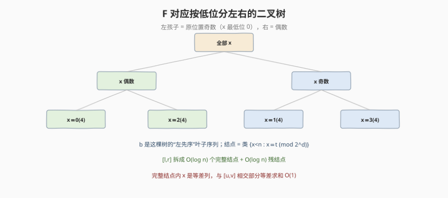

# Codeforces 117D 奇偶重排变换 题解

## 1. 题目概述

- **题目链接**：https://codeforces.com/problemset/problem/117/D
- **比赛来源**：Codeforces Beta Round 88 · Problem D（UTC 2011-09-23）
- **难度**：2500
- **标签**：递归结构、分块、位运算
- **评测类型**：普通
- **限制**：时间 6 s / 内存 256 MB

**题意**：设 $F(a)$ 由递归定义：$F(a)=F(\text{奇数位子列})+F(\text{偶数位子列})$（长度 1 时返回自身）。令 $a=[1,2,\dots,n]$、$b=F(a)$。有 $m$ 个询问 $(l,r,u,v)$，求 $\sum b_i$（$l\le i\le r$ 且 $u\le b_i\le v$）对 $mod$ 取模。

**约束**：

- $n\le10^{18}$、$m\le10^5$：不可能构造 $b$，必须利用递归结构。
- $mod\le10^9$：求和用 128 位中间量。
- 单组数据。

## 2. 示例与观察

官方样例一：

```text
输入：
4 5 10000
2 3 4 5
2 4 1 3
1 2 2 4
2 3 3 5
1 3 3 4
输出：
0
5
3
3
3
```

官方样例二：

```text
输入：
2 5 10000
1 2 2 2
1 1 4 5
1 1 2 5
1 1 1 3
1 2 5 5
输出：
2
0
0
1
0
```

**样例一走查**：$n=4$：$F([1,2,3,4])=F([1,3])+F([2,4])=[1,3]+[2,4]=[1,3,2,4]$ ✓。第二个询问 $(2,4,1,3)$：位置 2..4 的值是 $3,2,4$，落在 $[1,3]$ 的是 $3,2$，和 $5$ ✓。



**观察**：把 $x$（0 基下标）的二进制从低到高看：$F$ 的递归恰好是"按最低位分左右"的稳定分组，所以 $b$ 是这棵递归树的左先序遍历叶子序列。每个结点对应一类

$$\{x<n:\ x\equiv t \pmod{2^d}\},$$

结点内 $x$ 构成等差数列，步长 $2^d$。

## 3. 解题思路

### 3.1 朴素做法与瓶颈

$n$ 到 $10^{18}$，构造 $b$ 不可能；即使按位反转公式也需要处理"$n$ 不是 2 的幂"的截断。

### 3.2 核心观察：递归树上的查询


对结点 $(\text{深度 }d,\ \text{余数 }t)$：

- 它覆盖的位置区间是树中连续的 $[\text{off},\text{off}+\text{len}-1]$，其中 $\text{len}=\#\{x<n:x\equiv t\ (\mathrm{mod}\ 2^d)\}$；
- 左孩子 $(\text{位 }d=0)$：$t$ 不变、深度 $+1$；右孩子：$t+2^d$；
- 叶子：单个 $x$。

一次询问把 $[l,r]$ 递归拆成 $O(\log n)$ 个"完整结点"和 $O(\log n)$ 个"残结点"。对完整结点，求

$$\sum_{\substack{x\equiv t\ (2^d)\\ x<n,\ u\le x+1\le v}}(x+1),$$

$x=t+k\cdot2^d$，于是 $k\in[\lceil(u-1-t)/2^d\rceil,\ \lfloor(v-1-t)/2^d\rfloor]\cap[0,\text{len}-1]$，用等差数列求和 $O(1)$ 得到 ✓。

### 3.3 复杂度

每个询问 $O(\log n)$ 个结点（树高 $\le60$），总 $O(m\log n)$ ✓。

### 3.4 样例走查

$n=4$：根覆盖全部；左孩子 $x$ 偶（$0,2$），右孩子 $x$ 奇（$1,3$）。左孩子的左孩子 $x\equiv0\ (4)$ → $\{0\}$；左孩子的右孩子 $x\equiv2\ (4)$ → $\{2\}$；右孩子类似 → 顺序 $[0,2,1,3]$ → $b=[1,3,2,4]$ ✓。

## 4. 正确性证明

**引理 1**：$F$ 的递归与"按 $x(0$ 基$)$ 的最低位分组"一致：先把偶下标（即 $x$ 为偶数）分到左边，再递归。

**证明**：$F$ 取"奇数位"元素（1 基位置 1,3,5,… 即 $x=0,2,4,\dots$ 偶数）在前 ✓。∎

**引理 2**：深度 $d$、余数 $t$ 的结点恰覆盖 $\{x<n:x\equiv t\ (\mathrm{mod}\ 2^d)\}$，且这些 $x$ 是该结点子树叶子按左先序排列。

**证明**：对 $d$ 归纳：$d=0$ 时 $t=0$、覆盖全部；左孩子固定第 $d$ 位为 0（余数 $t$）、右孩子固定为 1（余数 $t+2^d$），递归成立 ✓。∎

**引理 3**：结点的位置区间长度等于该类元素个数，且左孩子在前的顺序对应 $b$ 的实际顺序。

**证明**：由引理 2，结点子树的叶子数就是类大小；$F$ 先递归左（偶）再右（奇）✓。∎

**定理**：算法对每个询问给出正确结果。

**证明**：由引理 2、3，树的叶子序列就是 $b$、位置区间与递归结构一致；查询被拆成不重不漏的结点（完整结点整段计入、残结点递归）；完整结点内的求和由等差数列公式精确计算（引理 2）✓。∎

## 5. 复杂度分析

- **时间**：$O(m\log n)$，每个结点 $O(1)$。
- **空间**：$O(\log n)$ 递归栈。
- **数值范围**：求和可达 $10^{36}$ 量级，用 `__int128`；`mod` 在最后取模。
- **与时限的关系**：6 s 下实测 $n=10^{18},m=10^5$ 约 $252$ ms。

## 6. 参考代码

### C++17

```cpp
#include <bits/stdc++.h>
using namespace std;
typedef long long ll;
typedef __int128 lll;

ll n, mod;
int K;

// 类 {x < n : x ≡ t (mod 2^d)} 的大小
static ll classSize(int d, ll t) {
    if (t >= n) return 0;
    return (n - 1 - t) / ((ll)1 << d) + 1;
}

// 全包含时：类内 x 满足 u <= x+1 <= v 的 (x+1) 之和
static ll fullSum(int d, ll t, ll u, ll v) {
    ll step = (ll)1 << d;
    ll len = classSize(d, t);
    if (len <= 0) return 0;
    // x = t + step*k, k in [0, len-1]；要求 u-1 <= x <= v-1
    ll A = u - 1 - t, B = v - 1 - t;
    ll klo = (A <= 0) ? 0 : (A + step - 1) / step;
    ll khi = (B < 0) ? -1 : B / step;
    if (khi > len - 1) khi = len - 1;
    if (klo > khi) return 0;
    lll cnt = (lll)khi - klo + 1;
    lll s = cnt * (lll)(t + 1) + (lll)step * ((lll)klo + khi) * cnt / 2;
    return (ll)(s % mod);
}

ll query(int d, ll t, ll off, ll len, ll ql, ll qr, ll u, ll v) {
    if (len <= 0) return 0;
    ll L = off, R = off + len - 1;
    if (R < ql || L > qr) return 0;
    if (ql <= L && R <= qr) return fullSum(d, t, u, v);
    // 左右孩子
    ll t0 = t, t1 = t + ((ll)1 << d);
    ll len0 = classSize(d + 1, t0);
    ll len1 = classSize(d + 1, t1);
    ll res = query(d + 1, t0, off, len0, ql, qr, u, v);
    res = (res + query(d + 1, t1, off + len0, len1, ql, qr, u, v)) % mod;
    return res;
}

int main() {
    int m;
    if (scanf("%lld %d %lld", &n, &m, &mod) != 3) return 0;
    K = 0;
    while (((ll)1 << K) < n) ++K;
    while (m--) {
        ll l, r, u, v;
        scanf("%lld %lld %lld %lld", &l, &r, &u, &v);
        printf("%lld\n", query(0, 0, 1, n, l, r, u, v) % mod);
    }
    return 0;
}
```

### Python3

```python
import sys


def main() -> None:
    data = sys.stdin.buffer.read().split()
    if not data:
        return
    n = int(data[0]); m = int(data[1]); mod = int(data[2])
    out = []
    p = 3

    def class_size(d, t):
        if t >= n:
            return 0
        return (n - 1 - t) // (1 << d) + 1

    def full_sum(d, t, u, v):
        step = 1 << d
        ln = class_size(d, t)
        if ln <= 0:
            return 0
        A = u - 1 - t
        B = v - 1 - t
        klo = 0 if A <= 0 else (A + step - 1) // step
        khi = -1 if B < 0 else B // step
        if khi > ln - 1:
            khi = ln - 1
        if klo > khi:
            return 0
        cnt = khi - klo + 1
        s = cnt * (t + 1) + step * (klo + khi) * cnt // 2
        return s % mod

    def query(d, t, off, ln, ql, qr, u, v):
        if ln <= 0:
            return 0
        L, R = off, off + ln - 1
        if R < ql or L > qr:
            return 0
        if ql <= L and R <= qr:
            return full_sum(d, t, u, v)
        t0 = t
        t1 = t + (1 << d)
        len0 = class_size(d + 1, t0)
        len1 = class_size(d + 1, t1)
        res = query(d + 1, t0, off, len0, ql, qr, u, v)
        res = (res + query(d + 1, t1, off + len0, len1, ql, qr, u, v)) % mod
        return res

    sys.setrecursionlimit(10000)
    for _ in range(m):
        l = int(data[p]); r = int(data[p + 1]); u = int(data[p + 2]); v = int(data[p + 3]); p += 4
        out.append(str(query(0, 0, 1, n, l, r, u, v) % mod))
    sys.stdout.write("\n".join(out) + "\n")


main()
```

## 7. 边界情况与易错点

1. **$n$ 不是 2 的幂**：类大小要用 $\lfloor(n-1-t)/2^d\rfloor+1$ 精确计算，不能假设满二叉树。
2. **$t\ge n$**：该类为空，直接返回 0。
3. **溢出**：$x$ 到 $10^{18}$、项数到 $10^{18}$，乘积到 $10^{36}$，必须 `__int128`。
4. **$mod=1$**：所有答案 0，注意取模不越界。
5. **递归深度**：树高约 $60$，安全；但结点数每次 $O(\log n)$。
6. **位置与值的对应**：位置是 1 基、$x$ 是 0 基，$b_i=x+1$，容易差一。
7. **左右孩子顺序**：先偶（左）后奇（右），反了就与实际 $F$ 不符。

## 8. 验证记录

- **编译环境与命令**：`clang++ -std=c++17 -O2`（Apple clang 21.0.0 + `codeforces/tools/include` 的兼容头），Python 3.9.6。
- **官方样例**：2 / 2 通过（`0 5 3 3 3`、`2 0 0 1 0`），C++ 与 Python 输出一致。
- **独立暴力对拍**：暴力直接递归构造 $b$（$n\le40$），再逐询问线性求和。**240 组**随机数据（含 $mod=1$、$u>n$ 等边界）全部一致。
- **最大约束性能**：$n=10^{18}$、$m=10^5$ 时 C++ 约 $252$ ms。
- **图片校验**：`cf117d_tree.svg`、`cf117d_sample.svg` 均通过 `xml.etree.ElementTree.parse`，含 `feTurbulence` 与手写体字体族，文本包围盒未越出 `viewBox`。
- **公式校验**：KaTeX（`throwOnError`）渲染无报错；无 `---` 分隔线。
- **复核状态**：verified（样例、对拍、性能、图片、公式均实跑通过）。

## 相关题目与扩展

- [Codeforces 117A 电梯往返时间](https://codeforces.com/problemset/problem/117/A)、[117B Very Interesting Game](https://codeforces.com/problemset/problem/117/B)、[117C Cycle](https://codeforces.com/problemset/problem/117/C)：同场其余题。
- [Codeforces 1076E Vasya and a Tree](https://codeforces.com/problemset/problem/1076/E)：回溯/递归结构上的查询。
- [LeetCode 427. 建立四叉树](https://leetcode.cn/problems/construct-quad-tree/)：递归分块。
- [LeetCode 1109. 航班预订统计](https://leetcode.cn/problems/corporate-flight-bookings/)：区间累加。

**延伸思考**：

1. **如果 $F$ 定义为"先偶后奇"**：只需交换左右孩子。
2. **如果要求输出 $b$ 的某一段**：可以沿树展开，输出长度受限时复杂度 $O(\text{输出长度}\log n)$。
3. **如果询问是"最大/最小值"**：完整结点内不再能 O(1) 求，需要更复杂的结构。
4. **如果 $n$ 到 $10^{18}$ 且 $mod$ 很大**：取模在最后做，中间必须 128 位。

