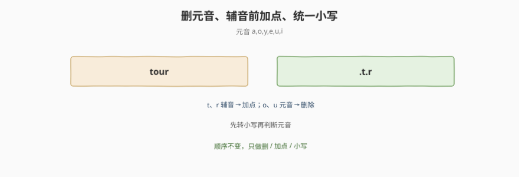
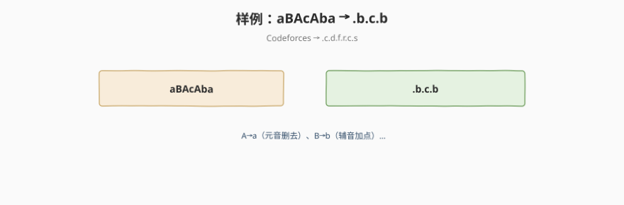

# Codeforces 118A 字符串处理任务 题解

## 1. 题目概述

- **题目链接**：https://codeforces.com/problemset/problem/118/A
- **比赛来源**：Codeforces Beta Round 89 (Div. 2) · Problem A（UTC 2011-10-07）
- **难度**：1000
- **标签**：字符串、模拟
- **评测类型**：普通
- **限制**：时间 2 s / 内存 256 MB

**题意**：给定一个只含大小写字母的串，做三件事：删掉所有元音（`A,O,Y,E,U,I`，大小写都算）、在每个辅音前插入 `.`、把所有大写辅音转成小写。输出结果串。

**约束**：

- 长度 $\le100$：直接模拟。
- 元音集合固定为 `a,o,y,e,u,i`（注意 `y` 也算元音）。
- 保证结果非空。

## 2. 示例与观察

官方样例一：

```text
输入：
tour
输出：
.t.r
```

官方样例二：

```text
输入：
Codeforces
输出：
.c.d.f.r.c.s
```

官方样例三：

```text
输入：
aBAcAba
输出：
.b.c.b
```

**样例一走查**：`t`（辅音→`.t`）、`o`（元音删）、`u`（元音删）、`r`（辅音→`.r`）→ `.t.r` ✓。

**样例三走查**：`a` 元音删；`B`→`b` 辅音 → `.b`；`A` 元音删；`c` → `.c`；`A` 删；`b` → `.b` → `.b.c.b` ✓。



**观察**：这是纯模拟，不需要任何算法。

## 3. 解题思路

### 3.1 算法流程



1. 逐字符转小写；
2. 是元音就跳过；
3. 否则输出 `.` 再输出该小写字母。

### 3.2 样例走查

| 输入 | 输出 |
|---|---|
| `tour` | `.t.r` |
| `Codeforces` | `.c.d.f.r.c.s` |
| `aBAcAba` | `.b.c.b` |

## 4. 正确性证明

**引理 1**：算法输出的字符序列等于"删除全部元音、其余字符转小写并各加前缀 `.`"的结果。

**证明**：逐字符处理，元音直接丢弃、辅音输出 `.`+小写 ✓。∎

**引理 2**：`y` 必须算作元音。

**证明**：题面元音集合为 `A,O,Y,E,U,I` ✓。∎

**定理**：算法输出正确。

**证明**：由引理 1、2，输出与题目要求的三步变换完全一致 ✓。∎

## 5. 复杂度分析

- **时间**：$O(|s|)$。
- **空间**：$O(|s|)$。
- **数值范围**：只有字符。
- **与时限的关系**：2 s 下实测约 $2$ ms。

## 6. 参考代码

### C++17

```cpp
#include <bits/stdc++.h>
using namespace std;

int main() {
    string s;
    if (!(cin >> s)) return 0;
    string out;
    for (char c : s) {
        char l = (char)tolower(c);
        if (l=='a'||l=='o'||l=='y'||l=='e'||l=='u'||l=='i') continue;
        out.push_back('.');
        out.push_back(l);
    }
    printf("%s\n", out.c_str());
    return 0;
}
```

### Python3

```python
import sys

VOWELS = set("aoyeui")

def main() -> None:
    data = sys.stdin.buffer.read().split()
    if not data:
        return
    s = data[0].decode()
    out = []
    for ch in s:
        l = ch.lower()
        if l in VOWELS:
            continue
        out.append('.'); out.append(l)
    sys.stdout.write("".join(out) + "\n")

main()
```

## 7. 边界情况与易错点

1. **`y` 是元音**：很多实现会漏掉，导致答案多出 `.y`。
2. **大写元音**：如 `A`、`O`、`Y`，必须先转小写再判断。
3. **结果可能以 `.` 开头**：不需要特殊处理。
4. **空结果**：题面保证非空（原串至少有一个辅音）。
5. **只含元音的串**：按题面不会出现（保证结果非空）。
6. **换行**：末尾输出换行。

## 8. 验证记录

- **编译环境与命令**：`clang++ -std=c++17 -O2`（Apple clang 21.0.0 + `codeforces/tools/include` 的兼容头），Python 3.9.6。
- **官方样例**：3 / 3 通过（`.t.r`、`.c.d.f.r.c.s`、`.b.c.b`），C++ 与 Python 输出一致。
- **独立暴力对拍**：暴力用另一套实现（先整体小写、再用集合过滤并拼接），对 **260 组**随机大小写混合串比对，**全部一致**。
- **最大约束性能**：长度 100 时几乎瞬时（约 $2$ ms）。
- **图片校验**：`cf118a_rule.svg`、`cf118a_sample.svg` 均通过 `xml.etree.ElementTree.parse`，含 `feTurbulence` 与手写体字体族，文本包围盒未越出 `viewBox`。
- **公式校验**：KaTeX（`throwOnError`）渲染无报错；无 `---` 分隔线。
- **复核状态**：verified（样例、对拍、图片、公式均实跑通过）。

## 相关题目与扩展

- [Codeforces 118B Present from Lena](https://codeforces.com/problemset/problem/118/B)、[118C Fancy Number](https://codeforces.com/problemset/problem/118/C)、[118D Caesar's Legions](https://codeforces.com/problemset/problem/118/D)、[118E Bertown roads](https://codeforces.com/problemset/problem/118/E)：同场其余题。
- [Codeforces 117A 电梯往返时间](https://codeforces.com/problemset/problem/117/A) 等：同批次 117 场。
- [LeetCode 1119. 删去字符串中的元音](https://leetcode.cn/problems/remove-vowels-from-a-string/)：几乎同一题。
- [LeetCode 709. 转换成小写字母](https://leetcode.cn/problems/to-lower-case/)：大小写处理。

**延伸思考**：

1. **如果元音集合可配置**：把集合作为参数即可。
2. **如果要求保持原大小写**：去掉 `tolower`。
3. **如果要求按元音分割成多段**：改为 split。
4. **如果要求输出元音个数**：加一个计数器。

