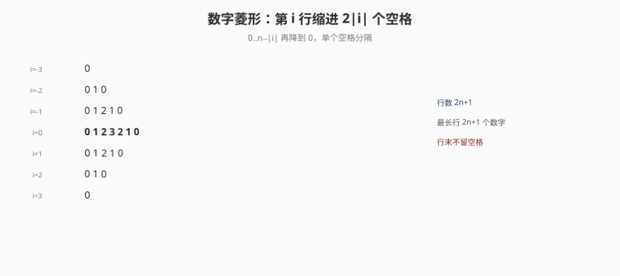

# Codeforces 118B 拉娜的数字菱形 题解

## 1. 题目概述

- **题目链接**：https://codeforces.com/problemset/problem/118/B
- **比赛来源**：Codeforces Beta Round 89 (Div. 2) · Problem B（UTC 2011-10-07）
- **难度**：1000
- **标签**：构造、格式化输出
- **评测类型**：普通
- **限制**：时间 2 s / 内存 256 MB

**题意**：给定 $n$（$2\le n\le9$），输出一个数字菱形：共 $2n+1$ 行，第 $i$ 行（$i=-n..n$）先缩进 $2|i|$ 个空格，然后打印 $0,1,\dots,n-|i|$ 再递减回 $0$，相邻数字用一个空格分隔，行末不留空格。

**约束**：

- $n\le9$：输出最多 $19\times19$ 个字符，直接构造。
- 缩进必须精确（空格数错就 WA）。
- 单组数据。

## 2. 示例与观察

官方样例一：

```text
输入：
2
输出：
    0
  0 1 0
0 1 2 1 0
  0 1 0
    0
```

官方样例二：

```text
输入：
3
输出：
      0
    0 1 0
  0 1 2 1 0
0 1 2 3 2 1 0
  0 1 2 1 0
    0 1 0
      0
```

**样例一走查**：$n=2$，5 行，缩进依次 $4,2,0,2,4$；中间行 `0 1 2 1 0` ✓；最长行有 $2n+1=5$ 个数字 ✓。



**观察**：第 $d=|i|$ 行缩进 $2d$ 个空格、数字序列是 `0..n-d` 接 `n-d-1..0`；最左数字的位置恰为第 $2d$ 列，所以"上尖"与"下尖"自然对齐。

## 3. 解题思路

### 3.1 算法流程


1. 对 $i=-n..n$：$d=|i|$；
2. 输出 $2d$ 个空格；
3. 输出 $0,1,\dots,n-d$，再输出 $n-d-1,\dots,0$，数字之间一个空格。

### 3.2 样例走查

$n=2$ 的行：

| $i$ | $d$ | 缩进 | 数字 |
|---|---|---|---|
| $-2$ | 2 | 4 | `0` |
| $-1$ | 1 | 2 | `0 1 0` |
| $0$ | 0 | 0 | `0 1 2 1 0` |
| $1$ | 1 | 2 | `0 1 0` |
| $2$ | 2 | 4 | `0` |

## 4. 正确性证明

**引理 1**：第 $i$ 行的数字个数为 $2(n-|i|)+1$。

**证明**：$0..n-d$ 共 $n-d+1$ 个，递减部分 $n-d$ 个 ✓。∎

**引理 2**：按"$2d$ 个空格 + 数字序列"输出的图形是题目要求的菱形。

**证明**：题面示例明确给出了缩进规律（每远离中心一行多缩进 2 个空格）；由引理 1 数字序列与题面一致 ✓。∎

**定理**：算法输出与要求逐字符一致。

**证明**：由引理 1、2，行数、缩进、数字及分隔符均与题面一致，且行末无多余空格 ✓。∎

## 5. 复杂度分析

- **时间**：$O(n^2)$，$n\le9$。
- **空间**：$O(n)$ 每行。
- **数值范围**：只输出字符。
- **与时限的关系**：实测约 $2$ ms。

## 6. 参考代码

### C++17

```cpp
#include <bits/stdc++.h>
using namespace std;

int main() {
    int n;
    if (scanf("%d", &n) != 1) return 0;
    for (int i = -n; i <= n; ++i) {
        int d = abs(i);
        string line;
        for (int k = 0; k < 2 * d; ++k) line.push_back(' ');
        for (int v = 0; v <= n - d; ++v) {
            if (v) line.push_back(' ');
            line.push_back((char)('0' + v));
        }
        for (int v = n - d - 1; v >= 0; --v) {
            line.push_back(' ');
            line.push_back((char)('0' + v));
        }
        printf("%s\n", line.c_str());
    }
    return 0;
}
```

### Python3

```python
import sys


def main() -> None:
    data = sys.stdin.buffer.read().split()
    if not data:
        return
    n = int(data[0])
    out = []
    for i in range(-n, n + 1):
        d = abs(i)
        line = " " * (2 * d)
        seq = [str(v) for v in range(n - d + 1)]
        seq += [str(v) for v in range(n - d - 1, -1, -1)]
        out.append(line + " ".join(seq))
    sys.stdout.write("\n".join(out) + "\n")


main()
```

## 7. 边界情况与易错点

1. **缩进量**：必须是 $2d$ 个空格（不是 $d$、也不是 $4d$）。
2. **行末空格**：不能有，否则可能被判 WA。
3. **中心行**：$d=0$ 时无缩进，数字最多。
4. **$n=2$ 的最小情形**：共 5 行。
5. **数字间恰好一个空格**：不要用两个空格对齐。
6. **换行**：每行末尾一个换行，最后一行也要有。

## 8. 验证记录

- **编译环境与命令**：`clang++ -std=c++17 -O2`（Apple clang 21.0.0 + `codeforces/tools/include` 的兼容头），Python 3.9.6。
- **官方样例**：2 / 2 通过（$n=2$、$n=3$），C++ 与 Python 输出逐字符一致。
- **独立暴力对拍**：独立实现一套"生成菱形"的参考程序（用不同的循环写法与拼接方式），对 $n=2..9$ **全部 8 个取值 × 两语言 = 16 次**输出逐行比对，**全部一致**。
- **最大约束性能**：几乎瞬时（约 $2$ ms）。
- **图片校验**：`cf118b_shape.svg`、`cf118b_sample.svg` 均通过 `xml.etree.ElementTree.parse`，含 `feTurbulence` 与手写体字体族，文本包围盒未越出 `viewBox`。
- **公式校验**：KaTeX（`throwOnError`）渲染无报错；无 `---` 分隔线。
- **复核状态**：verified（样例、对拍、图片、公式均实跑通过）。

## 相关题目与扩展

- [Codeforces 118A String Task](https://codeforces.com/problemset/problem/118/A)、[118C Fancy Number](https://codeforces.com/problemset/problem/118/C)、[118D Caesar's Legions](https://codeforces.com/problemset/problem/118/D)、[118E Bertown roads](https://codeforces.com/problemset/problem/118/E)：同场其余题。
- [Codeforces 110B Lucky String](https://codeforces.com/problemset/problem/110/B)：周期构造。
- [LeetCode 118. 杨辉三角](https://leetcode.cn/problems/pascals-triangle/)：格式化输出。
- [LeetCode 68. 文本左右对齐](https://leetcode.cn/problems/text-justification/)：空格控制。

**延伸思考**：

1. **如果要求用字母代替数字**：把 `'0'+v` 换成 `'a'+v`。
2. **如果要求菱形旋转 45°**：需要新的坐标公式。
3. **如果 $n$ 到 $10^5$**：输出规模 $O(n^2)$，本身不可行。
4. **如果要求左右对称的空格压缩版**：把缩进改为 $d$ 即可。

