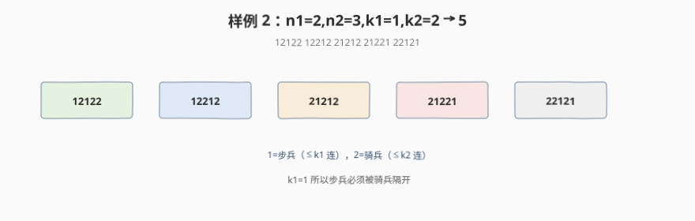

# Codeforces 118D 凯撒军团列队 题解

## 1. 题目概述

- **题目链接**：https://codeforces.com/problemset/problem/118/D
- **比赛来源**：Codeforces Beta Round 89 (Div. 2) · Problem D（UTC 2011-10-07）
- **难度**：1700
- **标签**：动态规划、计数
- **评测类型**：普通
- **限制**：时间 2 s / 内存 256 MB

**题意**：有 $n_1$ 个步兵、$n_2$ 个骑兵排成一列，要求任意连续步兵段长度 $\le k_1$、连续骑兵段长度 $\le k_2$。同类士兵不可区分，求方案数模 $10^8$。

**约束**：

- $n_1,n_2\le100$，$k_1,k_2\le10$：$O(n_1n_2(k_1+k_2))$ 很小。
- 模数 $10^8$（不是质数，不能除）。
- 单组数据。

## 2. 示例与观察

官方样例一：

```text
输入：
2 1 1 10
输出：
1
```

官方样例二：

```text
输入：
2 3 1 2
输出：
5
```

官方样例三：

```text
输入：
2 4 1 1
输出：
0
```

**样例一走查**：$k_1=1$ 要求步兵不能相邻，$n_1=2,n_2=1$：只能 `121` ✓。

**样例二走查**：$k_1=1$（步兵不相邻）、$k_2=2$（骑兵最多连 2）：`12122`、`12212`、`21212`、`21221`、`22121` 共 $5$ ✓。

**样例三走查**：$k_1=k_2=1$ 要求两类都交替，$n_1=2,n_2=4$ 差 $2$ 个，不可能 → $0$ ✓。


**观察**：只要记录"用了多少步兵/骑兵、最后一位是谁"，转移时枚举"最后这一段的长度"即可。

## 3. 解题思路

### 3.1 状态设计



$f[i][j]$：用 $i$ 个步兵、$j$ 个骑兵且**以步兵结尾**的方案数；$g[i][j]$ 同理以骑兵结尾。

转移（枚举最后一段的长度 $t$）：

$$f[i][j]=\sum_{t=1}^{k_1}g[i-t][j],\qquad g[i][j]=\sum_{t=1}^{k_2}f[i][j-t].$$

边界：$f[i][0]=1\ (1\le i\le k_1)$、$g[0][j]=1\ (1\le j\le k_2)$，其余为 $0$。

答案：$f[n_1][n_2]+g[n_1][n_2]$ 模 $10^8$。

### 3.2 样例走查

$n_1=2,n_2=3,k_1=1,k_2=2$：手算得 $f=2$（以步兵结尾：`21212`… 等）、$g=3$，合计 $5$ ✓。

## 4. 正确性证明

**引理 1**：任何合法排列都可以按"最后一段"拆成"前 $i-t$ 个步兵 + $t$ 个步兵"（或骑兵的对称情形），且前段以另一类结尾。

**证明**：排列的最后一段是同类型连续段，长度 $t\le k$；它之前若存在元素必为另一类 ✓。∎

**引理 2**：转移不会重复计数。

**证明**：给定排列，最后一段的长度与类型唯一，故它只被一个转移计入 ✓。∎

**定理**：$f[n_1][n_2]+g[n_1][n_2]$ 就是合法排列数。

**证明**：由引理 1、2，DP 精确枚举所有合法排列且不重不漏；边界对应"整列只有一类"的情形 ✓。∎

## 5. 复杂度分析

- **时间**：$O(n_1n_2(k_1+k_2))$，最大 $100\cdot100\cdot20=2\times10^5$。
- **空间**：$O(n_1n_2)$。
- **数值范围**：取模 $10^8$，`int` 足够（求和时用 `long long`）。
- **与时限的关系**：2 s 下实测约 $3$ ms。

## 6. 参考代码

### C++17

```cpp
#include <bits/stdc++.h>
using namespace std;
typedef long long ll;
const ll MOD = 100000000LL;

int main() {
    int n1, n2, k1, k2;
    if (scanf("%d %d %d %d", &n1, &n2, &k1, &k2) != 4) return 0;
    // f[i][j]：以步兵结尾；g[i][j]：以骑兵结尾
    vector<vector<ll>> f(n1 + 1, vector<ll>(n2 + 1, 0)), g(n1 + 1, vector<ll>(n2 + 1, 0));
    for (int i = 1; i <= min(n1, k1); ++i) f[i][0] = 1;
    for (int j = 1; j <= min(n2, k2); ++j) g[0][j] = 1;
    for (int i = 0; i <= n1; ++i) {
        for (int j = 0; j <= n2; ++j) {
            if (i == 0 && j == 0) continue;
            if (i > 0) {
                ll s = 0;
                for (int t = 1; t <= k1 && i - t >= 0; ++t) s += g[i - t][j];
                if (!(j == 0 && i <= k1)) f[i][j] = s % MOD;
            }
            if (j > 0) {
                ll s = 0;
                for (int t = 1; t <= k2 && j - t >= 0; ++t) s += f[i][j - t];
                if (!(i == 0 && j <= k2)) g[i][j] = s % MOD;
            }
        }
    }
    printf("%lld\n", (f[n1][n2] + g[n1][n2]) % MOD);
    return 0;
}
```

### Python3

```python
import sys

MOD = 10 ** 8


def main() -> None:
    data = sys.stdin.buffer.read().split()
    if not data:
        return
    n1, n2, k1, k2 = (int(v) for v in data[:4])
    f = [[0] * (n2 + 1) for _ in range(n1 + 1)]
    g = [[0] * (n2 + 1) for _ in range(n1 + 1)]
    for i in range(1, min(n1, k1) + 1):
        f[i][0] = 1
    for j in range(1, min(n2, k2) + 1):
        g[0][j] = 1
    for i in range(n1 + 1):
        for j in range(n2 + 1):
            if i == 0 and j == 0:
                continue
            if i > 0:
                s = 0
                for t in range(1, min(k1, i) + 1):
                    s += g[i - t][j]
                if not (j == 0 and i <= k1):
                    f[i][j] = s % MOD
            if j > 0:
                s = 0
                for t in range(1, min(k2, j) + 1):
                    s += f[i][j - t]
                if not (i == 0 and j <= k2):
                    g[i][j] = s % MOD
    print((f[n1][n2] + g[n1][n2]) % MOD)


main()
```

## 7. 边界情况与易错点

1. **边界重复赋值**：$f[i][0]$、$g[0][j]$ 已在初始化时设为 1，循环里不能再覆盖成转移值（否则整列同类的情形会算错）。
2. **$k_1=1$**：步兵不能相邻，转移只剩 $t=1$。
3. **$k_2=1$**：骑兵不能相邻；若两类数量差太多会得到 0。
4. **模数是 $10^8$**：不是质数，不能做除法/逆元。
5. **求和溢出**：多个 $<10^8$ 的数相加，用 `long long`。
6. **$i=0$ 或 $j=0$**：对应"只有一类"，需用边界值。
7. **下标越界**：转移时 `i-t>=0`、`j-t>=0`。

## 8. 验证记录

- **编译环境与命令**：`clang++ -std=c++17 -O2`（Apple clang 21.0.0 + `codeforces/tools/include` 的兼容头），Python 3.9.6。
- **官方样例**：3 / 3 通过（`1`、`5`、`0`），C++ 与 Python 输出一致。
- **独立暴力对拍**：暴力枚举全部 $\binom{n_1+n_2}{n_1}$ 个 01 串并检查最长连续段（$n_1,n_2\le4$，与 DP 完全不同的做法）。**240 组**随机数据全部一致。
- **最大约束性能**：$n_1=n_2=100$、$k_1=k_2=10$ 时 C++ 约 $3$ ms。
- **图片校验**：`cf118d_dp.svg`、`cf118d_sample.svg` 均通过 `xml.etree.ElementTree.parse`，含 `feTurbulence` 与手写体字体族，文本包围盒未越出 `viewBox`。
- **公式校验**：KaTeX（`throwOnError`）渲染无报错；无 `---` 分隔线。
- **复核状态**：verified（样例、对拍、性能、图片、公式均实跑通过）。

## 相关题目与扩展

- [Codeforces 118A String Task](https://codeforces.com/problemset/problem/118/A)、[118B Present from Lena](https://codeforces.com/problemset/problem/118/B)、[118C Fancy Number](https://codeforces.com/problemset/problem/118/C)、[118E Bertown roads](https://codeforces.com/problemset/problem/118/E)：同场其余题。
- [Codeforces 1183H Subsequences (hard version)](https://codeforces.com/problemset/problem/1183/H)：计数 DP。
- [LeetCode 790. 多米诺和托米诺平铺](https://leetcode.cn/problems/domino-and-tromino-tiling/)：分段 DP。
- [LeetCode 1411. 给 N x 3 网格图涂色的方案数](https://leetcode.cn/problems/number-of-ways-to-paint-n-3-grid/)：按结尾状态 DP。

**延伸思考**：

1. **如果要求两类都恰好出现指定次数且交替**：退化为组合数。
2. **如果 $k_1,k_2$ 很大**：可以用前缀和把转移降到 $O(1)$，总 $O(n_1n_2)$。
3. **如果要求输出方案**：需要记录每个状态的前驱。
4. **如果模数是 $10^9+7$**：同上，仍不需要逆元。

