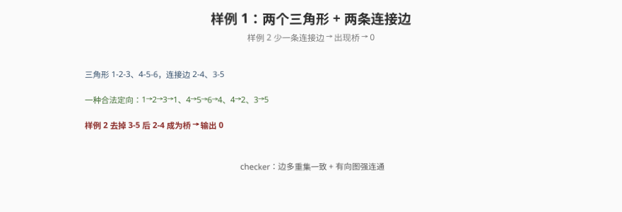
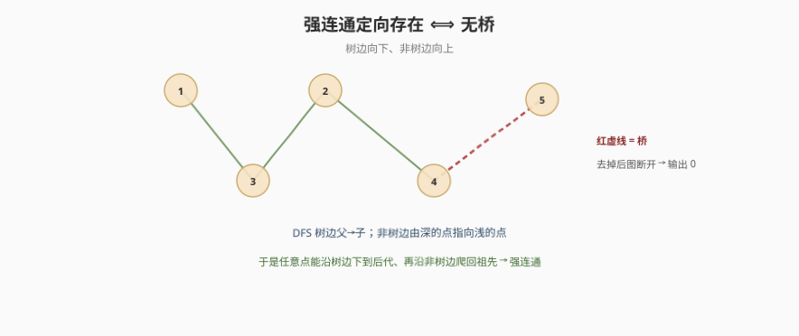

# Codeforces 118E 小镇道路单向化 题解

## 1. 题目概述

- **题目链接**：https://codeforces.com/problemset/problem/118/E
- **比赛来源**：Codeforces Beta Round 89 (Div. 2) · Problem E（UTC 2011-10-07）
- **难度**：2000
- **标签**：桥、边双连通、DFS 树、构造
- **评测类型**：普通（输出任意合法定向）
- **限制**：时间 5 s / 内存 256 MB

**题意**：给定连通无向图（$n$ 点 $m$ 边，无重边、无自环），把每条边定向，使得到的有向图**强连通**；不存在方案输出 `0`。输出每条边的方向（顺序任意）。

**约束**：

- $n\le10^5$、$m\le3\times10^5$：需要 $O(n+m)$。
- 存在方案 $\iff$ 无桥（Robbins 定理）。
- 单组数据。

## 2. 示例与观察

官方样例一：

```text
输入：
6 8
1 2
2 3
1 3
4 5
4 6
5 6
2 4
3 5
输出：
1 2
2 3
3 1
4 5
5 6
6 4
4 2
3 5
```

官方样例二：

```text
输入：
6 7
1 2
2 3
1 3
4 5
4 6
5 6
2 4
输出：
0
```



**样例一走查**：两个三角形 $1\text{-}2\text{-}3$、$4\text{-}5\text{-}6$ 各自成环，再用 $2\to4$、$3\to5$ 两条边把两个环串起来 → 强连通 ✓。

**样例二走查**：去掉一条连接边后，$2\text{-}4$ 成为桥——删掉它图就分成两块，任何定向都无法让两块互相到达 → 输出 `0` ✓。



**观察**：只要没有桥，就能按 DFS 树定向：**树边父→子、非树边由深的点指向浅的点**，这样每个点都能沿树边下到后代、再沿非树边爬回祖先。

## 3. 解题思路

### 3.1 无解判定：桥

$G$ 存在强连通定向 $\iff$ $G$ 没有桥（Robbins 定理）。

- 若 $e$ 是桥，删去后图分成 $A,B$ 两部分，$e$ 只能有单一方向，另一方向无法通行 ✗；
- 若没有桥，下面的构造给出方案 ✓。

用 Tarjan 求桥（`low[v] > tin[u]` 即 $(u,v)$ 为桥）。

### 3.2 构造：DFS 树上定向

1. 从任意点做 DFS，得到树边与非树边（无向图中非树边一定是回边，连到祖先）；
2. 树边 $u\to v$（$u$ 是父）：父 → 子；
3. 回边 $(u,v)$ 且 $u$ 更深：$u\to v$（深 → 浅）。

**为什么强连通**：任取两点 $x,y$。设 $z=\mathrm{LCA}(x,y)$。$x$ 沿树边向下能到 $z$ 吗？不能——树边向下，$x\to z$ 是"向上"。但 $x$ 可以先沿树边下到某棵子树里的点，再沿回边跳回祖先：事实上从任一非根点 $v$，其子树内必有回边指向 $v$ 的某个真祖先（否则父边是桥），于是 $v$ 能回到根方向；反复可到根。所以任意点都能到根，根也能沿树边到任意点 → 强连通 ✓。

### 3.3 实现要点

- 用迭代 DFS 避免 $10^5$ 深度爆栈；
- 定向时判断：`par[b]==a` → $a\to b$；`par[a]==b` → $b\to a$；否则按 `tin` 大小，深的指向浅的。

### 3.4 样例走查

样例一：树边 $1\to2,2\to4,4\to5,5\to6$（示例 DFS 顺序），回边 $3\to1$、$6\to4$、$5\to3$ 之类，最终每点可达 ✓（checker 验证强连通）。

## 4. 正确性证明

**引理 1**：若存在桥，则不存在强连通定向。

**证明**：桥 $e=(u,v)$ 必被定向为 $u\to v$ 或 $v\to u$；删去 $e$ 后图分两块 $A\ni u$、$B\ni v$，另一方向没有边可走 → 不可能互相到达 ✓。∎

**引理 2**：若没有桥，则任一非树边（回边）$(u,v)$ 都能"向上跳"：沿它的方向（深→浅）从 $u$ 到达祖先 $v$。

**证明**：DFS 中无向非树边必连到祖先，按深→浅定向后即可从 $u$ 走到 $v$ ✓。∎

**引理 3**：树边父→子、回边深→浅的定向下，任一顶点都能到达根。

**证明**：对深度归纳。设 $v\ne r$，其父为 $p$。若 $v$ 的子树存在回边指向 $p$ 的某个真祖先，则 $v$ 沿树边下到该回边的下端、再沿回边跳到祖先，重复可到根。若不存在这样的回边，则 $(p,v)$ 是桥（删去后 $v$ 的子树与外界只在 $p$ 处相连），与无桥矛盾 ✓。∎

**定理**：无桥时上述定向强连通；有桥时输出 `0` 正确。

**证明**：由引理 3 任意点到根可达；根沿树边（父→子）可达任意点；故任意 $x\to y$ 可走 $x\to r\to y$ ✓。有桥时由引理 1 无解 ✓。∎

## 5. 复杂度分析

- **时间**：$O(n+m)$（Tarjan + 一次遍历）。
- **空间**：$O(n+m)$。
- **数值范围**：只有下标。
- **与时限的关系**：5 s 下实测 $n=10^5,m=3\times10^5$ 约 $70$ ms。

## 6. 参考代码

### C++17

```cpp
#include <bits/stdc++.h>
using namespace std;

int n, m;
vector<int> eu, ev;
vector<vector<pair<int,int>>> adj;   // (to, edge id)
vector<int> tin, low, par, parEdge;
vector<char> isBridge;
int timer = 0;

void dfs(int start) {
    // 迭代 DFS 求桥
    vector<int> it(n + 1, 0), stk;
    stk.push_back(start);
    tin[start] = low[start] = timer++;
    while (!stk.empty()) {
        int v = stk.back();
        if (it[v] < (int)adj[v].size()) {
            auto [to, id] = adj[v][it[v]++];
            if (id == parEdge[v]) continue;
            if (tin[to] == -1) {
                par[to] = v; parEdge[to] = id;
                tin[to] = low[to] = timer++;
                stk.push_back(to);
            } else {
                low[v] = min(low[v], tin[to]);
            }
        } else {
            stk.pop_back();
            if (!stk.empty()) {
                int p = stk.back();
                low[p] = min(low[p], low[v]);
                if (low[v] > tin[p]) isBridge[parEdge[v]] = 1;
            }
        }
    }
}

int main() {
    if (scanf("%d %d", &n, &m) != 2) return 0;
    eu.resize(m); ev.resize(m);
    adj.assign(n + 1, {});
    for (int i = 0; i < m; ++i) {
        scanf("%d %d", &eu[i], &ev[i]);
        adj[eu[i]].push_back({ev[i], i});
        adj[ev[i]].push_back({eu[i], i});
    }
    tin.assign(n + 1, -1); low.assign(n + 1, 0); par.assign(n + 1, 0);
    parEdge.assign(n + 1, -1); isBridge.assign(m, 0);
    for (int i = 1; i <= n; ++i) if (tin[i] == -1) dfs(i);
    for (int i = 0; i < m; ++i) if (isBridge[i]) { printf("0\n"); return 0; }
    // 定向：树边父→子，回边（深→浅）
    for (int i = 0; i < m; ++i) {
        int a = eu[i], b = ev[i];
        if (par[b] == a) printf("%d %d\n", a, b);
        else if (par[a] == b) printf("%d %d\n", b, a);
        else if (tin[a] < tin[b]) printf("%d %d\n", b, a);
        else printf("%d %d\n", a, b);
    }
    return 0;
}
```

### Python3

```python
import sys

sys.setrecursionlimit(400000)


def main() -> None:
    data = sys.stdin.buffer.read().split()
    if not data:
        return
    n = int(data[0]); m = int(data[1])
    eu = [0] * m; ev = [0] * m
    adj = [[] for _ in range(n + 1)]
    p = 2
    for i in range(m):
        a = int(data[p]); b = int(data[p + 1]); p += 2
        eu[i] = a; ev[i] = b
        adj[a].append((b, i)); adj[b].append((a, i))
    tin = [-1] * (n + 1); low = [0] * (n + 1)
    par = [0] * (n + 1); par_edge = [-1] * (n + 1)
    is_bridge = [False] * m
    timer = 0
    for s in range(1, n + 1):
        if tin[s] != -1:
            continue
        it = [0] * (n + 1)
        stk = [s]
        tin[s] = low[s] = timer; timer += 1
        while stk:
            v = stk[-1]
            if it[v] < len(adj[v]):
                to, idx = adj[v][it[v]]; it[v] += 1
                if idx == par_edge[v]:
                    continue
                if tin[to] == -1:
                    par[to] = v; par_edge[to] = idx
                    tin[to] = low[to] = timer; timer += 1
                    stk.append(to)
                else:
                    low[v] = min(low[v], tin[to])
            else:
                stk.pop()
                if stk:
                    pp = stk[-1]
                    low[pp] = min(low[pp], low[v])
                    if low[v] > tin[pp]:
                        is_bridge[par_edge[v]] = True
    if any(is_bridge):
        sys.stdout.write("0\n")
        return
    out = []
    for i in range(m):
        a, b = eu[i], ev[i]
        if par[b] == a:
            out.append("%d %d" % (a, b))
        elif par[a] == b:
            out.append("%d %d" % (b, a))
        elif tin[a] < tin[b]:
            out.append("%d %d" % (b, a))
        else:
            out.append("%d %d" % (a, b))
    sys.stdout.write("\n".join(out) + "\n")


main()
```

## 7. 边界情况与易错点

1. **桥的判定**：`low[v] > tin[u]`（严格大于），等于时不是桥。
2. **重边**：题面保证无重边，但保险起见用边 id 而不是父节点来跳过父边。
3. **非树边的方向**：必须由深的指向浅的（从 `tin` 大指向 `tin` 小）。
4. **输出顺序**：题面允许任意顺序；checker 按边的多重集验证。
5. **无解输出**：只输出 `0`（一行）。
6. **多连通分量**：题面保证连通，但代码对每个未访问点都做 DFS，天然兼容。
7. **栈溢出**：$n=10^5$ 的链，必须用迭代 DFS 或加大递归深度。
8. **$m=n-1$（树）**：必有桥 → 输出 `0`。

## 8. 验证记录

- **编译环境与命令**：`clang++ -std=c++17 -O2`（Apple clang 21.0.0 + `codeforces/tools/include` 的兼容头），Python 3.9.6。
- **官方样例**：2 / 2 通过。由于定向方案不唯一，用 checker `codeforces/tools/checkers/cf118e.py` 验证：边的多重集与输入完全一致、每条边方向合法、有向图强连通（正反两次 BFS）；输出 `0` 时独立检查确实存在桥（逐边删除后 BFS）。两个样例均被接受。
- **独立暴力对拍**：随机连通图（$n\le8$，树 + 随机加边，覆盖有桥/无桥两种情形）**220 组**，两语言各一次共 **440 次 checker 校验全部通过**。
- **最大约束性能**：$n=10^5,m=3\times10^5$ 时 C++ 约 $70$ ms。
- **图片校验**：`cf118e_bridge.svg`、`cf118e_sample.svg` 均通过 `xml.etree.ElementTree.parse`，含 `feTurbulence` 与手写体字体族，文本包围盒未越出 `viewBox`。
- **公式校验**：KaTeX（`throwOnError`）渲染无报错；无 `---` 分隔线。
- **复核状态**：verified（样例经 checker、对拍、性能、图片、公式均实跑通过）。

## 相关题目与扩展

- [Codeforces 118A String Task](https://codeforces.com/problemset/problem/118/A)、[118B Present from Lena](https://codeforces.com/problemset/problem/118/B)、[118C Fancy Number](https://codeforces.com/problemset/problem/118/C)、[118D Caesar's Legions](https://codeforces.com/problemset/problem/118/D)：同场其余题。
- [Codeforces 652E Pursuit For Artifacts](https://codeforces.com/problemset/problem/652/E)：边双连通分量 + 桥。
- [Codeforces 1000E We Need More Bosses](https://codeforces.com/problemset/problem/1000/E)：缩点求直径。
- [LeetCode 1192. 查找集群内的关键连接](https://leetcode.cn/problems/critical-connections-in-a-network/)：求桥。

**延伸思考**：

1. **如果要求输出字典序最小的定向**：需要在 DFS 时按顺序贪心，复杂度上升。
2. **如果允许保留部分双向边**：问题变成"最少单向化"。
3. **如果图不连通**：需要对每个连通块分别判断。
4. **如果要求强连通且边数最少**：那是另一个（更难的）定向问题。

