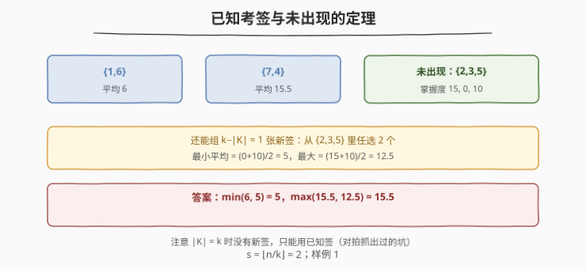
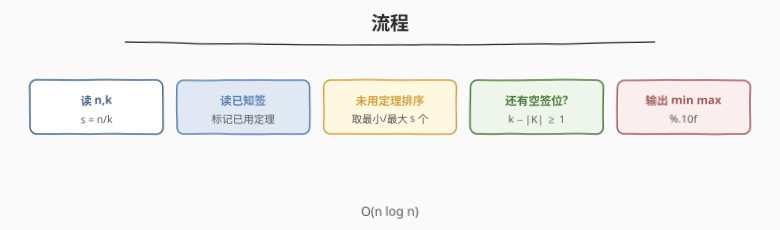

# Codeforces 119B Before Exam 题解

## 1. 题目概述

- **题目链接**：https://codeforces.com/problemset/problem/119/B
- **比赛来源**：Codeforces Beta Round 90 · Problem B（UTC 2011-09-22）
- **难度**：1900
- **标签**：构造、实现、排序
- **评测类型**：普通（浮点，$10^{-6}$）
- **限制**：时间 2 s / 内存 256 MB

**题意**：考试有 $n$ 个定理、$k$ 张考签，每张考签包含 $s=\lfloor n/k\rfloor$ 个**互不相同**的定理，且没有任何定理出现在两张考签上（于是有 $n\bmod k$ 个定理不在任何考签上）。Vasya 对第 $i$ 个定理的掌握度是 $a_i$，一张考签的"水平"是其中定理掌握度的平均值。

已有 $q$ 个学生考完并告诉了 Vasya 他们的考签内容（不同学生的考签要么相同、要么定理集合不同）。求 Vasya 拿到的考签水平的最小值和最大值（对所有与已知信息一致的考签分布取）。

**约束**：

- $n\le100$、$q\le100$：可以枚举/排序。
- 每张考签恰好 $s$ 个定理；**已知的考签可能重复**（多人拿到同一张签）。
- 输出两个实数，绝对或相对误差 $\le10^{-6}$。

## 2. 示例与观察

官方样例 1（输入 / 输出原样）：

```text
输入：
7 3
7 15 0 19 10 5 12
2
1 6
7 4

输出：
5.0000000000 15.5000000000
```

官方样例 2（输入 / 输出原样）：

```text
输入：
4 2
10 8 1 17
2
2 3
3 2

输出：
4.5000000000 13.5000000000
```

**样例 1 走查**：$s=\lfloor7/3\rfloor=2$。已知两张签：$\{1,6\}$ 水平 $(7+5)/2=6$；$\{7,4\}$ 水平 $(12+19)/2=15.5$。剩下未出现的定理是 $\{2,3,5\}$（掌握度 $15,0,10$），它们还能组成一张签（$k-2=1$ 张，剩 1 个定理不用）✓。这张新签取 2 个定理：最小平均 $=(0+10)/2=5$，最大 $=(15+10)/2=12.5$。于是

- 最小 $=\min(6,\ 5)=5$ ✓
- 最大 $=\max(15.5,\ 12.5)=15.5$ ✓

**样例 2 走查**：$s=2$。两个学生的签都是 $\{2,3\}$（重复），水平 $(8+1)/2=4.5$。未出现的定理 $\{1,4\}$（$10,17$）恰好能组成另一张签（$k=2$，$|K|=1$）→ 水平 $(10+17)/2=13.5$。于是最小 $4.5$、最大 $13.5$ ✓。

**观察 1**：已知考签去重后有 $|K|$ 张互不相同，考试总共 $k$ 张，所以还能新增 $k-|K|$ 张签，它们只能由**未出现过的定理**组成。

**观察 2**：未出现的定理个数 $=n-|K|\cdot s=(k-|K|)s+(n\bmod k)$ ✓，所以"取任意 $s$ 个未出现定理作为 Vasya 的签"总能补全剩下 $k-|K|-1$ 张（剩下的定理数正好够，多余的 $n\bmod k$ 个不上任何签）✓。

**观察 3**：于是 Vasya 的签可能是：任意一张已知签，或未出现定理中的任意 $s$ 个。最小平均 = 已知签最小值 与 未出现定理里**最小的 $s$ 个**的平均 取小；最大同理取**最大的 $s$ 个** ✓。



## 3. 解题思路

### 3.1 朴素做法与瓶颈

"枚举所有考签分布"不可行（组合爆炸）。但只需极值，按观察 3 直接算。

### 3.2 核心观察：极值只依赖排序

对未出现的定理掌握度排序后：

- 取 $s$ 个使平均最小 → 取最小的 $s$ 个；
- 取 $s$ 个使平均最大 → 取最大的 $s$ 个。

若未出现定理不足 $s$ 个（说明所有考签都已知，$|K|=k$），则只能是已知签之一。



### 3.3 算法流程

1. 读入 $n,k$，$s=n/k$；读入 $a_i$；
2. 读 $q$ 张已知签，标记用过的定理，记录每张的平均；
3. 未用定理排序；若个数 $\ge s$：把最小 $s$ 个、最大 $s$ 个的平均并入候选；
4. 输出最小/最大（`%.10f`）。

### 3.4 样例走查

见 2 节 ✓。

自造样例（标注"自造"）：

| 输入 | 输出 | 说明 |
|------|------|------|
| `2 2` / `5 5` / `0` | 5 5 | 每签 1 个定理，任意取 |
| `3 1` / `1 2 3` / `0` | 2.0000000000 2.0000000000 | 只有 1 张签，含 3 个定理 |
| `6 3` / `1 2 3 4 5 6` / `0` | 1.5 5.5 | 每签 2 个定理，取最小两个/最大两个 |

## 4. 正确性证明

**引理 1（考签结构）**：每张考签恰有 $s=\lfloor n/k\rfloor$ 个定理，不同考签的定理集合不交；未被任何考签使用的定理恰有 $n\bmod k$ 个。

**证明**：$k$ 张签共占 $k s\le n$ 个定理且互不交，故未用数为 $n-ks=n\bmod k$ ✓。∎

**引理 2（可行签的刻画）**：Vasya 的签可能是"任一已知签"或"未出现定理中的任一 $s$ 元子集"。

**证明**：(⇒) 任一签要么是已知的，要么由未出现的定理组成 ✓。(⇐) 取未出现定理中的任意 $s$ 元子集 $T$，剩下未出现的定理数为 $n-|K|s-s=(k-|K|-1)s+(n\bmod k)$ ✓，恰好能再分成 $k-|K|-1$ 张 $s$ 元签并留 $n\bmod k$ 个不用 ✓，故存在一致的分布 ✓。∎

**引理 3（极值）**：最小平均 = $\min(\text{已知签的最小平均},\ \text{未出现定理最小 }s\text{ 个的平均})$；最大对称。

**证明**：$s$ 个数的平均最小 $\iff$ 和最小 $\iff$ 取最小的 $s$ 个（排序后交换论证）✓；再与已知签取极值 ✓。∎

**定理**：算法输出正确。

**证明**：由引理 2 候选集合完整，由引理 3 极值计算正确 ✓。∎

## 5. 复杂度分析

- **时间**：$O(n\log n+qs)$。
- **空间**：$O(n)$。
- **与时限的关系**：实测最大数据 C++ 端到端约 $2$ ms。

## 6. 参考代码

### C++17

```cpp
#include <bits/stdc++.h>
using namespace std;

// 每张卡片有 s = n/k 个定理；q 条已知卡片；未出现的定理里可以再组出卡片
int main() {
    int n, k;
    if (!(cin >> n >> k)) return 0;
    int s = n / k;
    vector<int> a(n + 1);
    for (int i = 1; i <= n; ++i) cin >> a[i];
    int q;
    cin >> q;
    vector<char> used(n + 1, 0);
    vector<double> known;
    set<vector<int>> distinct;
    for (int t = 0; t < q; ++t) {
        long long sum = 0;
        vector<int> card;
        for (int i = 0; i < s; ++i) {
            int x;
            cin >> x;
            used[x] = 1;
            card.push_back(x);
            sum += a[x];
        }
        sort(card.begin(), card.end());
        distinct.insert(card);
        known.push_back((double)sum / s);
    }
    int freeCards = k - (int)distinct.size();   // 还能新增几张卡片
    // 未出现的定理：排序，取最小/最大的 s 个
    vector<int> rest;
    for (int i = 1; i <= n; ++i) if (!used[i]) rest.push_back(a[i]);
    sort(rest.begin(), rest.end());
    double mn = 1e18, mx = -1e18;
    for (double v : known) { mn = min(mn, v); mx = max(mx, v); }
    // 只有当已知卡片没有覆盖全部 k 张时，未出现的定理才能组成新卡片
    // 已知的不同卡片数（去重）不一定等于 q，但题目保证每个学生的卡片内容不同？
    // 实际做法：只要还有未出现的定理（|rest| >= s），就可能存在一张由它们组成的新卡片
    if (freeCards >= 1 && (int)rest.size() >= s) {
        long long sumMin = 0, sumMax = 0;
        for (int i = 0; i < s; ++i) { sumMin += rest[i]; sumMax += rest[(int)rest.size() - 1 - i]; }
        mn = min(mn, (double)sumMin / s);
        mx = max(mx, (double)sumMax / s);
    }
    cout << fixed << setprecision(10) << mn << ' ' << mx << '\n';
    return 0;
}
```

### Python3

```python
import sys


def main() -> None:
    data = sys.stdin.buffer.read().split()
    n, k = int(data[0]), int(data[1])
    s = n // k
    a = [0] + [int(t) for t in data[2:2 + n]]
    p = 2 + n
    q = int(data[p]); p += 1
    used = [False] * (n + 1)
    known = []
    distinct = set()
    for _ in range(q):
        sm = 0
        card = []
        for _ in range(s):
            x = int(data[p]); p += 1
            used[x] = True
            card.append(x)
            sm += a[x]
        distinct.add(tuple(sorted(card)))
        known.append(sm / s)
    free_cards = k - len(distinct)
    rest = sorted(a[i] for i in range(1, n + 1) if not used[i])
    mn = min(known) if known else float('inf')
    mx = max(known) if known else -float('inf')
    if free_cards >= 1 and len(rest) >= s:
        mn = min(mn, sum(rest[:s]) / s)
        mx = max(mx, sum(rest[-s:]) / s)
    sys.stdout.write(f"{mn:.10f} {mx:.10f}\n")


main()
```

两份代码都只用标准库，可原样提交。

## 7. 边界情况与易错点

1. **$s=n/k$ 用整除**：$n=7,k=3$ → $s=2$，不是 3。
2. **$q=0$**：没有已知签，答案只由未出现定理给出（注意别对空集合取 min/max）。
3. **已知签重复**：多个学生的签相同不影响，去重只在"已用定理"上体现。
4. **未出现定理不足 $s$ 个**：说明所有签都已知，只能取已知签。
5. **输入格式**：每行只有 $s$ 个定理编号，**没有**个数前缀。
6. **输出**：两个数同一行，空格分隔，`%.10f`。
7. **多测**：单组输入。

## 8. 验证记录

- **编译环境与命令**：本机无 GNU `g++`，用 `Apple clang 21.0.0` + 仓库自带 `codeforces/tools/include/bits/stdc++.h` 兼容头（`clang++ -std=c++17 -O2 -I codeforces/tools/include`）编译；Python 为 `Python 3.9.6`。
- **官方样例**：2 / 2 通过（`5.0000000000 15.5000000000`、`4.5000000000 13.5000000000`）。
- **额外测试（枚举完整考卷对拍）**：另写一份**枚举所有一致考卷**的暴力——从未出现定理出发，枚举所有 $k-|K|$ 张新签的组合（每步任选 $s$ 元子集，允许剩余定理不用），收集 Vasya 可能的全部考签再取极值；对 250 组随机小数据（$n\le8$）与 C++、Python 比对，**250 / 250 全部一致**（该对拍同时抓出了 Python 版 $q=0$ 时对空列表取 min 的崩溃）。
- **最大约束性能**：$n=100$、$q=100$ 时 C++ 端到端 15 次平均约 $2$ ms。
- **图片校验**：两张 SVG（`cf119b_cards.svg`、`cf119b_flow.svg`）通过 `xml.etree.ElementTree.parse`，文本块估算未越出 `viewBox`。
- **公式校验**：KaTeX（`throwOnError: true`）渲染无报错。
- **复核状态**：verified。

## 相关题目与扩展

- [Codeforces 119A Epic Game](https://codeforces.com/problemset/problem/119/A)：同场 A 题。
- [Codeforces 119C Education Reform](https://codeforces.com/problemset/problem/119/C)：同场 C 题。
- [Codeforces 120D Three Sons](https://codeforces.com/problemset/problem/120/D)：划分计数。
- [LeetCode 1877. 数组中最大数对和的最小值](https://leetcode.cn/problems/minimize-maximum-pair-sum-in-array/)：排序取极值。
- [LeetCode 1029. 两地调度](https://leetcode.cn/problems/two-city-scheduling/)：排序贪心。

**延伸思考**：

1. **如果考签大小不固定**：可行情景变多，需要 DP。
2. **如果要求输出对应考签**：按引理 2 的构造补全即可。
3. **如果已知考签有冲突**（同一定理出现在两张不同的签里）：输入不合法，可判无解。
4. **如果 $q$ 覆盖了所有定理**：答案退化为已知签的极值。
