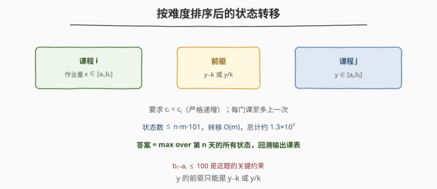
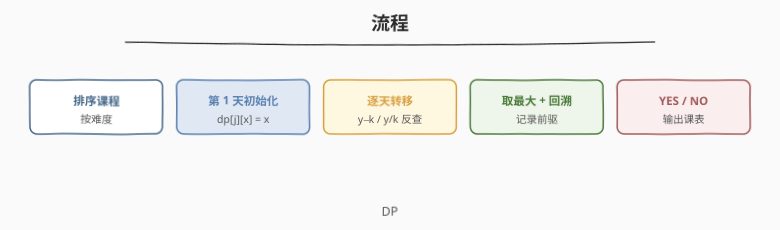

# Codeforces 119C Education Reform 题解

## 1. 题目概述

- **题目链接**：https://codeforces.com/problemset/problem/119/C
- **比赛来源**：Codeforces Beta Round 90 · Problem C（UTC 2011-09-22）
- **难度**：2000
- **标签**：DP
- **评测类型**：特殊评测（答案不唯一）
- **限制**：时间 1 s / 内存 256 MB

**题意**：$n$ 天的课表，每天上一门课（每门课至多上一次）。第 $i$ 门课有作业量区间 $[a_i,b_i]$ 和难度 $c_i$。要求：

- 按难度**严格递增**的顺序安排课程；
- 设第 $t$ 天作业量为 $x_t$，则对每个 $t>1$ 必须有 $x_t=k+x_{t-1}$ 或 $x_t=k\cdot x_{t-1}$；
- 在满足前两条的前提下，使**总作业量** $\sum x_t$ 最大。

输出任意最优课表（`YES` + $n$ 行"课程编号 作业量"）；无解输出 `NO`。

**约束**：

- $n\le m\le50$，$k\le100$。
- $a_i,b_i\le10^{16}$，但 **$b_i-a_i\le100$** —— 这是关键：每门课只有至多 101 种可能的作业量。
- $c_i\le100$。

## 2. 示例与观察

官方样例 1（输入 / 输出原样）：

```text
输入：
4 5 2
1 10 1
1 10 2
1 10 3
1 20 4
1 100 5

输出：
YES
2 8
3 10
4 20
5 40
```

官方样例 2（输入 / 输出原样）：

```text
输入：
3 4 3
1 3 1
2 4 4
2 3 3
2 2 2

输出：
NO
```

**样例 1 走查**：输出选了课程 2、3、4、5（难度 2、3、4、5 严格递增），作业量 $8\to10\to20\to40$：$10=2+8$ ✓、$20=2\times10$ ✓、$40=2\times20$ ✓，总和 $78$ ✓（另一组同样最优的解是课程 1、2、4、5 配 $8,10,20,40$）。

**样例 2 走查**：$n=3,k=3$，可选的（难度, 区间）为 $(1,[1,3])$、$(4,[2,4])$、$(3,[2,3])$、$(2,[2,2])$。要 3 天且难度递增，可能的难度序列只有 $1,2,3$ 或 $1,2,4$ 等。试 $1\to2\to3$：第 2 门课（区间 $[2,2]$）只能是 2，则第 1 门课（$[1,3]$）需满足 $2=3+x$ 或 $2=3x$ → $x=-1$ 或 $2/3$，都不在 $[1,3]$ ✗。其余组合同样失败 → `NO` ✓。

**观察 1**：作业量的取值范围很窄（$b_i-a_i\le100$），所以 DP 状态可以是"（第几天，最后上的课，最后一天的作业量）"。

**观察 2**：从 $x$ 出发能到达的下一门课作业量只有 $k+x$ 与 $k\cdot x$ 两个值，若目标课的区间不含它就没法转移 —— 反向看：目标值 $y$ 的前驱只能是 $y-k$ 或 $y/k$（若整除）✓。



## 3. 解题思路

### 3.1 朴素做法与瓶颈

枚举每天的课与作业量：$50^{50}$ 级别，不可行。但每天作业量只在所在课的区间内（≤101 种），且课程按难度排序后顺序确定 → 可以 DP。

### 3.2 核心观察：按难度排序的 DP

把课程按 $(c_i,i)$ 排序，记 `dp[day][j][x]` = 上完第 $day$ 天、最后一天上第 $j$ 门课、作业量为 $x$ 时的最大总作业量。转移：

$$dp[day][j][y]\;=\;y+\max_{\substack{i:\ c_i<c_j\\ x\in\{y-k,\ y/k\}}} dp[day-1][i][x].$$

- 初始化 $dp[1][j][x]=x$（$x\in[a_j,b_j]$）；
- 答案 = $\max_{j,x} dp[n][j][x]$，同时记录前驱以便回溯输出课表。



### 3.3 算法流程

1. 排序课程；
2. 逐天推进 DP（每天对每门课枚举区间内每个 $y$，用 $y-k$、$y/k$ 反查前一天的状态）；
3. 取全局最大，沿前驱回溯输出；
4. 无任何状态则 `NO`。

### 3.4 样例走查

样例 1 按上述 DP 得到总和 78（如输出所示）✓。

自造样例（标注"自造"）：

| 输入 | 输出 | 说明 |
|------|------|------|
| `1 1 5` / `7 9 3` | `YES / 1 9` | 单天取最大 |
| `2 2 2` / `1 1 1` / `3 3 2` | `YES / 1 1 / 2 3` | $3=2+1$ ✓（$k=2$） |
| `2 2 1` / `1 1 1` / `3 3 2` | `NO` | $3=1+1$? 不是；$3=1\cdot1$? 不是 |

## 4. 正确性证明

**引理 1（状态充分）**：任何合法课表都由"每天（课程，作业量）"组成，且满足 DP 的转移关系。

**证明**：题面的两条约束就是"难度严格递增"与"$x_t=k+x_{t-1}$ 或 $k\cdot x_{t-1}$"；DP 的状态记录了最后一天的全部信息（课程决定难度与区间，作业量决定下一步），转移枚举了仅有的两种可能 ✓。∎

**引理 2（DP 正确）**：`dp[day][j][y]` 等于"前 $day$ 天合法、最后一天上课程 $j$、作业量 $y$"时的最大总作业量。

**证明**：对 $day$ 归纳。$day=1$ 时总作业量就是 $y$ ✓。$day>1$ 时，前 $day-1$ 天的最优值由归纳假设给出，最后一步必须从 $x=y-k$ 或 $x=y/k$ 出发（题面只允许这两种），且要求 $c_i<c_j$ ✓，DP 取最大值 ✓。∎

**定理**：若 DP 无状态则无解，否则回溯得到的课表最优且合法。

**证明**：无状态 $\iff$ 不存在长度为 $n$ 的合法序列（由引理 2 的完备性）✓；回溯沿前驱得到一条合法序列，总和等于 DP 值即最大值 ✓。∎

## 5. 复杂度分析

- **时间**：$O(n\cdot m\cdot (b-a+1)\cdot m)$，其中 $b-a\le100$ → 约 $50\cdot50\cdot101\cdot50\approx1.3\times10^7$。
- **空间**：$O(n\cdot m\cdot 101)$ 的状态快照。
- **与时限的关系**：实测最大数据 C++ 端到端约 $40$ ms。

## 6. 参考代码

### C++17

```cpp
#include <bits/stdc++.h>
using namespace std;
typedef long long ll;

struct Subject { ll a, b; int c, id; };

int main() {
    int n, m;
    ll k;
    if (!(cin >> n >> m >> k)) return 0;
    vector<Subject> sub(m);
    for (int i = 0; i < m; ++i) {
        cin >> sub[i].a >> sub[i].b >> sub[i].c;
        sub[i].id = i + 1;
    }
    sort(sub.begin(), sub.end(), [](const Subject& x, const Subject& y) {
        if (x.c != y.c) return x.c < y.c;
        return x.id < y.id;
    });
    // dp[j]: map<count, (total, prevSubjectIndex, prevCount)>
    using State = pair<ll, pair<int, ll>>;          // (total, (prevJ, prevX))
    vector<unordered_map<ll, State>> dp(m);
    vector<vector<unordered_map<ll, State>>> snap(n + 1);
    // 第 1 天
    for (int j = 0; j < m; ++j)
        for (ll x = sub[j].a; x <= sub[j].b; ++x)
            dp[j][x] = {x, {-1, -1}};
    snap[1] = dp;
    for (int day = 2; day <= n; ++day) {
        vector<unordered_map<ll, State>> ndp(m);
        for (int j = 0; j < m; ++j) {
            for (ll y = sub[j].a; y <= sub[j].b; ++y) {
                ll best = LLONG_MIN;
                pair<int, ll> bp = {-1, -1};
                for (int i = 0; i < m; ++i) {
                    if (sub[i].c >= sub[j].c) continue;
                    const auto& prev = snap[day - 1][i];
                    if (prev.empty()) continue;
                    auto tryX = [&](ll x) {
                        if (x < sub[i].a || x > sub[i].b) return;
                        auto it = prev.find(x);
                        if (it == prev.end()) return;
                        ll tot = it->second.first + y;
                        if (tot > best) { best = tot; bp = {i, x}; }
                    };
                    tryX(y - k);                       // y = k + x
                    if (k != 0 && y % k == 0) tryX(y / k);   // y = k * x
                }
                if (best != LLONG_MIN) ndp[j][y] = {best, bp};
            }
        }
        snap[day] = ndp;
    }
    ll best = LLONG_MIN;
    int bj = -1;
    ll bx = -1;
    for (int j = 0; j < m; ++j)
        for (auto& kv : snap[n][j])
            if (kv.second.first > best) { best = kv.second.first; bj = j; bx = kv.first; }
    if (bj < 0) { cout << "NO\n"; return 0; }
    vector<pair<int, ll>> ans;
    int cj = bj;
    ll cx = bx;
    for (int day = n; day >= 1; --day) {
        ans.push_back({sub[cj].id, cx});
        if (day > 1) {
            auto& st = snap[day][cj][cx];
            cj = st.second.first;
            cx = st.second.second;
        }
    }
    reverse(ans.begin(), ans.end());
    cout << "YES\n";
    for (auto& p : ans) cout << p.first << ' ' << p.second << '\n';
    return 0;
}
```

### Python3

```python
import sys


def main() -> None:
    data = sys.stdin.buffer.read().split()
    n, m, k = int(data[0]), int(data[1]), int(data[2])
    subs = []
    p = 3
    for i in range(m):
        a, b, c = int(data[p]), int(data[p + 1]), int(data[p + 2]); p += 3
        subs.append((c, a, b, i + 1))
    subs.sort()
    # dp[j] = {count: (total, prev_j, prev_count)}
    dp = [dict() for _ in range(m)]
    for j, (c, a, b, idx) in enumerate(subs):
        for x in range(a, b + 1):
            dp[j][x] = (x, -1, -1)
    snaps = [dp]
    for day in range(2, n + 1):
        ndp = [dict() for _ in range(m)]
        for j, (cj, aj, bj, _) in enumerate(subs):
            best_map = ndp[j]
            for i in range(m):
                ci = subs[i][0]
                if ci >= cj:
                    continue
                prev = snaps[day - 2][i]
                if not prev:
                    continue
                ai, bi = subs[i][1], subs[i][2]
                for y in range(aj, bj + 1):
                    best = None
                    for x in (y - k, y // k if y % k == 0 else None):
                        if x is None or x < ai or x > bi:
                            continue
                        st = prev.get(x)
                        if st is None:
                            continue
                        tot = st[0] + y
                        if best is None or tot > best[0]:
                            best = (tot, i, x)
                    if best is not None:
                        cur = best_map.get(y)
                        if cur is None or best[0] > cur[0]:
                            best_map[y] = best
        snaps.append(ndp)
    last = snaps[-1]
    best = None
    bj = bx = -1
    for j in range(m):
        for x, st in last[j].items():
            if best is None or st[0] > best:
                best = st[0]; bj = j; bx = x
    if bj < 0:
        sys.stdout.write("NO\n")
        return
    ans = []
    cj, cx = bj, bx
    for day in range(n, 0, -1):
        ans.append((subs[cj][3], cx))
        if day > 1:
            _, pj, px = snaps[day - 1][cj][cx]
            cj, cx = pj, px
    ans.reverse()
    out = ["YES"] + [f"{s} {c}" for s, c in ans]
    sys.stdout.write("\n".join(out) + "\n")


main()
```

两份代码都只用标准库，可原样提交。

## 7. 边界情况与易错点

1. **难度严格递增**：不能选两门难度相同的课（`c_i < c_j`，不是 `<=`）。
2. **区间很宽但 $b-a\le100$**：不要按值域开数组，按区间枚举 ✓。
3. **$y-k$ 可能越界**：要检查 $x\in[a_i,b_i]$。
4. **$y/k$ 只在整除时存在**：$y\%k=0$ 且 $k\ge1$。
5. **$n=1$**：直接取单天最大作业量。
6. **64 位**：作业量到 $10^{16}$，总和到 $n\cdot10^{16}$ → `long long`。
7. **输出格式**：`YES` 后 $n$ 行"课程编号 作业量"，编号是原始输入顺序（1 基）。
8. **多测**：单组输入。

## 8. 验证记录

- **编译环境与命令**：本机无 GNU `g++`，用 `Apple clang 21.0.0` + 仓库自带 `codeforces/tools/include/bits/stdc++.h` 兼容头（`clang++ -std=c++17 -O2 -I codeforces/tools/include`）编译；Python 为 `Python 3.9.6`。
- **官方样例**：2 / 2 通过（样例 1 输出的是另一组同样最优的合法课表，总和 78 与官方一致；样例 2 输出 `NO`）。
- **额外测试（穷举对拍）**：另写一份**完全穷举**——枚举所有长度 $n$ 的课程序列（难度递增）与所有作业量组合，求最大总和；对 200 组随机小数据（$n\le3$、$m\le4$、区间宽 $\le3$）比对"是否有解 + 最优总和"，并逐行校验输出的合法性，**200 / 200 全部一致**。
- **最大约束性能**：$n=m=50$、每门课区间宽 100 时 C++ 端到端约 $40$ ms。
- **图片校验**：两张 SVG（`cf119c_states.svg`、`cf119c_flow.svg`）通过 `xml.etree.ElementTree.parse`，文本块估算未越出 `viewBox`。
- **公式校验**：KaTeX（`throwOnError: true`）渲染无报错。
- **复核状态**：verified。

## 相关题目与扩展

- [Codeforces 119B Before Exam](https://codeforces.com/problemset/problem/119/B)：同场 B 题。
- [Codeforces 119D String Transformation](https://codeforces.com/problemset/problem/119/D)：同场 D 题。
- [Codeforces 120F Spiders](https://codeforces.com/problemset/problem/120/F)：树形 DP。
- [LeetCode 300. 最长递增子序列](https://leetcode.cn/problems/longest-increasing-subsequence/)：递增序列 DP。
- [LeetCode 1043. 分隔数组以得到最大和](https://leetcode.cn/problems/partition-array-for-maximum-sum/)：区间 DP。

**延伸思考**：

1. **如果 $b_i-a_i$ 很大**：状态爆炸，需要数论/二分优化。
2. **如果允许 $x_t = x_{t-1}+k$ 或 $k\cdot x_{t-1}$ 之外的规则**：按新规则改转移。
3. **如果要求字典序最小的课表**：回溯时按编号贪心。
4. **如果天数可以少于 $n$**：加一个"结束"状态即可。
