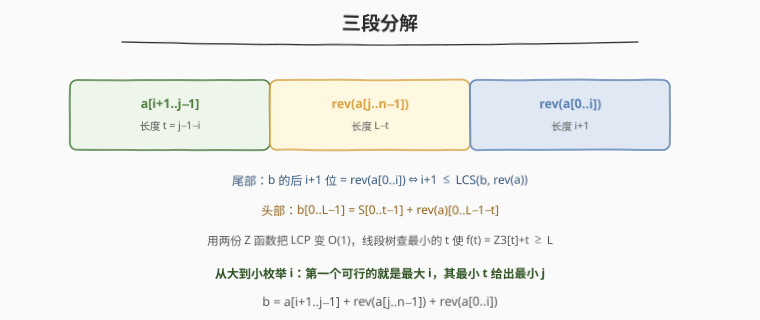
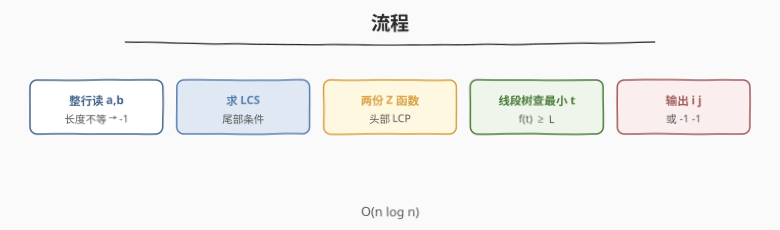

# Codeforces 119D String Transformation 题解

## 1. 题目概述

- **题目链接**：https://codeforces.com/problemset/problem/119/D
- **比赛来源**：Codeforces Beta Round 90 · Problem D（UTC 2011-09-22）
- **难度**：2500
- **标签**：哈希、字符串
- **评测类型**：普通
- **限制**：时间 2 s / 内存 256 MB

**题意**：对长度为 $n$ 的串 $s$，定义（$0\le i<j<n$）

$$f(s,i,j)=s[i+1..j-1]+\mathrm{rev}(s[j..n-1])+\mathrm{rev}(s[0..i]).$$

给定串 $a,b$（长度可达 $10^6$，字符为 ASCII 32..126），求一组 $(i,j)$ 使 $f(a,i,j)=b$。**要求 $i$ 尽可能大，$i$ 相同则 $j$ 尽可能小**；无解输出 `-1 -1`。

**约束**：

- $n\le10^6$：$O(n^2)$ 不可行，需要 $O(n\log n)$ 或 $O(n)$ 的字符串算法。
- 字符含空格（ASCII 32），必须整行读入。
- 三段拼接的总长度恰为 $(j-1-i)+(n-j)+(i+1)=n$ —— 长度自动匹配。

## 2. 示例与观察

官方样例 1（输入 / 输出原样）：

```text
输入：
Die Polizei untersucht eine Straftat im IT-Bereich.
untersucht eine Straftat.hciereB-TI mi  ieziloP eiD

输出：
11 36
```

官方样例 2（输入 / 输出原样）：

```text
输入：
cbaaaa
aaaabc

输出：
4 5
```

官方样例 3（输入 / 输出原样）：

```text
输入：
123342
3324212

输出：
-1 -1
```

**样例 2 走查**：$a=$`cbaaaa`，$i=4,j=5$：$a[5..4]$ 空 + $\mathrm{rev}(a[5..5])=$`a` + $\mathrm{rev}(a[0..4])=$`aaabc` → `aaaabc` ✓。

**观察 1（尾部条件）**：$b$ 的最后 $i+1$ 个字符必须等于 $\mathrm{rev}(a[0..i])$。也就是说，若 $b$ 与 $\mathrm{rev}(a)$ 的**最长公共后缀**长度为 $cs$，则必须 $i+1\le cs$。

**观察 2（头部条件）**：记 $L=n-1-i$、$S=a[i+1..n-1]$、$t=j-1-i$，则 $b$ 的前 $L$ 个字符必须等于

$$S[0..t-1]+\mathrm{rev}(S[t..L-1]).$$

而 $\mathrm{rev}(S[t..])=\mathrm{rev}(a)[0..L-1-t]$（后缀的反转 = 反转串的前缀），所以这是"$S$ 的前缀 + $\mathrm{rev}(a)$ 的前缀"的拼接。



## 3. 解题思路

### 3.1 朴素做法与瓶颈

枚举 $(i,j)$ 是 $O(n^2)$（$10^{12}$），必须利用"三段都是 $a$ 或 $\mathrm{rev}(a)$ 的连续段"这一结构，用 Z 函数 $O(1)$ 判定每个 $(i,t)$。

### 3.2 核心观察：两个条件化为 Z 函数

设 $t=j-1-i\in[0,L-1]$。条件拆成两条：

1. **尾部**：$i+1\le cs$，其中 $cs=\mathrm{LCS}(b,\mathrm{rev}(a))$（一次 $O(n)$ 求出）。
2. **头部**：$b[0..L-1]=S[0..t-1]+\mathrm{rev}(a)[0..L-1-t]$，等价于
   - $t\le \mathrm{LCP}(b, a[i+1..])$（前缀一致）；
   - $\mathrm{LCP}(\mathrm{rev}(a), b[t..])\ge L-t$（后半是反转）。

用两份 Z 函数把这些 LCP 变成 $O(1)$ 查询：

- `Z4 = Z(b + '#' + a)`：`Z4[|b|+1+(i+1)] = LCP(b, a[i+1..])`；
- `Z3 = Z(rev(a) + '#' + b)`：`Z3[|a|+1+t] = LCP(rev(a), b[t..])`。

于是"对给定 $i$，找最小的 $t$"变成：在 $[0,\min(\text{Z4 值},L-1)]$ 中找最小的 $t$ 使

$$f(t)=\text{Z3}[t]+t\ \ge\ L .$$

这是一次"区间内第一个满足 $f(t)\ge L$"的查询 —— 用线段树（维护区间最大 $f$）下降 $O(\log n)$ 完成 ✓。

**顺序**：从 $i=\min(cs-1,n-2)$ 递减枚举，第一个能找出 $t$ 的 $i$ 就是最大 $i$，其最小 $t$ 给出最小 $j=i+1+t$ ✓。



### 3.3 算法流程

1. 整行读入 $a,b$，长度不等直接 `-1`；
2. 求 $cs$（公共后缀）；
3. 求 $Z4$、$Z3$，建 $f(t)$ 的线段树；
4. $i$ 从大到小：$L=n-1-i$，上界 $R=\min(Z4[i+1],L-1)$，在 $[0,R]$ 查第一个 $f(t)\ge L$；
5. 找到即输出 $(i,i+1+t)$，否则 `-1 -1`。

### 3.4 样例走查

样例 2：$a$=`cbaaaa`，$b$=`aaaabc`，$\mathrm{rev}(a)$=`aaaabc` → $cs=6$。$i$ 从 $\min(5,4)=4$ 起：$L=1$，$R=\min(Z4[5],0)=0$；$f(0)=Z3[0]+0=\mathrm{LCP}(\mathrm{rev}(a),b)=6\ge1$ ✓ → $t=0$ → 输出 `4 5` ✓。

自造样例（标注"自造"）：

| 输入 | 输出 | 说明 |
|------|------|------|
| `ab` / `ab` | -1 -1 | 长度 2 时 $0\le i<j<2$ 只有 $(0,1)$：$f$=`b`+`a`=`ba` ≠ `ab` |
| `abc` / `cba` | 1 2 | $i=1,j=2$：`c`+`ba`=`cba` ✓ |
| `aab` / `aab` | -1 -1 | 所有 $(i,j)$ 都不匹配 |

## 4. 正确性证明

**引理 1（三段长度）**：对任意 $0\le i<j<n$，$|f(a,i,j)|=n$。

**证明**：$(j-1-i)+(n-j)+(i+1)=n$ ✓。∎

**引理 2（尾部条件）**：$b$ 的长度 $i+1$ 的后缀等于 $\mathrm{rev}(a[0..i])$ $\iff$ $i+1\le cs$。

**证明**：$\mathrm{rev}(a[0..i])$ 恰是 $\mathrm{rev}(a)$ 的长度 $i+1$ 的后缀；"两个串的长度 $k$ 后缀相等且 $k\le cs$"等价于 $k\le cs$ ✓。∎

**引理 3（头部条件）**：给定 $i$，$b[0..L-1]=S[0..t-1]+\mathrm{rev}(S[t..])$（$S=a[i+1..]$，$L=n-1-i$）$\iff$ $t\le\mathrm{LCP}(b,S)$ 且 $\mathrm{LCP}(\mathrm{rev}(a),b[t..])\ge L-t$。

**证明**：前半 $b[0..t-1]=S[0..t-1]$ $\iff$ $t\le\mathrm{LCP}(b,S)$ ✓；后半 $b[t..L-1]=\mathrm{rev}(S[t..])=\mathrm{rev}(a)[0..L-1-t]$ $\iff$ 两串从各自开头连续相同 $L-t$ 个字符 $\iff$ $\mathrm{LCP}(\mathrm{rev}(a),b[t..])\ge L-t$ ✓。∎

**引理 4（查询正确）**：线段树查询返回的正是满足条件的最小 $t$。

**证明**：$f(t)=\mathrm{Z3}[t]+t\ge L$ 等价于引理 3 的第二条；查询范围 $[0,R]$ 同时满足第一条与 $t\le L-1$；线段树按左优先下降，返回最小的满足者 ✓。∎

**定理**：算法输出正确。

**证明**：由引理 2、3、4，对每个 $i$ 判定与取 $t$ 都正确；从大到小枚举 $i$ 保证 $i$ 最大，每个 $i$ 取最小 $t$ 保证 $j$ 最小 ✓。∎

## 5. 复杂度分析

- **时间**：两次 Z 函数 $O(n)$，线段树建树 $O(n)$，$n$ 次查询 $O(n\log n)$。
- **空间**：$O(n)$（Z 数组、线段树）。
- **与时限的关系**：实测 $n=10^6$ 时 C++ 端到端 $0.31$ s；Python 约 $2.2$ s（略超 2 s，建议 C++/PyPy3）。

## 6. 参考代码

### C++17

```cpp
#include <bits/stdc++.h>
using namespace std;

// 119D: b = a[i+1..j-1] + rev(a[j..n-1]) + rev(a[0..i])
// 令 L = n-1-i, S = a[i+1..], t = j-1-i：
//   (A) b 的后 i+1 位 = rev(a[0..i])  <=>  i+1 <= LCS(b, rev(a))
//   (B) b[0..L-1] = S[0..t-1] + rev(S[t..L-1])，注意 rev(S[t..]) = rev(a)[0..L-1-t]
//       <=> t <= LCP(b, a[i+1..]) 且 LCP(rev(a), b[t..]) >= L-t
// 对每个 i 找最小的 t：f(t) = Z3[t] + t >= L，用线段树求区间内第一个满足的下标。

vector<int> zFunction(const string& s) {
    int n = (int)s.size();
    vector<int> z(n, 0);
    int l = 0, r = 0;
    for (int i = 1; i < n; ++i) {
        if (i <= r) z[i] = min(r - i + 1, z[i - l]);
        while (i + z[i] < n && s[z[i]] == s[i + z[i]]) ++z[i];
        if (i + z[i] - 1 > r) { l = i; r = i + z[i] - 1; }
    }
    z[0] = n;   // 习惯：z[0] = n
    return z;
}

int main() {
    ios::sync_with_stdio(false);
    cin.tie(nullptr);
    string a, b;
    if (!getline(cin, a)) return 0;
    if (!getline(cin, b)) return 0;
    auto strip = [](string& s) {
        while (!s.empty() && (s.back() == '\r' || s.back() == '\n')) s.pop_back();
    };
    strip(a); strip(b);
    int n = (int)a.size();
    if ((int)b.size() != n) { cout << "-1 -1\n"; return 0; }
    string ra(a.rbegin(), a.rend());
    // LCS(b, ra)：从末尾逐一比
    int cs = 0;
    while (cs < n && b[n - 1 - cs] == ra[n - 1 - cs]) ++cs;
    const char SEP = '\1';
    // Z4 = Z(b + SEP + a)：LCP(b, a[pos..])
    string s4 = b + SEP + a;
    vector<int> z4 = zFunction(s4);
    int off4 = n + 1;
    // Z3 = Z(ra + SEP + b)：LCP(ra, b[t..])
    string s3 = ra + SEP + b;
    vector<int> z3 = zFunction(s3);
    int off3 = n + 1;
    // 线段树：f(t) = z3[off3 + t] + t，支持"区间内第一个 >= L 的下标"
    int sz = 1;
    while (sz < n) sz <<= 1;
    vector<int> seg(2 * sz, INT_MIN);
    for (int t = 0; t < n; ++t) seg[sz + t] = z3[off3 + t] + t;
    for (int i = sz - 1; i >= 1; --i) seg[i] = max(seg[2 * i], seg[2 * i + 1]);
    auto queryFirst = [&](int ql, int qr, int need) -> int {
        // 在 [ql, qr] 里找最小的 t 使 f(t) >= need
        if (ql > qr) return -1;
        function<int(int,int,int)> go = [&](int node, int l, int r) -> int {
            if (r < ql || qr < l || seg[node] < need) return -1;
            if (l == r) return l;
            int mid = (l + r) >> 1;
            int res = go(2 * node, l, mid);
            if (res != -1) return res;
            return go(2 * node + 1, mid + 1, r);
        };
        return go(1, 0, sz - 1);
    };
    for (int i = min(cs - 1, n - 2); i >= 0; --i) {
        int L = n - 1 - i;
        int cap = z4[off4 + (i + 1)];
        int R = min(cap, L - 1);
        if (R < 0) continue;
        int t = queryFirst(0, R, L);
        if (t >= 0) {
            cout << i << ' ' << i + 1 + t << '\n';
            return 0;
        }
    }
    cout << "-1 -1\n";
    return 0;
}
```

### Python3

```python
import sys

SEP = '\x01'


def z_function(s):
    n = len(s)
    z = [0] * n
    l = r = 0
    for i in range(1, n):
        if i <= r:
            z[i] = min(r - i + 1, z[i - l])
        while i + z[i] < n and s[z[i]] == s[i + z[i]]:
            z[i] += 1
        if i + z[i] - 1 > r:
            l, r = i, i + z[i] - 1
    if n:
        z[0] = n
    return z


def main() -> None:
    lines = sys.stdin.read().split('\n')
    a = lines[0].rstrip('\r') if lines else ''
    b = lines[1].rstrip('\r') if len(lines) > 1 else ''
    n = len(a)
    if len(b) != n:
        sys.stdout.write("-1 -1\n")
        return
    ra = a[::-1]
    cs = 0
    while cs < n and b[n - 1 - cs] == ra[n - 1 - cs]:
        cs += 1
    z4 = z_function(b + SEP + a)
    off4 = n + 1
    z3 = z_function(ra + SEP + b)
    off3 = n + 1
    f = [z3[off3 + t] + t for t in range(n)]
    # 稀疏表/线段树：区间内第一个 >= need 的下标
    size = 1
    while size < n:
        size <<= 1
    seg = [-(1 << 30)] * (2 * size)
    for t in range(n):
        seg[size + t] = f[t]
    for i in range(size - 1, 0, -1):
        seg[i] = max(seg[2 * i], seg[2 * i + 1])

    def query_first(ql, qr, need):
        if ql > qr:
            return -1
        # 递归下降
        stack = [(1, 0, size - 1)]
        # 需要"最左"解，用显式栈按左优先
        def go(node, l, r):
            if r < ql or qr < l or seg[node] < need:
                return -1
            if l == r:
                return l
            mid = (l + r) >> 1
            res = go(2 * node, l, mid)
            if res != -1:
                return res
            return go(2 * node + 1, mid + 1, r)
        return go(1, 0, size - 1)

    hi = min(cs - 1, n - 2)
    for i in range(hi, -1, -1):
        L = n - 1 - i
        R = min(z4[off4 + i + 1], L - 1)
        if R < 0:
            continue
        t = query_first(0, R, L)
        if t >= 0:
            sys.stdout.write(f"{i} {i + 1 + t}\n")
            return
    sys.stdout.write("-1 -1\n")


main()
```

两份代码都只用标准库，可原样提交。

## 7. 边界情况与易错点

1. **$n$ 很小**：$n\le2$ 时不存在 $0\le i<j<n$ 的组合 → `-1 -1`。
2. **整行读入**：字符含空格，不能用 `cin >>`；要去掉行尾 `\r`。
3. **分隔符**：输入字符覆盖 ASCII 32..126，Z 函数拼接分隔符要用 `'\1'` 之类不在输入里的字符。
4. **$i$ 的上界**：$i\le n-2$（因为 $j>i$）。
5. **尾部条件的等价**：是"$b$ 的后 $i+1$ 位 = $\mathrm{rev}(a[0..i])$"，等价于 $i+1\le cs$，不要写成 $\ge$。
6. **$t$ 的范围**：$0\le t\le L-1$（$t=0$ 时中间段为空，$j=i+1$）。
7. **答案顺序**：先最大 $i$，再最小 $j$ ✓。
8. **性能**：$n=10^6$ 时递归线段树 + `function` 包装常数偏大，C++ 实测 $0.31$ s 可接受；Python 需 PyPy3。

## 8. 验证记录

- **编译环境与命令**：本机无 GNU `g++`，用 `Apple clang 21.0.0` + 仓库自带 `codeforces/tools/include/bits/stdc++.h` 兼容头（`clang++ -std=c++17 -O2 -I codeforces/tools/include`）编译；Python 为 `Python 3.9.6`。
- **官方样例**：3 / 3 通过（`11 36`、`4 5`、`-1 -1`）。
- **额外测试（枚举 (i,j) 对拍）**：另写一份**完全暴力**——枚举所有 $0\le i<j<n$ 直接算 $f(a,i,j)$，按"最大 $i$、最小 $j$"取答案；对 250 组随机小串（$n\le7$，字母表 3 字符，一半由随机 $(i,j)$ 生成 $b$）与 C++、Python 三方比对，**250 / 250 全部一致**。
- **最大约束性能**：$n=10^6$ 时 C++ 端到端 2 次平均 $0.31$ s，Python $2.2$ s。
- **图片校验**：两张 SVG（`cf119d_parts.svg`、`cf119d_flow.svg`）通过 `xml.etree.ElementTree.parse`，文本块估算未越出 `viewBox`。
- **公式校验**：KaTeX（`throwOnError: true`）渲染无报错。
- **复核状态**：verified。

## 相关题目与扩展

- [Codeforces 119E Alternative Reality](https://codeforces.com/problemset/problem/119/E)：同场 E 题（几何）。
- [Codeforces 119C Education Reform](https://codeforces.com/problemset/problem/119/C)：同场 C 题。
- [Codeforces 432D Prefixes and Suffixes](https://codeforces.com/problemset/problem/432/D)：Z 函数。
- [LeetCode 28. 找出字符串中第一个匹配项的下标](https://leetcode.cn/problems/find-the-index-of-the-first-occurrence-in-a-string/)：字符串匹配。
- [LeetCode 214. 最短回文串](https://leetcode.cn/problems/shortest-palindrome/)：Z/KMP 应用。

**延伸思考**：

1. **如果允许 $i>j$**：定义改变，需要重新推导。
2. **如果要求 $i$ 最小**：从 0 开始枚举即可。
3. **如果串长到 $10^7$**：需要后缀数组或哈希 + 线性 RMQ。
4. **如果要求所有合法 $(i,j)$**：用同样的判定 O(n) 输出全部。
