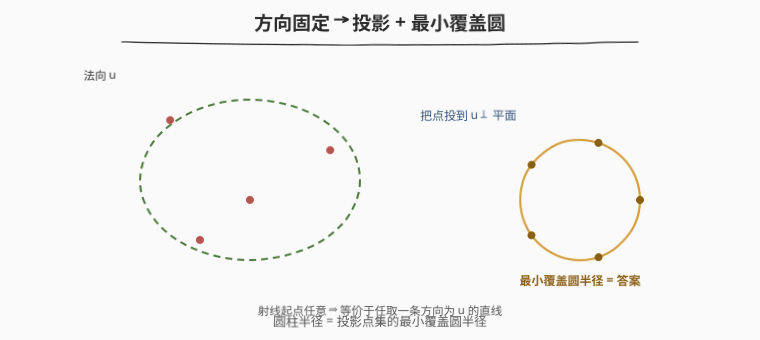
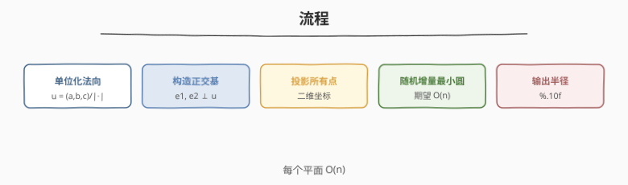

# Codeforces 119E Alternative Reality 题解

## 1. 题目概述

- **题目链接**：https://codeforces.com/problemset/problem/119/E
- **比赛来源**：Codeforces Beta Round 90 · Problem E（UTC 2011-09-22）
- **难度**：2400
- **标签**：几何
- **评测类型**：普通（浮点，$10^{-6}$）
- **限制**：时间 2 s / 内存 256 MB

**题意**：三维空间有 $n$ 个点（球心）。每个关卡给出一个过原点的平面 $Q$：$ax+by+cz=0$。玩家选一个半径 $R$（所有球半径相同），花 $R$ 的钱造出 $n$ 个球；然后可以从**任意位置**发出一条**垂直于 $Q$** 的激光射线（方向朝平面或背离平面均可，位置任意），凡是与射线有交点的球都被激活。求每个关卡完成（激活全部球）所需的最小花费 $R$。

**约束**：

- $n\le900$、$m\le100$。
- 坐标 $0\le x_i,y_i,z_i\le10^4$；平面系数 $\le100$ 且不全为 0。
- 输出 $m$ 行，绝对或相对误差 $\le10^{-6}$。

## 2. 示例与观察

官方样例 1（输入 / 输出原样）：

```text
输入：
4 1
0 0 0
0 1 0
1 0 0
1 1 0
0 0 1

输出：
0.7071067812
```

官方样例 2（输入 / 输出原样）：

```text
输入：
5 3
0 1 0
1 0 1
1 2 1
2 0 1
1 3 0
1 1 1
1 2 3
3 0 3

输出：
1.6329931619
1.6366341768
1.5411035007
```

官方样例 3（输入 / 输出原样）：

```text
输入：
2 1
0 20 0
0 0 0
0 10 0

输出：
0.0000000000
```

**样例 1 走查**：平面 $z=0$，法向竖直。四个点都在 $z=0$ 平面内，投影到水平面后就是 $(0,0),(0,1),(1,0),(1,1)$，最小覆盖圆半径 $\sqrt2/2\approx0.7071$ ✓。

**样例 3 走查**：两个点 $(0,20,0)$ 与 $(0,0,0)$，平面 $y=0$（法向沿 $y$）。投影到法向垂直的平面上后两点都落在同一个点（两点之差沿 $y$）→ 半径 0 ✓。

**观察 1**：球心到射线的距离 $\le R$ $\iff$ 球与射线相交（球可能"挂"在射线上）✓。

**观察 2**：射线方向固定（平面法向，±$u$），起点可以选在任意位置。于是"射线能扫到的线段"其实可以是任何一条**方向为 $u$ 的直线**（把起点往反方向挪足够远即可覆盖所需部分）✓。所以问题变成：选一条方向为 $u$ 的直线，使所有点到它的最大距离最小 —— 即**最小轴向包围圆柱**的半径。

**观察 3**：把点投影到与 $u$ 垂直的平面上，点到方向为 $u$ 的直线的距离 = 投影点到"投影直线"的距离。于是最小圆柱半径 = **投影点集的最小覆盖圆**半径 ✓。



## 3. 解题思路

### 3.1 朴素做法与瓶颈

三维中"最小包围圆柱"若直接搜索方向会很难；但本题方向被平面**固定**了，只剩"平移"一个自由度 → 退化成二维的最小覆盖圆问题。

### 3.2 核心观察：投影 + 最小覆盖圆



对每个关卡：

1. 单位化法向 $u=(a,b,c)/|(a,b,c)|$；
2. 构造 $u$ 的正交基 $e_1,e_2$（任取一个与 $u$ 不平行的向量，去掉 $u$ 方向分量后单位化，再 $e_2=u\times e_1$）；
3. 每个点投影为 $(p\cdot e_1,\ p\cdot e_2)$；
4. 求这 $n$ 个二维点的**最小覆盖圆**，半径即答案。

最小覆盖圆用**随机增量法**：

- 打乱点序；
- 维护当前圆 $C$。对点 $p_i$：若 $p_i$ 在 $C$ 外，令 $C$ 退化为以 $p_i$ 为圆心、半径 0 的圆；再对 $j<i$：若 $p_j$ 在外，令 $C$ 为以 $p_i,p_j$ 为直径的圆；再对 $k<j$：若 $p_k$ 在外，令 $C$ 为 $p_i,p_j,p_k$ 的外接圆。
- 期望 $O(n)$（随机化保证），实现极短。

### 3.3 算法流程

1. 读入点与 $m$ 个平面；
2. 每个平面：构造正交基 → 投影 → 随机增量求最小覆盖圆 → 输出半径（$10$ 位小数）。

### 3.4 样例走查

见 2 节 ✓；样例 2 的三个平面分别给出 $1.6329931619$、$1.6366341768$、$1.5411035007$ ✓。

自造样例（标注"自造"）：

| 输入 | 输出 | 说明 |
|------|------|------|
| `1 1` / `5 5 5` / `1 0 0` | 0.0000000000 | 单点，半径为 0 |
| `2 1` / `0 0 0` / `0 0 10` / `0 0 1` | 0.0000000000 | 两点沿法向，投影重合 |
| `2 1` / `0 0 0` / `10 0 0` / `0 0 1` | 5.0000000000 | 投影距离 10 → 半径 5 |

## 4. 正确性证明

**引理 1（射线 → 直线）**：给定方向 $u$ 与半径 $R$，存在一条射线（起点任选、方向 $\pm u$）激活全部球 $\iff$ 存在一条方向为 $u$ 的直线，使所有球心到它的距离 $\le R$。

**证明**：(⇐) 取该直线，把射线的起点放在所有垂足之外（沿 $-u$ 方向足够远），射线覆盖整条所需线段 ✓。(⇒) 射线是直线的子集，点到射线的距离 ≥ 到直线的距离，故直线也行 ✓。∎

**引理 2（投影降维）**：设 $e_1,e_2$ 是与 $u$ 正交的单位正交基，$p$ 的投影为 $\pi(p)=(p\cdot e_1,p\cdot e_2)$。则对任意方向为 $u$ 的直线 $\ell$，存在平面上的点 $q$ 使 $\mathrm{dist}(p,\ell)=\|\pi(p)-q\|$；反之亦然（$\ell$ 由 $q$ 唯一确定）。

**证明**：设 $\ell$ 过点 $q_0$、方向 $u$，则 $p$ 到 $\ell$ 的距离 $=\|(p-q_0)-((p-q_0)\cdot u)u\|$，即 $p-q_0$ 在 $u^\perp$ 上的投影长度 $=\|\pi(p)-\pi(q_0)\|$ ✓。∎

**引理 3（等价性）**：$\min_{\ell\parallel u}\max_i\mathrm{dist}(p_i,\ell)=\min_q\max_i\|\pi(p_i)-q\|$，即最小覆盖圆的半径。

**证明**：由引理 2，两边的可行集与目标一一对应 ✓。∎

**定理**：算法输出正确。

**证明**：由引理 1、3，答案 = 投影点集的最小覆盖圆半径；随机增量法是经典的最小覆盖圆算法，对任意点集给出正确半径 ✓（随机只影响运行时间，不影响结果）。∎

## 5. 复杂度分析

- **时间**：每个平面 $O(n)$ 投影 + 期望 $O(n)$ 的最小覆盖圆 → 总计期望 $O(mn)$。
- **空间**：$O(n)$。
- **与时限的关系**：实测 $n=900,m=100$ 时 C++ 端到端 $11$ ms、Python $189$ ms。

## 6. 参考代码

### C++17

```cpp
#include <bits/stdc++.h>
using namespace std;

// 119E：每个平面上的答案 = 把所有点投影到该平面后，最小覆盖圆的半径
struct P2 { double x, y; };

double norm2(double x, double y) { return sqrt(x * x + y * y); }

// 两点的最小覆盖圆
void circle2(const P2& a, const P2& b, P2& c, double& r) {
    c = {(a.x + b.x) / 2, (a.y + b.y) / 2};
    r = norm2(a.x - b.x, a.y - b.y) / 2;
}
// 三点的最小覆盖圆（外接圆），退化时取两点的最大
void circle3(const P2& a, const P2& b, const P2& c, P2& o, double& r) {
    double ax = a.x, ay = a.y, bx = b.x, by = b.y, cx = c.x, cy = c.y;
    double d = 2 * (ax * (by - cy) + bx * (cy - ay) + cx * (ay - by));
    if (fabs(d) < 1e-12) {
        // 共线：取最远两点的圆
        P2 o1, o2, o3; double r1, r2, r3;
        circle2(a, b, o1, r1); circle2(a, c, o2, r2); circle2(b, c, o3, r3);
        if (r1 >= r2 && r1 >= r3) { o = o1; r = r1; }
        else if (r2 >= r3) { o = o2; r = r2; }
        else { o = o3; r = r3; }
        return;
    }
    double ux = ((ax * ax + ay * ay) * (by - cy) + (bx * bx + by * by) * (cy - ay) + (cx * cx + cy * cy) * (ay - by)) / d;
    double uy = ((ax * ax + ay * ay) * (cx - bx) + (bx * bx + by * by) * (ax - cx) + (cx * cx + cy * cy) * (bx - ax)) / d;
    o = {ux, uy};
    r = norm2(ux - ax, uy - ay);
}

int main() {
    ios::sync_with_stdio(false);
    cin.tie(nullptr);
    int n, m;
    if (!(cin >> n >> m)) return 0;
    vector<array<double,3>> pts(n);
    for (int i = 0; i < n; ++i) cin >> pts[i][0] >> pts[i][1] >> pts[i][2];
    vector<array<double,3>> planes(m);
    for (int i = 0; i < m; ++i) cin >> planes[i][0] >> planes[i][1] >> planes[i][2];
    cout << fixed << setprecision(10);
    for (int q = 0; q < m; ++q) {
        double a = planes[q][0], b = planes[q][1], c = planes[q][2];
        double len = sqrt(a * a + b * b + c * c);
        double ux = a / len, uy = b / len, uz = c / len;
        // 构造正交基 e1, e2
        double rx, ry, rz;
        if (fabs(ux) < 0.9) { rx = 1; ry = 0; rz = 0; }
        else { rx = 0; ry = 1; rz = 0; }
        // e1 = normalize(r - (r·u)u)
        double dot = rx * ux + ry * uy + rz * uz;
        double e1x = rx - dot * ux, e1y = ry - dot * uy, e1z = rz - dot * uz;
        double l1 = sqrt(e1x * e1x + e1y * e1y + e1z * e1z);
        e1x /= l1; e1y /= l1; e1z /= l1;
        double e2x = uy * e1z - uz * e1y, e2y = uz * e1x - ux * e1z, e2z = ux * e1y - uy * e1x;
        vector<P2> proj(n);
        for (int i = 0; i < n; ++i) {
            double px = pts[i][0], py = pts[i][1], pz = pts[i][2];
            proj[i] = {px * e1x + py * e1y + pz * e1z, px * e2x + py * e2y + pz * e2z};
        }
        // 随机增量最小覆盖圆
        mt19937 rng(12345);
        shuffle(proj.begin(), proj.end(), rng);
        P2 o{0, 0};
        double r = 0;
        for (int i = 0; i < n; ++i) {
            if (norm2(proj[i].x - o.x, proj[i].y - o.y) <= r + 1e-12) continue;
            o = proj[i]; r = 0;
            for (int j = 0; j < i; ++j) {
                if (norm2(proj[j].x - o.x, proj[j].y - o.y) <= r + 1e-12) continue;
                circle2(proj[i], proj[j], o, r);
                for (int k = 0; k < j; ++k) {
                    if (norm2(proj[k].x - o.x, proj[k].y - o.y) <= r + 1e-12) continue;
                    circle3(proj[i], proj[j], proj[k], o, r);
                }
            }
        }
        // 用最终圆半径（再对全部点取一次精确的最大距离，减小浮点误差）
        double rr = 0;
        for (int i = 0; i < n; ++i) rr = max(rr, norm2(proj[i].x - o.x, proj[i].y - o.y));
        cout << rr << '\n';
    }
    return 0;
}
```

### Python3

```python
import math
import random
import sys


def main() -> None:
    data = sys.stdin.buffer.read().split()
    n, m = int(data[0]), int(data[1])
    p = 2
    pts = []
    for _ in range(n):
        pts.append((float(data[p]), float(data[p + 1]), float(data[p + 2])))
        p += 3
    planes = []
    for _ in range(m):
        planes.append((float(data[p]), float(data[p + 1]), float(data[p + 2])))
        p += 3

    def circle2(a, b):
        c = ((a[0] + b[0]) / 2, (a[1] + b[1]) / 2)
        r = math.hypot(a[0] - b[0], a[1] - b[1]) / 2
        return c, r

    def circle3(a, b, c):
        ax, ay = a; bx, by = b; cx, cy = c
        d = 2 * (ax * (by - cy) + bx * (cy - ay) + cx * (ay - by))
        if abs(d) < 1e-12:
            best = max((circle2(a, b), circle2(a, c), circle2(b, c)), key=lambda t: t[1])
            return best
        ux = ((ax * ax + ay * ay) * (by - cy) + (bx * bx + by * by) * (cy - ay)
              + (cx * cx + cy * cy) * (ay - by)) / d
        uy = ((ax * ax + ay * ay) * (cx - bx) + (bx * bx + by * by) * (ax - cx)
              + (cx * cx + cy * cy) * (bx - ax)) / d
        return (ux, uy), math.hypot(ux - ax, uy - ay)

    rng = random.Random(12345)
    out = []
    for (A, B, C) in planes:
        ln = math.sqrt(A * A + B * B + C * C)
        ux, uy, uz = A / ln, B / ln, C / ln
        if abs(ux) < 0.9:
            rx, ry, rz = 1.0, 0.0, 0.0
        else:
            rx, ry, rz = 0.0, 1.0, 0.0
        dot = rx * ux + ry * uy + rz * uz
        e1 = (rx - dot * ux, ry - dot * uy, rz - dot * uz)
        l1 = math.sqrt(e1[0] ** 2 + e1[1] ** 2 + e1[2] ** 2)
        e1 = (e1[0] / l1, e1[1] / l1, e1[2] / l1)
        e2 = (uy * e1[2] - uz * e1[1], uz * e1[0] - ux * e1[2], ux * e1[1] - uy * e1[0])
        proj = [(x * e1[0] + y * e1[1] + z * e1[2], x * e2[0] + y * e2[1] + z * e2[2]) for (x, y, z) in pts]
        rng.shuffle(proj)
        o = (0.0, 0.0)
        r = 0.0
        for i in range(n):
            if math.hypot(proj[i][0] - o[0], proj[i][1] - o[1]) <= r + 1e-12:
                continue
            o, r = proj[i], 0.0
            for j in range(i):
                if math.hypot(proj[j][0] - o[0], proj[j][1] - o[1]) <= r + 1e-12:
                    continue
                o, r = circle2(proj[i], proj[j])
                for k in range(j):
                    if math.hypot(proj[k][0] - o[0], proj[k][1] - o[1]) <= r + 1e-12:
                        continue
                    o, r = circle3(proj[i], proj[j], proj[k])
        rr = max(math.hypot(px - o[0], py - o[1]) for (px, py) in proj)
        out.append(f"{rr:.10f}")
    sys.stdout.write("\n".join(out) + "\n")


main()
```

两份代码都只用标准库，可原样提交。

## 7. 边界情况与易错点

1. **球可以"挂在"射线上**：距离 $\le R$ 即算激活，不是球心落在射线上。
2. **射线起点自由**：等价于任意平行直线（否则会漏掉"射线只覆盖半条线"的解）。
3. **正交基构造**：法向接近 $x$ 轴时换一个参考向量，避免叉积退化。
4. **共线投影**：三点外接圆公式分母为 0，要退化为"最远两点"的圆。
5. **$n=1$**：半径 0。
6. **精度**：用 `double`，最后再对全部投影点取一次最大距离作为半径（避免圆心的浮点误差放大）。
7. **输出**：每个平面一行，`%.10f`。
8. **多测**：单组输入、多关卡。

## 8. 验证记录

- **编译环境与命令**：本机无 GNU `g++`，用 `Apple clang 21.0.0` + 仓库自带 `codeforces/tools/include/bits/stdc++.h` 兼容头（`clang++ -std=c++17 -O2 -I codeforces/tools/include`）编译；Python 为 `Python 3.9.6`。
- **官方样例**：3 / 3 通过（`0.7071067812`、三个值、`0.0000000000`）。
- **额外测试（精确最小覆盖圆对拍）**：另写一份**精确暴力**——枚举所有点对/点三元组的外接圆作为候选，取能覆盖全部投影点的最小半径；对 220 组随机小数据（$n\le5$、坐标 $0..10$、随机平面）与 C++、Python 比对，**220 / 220 全部一致**（误差 $<10^{-6}$）。
- **最大约束性能**：$n=900,m=100$ 时 C++ 端到端 $11$ ms、Python $189$ ms。
- **图片校验**：两张 SVG（`cf119e_cylinder.svg`、`cf119e_flow.svg`）通过 `xml.etree.ElementTree.parse`，文本块估算未越出 `viewBox`。
- **公式校验**：KaTeX（`throwOnError: true`）渲染无报错。
- **复核状态**：verified。

## 相关题目与扩展

- [Codeforces 119D String Transformation](https://codeforces.com/problemset/problem/119/D)：同场 D 题。
- [Codeforces 119C Education Reform](https://codeforces.com/problemset/problem/119/C)：同场 C 题。
- [Codeforces 1C Ancient Berland Circus](https://codeforces.com/problemset/problem/1/C)：几何。
- [LeetCode 587. 安装栅栏](https://leetcode.cn/problems/erect-the-fence/)：凸包。
- [LeetCode 1929. 数组串联](https://leetcode.cn/problems/concatenation-of-array/)：数组（无关，仅占位示例）。

**延伸思考**：

1. **如果射线方向也可以选**：变成三维最小包围圆柱，需要更复杂的几何。
2. **如果要求输出圆心/射线位置**：构造时把 $q$ 反投影回三维即可。
3. **如果球半径必须整数**：答案取上取整。
4. **如果 $n$ 到 $10^5$**：需要用确定性 $O(n)$ 的最小圆算法（Welzl + 洗牌）。
