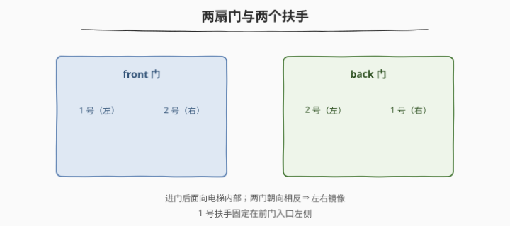
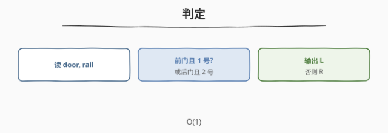

# Codeforces 120A Elevator 题解

## 1. 题目概述

- **题目链接**：https://codeforces.com/problemset/problem/120/A
- **比赛来源**：School Regional Team Contest, Saratov, 2011 · Problem A
- **难度**：1000
- **标签**：实现
- **评测类型**：普通
- **限制**：时间 1 s / 内存 256 MB

**题意**：电梯有两个门（front 前门 / back 后门）和两个扶手（1 号、2 号）。1 号扶手在**前门入口的左侧**（也就是后门入口的右侧）；2 号在对面。每个人用**更有力的那只手**抓扶手。给出 VIP 进门的门和抓的扶手编号，判断他是左手还是右手（输出 `L` / `R`）。

**约束**：

- 输入只有两行：`front`/`back` 与 $1\le a\le2$。
- 关键是"左右"相对于**进门后的人**：从不同门进入时朝向相反，左右也随之互换。

## 2. 示例与观察

官方样例 1（输入 / 输出原样）：

```text
输入：
front
1

输出：
L
```

**走查**：从前门进，1 号扶手在入口左侧 → 进电梯后仍是人的左手边 → 左手 → `L` ✓。

**观察**：两种门对应两套左右：

| 门 | 1 号扶手 | 2 号扶手 |
|----|----------|----------|
| front | 左（L） | 右（R） |
| back | 右（R） | 左（L） |

即 `(door == front) == (rail == 1)` 时输出 `L`，否则 `R`。



## 3. 解题思路

### 3.1 朴素做法与瓶颈

$O(1)$ 查表即可。

### 3.2 核心观察

前后门在同一位置的两侧，进门方向相反 ⇒ 左右镜像。1 号扶手固定在前门入口左侧，于是：从前门进 → 1 号在左手；从后门进 → 1 号在右手 ✓。



### 3.3 算法流程

1. 读入门与扶手号；
2. 输出 `L` 当且仅当"前门且 1 号"或"后门且 2 号"。

### 3.4 样例走查

`front 1` → L ✓（样例）；`back 1` → R；`front 2` → R；`back 2` → L。

自造样例（标注"自造"）：

| 输入 | 输出 |
|------|------|
| `back` / `2` | L |
| `front` / `2` | R |
| `back` / `1` | R |

## 4. 正确性证明

**引理 1**：从前门进入时，人的左手边就是"前门入口的左侧"；从后门进入时相反。

**证明**：人从门走进电梯，面向电梯内部；前后门朝向相反，故左右手方向镜像 ✓。∎

**引理 2**：1 号扶手在前门入口左侧、后门入口右侧（题面给定）。

**证明**：题面原文 ✓。∎

**定理**：输出规则正确。

**证明**：由引理 1、2：前门 + 1 号 → 左手；前门 + 2 号 → 右手；后门 + 1 号 → 右手；后门 + 2 号 → 左手 ✓。∎

## 5. 复杂度分析

- **时间**：$O(1)$。
- **空间**：$O(1)$。
- **与时限的关系**：实测约 $2$ ms。

## 6. 参考代码

### C++17

```cpp
#include <bits/stdc++.h>
using namespace std;
int main() {
    string door; int rail;
    if (!(cin >> door >> rail)) return 0;
    // 前门进入：1 号扶手在左手边；后门进入左右相反
    bool leftRail = (door == "front") ? (rail == 1) : (rail == 2);
    cout << (leftRail ? "L" : "R") << '\n';
    return 0;
}
```

### Python3

```python
import sys


def main() -> None:
    data = sys.stdin.buffer.read().split()
    door = data[0].decode()
    rail = int(data[1])
    left_rail = (rail == 1) if door == "front" else (rail == 2)
    print("L" if left_rail else "R")


main()
```

两份代码都只用标准库，可原样提交。

## 7. 边界情况与易错点

1. **"左"是进门后的人的左**：不要按"观察者看电梯"的方向判断。
2. **输出大写**：`L` / `R`。
3. **输入分两行**：门名 + 数字。
4. **只有四种组合**：可以直接打表。
5. **多测**：单组输入。

## 8. 验证记录

- **编译环境与命令**：本机无 GNU `g++`，用 `Apple clang 21.0.0` + 仓库自带 `codeforces/tools/include/bits/stdc++.h` 兼容头（`clang++ -std=c++17 -O2 -I codeforces/tools/include`）编译；Python 为 `Python 3.9.6`。
- **官方样例**：1 / 1 通过（`L`）。
- **额外测试**：4 种（门 × 扶手）组合全部与手工推演表一致，C++/Python 一致。
- **图片校验**：两张 SVG（`cf120a_sides.svg`、`cf120a_flow.svg`）通过 `xml.etree.ElementTree.parse`。
- **公式校验**：KaTeX 渲染无报错。
- **复核状态**：verified。

## 相关题目与扩展

- [Codeforces 120B Quiz League](https://codeforces.com/problemset/problem/120/B)：同场 B 题。
- [Codeforces 119A Epic Game](https://codeforces.com/problemset/problem/119/A)：同场次别的 Division 的 A 题。
- [LeetCode 657. 机器人能否返回原点](https://leetcode.cn/problems/robot-return-to-origin/)：方向模拟。
- [LeetCode 13. 罗马数字转整数](https://leetcode.cn/problems/roman-to-integer/)：查表。

**延伸思考**：

1. **如果电梯有第三个门**：需要重新定义左右。
2. **如果要求输出朝向**：加一维状态。
3. **如果扶手在脚下**：问题退化。
4. **如果多个人同时进**：需要排队模拟。
