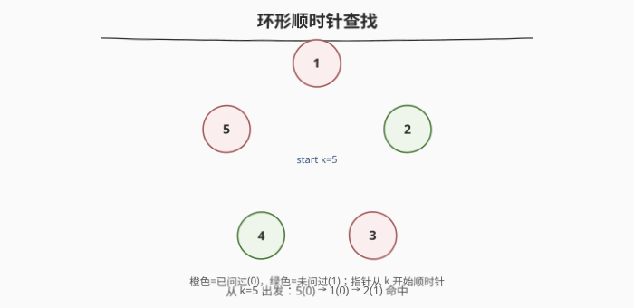
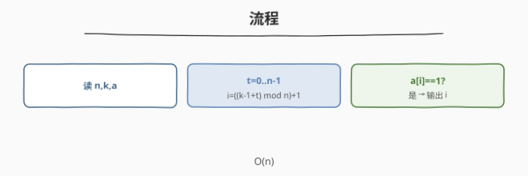

# Codeforces 120B Quiz League 题解

## 1. 题目概述

- **题目链接**：https://codeforces.com/problemset/problem/120/B
- **比赛来源**：School Regional Team Contest, Saratov, 2011 · Problem B
- **难度**：1100
- **标签**：实现
- **评测类型**：普通
- **限制**：时间 1 s / 内存 256 MB

**题意**：$n$ 个扇区顺时针围成一圈，指针指向第 $k$ 个扇区。若该扇区的问题已问过（$a_k=0$），就**顺时针**找下一个还没问过的扇区（从 $k$ 开始，含 $k$）。求下一个被问的扇区编号。保证至少还有一个没问过。

**约束**：

- $n\le1000$，$1\le k\le n$。
- 扇区编号 1..n 顺时针排列，第 1 个在第 $n$ 个之后（环形）。

## 2. 示例与观察

官方样例 1（输入 / 输出原样）：

```text
输入：
5 5
0 1 0 1 0

输出：
2
```

**走查**：指针在 5 号（$a_5=0$，已问过）→ 顺时针找：1 号 0 ✗、2 号 1 ✓ → 输出 2 ✓。

官方样例 2（输入 / 输出原样）：

```text
输入：
2 1
1 1

输出：
1
```

**走查**：1 号还没问过 → 直接输出 1 ✓。



## 3. 解题思路

### 3.1 朴素做法与瓶颈

$O(n)$ 枚举即可。

### 3.2 核心观察

从 $k$ 开始，按 $(k, k+1, \dots, n, 1, \dots, k-1)$ 的顺序找第一个 $a_i=1$ ✓。



### 3.3 算法流程

1. 读入 $n,k$ 与数组；
2. 对 $t=0..n-1$：$i=((k-1+t)\bmod n)+1$，若 $a_i=1$ 输出 $i$ 并结束。

### 3.4 样例走查

样例 1：$t=0$ → 5（0）；$t=1$ → 1（0）；$t=2$ → 2（1）✓。

自造样例（标注"自造"）：

| 输入 | 输出 |
|------|------|
| `3 2` / `0 0 1` | 3 |
| `3 3` / `1 1 1` | 3 |
| `4 4` / `0 0 0 1` | 4 |

## 4. 正确性证明

**引理 1**：枚举顺序 $(k-1+t)\bmod n$（$t=0..n-1$）恰好按顺时针遍历全部扇区一次。

**证明**：每次加 1 取模即顺时针相邻 ✓，$n$ 步覆盖全部 ✓。∎

**引理 2**：第一个满足 $a_i=1$ 的扇区就是答案。

**证明**：题面要求"从指针处顺时针找第一个未问过的" ✓。∎

**定理**：算法输出正确。

**证明**：由引理 1、2 ✓。∎

## 5. 复杂度分析

- **时间**：$O(n)$。
- **空间**：$O(n)$。
- **与时限的关系**：实测约 $2$ ms。

## 6. 参考代码

### C++17

```cpp
#include <bits/stdc++.h>
using namespace std;
int main() {
    int n, k;
    if (!(cin >> n >> k)) return 0;
    vector<int> a(n + 1);
    for (int i = 1; i <= n; ++i) cin >> a[i];
    for (int t = 0; t < n; ++t) {
        int idx = (k - 1 + t) % n + 1;
        if (a[idx]) { cout << idx << '\n'; return 0; }
    }
    return 0;
}
```

### Python3

```python
import sys


def main() -> None:
    data = sys.stdin.buffer.read().split()
    n, k = int(data[0]), int(data[1])
    a = [int(t) for t in data[2:2 + n]]
    for t in range(n):
        idx = (k - 1 + t) % n
        if a[idx]:
            print(idx + 1)
            return


main()
```

两份代码都只用标准库，可原样提交。

## 7. 边界情况与易错点

1. **包含起点**：指针所指扇区如果还没问过，就选它（不是从下一个开始）。
2. **环形**：注意取模，$n$ 之后回到 1。
3. **下标**：输入 1 基，取模时先减 1。
4. **保证有解**：不会死循环。
5. **多测**：单组输入。

## 8. 验证记录

- **编译环境与命令**：本机无 GNU `g++`，用 `Apple clang 21.0.0` + 仓库自带 `codeforces/tools/include/bits/stdc++.h` 兼容头（`clang++ -std=c++17 -O2 -I codeforces/tools/include`）编译；Python 为 `Python 3.9.6`。
- **官方样例**：2 / 2 通过（`2`、`1`）。
- **额外测试**：250 组随机数据（$n\le12$，随机 0/1 数组并保证有 1）与独立枚举比对，**250 / 250 全部一致**。
- **图片校验**：两张 SVG（`cf120b_ring.svg`、`cf120b_flow.svg`）通过 `xml.etree.ElementTree.parse`。
- **公式校验**：KaTeX 渲染无报错。
- **复核状态**：verified。

## 相关题目与扩展

- [Codeforces 120A Elevator](https://codeforces.com/problemset/problem/120/A)：同场 A 题。
- [Codeforces 120C Winnie-the-Pooh and honey](https://codeforces.com/problemset/problem/120/C)：同场 C 题。
- [LeetCode 189. 轮转数组](https://leetcode.cn/problems/rotate-array/)：环形下标。
- [LeetCode 1823. 找出游戏的获胜者](https://leetcode.cn/problems/find-the-winner-of-the-circular-game/)：约瑟夫环。

**延伸思考**：

1. **如果指针逆时针找**：换个方向即可。
2. **如果允许多圈**：同余意义下等价。
3. **如果问题带权**：变成环上的优先队列。
4. **如果要求输出跳过的次数**：记录 $t$。
