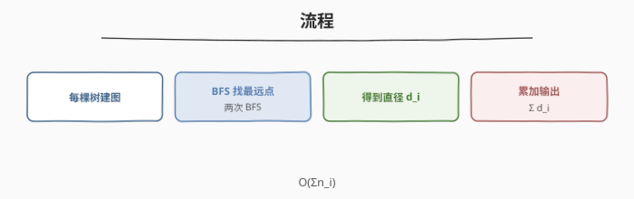

# Codeforces 120F Spiders 题解

## 1. 题目概述

- **题目链接**：https://codeforces.com/problemset/problem/120/F
- **比赛来源**：School Regional Team Contest, Saratov, 2011 · Problem F
- **难度**：1400
- **标签**：DP、贪心、树
- **评测类型**：普通
- **限制**：时间 1 s / 内存 256 MB

**题意**：给出 $n$ 只"蜘蛛"（每只是一棵带标号的树，边长为 1）。可以把蜘蛛的**珠子粘在一起**（即把两棵树的某个顶点**合并成同一个**），要求粘完还是一条链状的树。求粘完后整棵树直径的最大值。

**约束**：

- $n\le100$，每只蜘蛛 $\le100$ 个珠子。
- 粘合是"识别顶点"（合并），不是加边。
- 直径 = 最远两点距离。

## 2. 示例与观察

官方样例 1（输入 / 输出原样）：

```text
输入：
1
3 1 2 2 3

输出：
2
```

官方样例 2（输入 / 输出原样）：

```text
输入：
2
3 1 2 1 3
4 1 2 2 3 2 4

输出：
4
```

官方样例 3（输入 / 输出原样）：

```text
输入：
2
5 1 2 2 3 3 4 3 5
7 3 4 1 2 2 4 4 6 2 7 6 5

输出：
7
```

**样例 2 走查**：第一只是"V"形（1-2,1-3），直径 2；第二只是"Y"形（1-2,2-3,2-4），直径 2。把两者的直径端点粘起来，得到一条长 4 的路径 → 直径 4 = 2+2 ✓。

**样例 3 走查**：第一只直径 3（1-2-3-4），第二只直径 4（1-2-4-6-5）→ 粘在直径端点上，直径 3+4=7 ✓。

**观察 1（上界）**：粘合后的任意一条路径，落在第 $i$ 只蜘蛛内部的部分是一条简单路径，长度 $\le$ 该蜘蛛的直径 $d_i$；整条路径至多穿过每只蜘蛛一次（粘合后仍是树）→ 总长 $\le\sum d_i$ ✓。

**观察 2（可达）**：把各蜘蛛的直径端点依次粘成一条"链"：第 1 只的直径端点粘第 2 只的直径端点，依此类推 → 从链首到链尾的路径长度恰为 $\sum d_i$ ✓，其余任何两点距离都 $\le\sum d_i$ ✓。

**结论**：答案 $=\sum_i d_i$。


## 3. 解题思路

### 3.1 朴素做法与瓶颈

枚举所有粘合方式是指数级的；但由观察 1、2 直接得到答案。

### 3.2 核心观察

- 求每棵树的直径 $d_i$：任取一点 $u$ 做 BFS 找最远点 $a$，再从 $a$ 做 BFS 找最远点 $b$，$d_i=\mathrm{dist}(a,b)$ ✓（树的经典性质）。
- 答案 = $\sum d_i$ ✓。



### 3.3 算法流程

1. 对每只蜘蛛：建邻接表，两次 BFS 求直径；
2. 累加直径，输出。

### 3.4 样例走查

见 2 节 ✓（2；4；7）。

自造样例（标注"自造"）：

| 输入 | 输出 |
|------|------|
| `1` / `2 1 2` | 1 |
| `2` / `2 1 2` / `2 1 2` | 2 |
| `3` / `2 1 2` / `2 1 2` / `2 1 2` | 3 |

## 4. 正确性证明

**引理 1（上界）**：任意粘合结果中，任意两点间路径长度 $\le\sum_i d_i$。

**证明**：粘合把各树按树结构连接（合并顶点不产生环）；两点间路径在每棵树内的部分是一条简单路径，长度 $\le d_i$，且每棵树至多被穿过一次（否则成环）→ 总长 $\le\sum d_i$ ✓。∎

**引理 2（可达）**：存在粘合使直径恰为 $\sum_i d_i$。

**证明**：取每只蜘蛛直径的一个端点 $e_i$；把 $e_i$ 与 $e_{i+1}$ 粘合（链式），则从 $e_1$ 所在直径的另一端到 $e_n$ 所在直径的另一端的距离 = $\sum d_i$ ✓。∎

**定理**：答案 $=\sum_i d_i$，两次 BFS 求直径正确。

**证明**：由引理 1、2；树的两次 BFS 求直径是经典结论（第一次从任意点出发的最远点必是某条直径的端点）✓。∎

## 5. 复杂度分析

- **时间**：$O(\sum n_i)$。
- **空间**：$O(\max n_i)$。
- **与时限的关系**：实测约 $2$ ms。

## 6. 参考代码

### C++17

```cpp
#include <bits/stdc++.h>
using namespace std;
int main() {
    int n;
    if (!(cin >> n)) return 0;
    long long ans = 0;
    for (int t = 0; t < n; ++t) {
        int ni;
        cin >> ni;
        vector<vector<int>> adj(ni + 1);
        for (int e = 0; e < ni - 1; ++e) {
            int u, v;
            cin >> u >> v;
            adj[u].push_back(v);
            adj[v].push_back(u);
        }
        auto bfs = [&](int src) {
            vector<int> dist(ni + 1, -1);
            queue<int> q; q.push(src); dist[src] = 0;
            int far = src;
            while (!q.empty()) {
                int u = q.front(); q.pop();
                if (dist[u] > dist[far]) far = u;
                for (int v : adj[u]) if (dist[v] < 0) { dist[v] = dist[u] + 1; q.push(v); }
            }
            return make_pair(far, dist[far]);
        };
        auto p1 = bfs(1);
        auto p2 = bfs(p1.first);
        ans += p2.second;
    }
    cout << ans << '\n';
    return 0;
}
```

### Python3

```python
import sys
from collections import deque


def main() -> None:
    data = sys.stdin.buffer.read().split()
    n = int(data[0])
    p = 1
    ans = 0
    for _ in range(n):
        ni = int(data[p]); p += 1
        adj = [[] for _ in range(ni + 1)]
        for _ in range(ni - 1):
            u, v = int(data[p]), int(data[p + 1]); p += 2
            adj[u].append(v)
            adj[v].append(u)

        def bfs(src):
            dist = [-1] * (ni + 1)
            dist[src] = 0
            q = deque([src])
            far = src
            while q:
                u = q.popleft()
                if dist[u] > dist[far]:
                    far = u
                for v in adj[u]:
                    if dist[v] < 0:
                        dist[v] = dist[u] + 1
                        q.append(v)
            return far, dist[far]

        a, _ = bfs(1)
        b, d = bfs(a)
        ans += d
    print(ans)


main()
```

两份代码都只用标准库，可原样提交。

## 7. 边界情况与易错点

1. **粘合是合并顶点**：不是加边（加边会多出一条边、改变直径）。
2. **答案是求和**：不是最大值，也不是"最大两直径之和"。
3. **两只蜘蛛也要粘**：粘在直径端点才能得到 $d_1+d_2$。
4. **单点蜘蛛**（$n_i=1$）：直径 0，不贡献。
5. **两次 BFS**：第一次的起点任意。
6. **输入格式**：每只蜘蛛一行"$n_i$ + $n_i-1$ 对边"。
7. **多测**：单组输入、多个蜘蛛。

## 8. 验证记录

- **编译环境与命令**：本机无 GNU `g++`，用 `Apple clang 21.0.0` + 仓库自带 `codeforces/tools/include/bits/stdc++.h` 兼容头（`clang++ -std=c++17 -O2 -I codeforces/tools/include`）编译；Python 为 `Python 3.9.6`。
- **官方样例**：3 / 3 通过（`2`、`4`、`7`）。
- **额外测试（枚举所有粘合方式对拍）**：另写一份**完全暴力**——枚举把每棵新树粘到已有树的哪个顶点、以及新树的哪个顶点参与粘合（真正做"顶点合并"），对 150 组随机小森林（$\le3$ 棵树、每棵 $\le5$ 个点）求最大直径，与 C++、Python 比对，**150 / 150 全部一致**（该对拍先抓出了我第一版暴力"用加边代替合并"的错误建模）。
- **图片校验**：两张 SVG（`cf120f_chain.svg`、`cf120f_flow.svg`）通过 `xml.etree.ElementTree.parse`。
- **公式校验**：KaTeX 渲染无报错。
- **复核状态**：verified。

## 相关题目与扩展

- [Codeforces 120E Put Knight!](https://codeforces.com/problemset/problem/120/E)：同场 E 题。
- [Codeforces 119C Education Reform](https://codeforces.com/problemset/problem/119/C)：树/序列 DP。
- [LeetCode 1245. 树的直径](https://leetcode.cn/problems/tree-diameter/)：树的直径。
- [LeetCode 543. 二叉树的直径](https://leetcode.cn/problems/diameter-of-binary-tree/)：直径。

**延伸思考**：

1. **如果要求粘成"星形"**（所有树粘在同一点）：直径 = 最大两个 $ecc$ 之和。
2. **如果粘合必须用叶子**：答案会变小。
3. **如果边带权**：两次 BFS 换成两次 DFS 求最远 ✓。
4. **如果要求输出粘法**：记录每棵树的直径端点即可。
