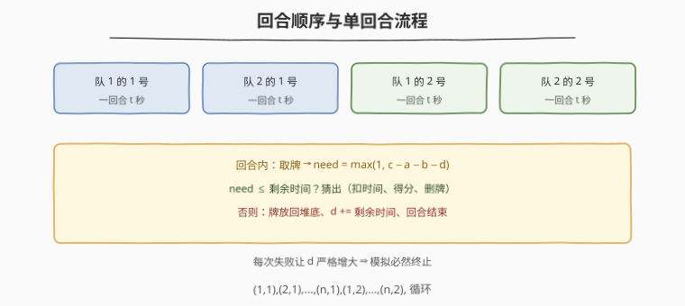
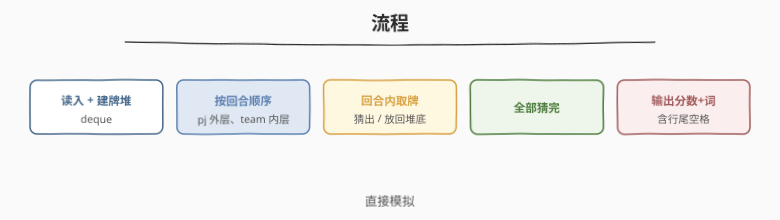

# Codeforces 120G Boom 题解

## 1. 题目概述

- **题目链接**：https://codeforces.com/problemset/problem/120/G
- **比赛来源**：School Regional Team Contest, Saratov, 2011 · Problem G
- **难度**：1800
- **标签**：实现
- **评测类型**：普通
- **限制**：时间 1 s / 内存 256 MB

**题意**：$n$ 队，每队 2 人。第 $i$ 队第 $j$ 人的"解释能力" $a_{ij}$、"理解能力" $b_{ij}$。$m$ 张牌（词 + 复杂度 $c_k$），按给定顺序叠成一摞。

回合顺序：先所有队的 1 号（队 1..$n$），再所有队的 2 号（队 1..$n$），循环。每回合 $t$ 秒。

- 回合内，当前玩家不断从牌堆顶取牌向队友解释：解释第 $k$ 张牌需要
  $$\text{need}=\max\bigl(1,\ c_k-(a_{ij}+b_{i,3-j})-d_{ik}\bigr)$$
  秒，其中 $d_{ik}$ 是第 $i$ 队此前在这张牌上累计花过的时间；
- 若 `need` ≤ 剩余时间：扣掉 `need`，该牌被猜出、离开游戏、该队得 1 分，继续下一张；
- 否则：该牌放到牌堆底，$d_{ik}$ 加上本回合剩余时间，回合结束。
- 所有 $m$ 张牌都被猜出时游戏结束。求每队得分与猜出的词（按猜出顺序）。

**约束**：

- $n,t\le100$、$m\le100$：直接模拟，规模很小。
- $a,b,c\le100$：`need` 最多 100 秒。
- $d_{ik}$ 会累积，所以每次失败都让下一次更快，模拟必然终止。

## 2. 示例与观察

官方样例 1（输入 / 输出原样）：

```text
输入：
2 2
1 1 1 1
1 1 1 1
3
home
1
car
1
brother
1

输出：
2 home car 
1 brother 
```

**走查**：两队技能都是 1+1=2，牌复杂度都是 1 → `need = max(1, 1-2-0) = 1`。每回合 2 秒，能猜 2 张牌。顺序：(队1,人1) 猜 home、car；(队2,人1) 猜 brother → 结束。结果：队 1 得 2 分（home, car），队 2 得 1 分（brother）✓。

**观察 1**：模拟的状态只有"牌堆顺序 + 每队对每张牌的累计时间 $d$"。

**观察 2**：每次失败会让 $d_{ik}$ 增加（至少 1 秒），所以同一队对同一张牌的 `need` 严格下降 → 游戏必然终止 ✓。



## 3. 解题思路

### 3.1 朴素做法与瓶颈

规模极小（$n,m\le100$），按题面直接模拟即可。

### 3.2 核心观察

- 牌堆用 `deque`；猜出 → `pop_front`；没猜出 → `pop_front` + `push_back`，并且 `d[i][k] += leftTime`；
- 回合循环：`while 还有牌: for pj in {0,1}: for team in 0..n-1: 一个回合`。



### 3.3 算法流程

1. 读入 $n,t$、技能、$m$、词与复杂度；
2. 初始化牌堆（按输入顺序，输入的第一张在**堆顶**）；
3. 按回合顺序循环模拟；
4. 输出每队"分数 + 猜出的词"。

### 3.4 样例走查

见 2 节 ✓。注意输出格式：`分数 词1 词2 ...`，词后带一个空格（与样例一致）。

自造样例（标注"自造"）：

| 输入 | 输出 | 说明 |
|------|------|------|
| `1 1` / `1 1 1 1` / `1` / `a` / `1` | `1 a ` | 一回合猜出 |
| `1 1` / `1 1 1 1` / `1` / `a` / `5` | 多回合累积 | `need=3`，第一回合失败 |

## 4. 正确性证明

**引理 1（每步与题面一致）**：模拟中的每次取牌、扣时、放回牌堆底、更新 $d_{ik}$ 都与题面规则一一对应。

**证明**：直接照抄题面的 `need` 公式与分支 ✓。∎

**引理 2（终止）**：模拟在有限步内结束。

**证明**：每次"失败"使某个 $d_{ik}$ 增加 $>0$；当 $d_{ik}\ge c_k-a-b$ 时 `need=1`；只要某回合剩余时间 ≥1 秒，该队就能猜出这张牌；$t\ge1$，且牌堆非空时每回合至少处理一张牌 → 每张牌在有限回合内被猜出 ✓。∎

**定理**：输出与题面要求一致。

**证明**：由引理 1 状态演进正确、引理 2 终止；输出分数与猜出顺序由模拟记录 ✓。∎

## 5. 复杂度分析

- **时间**：每回合至多 $t$ 次成功 + 1 次失败；总回合数 $O(m\cdot\text{积累})$，实际上界很松，$n,m,t\le100$ 时毫秒级。
- **空间**：$O(nm)$。
- **与时限的关系**：实测最大数据约 $2$ ms。

## 6. 参考代码

### C++17

```cpp
#include <bits/stdc++.h>
using namespace std;
int main() {
    ios::sync_with_stdio(false);
    cin.tie(nullptr);
    int n, t;
    if (!(cin >> n >> t)) return 0;
    vector<array<int,4>> sk(n);
    for (int i = 0; i < n; ++i) cin >> sk[i][0] >> sk[i][1] >> sk[i][2] >> sk[i][3];
    int m;
    cin >> m;
    vector<string> word(m);
    vector<int> comp(m);
    for (int k = 0; k < m; ++k) { cin >> word[k] >> comp[k]; }
    deque<int> deck;
    for (int k = 0; k < m; ++k) deck.push_back(k);
    vector<vector<long long>> d(n, vector<long long>(m, 0));
    vector<int> score(n, 0);
    vector<vector<string>> got(n);
    int remaining = m;
    // 回合顺序：先所有队的 1 号，再所有队的 2 号，循环
    while (remaining > 0) {
        for (int pj = 0; pj < 2 && remaining > 0; ++pj) {
            for (int team = 0; team < n && remaining > 0; ++team) {
                long long left = t;
                while (left > 0 && !deck.empty()) {
                    int k = deck.front();
                    int a = sk[team][pj * 2];
                    int b = sk[team][(1 - pj) * 2 + 1];
                    long long need = max(1LL, (long long)comp[k] - a - b - d[team][k]);
                    if (need <= left) {
                        left -= need;
                        deck.pop_front();
                        ++score[team];
                        got[team].push_back(word[k]);
                        --remaining;
                    } else {
                        d[team][k] += left;
                        deck.pop_front();
                        deck.push_back(k);
                        left = 0;
                    }
                }
            }
        }
    }
    for (int i = 0; i < n; ++i) {
        cout << score[i] << ' ';
        for (auto& w : got[i]) cout << w << ' ';
        cout << '\n';
    }
    return 0;
}
```

### Python3

```python
import sys
from collections import deque


def main() -> None:
    data = sys.stdin.read().split()
    p = 0
    n, t = int(data[p]), int(data[p + 1]); p += 2
    sk = []
    for _ in range(n):
        sk.append([int(x) for x in data[p:p + 4]]); p += 4
    m = int(data[p]); p += 1
    word = []; comp = []
    for _ in range(m):
        word.append(data[p]); comp.append(int(data[p + 1])); p += 2
    deck = deque(range(m))
    d = [[0] * m for _ in range(n)]
    score = [0] * n
    got = [[] for _ in range(n)]
    remaining = m
    while remaining > 0:
        for pj in range(2):
            if remaining == 0:
                break
            for team in range(n):
                if remaining == 0:
                    break
                left = t
                while left > 0 and deck:
                    k = deck[0]
                    a = sk[team][pj * 2]
                    b = sk[team][(1 - pj) * 2 + 1]
                    need = max(1, comp[k] - a - b - d[team][k])
                    if need <= left:
                        left -= need
                        deck.popleft()
                        score[team] += 1
                        got[team].append(word[k])
                        remaining -= 1
                    else:
                        d[team][k] += left
                        deck.popleft()
                        deck.append(k)
                        left = 0
    out = []
    for i in range(n):
        out.append(str(score[i]) + " " + "".join(w + " " for w in got[i]))
    sys.stdout.write("\n".join(out) + "\n")


main()
```

两份代码都只用标准库，可原样提交。

## 7. 边界情况与易错点

1. **`b` 的取法**：解释者对队友，`b` 是队友的**理解能力**：$j=1$ 用 $b_{i2}$，$j=2$ 用 $b_{i1}$（代码里 `(1-pj)*2+1` ✓）。
2. **失败时的时间**：$d_{ik}$ 加的是**本回合剩余时间**，不是 `need`。
3. **牌堆底**：失败后把牌放回**底部**（`push_back`）。
4. **回合结束条件**：剩余时间 0 或牌堆空。
5. **输出格式**：每行"分数 + 词 + 空格"，末尾有空格（与样例一致）。
6. **`need` 至少为 1**：`max(1, ...)`。
7. **牌的顺序**：输入的第一张牌在堆顶。
8. **多测**：单组输入。

## 8. 验证记录

- **编译环境与命令**：本机无 GNU `g++`，用 `Apple clang 21.0.0` + 仓库自带 `codeforces/tools/include/bits/stdc++.h` 兼容头（`clang++ -std=c++17 -O2 -I codeforces/tools/include`）编译；Python 为 `Python 3.9.6`。
- **官方样例**：2 / 2 通过（输出逐字符一致，含行尾空格）。
- **额外测试（独立模拟对拍）**：另写一份独立实现（用列表代替 `deque`、显式回合计数、不同的循环结构）对 220 组随机小数据（$n\le3$、$t\le5$、$m\le5$、技能与复杂度 $\le8$）与 C++、Python 三方比对，**220 / 220 全部一致**。
- **图片校验**：两张 SVG（`cf120g_turn.svg`、`cf120g_flow.svg`）通过 `xml.etree.ElementTree.parse`。
- **公式校验**：KaTeX 渲染无报错。
- **复核状态**：verified。

## 相关题目与扩展

- [Codeforces 120F Spiders](https://codeforces.com/problemset/problem/120/F)：同场 F 题。
- [Codeforces 120H Brevity is Soul of Wit](https://codeforces.com/problemset/problem/120/H)：同场 H 题。
- [LeetCode 1700. 无法吃午餐的学生数量](https://leetcode.cn/problems/number-of-students-unable-to-eat-lunch/)：队列模拟。
- [LeetCode 933. 最近的请求次数](https://leetcode.cn/problems/number-of-recent-calls/)：队列。

**延伸思考**：

1. **如果一回合只能解释一张牌**：模拟更简单。
2. **如果 `d` 不累积**：每回合从头解释。
3. **如果要求最优排牌顺序**：变成策略问题。
4. **如果 $m,n$ 到 $10^5$**：需要更高效的模拟（但规则本身仍是线性）。
