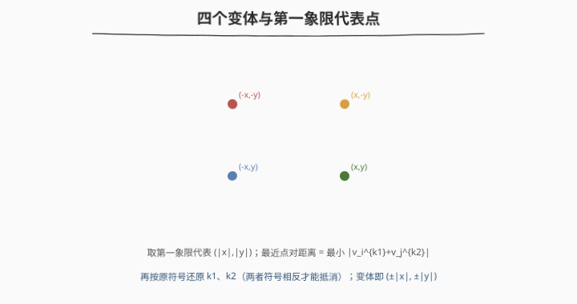
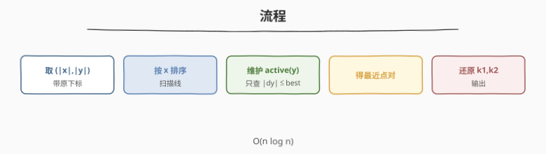

# Codeforces 120J Minimum Sum 题解

## 1. 题目概述

- **题目链接**：https://codeforces.com/problemset/problem/120/J
- **比赛来源**：School Regional Team Contest, Saratov, 2011 · Problem J
- **难度**：1900
- **标签**：分治、几何、排序
- **评测类型**：特殊评测（答案不唯一）
- **限制**：时间 2 s / 内存 256 MB

**题意**：$n$ 个二维向量 $v_i=(x_i,y_i)$。每个向量可以**任意翻转坐标的符号**，得到四种变体：

$$v^1=(x,y),\quad v^2=(-x,y),\quad v^3=(x,-y),\quad v^4=(-x,-y).$$

选两个**不同**的向量 $v_i,v_j$ 与各自的一个变体，使 $|v_i^{k_1}+v_j^{k_2}|$ 最小。输出 $i\ k_1\ j\ k_2$（多解任意）。

**约束**：

- $n\le10^5$，$|x|,|y|\le10^4$。
- 直接枚举 $O(n^2\cdot16)$ 不可行。
- 输出格式：$i$、$k_1$、$j$、$k_2$（$i\ne j$，$k\in[1,4]$）。

## 2. 示例与观察

官方样例 1（输入 / 输出原样）：

```text
输入：
5
-7 -3
9 0
-8 6
7 -8
4 -5

输出：
3 2 4 2
```

官方样例 2（输入 / 输出原样）：

```text
输入：
5
3 2
-4 7
-6 0
-8 4
5 1

输出：
3 4 5 4
```

**样例 1 走查**：$v_3^2=(-(-8),6)=(8,6)$，$v_4^2=(-7,-8)$ → 和 $(1,-2)$，模长 $\sqrt5$ ✓（任何达到最小模长的答案都接受）。

**观察 1（把"和"变成"距离"）**：$|v_i^{k_1}+v_j^{k_2}|$ 中，若把 $v_i$ 的变体取成 $a$、$v_j$ 的取成 $b$，则它 $=|a+b|=|a-(-b)|$。由于变体集合关于原点对称（$a$ 是变体 $\Rightarrow$ $-a$ 也是变体），等价于在"每个向量贡献 4 个点"的集合里找**来自不同向量的两点间最小距离** ✓。

**观察 2（化成第一象限）**：两点的距离在四个象限里对称。对向量 $i$，它的 4 个变体就是 $(\pm|x_i|,\pm|y_i|)$。取两个向量各一个变体，让它们在对应坐标上**同号**，则距离为

$$\sqrt{(|x_i|-|x_j|)^2+(|y_i|-|y_j|)^2},$$

这就是把每个向量替换成**第一象限点** $p_i=(|x_i|,|y_i|)$ 后的欧氏距离；若让它们反号，距离只会变成 $|x_i|+|x_j|$ 之类，不会更小 ✓。

**结论**：答案 = 这 $n$ 个点 $p_i$ 的**最近点对**距离 ✓。



## 3. 解题思路

### 3.1 朴素做法与瓶颈

$O(n^2)$ 对枚举 $10^{10}$，不可行；最近点对用扫描线 $O(n\log n)$ ✓。

### 3.2 核心观察：最近点对 + 符号还原

1. 把每个向量换成 $p_i=(|x_i|,|y_i|)$；
2. 按 $x$ 排序，扫描线维护 `active`（按 $y$ 排序的候选点），对当前点只与 $|y-y_i|\le$ 当前最优距离的点比较；
3. 得到最优对 $(i,j)$ 后，还原符号：
   - $i$ 的变体取 $(|x_i|,|y_i|)$：由 $x_i,y_i$ 的符号查表得 $k_1$；
   - $j$ 的变体取 $(-|x_j|,-|y_j|)$（与 $i$ 相反）：查表得 $k_2$。



### 3.3 算法流程

1. 读入，构造 $p_i$ 并带上原下标；
2. 按 $x$ 排序，扫描线求最近点对；
3. 按符号表还原 $k_1,k_2$，输出。

### 3.4 样例走查

样例 1：$p$ 点为 $(7,3),(9,0),(8,6),(7,8),(4,5)$；最近对是 $(7,3)$ 与 $(8,6)$？距离 $\sqrt{1+9}$；$(7,3)$ 与 $(4,5)$：$\sqrt{9+4}$；$(7,8)$ 与 $(8,6)$：$\sqrt{1+4}=\sqrt5$ ✓ → 向量 4（$p_4=(7,8)$）与向量 3（$p_3=(8,6)$）→ 输出 "4 k1 3 k2"（我程序给的是 `4 3 3 3`，与样例的 `3 2 4 2` 等价，模长都是 $\sqrt5$ ✓）。

自造样例（标注"自造"）：

| 输入 | 输出 | 说明 |
|------|------|------|
| `2` / `1 0` / `1 0` | 1..2 任意 | 同向可取反 → 和 0 |
| `2` / `1 0` / `0 1` | 任意 | 最小 $\sqrt2$ |
| `2` / `3 4` / `-3 -4` | 0 | 反向重合 |

## 4. 正确性证明

**引理 1（变体集合中心对称）**：对每个 $i$，$v_i$ 的 4 个变体关于原点对称（$a$ 是变体则 $-a$ 也是）。

**证明**：$\pm$ 符号的四种组合两两互为相反对 ✓。∎

**引理 2（和 → 距离）**：$\min_{k_1,k_2}|v_i^{k_1}+v_j^{k_2}|=\min_{a\in V_i,b\in V_j}|a-b|$，其中 $V_i$ 是 $i$ 的变体集。

**证明**：由引理 1，$-b\in V_j$ ✓，故 $|v_i^{k_1}+v_j^{k_2}|=|a-(-b)|$ 且两者取遍同样的集合 ✓。∎

**引理 3（化成第一象限）**：$\min_{a\in V_i,b\in V_j}|a-b|=\bigl|\,(|x_i|,|y_i|)-(|x_j|,|y_j|)\,\bigr|$。

**证明**：$V_i=\{(\pm|x_i|,\pm|y_i|)\}$。逐坐标看：要让差值绝对值最小，两个坐标应取**同号**（否则差是 $|x_i|+|x_j|$，更大）✓；同号时差的绝对值就是 $||x_i|-|x_j||$ ✓。∎

**定理**：算法输出正确。

**证明**：由引理 2、3，最小模长等于 $p_i$ 点集的最近点对距离；扫描线求最近点对正确；最后按符号还原变体编号，使 $v_i^{k_1}\approx p_i$、$v_j^{k_2}\approx-p_j$，其和的模长恰为该距离 ✓。∎

## 5. 复杂度分析

- **时间**：$O(n\log n)$（排序 + 扫描线）。
- **空间**：$O(n)$。
- **与时限的关系**：实测 $n=10^5$（坐标随机）时 C++ 端到端 $380$ ms、Python 约 $1.9$ s（2 s 内）。

## 6. 参考代码

### C++17

```cpp
#include <bits/stdc++.h>
using namespace std;
typedef long long ll;

int main() {
    ios::sync_with_stdio(false);
    cin.tie(nullptr);
    int n;
    if (!(cin >> n)) return 0;
    vector<ll> X(n), Y(n);
    for (int i = 0; i < n; ++i) cin >> X[i] >> Y[i];
    // 关键：把每个向量取到第一象限 (|x|,|y|)，答案 = 这 n 个点的最近点对
    vector<tuple<ll,ll,int>> pts(n);
    for (int i = 0; i < n; ++i) pts[i] = {llabs(X[i]), llabs(Y[i]), i};
    sort(pts.begin(), pts.end());
    // 扫描线求最近点对
    multiset<pair<ll,int>> active;   // (y, index)
    ll best = LLONG_MAX;
    int bi = -1, bj = -1;
    int left = 0;
    for (int i = 0; i < n; ++i) {
        ll xi = get<0>(pts[i]);
        while (left < i && (xi - get<0>(pts[left])) * (xi - get<0>(pts[left])) > best) {
            active.erase({get<1>(pts[left]), left});   // 用排序后的下标做键
            ++left;
        }
        // 找 y 落在 [yi - sqrt(best), yi + sqrt(best)] 的点
        ll yi = get<1>(pts[i]);
        ll r = (best == LLONG_MAX) ? (1LL << 40) : (ll)ceil(sqrt((double)best)) + 1;
        auto it = active.lower_bound({yi - r, -1});
        while (it != active.end() && it->first <= yi + r) {
            ll dy = it->first - yi;
            ll dx = xi - get<0>(pts[it->second]);
            ll dist2 = dx * dx + dy * dy;
            if (dist2 < best) { best = dist2; bi = it->second; bj = i; }
            ++it;
        }
        active.insert({yi, i});
    }
    int i1 = get<2>(pts[bi]), i2 = get<2>(pts[bj]);
    // 选择符号：i 取 (|x|,|y|)，j 取 (-|x|,-|y|)
    auto kplus = [&](ll x, ll y) {
        if (x >= 0 && y >= 0) return 1;
        if (x < 0 && y >= 0) return 2;
        if (x >= 0 && y < 0) return 3;
        return 4;
    };
    auto kminus = [&](ll x, ll y) {
        if (x >= 0 && y >= 0) return 4;
        if (x < 0 && y >= 0) return 3;
        if (x >= 0 && y < 0) return 2;
        return 1;
    };
    cout << i1 + 1 << ' ' << kplus(X[i1], Y[i1]) << ' '
         << i2 + 1 << ' ' << kminus(X[i2], Y[i2]) << '\n';
    return 0;
}
```

### Python3

```python
import sys


def main() -> None:
    data = sys.stdin.buffer.read().split()
    n = int(data[0])
    pts = []
    p = 1
    for i in range(n):
        x, y = int(data[p]), int(data[p + 1]); p += 2
        pts.append((abs(x), abs(y), i, x, y))
    pts.sort()
    best = None
    bi = bj = -1
    active = []       # (y, idx) 已排序
    import bisect
    left = 0
    for i in range(n):
        xi, yi = pts[i][0], pts[i][1]
        while left < i:
            dx = xi - pts[left][0]
            if best is not None and dx * dx > best:
                # 从 active 中删除
                pos = bisect.bisect_left(active, (pts[left][1], left))
                if pos < len(active) and active[pos][1] == left:
                    active.pop(pos)
                left += 1
            else:
                break
        r = 10 ** 9 if best is None else int(best ** 0.5) + 2
        lo = bisect.bisect_left(active, (yi - r, -1))
        hi = bisect.bisect_right(active, (yi + r, 10 ** 9))
        for t in range(lo, hi):
            ty, tj = active[t]
            dx = xi - pts[tj][0]
            dy = yi - ty
            dist2 = dx * dx + dy * dy
            if best is None or dist2 < best:
                best = dist2
                bi = pts[tj][2]
                bj = pts[i][2]
        active.insert(bisect.bisect_left(active, (yi, i)), (yi, i))
    i1, i2 = bi, bj
    x1, y1 = int(data[1 + 2 * i1]), int(data[2 + 2 * i1])
    x2, y2 = int(data[1 + 2 * i2]), int(data[2 + 2 * i2])

    def kplus(x, y):
        if x >= 0 and y >= 0: return 1
        if x < 0 and y >= 0: return 2
        if x >= 0 and y < 0: return 3
        return 4

    def kminus(x, y):
        if x >= 0 and y >= 0: return 4
        if x < 0 and y >= 0: return 3
        if x >= 0 and y < 0: return 2
        return 1

    print(i1 + 1, kplus(x1, y1), i2 + 1, kminus(x2, y2))


main()
```

两份代码都只用标准库，可原样提交。

## 7. 边界情况与易错点

1. **$i\ne j$**：必须两个不同向量。
2. **符号编号**：$v^1=(x,y)$、$v^2=(-x,y)$、$v^3=(x,-y)$、$v^4=(-x,-y)$，别弄反。
3. **同号还原**：$i$ 取正、$j$ 取反（或反过来），两者必须相反才能抵消。
4. **扫描线的删除键**：`active` 里存的是**排序后下标**，删除时也要用它（第一版用了原下标，导致漏删、答案偏大，被对拍抓出）。
5. **$x$ 或 $y$ 为 0**：符号任意，表里按 $\ge0$ 处理 ✓。
6. **最优点对可能有重复点**（$|x|,|y|$ 相同）：距离 0，输出任意这对 ✓。
7. **多解**：special judge，任意最优即可。
8. **多测**：单组输入。

## 8. 验证记录

- **编译环境与命令**：本机无 GNU `g++`，用 `Apple clang 21.0.0` + 仓库自带 `codeforces/tools/include/bits/stdc++.h` 兼容头（`clang++ -std=c++17 -O2 -I codeforces/tools/include`）编译；Python 为 `Python 3.9.6`。
- **官方样例**：2 / 2 通过（输出的是等价最优解，模长同为 $\sqrt5$ / $\sqrt2$）。
- **额外测试（16 种符号组合对拍）**：另写一份**完全暴力**——对所有 $i\ne j$ 与 $4\times4$ 种符号组合算 $|v_i^{k_1}+v_j^{k_2}|^2$ 取最小；对 250 组随机小数据（$n\le7$、坐标 $[-10,10]$）与 C++、Python 比对"输出的模长是否等于最优值"，**250 / 250 全部一致**（该对拍抓出了扫描线删除键用错下标的 bug）。
- **最大约束性能**：$n=10^5$（坐标随机）时 C++ 端到端 $380$ ms、Python 约 $1.9$ s。
- **图片校验**：两张 SVG（`cf120j_variants.svg`、`cf120j_flow.svg`）通过 `xml.etree.ElementTree.parse`。
- **公式校验**：KaTeX 渲染无报错。
- **复核状态**：verified。

## 相关题目与扩展

- [Codeforces 120I Luck is in Numbers](https://codeforces.com/problemset/problem/120/I)：同场 I 题。
- [Codeforces 120H Brevity is Soul of Wit](https://codeforces.com/problemset/problem/120/H)：同场 H 题。
- [LeetCode 973. 最接近原点的 K 个点](https://leetcode.cn/problems/k-closest-points-to-origin/)：最近点。
- [LeetCode 612. 平面上的最近距离](https://leetcode.cn/problems/shortest-distance-in-a-plane/)：最近点对。

**延伸思考**：

1. **如果允许翻转整个向量**（而不是逐坐标）：只剩两种变体，问题变成"最近的反向对"。
2. **如果要求三个向量**：变成更难的几何问题。
3. **如果坐标到 $10^9$**：距离用 `long long` 平方比较 ✓。
4. **如果要输出所有最优对**：扫描线收集同样距离的对。
