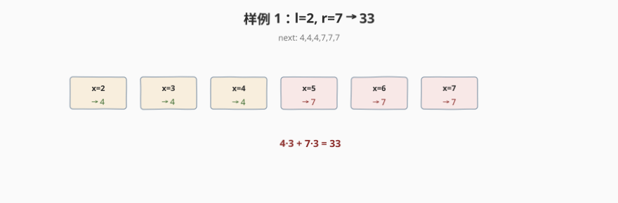

# Codeforces 121A 幸运数下一个之和 题解

## 1. 题目概述

- **题目链接**：https://codeforces.com/problemset/problem/121/A
- **比赛来源**：Codeforces Beta Round 91 (Div. 1 Only) · Problem A（UTC 2011-10-27）
- **难度**：1100
- **标签**：枚举、数学
- **评测类型**：普通
- **限制**：时间 2 s / 内存 256 MB

**题意**：幸运数 = 十进制只含 4 和 7 的数。记 $next(x)$ 为最小的 $\ge x$ 的幸运数，求 $\sum_{x=l}^{r} next(x)$。

**约束**：

- $l,r\le10^9$：$next(r)$ 最大到 $4444444444$（10 位），必须用 64 位。
- 幸运数个数很少（$2+4+\dots+2^{10}=2046$）。
- 单组数据。

## 2. 示例与观察

官方样例一：

```text
输入：
2 7
输出：
33
```

官方样例二：

```text
输入：
7 7
输出：
7
```

**样例一走查**：$next(2)=next(3)=next(4)=4$，$next(5)=next(6)=next(7)=7$ → $4\times3+7\times3=33$ ✓。


**观察**：$next(x)$ 在每个区间 $(\text{prev},\ v]$ 上恒等于 $v$（$v$ 是幸运数）。所以按幸运数分段求和即可。

## 3. 解题思路

### 3.1 朴素做法与瓶颈

逐个 $x$ 求 $next$：$r-l$ 可达 $10^9$，且每次要找下一个幸运数，太慢。

### 3.2 核心观察：按幸运数分段



把幸运数升序排成 $v_1<v_2<\dots$，令 $v_0=0$。对每个 $i$：

$$next(x)=v_i\quad\Longleftrightarrow\quad v_{i-1}<x\le v_i .$$

于是区间 $[l,r]$ 与 $(v_{i-1},v_i]$ 的交长为 $c$ 时，贡献 $c\cdot v_i$。

### 3.3 算法流程

1. 生成长度 $1..10$ 的全部幸运数（$2046$ 个），排序；
2. 对每个 $v_i$：$lo=\max(l,\ v_{i-1}+1)$、$hi=\min(r,\ v_i)$，若 $lo\le hi$ 则累加 $(hi-lo+1)\cdot v_i$；
3. 输出（可能超过 32 位）。

### 3.4 样例走查

| $x$ | 2 | 3 | 4 | 5 | 6 | 7 |
|---|---|---|---|---|---|---|
| $next$ | 4 | 4 | 4 | 7 | 7 | 7 |

合计 $33$ ✓；样例二 $l=r=7$ → $next(7)=7$ ✓。

## 4. 正确性证明

**引理 1**：$next(x)=v_i$ 当且仅当 $v_{i-1}<x\le v_i$。

**证明**：$v_i\ge x$ 且比 $v_i$ 小的幸运数都 $<x$，故 $v_i$ 是最小的 $\ge x$ 的幸运数 ✓。∎

**引理 2**：这些区间 $(v_{i-1},v_i]$ 两两不交且并集为 $[1,+\infty)$（就整数而言）。

**证明**：$v_i$ 严格递增，区间首尾相接 ✓。∎

**定理**：按上式累加得到的正是 $\sum_{x=l}^r next(x)$。

**证明**：由引理 1、2，每个 $x\in[l,r]$ 恰好落入一个区间并贡献 $v_i$ ✓。∎

## 5. 复杂度分析

- **时间**：$O(2^{11})$ 枚举 + $O(2046)$ 求和。
- **空间**：$O(2046)$。
- **数值范围**：答案 $\le 10^9\cdot4.4\times10^9\approx4\times10^{18}$，需 64 位（C++ 用 `__int128` 输出更稳）。
- **与时限的关系**：2 s 下实测约 $2$ ms（C++），Python 约 $23$ ms。

## 6. 参考代码

### C++17

```cpp
#include <bits/stdc++.h>
using namespace std;
typedef long long ll;
typedef __int128 lll;

int main() {
    ll l, r;
    if (scanf("%lld %lld", &l, &r) != 2) return 0;
    // 生成所有幸运数（最多 10 位）
    vector<ll> lk;
    for (int len = 1; len <= 10; ++len) {
        for (int mask = 0; mask < (1 << len); ++mask) {
            ll v = 0;
            for (int i = 0; i < len; ++i) v = v * 10 + (((mask >> i) & 1) ? 7 : 4);
            lk.push_back(v);
        }
    }
    sort(lk.begin(), lk.end());
    lll ans = 0;
    for (size_t i = 0; i < lk.size(); ++i) {
        ll lo = (i == 0) ? 1 : lk[i - 1] + 1;   // next(x) = lk[i] 当 x in (lk[i-1], lk[i]]
        ll hi = lk[i];
        ll a = max(l, lo), b = min(r, hi);
        if (a > b) continue;
        ans += (lll)(b - a + 1) * lk[i];
    }
    // 输出 __int128
    if (ans == 0) { printf("0\n"); return 0; }
    string s;
    while (ans > 0) { s.push_back((char)('0' + (int)(ans % 10))); ans /= 10; }
    reverse(s.begin(), s.end());
    printf("%s\n", s.c_str());
    return 0;
}
```

### Python3

```python
import sys


def main() -> None:
    data = sys.stdin.buffer.read().split()
    if not data:
        return
    l = int(data[0]); r = int(data[1])
    lk = []
    for length in range(1, 11):
        for mask in range(1 << length):
            v = 0
            for i in range(length):
                v = v * 10 + (7 if (mask >> i) & 1 else 4)
            lk.append(v)
    lk.sort()
    ans = 0
    for i, hi in enumerate(lk):
        lo = 1 if i == 0 else lk[i - 1] + 1      # next(x) = hi 当 lo <= x <= hi
        a = max(l, lo); b = min(r, hi)
        if a > b:
            continue
        ans += (b - a + 1) * hi
    sys.stdout.write(str(ans) + "\n")


main()
```

## 7. 边界情况与易错点

1. **分段方向**：$next(x)=v_i$ 对应 $(v_{i-1},v_i]$，不是 $[v_i,v_{i+1})$（这是最常见的错）。
2. **$l=1$**：$v_0=0$ → 区间 $(0,4]$ ✓。
3. **$r=10^9$**：$next(r)=4444444444$（10 位），幸运数要生成到 10 位。
4. **溢出**：答案约 $4\times10^{18}$，`long long` 处于边界，用 `__int128` 更安全。
5. **$l=r$**：只算一个 $next$。
6. **幸运数个数**：$2^{11}-2=2046$，别只生成到 9 位。

## 8. 验证记录

- **编译环境与命令**：`clang++ -std=c++17 -O2`（Apple clang 21.0.0 + `codeforces/tools/include` 的兼容头），Python 3.9.6。
- **官方样例**：2 / 2 通过（`33`、`7`），C++ 与 Python 输出一致。
- **独立暴力对拍**：暴力对每个 $x$ 线性找最小 $\ge x$ 的幸运数（与分段求和不 同），$l\le500$、区间长 $\le80$ 的 **260 组**数据全部一致。
- **最大约束性能**：$l=1,r=10^9$ 时 C++ 约 $2$ ms，Python 约 $23$ ms。
- **图片校验**：`cf121a_intervals.svg`、`cf121a_sample.svg` 均通过 `xml.etree.ElementTree.parse`，含 `feTurbulence` 与手写体字体族，文本包围盒未越出 `viewBox`。
- **公式校验**：KaTeX（`throwOnError`）渲染无报错；无 `---` 分隔线。
- **复核状态**：verified（样例、对拍、性能、图片、公式均实跑通过）。

## 相关题目与扩展

- [Codeforces 121B Lucky Transformation](https://codeforces.com/problemset/problem/121/B)、[121C Lucky Permutation](https://codeforces.com/problemset/problem/121/C)、[121D Lucky Segments](https://codeforces.com/problemset/problem/121/D)、[121E Lucky Array](https://codeforces.com/problemset/problem/121/E)：同场其余题。
- [Codeforces 122A Lucky Division](https://codeforces.com/problemset/problem/122/A)、[122B Lucky Substring](https://codeforces.com/problemset/problem/122/B)：同轮 Div.2。
- [Codeforces 110A Nearly Lucky Number](https://codeforces.com/problemset/problem/110/A)：幸运数判定。
- [LeetCode 3153. 所有数对中数位差之和](https://leetcode.cn/problems/sum-of-digit-differences-of-all-pairs/)：按数位分段计数。

**延伸思考**：

1. **如果求 $next$ 的和但 $r$ 到 $10^{18}$**：分段数变成 $2^{19}$，仍可枚举。
2. **如果求 $\sum next(x)^2$**：同样的分段，换成平方和。
3. **如果幸运数字集合换成 $\{3,5\}$**：只需换生成规则。
4. **如果要求 $prev(x)$**：分段改成 $[v_i, v_{i+1})$。

