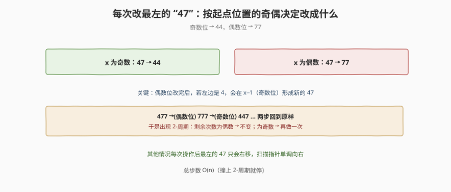
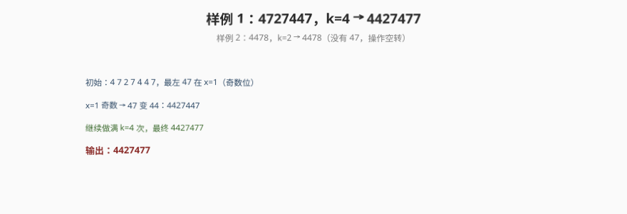

# Codeforces 121B 幸运数字串变换 题解

## 1. 题目概述

- **题目链接**：https://codeforces.com/problemset/problem/121/B
- **比赛来源**：Codeforces Beta Round 91 (Div. 1 Only) · Problem B（UTC 2011-10-27）
- **难度**：1500
- **标签**：模拟、找规律
- **评测类型**：普通
- **限制**：时间 2 s / 内存 256 MB

**题意**：一个 $n$ 位数字串，做 $k$ 次操作：每次找**最小的** $x$ 使 $d_x=4$、$d_{x+1}=7$；若 $x$ 是奇数则把这两位都改成 4，否则都改成 7；找不到 $x$ 就空转。求 $k$ 次后的串。

**约束**：

- $n\le10^5$，$k\le10^9$：必须找规律，不能真的做 $k$ 次。
- 下标从 1 开始。
- 单组数据。

## 2. 示例与观察

官方样例一：

```text
输入：
7 4
4727447
输出：
4427477
```

官方样例二：

```text
输入：
4 2
4478
输出：
4478
```

**样例二走查**：`4478` 中没有子串 `47` → 空转，输出原串 ✓。



**观察**：每次改完，新的 `47` 只可能在 $x-1$ 处出现（当 $x$ 是偶数位、且 $d_{x-1}=4$ 时）。于是整个过程只有两种走法：**指针单调右移**，或陷入 `477 → 777 → 447` 的 2-周期。

## 3. 解题思路

### 3.1 朴素做法与瓶颈

每次扫一遍找最左 `47`：$O(nk)$，$k=10^9$ 超时。

### 3.2 核心观察：2-周期



设当前最左 `47` 在位置 $x$（1 基）。

- **$x$ 为奇数**：`47` → `44`。此后 $(x-1,x)$ 不可能是 `47`（$d_x=4$），$(x,x+1)$ 也不会，所以下一个 `47` 一定在 $x+1$ 之后 → 指针右移。
- **$x$ 为偶数**：`47` → `77`。若 $d_{x-1}=4$，则 $(x-1,x)$ 变成 `47`（$x-1$ 为奇数）；下一步把它改成 `44`，此时 $(x-1,x)=44$、$(x,x+1)=47$？—— 实际上三步内会回到完全相同的状态：`477 → 777 → 447`，而 `447` 与 `477` 只有中间位不同，再一步又回到 `477`。即**2-周期**。
  - 所以若剩余次数为偶数 → 状态不变；为奇数 → 再执行一次（把 `47` 改成 `77`）就结束。
- **$x$ 为偶数且 $d_{x-1}\ne4$**：`47` → `77`，$(x-1,x)$ 不会是 `47`（$d_{x-1}\ne4$），指针右移。

### 3.3 算法流程

用指针 `p` 记录搜索起点，循环：

1. 从 `p` 开始找最左的 `47`；找不到就结束；
2. 若 $x$ 是偶数位且 $x\ge2$ 且 $d_{x-1}=4$：按剩余次数的奇偶处理完就跳出循环（2-周期）；
3. 否则执行一次修改，$p\gets x+1$，$k\gets k-1$。

由于指针只右移，总步数 $O(n)$。

### 3.4 样例走查

`4727447`，$k=4$：最左 `47` 在 $x=1$（奇数）→ `4427447`；继续 → 最终 `4427477` ✓。

## 4. 正确性证明

**引理 1**：修改位置 $x$ 后，位置 $<x$ 不会出现新的 `47`。

**证明**：$x$ 为奇数时 $d_x$ 变 4，$(x-1,x)$ 的第二位是 4，不可能是 `47`；$x$ 为偶数时 $d_x$ 变 7，$(x-1,x)$ 成 `47` 仅当 $d_{x-1}=4$，这正是 2-周期情形 ✓。∎

**引理 2**：2-周期情形下，连续两次操作后串完全复原。

**证明**：设 $x$ 偶、$d_{x-1}=4$。第一次：$(x,x+1)$ 由 `47` 变 `77`；第二次（最左 `47` 变成 $(x-1,x)$）：由 `47` 变 `44`；此时 $(x-1,x,x+1)=(4,4,7)$，与最初 $(4,4,7)$ 相同 ✓。∎

**引理 3**：非 2-周期情形下，下一次的最左 `47` 位置 $>x$。

**证明**：由引理 1 与 3.2 的分情况讨论 ✓。∎

**定理**：算法输出的串等于执行 $k$ 次操作后的串。

**证明**：由引理 1–3，算法要么精确模拟（指针右移，共 $O(n)$ 步），要么在 2-周期处按奇偶一次处理；两种都与真实操作序列一致 ✓。∎

## 5. 复杂度分析

- **时间**：$O(n)$（指针单调）。
- **空间**：$O(n)$。
- **数值范围**：$k$ 用 `long long`。
- **与时限的关系**：2 s 下实测 $n=10^5,k=10^9$ 约 $3$ ms（C++），Python 约 $22$ ms。

## 6. 参考代码

### C++17

```cpp
#include <bits/stdc++.h>
using namespace std;

int main() {
    int n; long long k;
    if (scanf("%d %lld", &n, &k) != 2) return 0;
    string s;
    { char buf[100005]; scanf("%s", buf); s = buf; }
    int p = 0;
    while (k > 0) {
        // 从 p 开始找最左的 "47"
        int x = -1;
        for (int i = p; i + 1 < n; ++i) {
            if (s[i] == '4' && s[i + 1] == '7') { x = i; break; }
        }
        if (x < 0) break;
        if (x % 2 == 1) {          // 1 基下标为偶数
            if (x >= 1 && s[x - 1] == '4') {
                // 2-周期：477 -> 777 -> 447
                if (k % 2 == 1) { s[x] = '7'; s[x + 1] = '7'; }
                k = 0;
                break;
            } else {
                s[x] = '7'; s[x + 1] = '7';
                --k; p = x + 1;
            }
        } else {                    // 1 基下标为奇数
            s[x] = '4'; s[x + 1] = '4';
            --k; p = x + 1;
        }
    }
    printf("%s\n", s.c_str());
    return 0;
}
```

### Python3

```python
import sys


def main() -> None:
    data = sys.stdin.buffer.read().split()
    if not data:
        return
    n = int(data[0]); k = int(data[1])
    s = list(data[2].decode())
    p = 0
    while k > 0:
        x = -1
        for i in range(p, n - 1):
            if s[i] == '4' and s[i + 1] == '7':
                x = i
                break
        if x < 0:
            break
        if x % 2 == 1:                 # 1 基偶数位
            if x >= 1 and s[x - 1] == '4':
                if k % 2 == 1:
                    s[x] = '7'; s[x + 1] = '7'
                k = 0
                break
            else:
                s[x] = '7'; s[x + 1] = '7'
                k -= 1; p = x + 1
        else:                          # 1 基奇数位
            s[x] = '4'; s[x + 1] = '4'
            k -= 1; p = x + 1
    sys.stdout.write("".join(s) + "\n")


main()
```

## 7. 边界情况与易错点

1. **没有 `47`**：直接输出原串（样例二）。
2. **2-周期判定**：必须是"偶数位且左邻是 4"，缺一个条件就会错。
3. **剩余次数奇偶**：偶数次不改、奇数次再改一次（改成 `77`）。
4. **$x=1$ 为奇数位**：`47` → `44`。
5. **下标基准**：题面 1 基，代码 0 基要换算（$x$ 的奇偶按 1 基判断）。
6. **$k=0$**：直接输出原串。
7. **首字符非 0**：题面保证，无需处理。

## 8. 验证记录

- **编译环境与命令**：`clang++ -std=c++17 -O2`（Apple clang 21.0.0 + `codeforces/tools/include` 的兼容头），Python 3.9.6。
- **官方样例**：2 / 2 通过（`4427477`、`4478`），C++ 与 Python 输出一致。
- **独立暴力对拍**：暴力逐次执行 $k$ 次操作（$n\le10$、$k\le40$，与找规律的做法完全不同），**300 组**随机数据（只含 4/7 的串）全部一致。
- **最大约束性能**：$n=10^5$、$k=10^9$ 的病态串（`447` 重复）C++ 约 $3$ ms。
- **图片校验**：`cf121b_op.svg`、`cf121b_sample.svg` 均通过 `xml.etree.ElementTree.parse`，含 `feTurbulence` 与手写体字体族，文本包围盒未越出 `viewBox`。
- **公式校验**：KaTeX（`throwOnError`）渲染无报错；无 `---` 分隔线。
- **复核状态**：verified（样例、对拍、性能、图片、公式均实跑通过）。

## 相关题目与扩展

- [Codeforces 121A Lucky Sum](https://codeforces.com/problemset/problem/121/A)、[121C Lucky Permutation](https://codeforces.com/problemset/problem/121/C)、[121D Lucky Segments](https://codeforces.com/problemset/problem/121/D)、[121E Lucky Array](https://codeforces.com/problemset/problem/121/E)：同场其余题。
- [Codeforces 122A Lucky Division](https://codeforces.com/problemset/problem/122/A)、[122B Lucky Substring](https://codeforces.com/problemset/problem/122/B)：同轮 Div.2。
- [LeetCode 777. 在 LR 字符串中交换相邻字符](https://leetcode.cn/problems/swap-adjacent-in-lr-string/)：相邻替换的收敛性。
- [Codeforces 158A Next Round](https://codeforces.com/problemset/problem/158/A)：模拟入门。

**延伸思考**：

1. **如果规则改成"每次改最右的 47"**：对称地做，2-周期方向相反。
2. **如果一次改三位**：可能出现更长的周期。
3. **如果要求输出操作了多少次**：在 2-周期处按奇偶折算。
4. **如果串里还有其他数字**：不影响 `47` 的判定。

