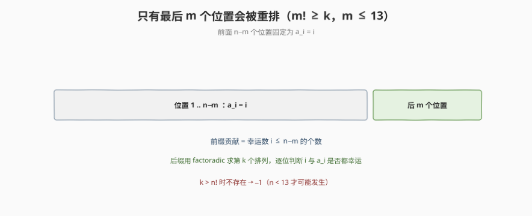
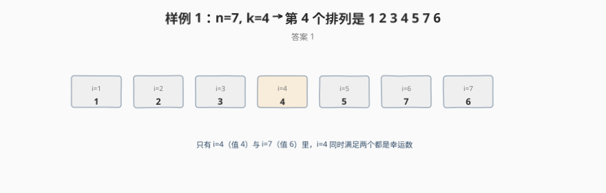

# Codeforces 121C 第 k 个排列的幸运位 题解

## 1. 题目概述

- **题目链接**：https://codeforces.com/problemset/problem/121/C
- **比赛来源**：Codeforces Beta Round 91 (Div. 1 Only) · Problem C（UTC 2011-10-27）
- **难度**：1900
- **标签**：组合数学、康托展开、枚举
- **评测类型**：普通
- **限制**：时间 2 s / 内存 256 MB

**题意**：求 $1..n$ 字典序第 $k$ 个排列（不存在输出 `-1`），并统计有多少个位置 $i$ 满足 $i$ 与 $a_i$ 都是幸运数。

**约束**：

- $n,k\le10^9$：$n!$ 巨大，但 $k\le10^9<13!$，只有最后 $\le13$ 个位置会被重排。
- 幸运数判定逐位即可。
- 单组数据。

## 2. 示例与观察

官方样例一：

```text
输入：
7 4
输出：
1
```

官方样例二：

```text
输入：
4 7
输出：
1
```

**样例一走查**：$1..7$ 的第 4 个排列是 $1,2,3,4,5,7,6$。逐位看：$i=4$ 时 $a_4=4$（都幸运 ✓）；$i=7$ 时 $a_7=6$（6 不是幸运数 ✗）；其余位置 $i$ 不是幸运数 → 答案 $1$ ✓。

**样例二走查**：$n=4$，$4!=24\ge7$，第 7 个排列是 $2,1,3,4$？——按康托展开计算，答案位置只有 $i=4$（$a_4=4$）✓ → $1$ ✓。



**观察**：若 $m! \ge k$ 且 $m\le n$，则前 $n-m$ 个位置固定为 $a_i=i$，只有后 $m$ 个位置在 $k$ 个排列里变化。

## 3. 解题思路

### 3.1 朴素做法与瓶颈

生成第 $k$ 个排列：$n$ 可达 $10^9$，不可能。

### 3.2 核心观察：前缀固定 + 后缀康托展开



1. 求最小的 $m$ 使 $m!\ge k$（$m\le13$）。若 $m>n$ → 第 $k$ 个排列不存在 → `-1`；
2. 位置 $1..n-m$ 上 $a_i=i$ → 这些位置中幸运的 $i$ 的个数就是"幸运数 $\le n-m$ 的个数"；
3. 后缀值集合是 $\{n-m+1,\dots,n\}$，用康托展开（factoradic）求第 $k$ 个排列；
4. 逐位检查后缀中 $i$ 与 $a_i$ 是否都幸运。

### 3.3 样例走查

$n=7,k=4$：$3! = 6\ge4$ → $m=3$；前缀 $1..4$ 固定，其中幸运数只有 $4$ → 贡献 $1$；后缀 $\{5,6,7\}$ 的第 4 个排列是 $(7,5,6)$ → 位置 $5,6,7$ 都不是幸运数 → 总答案 $1$ ✓。

## 4. 正确性证明

**引理 1**：$n$ 个元素的字典序排列中，前 $n-m$ 个位置固定当且仅当 $k\le m!$。

**证明**：固定首位后剩余 $(n-1)!$ 种；前 $n-m$ 位固定时共有 $m!$ 个排列，第几个都落在这 $m!$ 个里 ✓。∎

**引理 2**：前缀 $1..n-m$ 上 $a_i=i$，故其中满足"$i$ 与 $a_i$ 都幸运"的位置恰为幸运数 $i\le n-m$。

**证明**：$a_i=i$，条件退化为"$i$ 是幸运数" ✓。∎

**引理 3**：factoradic 展开给出后缀的第 $k$ 个排列。

**证明**：标准康托展开结论：第 $k$ 个排列由 $k-1$ 的阶乘进制表示唯一确定 ✓。∎

**定理**：算法输出正确（不存在时输出 `-1`）。

**证明**：由引理 1，$m>n$ 时 $k>n!$ 不存在 ✓；否则由引理 2、3 前缀与后缀的贡献都被精确统计 ✓。∎

## 5. 复杂度分析

- **时间**：$O(m^2 + \#\text{lucky}\le10^9)$，$m\le13$。
- **空间**：$O(m)$。
- **数值范围**：$n\le10^9$，阶乘到 $20!$ 需 `long long`（或只算到 $13!$）。
- **与时限的关系**：2 s 下实测约 $3$ ms（C++），Python 约 $22$ ms。

## 6. 参考代码

### C++17

```cpp
#include <bits/stdc++.h>
using namespace std;
typedef long long ll;

static bool isLucky(ll x) {
    if (x <= 0) return false;
    while (x) { int d = (int)(x % 10); if (d != 4 && d != 7) return false; x /= 10; }
    return true;
}

int main() {
    ll n, k;
    if (scanf("%lld %lld", &n, &k) != 2) return 0;
    ll fact[21];
    fact[0] = 1;
    for (int i = 1; i <= 20; ++i) fact[i] = fact[i - 1] * i;
    int m = 0;
    while (m <= 20 && fact[m] < k) ++m;
    if (m > n) { printf("-1\n"); return 0; }
    ll ans = 0;
    {
        vector<ll> lk;
        for (int len = 1; len <= 10; ++len) {
            for (int mask = 0; mask < (1 << len); ++mask) {
                ll v = 0;
                for (int i = 0; i < len; ++i) v = v * 10 + (((mask >> i) & 1) ? 7 : 4);
                lk.push_back(v);
            }
        }
        sort(lk.begin(), lk.end());
        for (ll v : lk) {
            if (v > n - m) break;
            ++ans;                       // 位置 v 上放的就是 v，且 v 是幸运数
        }
    }
    vector<ll> vals;
    for (ll v = n - m + 1; v <= n; ++v) vals.push_back(v);
    ll idx = k - 1;
    vector<ll> tail;
    for (int i = 0; i < m; ++i) {
        ll f = fact[m - 1 - i];
        int pos = (int)(idx / f);
        idx %= f;
        tail.push_back(vals[pos]);
        vals.erase(vals.begin() + pos);
    }
    for (int i = 0; i < m; ++i) {
        ll pos = n - m + 1 + i;
        if (isLucky(pos) && isLucky(tail[i])) ++ans;
    }
    printf("%lld\n", ans);
    return 0;
}
```

### Python3

```python
import sys


def is_lucky(x):
    if x <= 0:
        return False
    while x:
        d = x % 10
        if d != 4 and d != 7:
            return False
        x //= 10
    return True


def main() -> None:
    data = sys.stdin.buffer.read().split()
    if not data:
        return
    n = int(data[0]); k = int(data[1])
    fact = [1] * 21
    for i in range(1, 21):
        fact[i] = fact[i - 1] * i
    m = 0
    while m <= 20 and fact[m] < k:
        m += 1
    if m > n:
        sys.stdout.write("-1\n")
        return
    ans = 0
    lk = []
    for length in range(1, 11):
        for mask in range(1 << length):
            v = 0
            for i in range(length):
                v = v * 10 + (7 if (mask >> i) & 1 else 4)
            lk.append(v)
    lk.sort()
    for v in lk:
        if v > n - m:
            break
        ans += 1
    vals = list(range(n - m + 1, n + 1))
    idx = k - 1
    tail = []
    for i in range(m):
        f = fact[m - 1 - i]
        pos = idx // f
        idx %= f
        tail.append(vals.pop(pos))
    for i in range(m):
        pos = n - m + 1 + i
        if is_lucky(pos) and is_lucky(tail[i]):
            ans += 1
    sys.stdout.write(str(ans) + "\n")


main()
```

## 7. 边界情况与易错点

1. **$k>n!$**：例如 $n=3,k=7$ → `-1`（注意 $m>n$ 的判定）。
2. **$k=1$**：$m=1$，后缀只有 1 个元素，排列就是本身。
3. **$n$ 很大而 $k$ 小**：前缀几乎全部固定，只需数幸运数。
4. **阶乘溢出**：只用 `fact[m]`（$m\le13$），但数组算到 $20!$ 在 `long long` 内 ✓。
5. **位置与值的基准**：都是 1 基。
6. **幸运数个数**：枚举到 $10^{10}$ 足够（$n\le10^9$）；用二分或直接 break。
7. **$n=1$**：$m=1\le n$ ✓ 答案看 $i=1$ 是否幸运（不是）→ $0$。

## 8. 验证记录

- **编译环境与命令**：`clang++ -std=c++17 -O2`（Apple clang 21.0.0 + `codeforces/tools/include` 的兼容头），Python 3.9.6。
- **官方样例**：2 / 2 通过（`1`、`1`），C++ 与 Python 输出一致。
- **独立暴力对拍**：对 $n\le7$ 用 `itertools.permutations` 生成全部排列取第 $k$ 个（与康托展开完全不同），$k$ 取到 $6000$，**220 组**全部一致。
- **最大约束性能**：$n=k=10^9$ 时 C++ 约 $3$ ms。
- **图片校验**：`cf121c_suffix.svg`、`cf121c_sample.svg` 均通过 `xml.etree.ElementTree.parse`，含 `feTurbulence` 与手写体字体族，文本包围盒未越出 `viewBox`。
- **公式校验**：KaTeX（`throwOnError`）渲染无报错；无 `---` 分隔线。
- **复核状态**：verified（样例、对拍、性能、图片、公式均实跑通过）。

## 相关题目与扩展

- [Codeforces 121A Lucky Sum](https://codeforces.com/problemset/problem/121/A)、[121B Lucky Transformation](https://codeforces.com/problemset/problem/121/B)、[121D Lucky Segments](https://codeforces.com/problemset/problem/121/D)、[121E Lucky Array](https://codeforces.com/problemset/problem/121/E)：同场其余题。
- [Codeforces 122A Lucky Division](https://codeforces.com/problemset/problem/122/A)、[122B Lucky Substring](https://codeforces.com/problemset/problem/122/B)：同轮 Div.2。
- [LeetCode 60. 排列序列](https://leetcode.cn/problems/permutation-sequence/)：几乎同一题（康托展开）。
- [LeetCode 440. 字典序的第K小数字](https://leetcode.cn/problems/k-th-smallest-in-lexicographical-order/)：第 k 个的另一种问法。

**延伸思考**：

1. **如果要求第 k 个排列本身**：直接输出后缀即可。
2. **如果 $k$ 到 $10^{18}$**：$m$ 增大到 $19$，方法不变。
3. **如果要求"位置与值都是幸运数"的计数**：与本题一致。
4. **如果要求字典序最大的第 k 个**：从尾部做康托展开。

