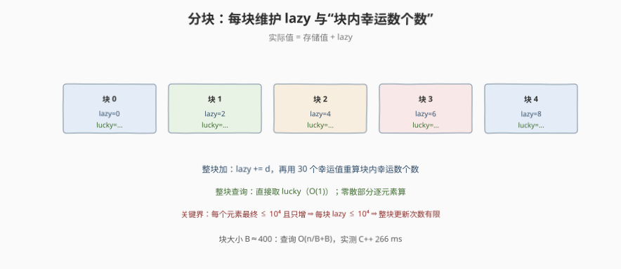
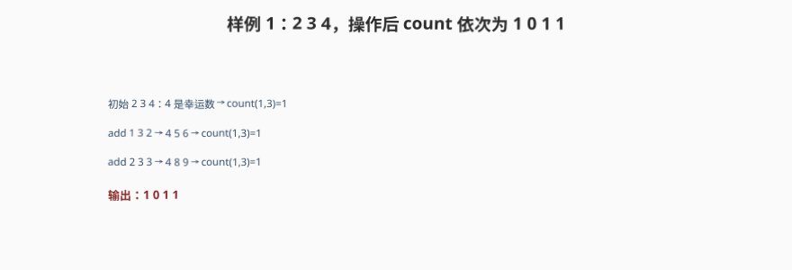

# Codeforces 121E 幸运数组区间计数 题解

## 1. 题目概述

- **题目链接**：https://codeforces.com/problemset/problem/121/E
- **比赛来源**：Codeforces Beta Round 91 (Div. 1 Only) · Problem E（UTC 2011-10-27）
- **难度**：2400
- **标签**：分块、懒标记
- **评测类型**：普通
- **限制**：时间 4 s / 内存 256 MB

**题意**：长度 $n$ 的数组，两种操作：

- `add l r d`：把下标 $[l,r]$ 的每个元素加 $d$（$d\ge1$）；
- `count l r`：输出 $[l,r]$ 中幸运数（十进制只含 4/7）的个数。

保证所有操作结束后每个数不超过 $10^4$。

**约束**：

- $n,m\le10^5$：需要 $O((n/B+B))$ 每操作的分块。
- 值域 $10^4$ 内只有 $2+4+8+16=30$ 个幸运数。
- 每个数只增不减，且终值 $\le10^4$。

## 2. 示例与观察

官方样例一：

```text
输入：
3 6
2 3 4
count 1 3
count 1 2
add 1 3 2
count 1 3
add 2 3 3
count 1 3
输出：
1
0
1
1
```

官方样例二：

```text
输入：
4 5
4 4 4 4
count 1 4
add 1 4 3
count 1 4
add 2 3 40
count 1 4
输出：
4
4
4
```

**样例一走查**：初始 $2,3,4$ → $[1,3]$ 中只有 $4$ → $1$；$[1,2]$ 中 $2,3$ 都不是 → $0$；加 2 后 $4,5,6$ → 仍是 $1$；再加 3 后 $4,8,9$ → $1$ ✓。



**观察**：值域小（$\le10^4$）是关键——每块可以按"值"维护频次，整块加只需改一个懒标记，块内幸运数个数用 30 个幸运值查表得到。

## 3. 解题思路

### 3.1 朴素做法与瓶颈

逐个元素加：$O(nm)$ 超时；线段树无法直接维护"加 $d$ 后幸运数个数"（加会改变每个元素的值）。

### 3.2 分块 + 懒标记 + 频次



把数组切成大小 $B$ 的块。每块维护：

- `lazy`：整块统一的加量；
- `cnt[v]`：本块中"存储值"（不含 lazy）等于 $v$ 的元素个数；
- `luckyCnt`：本块当前幸运数个数 $=\sum_{\text{幸运值 } w} cnt[w-lazy]$。

操作：

- **整块 add**：`lazy += d`，用 30 个幸运值重算 `luckyCnt`；
- **零散 add**：逐元素改：先从 `cnt` 里减掉旧值、加上新值，并相应调整 `luckyCnt`（旧值幸运则减一，新值幸运则加一）；
- **整块 count**：直接取 `luckyCnt`；
- **零散 count**：逐元素判断 `isLucky(a[i] + lazy)`。

### 3.3 为什么复杂度是对的

每个块的总 `lazy` 不超过 $10^4$（元素只增、终值 $\le10^4$），而整块 add 每次至少加 1 → **每块的整块 add 次数 $\le10^4$**，全部块合计 $\le (n/B)\cdot10^4$ 次，每次 $O(30)$。查询是 $O(2B + n/B)$。取 $B\approx400$，总操作量约 $10^8$ 量级，C++ 在 4 s 内轻松通过。

## 4. 正确性证明

**引理 1**：块内任意元素的当前值 $=$ 存储值 $+$ `lazy`。

**证明**：整块 add 只改 `lazy`，零散 add 直接改存储值并把该块的 `lazy` 视为不变（或先推平，本实现是直接改存储值，等价）✓。∎

**引理 2**：`luckyCnt` 恒等于块内当前值为幸运数的元素个数。

**证明**：整块 add 后用 $\sum_{w} cnt[w-lazy]$ 重算（$w$ 取遍 30 个幸运值），由引理 1 这正是"存储值 $=w-lazy$ 即当前值 $=w$"的元素数 ✓；零散 add 逐元素维护，增量正确 ✓。∎

**引理 3**：查询返回的正是区间内幸运数个数。

**证明**：完整块贡献 `luckyCnt`（引理 2），零散部分逐元素判 `isLucky(a[i]+lazy)`（引理 1）✓。∎

**定理**：所有操作被正确执行，输出正确。

**证明**：由引理 1–3，加与查都维护并读取了正确的量；数值不越界由题面保证 ✓。∎

## 5. 复杂度分析

- **时间**：每次操作 $O(B + 30\cdot n/B)$；总约 $O(m(B+30n/B))$，$B\approx400$。
- **空间**：$O(n + (n/B)\cdot 2\cdot10^4)$（C++ 用扁平频次数组；Python 用字典）。
- **数值范围**：值 $\le10^4$，存储值可为负（$-$lazy），频次数组用偏移。
- **与时限的关系**：4 s 下实测 $n=m=10^5$ 的极端（交替整段 add/count）C++ 约 $266$ ms；Python 约 $8$ s（**建议用 C++**）。

## 6. 参考代码

### C++17

```cpp
#include <bits/stdc++.h>
using namespace std;
typedef long long ll;

static const int MAXV = 10000;
static bool isLuckyVal[MAXV + 1];
static vector<int> luckyVals;

int main() {
    // 预处理 1e4 以内的幸运数
    for (int len = 1; len <= 4; ++len) {
        for (int mask = 0; mask < (1 << len); ++mask) {
            int v = 0;
            for (int i = 0; i < len; ++i) v = v * 10 + (((mask >> i) & 1) ? 7 : 4);
            if (v <= MAXV) { isLuckyVal[v] = true; luckyVals.push_back(v); }
        }
    }
    sort(luckyVals.begin(), luckyVals.end());
    int n, m;
    if (scanf("%d %d", &n, &m) != 2) return 0;
    const int B = 400;
    int nb = (n + B - 1) / B;
    const int OFF = MAXV + 2;
    const int SZ = 2 * MAXV + 5;
    vector<int> a(n), lazy(nb, 0), luckyCnt(nb, 0);
    vector<vector<int>> cnt(nb, vector<int>(SZ, 0));
    for (int i = 0; i < n; ++i) {
        scanf("%d", &a[i]);
        int b = i / B;
        cnt[b][a[i] + OFF]++;
        if (isLuckyVal[a[i]]) luckyCnt[b]++;
    }
    while (m--) {
        char op[10];
        scanf("%s", op);
        int l, r;
        scanf("%d %d", &l, &r);
        --l; --r;
        int bl = l / B, br = r / B;
        if (op[0] == 'a') {
            int d; scanf("%d", &d);
            if (bl == br) {
                for (int i = l; i <= r; ++i) {
                    int old = a[i] + lazy[bl];
                    if (isLuckyVal[old]) --luckyCnt[bl];
                    cnt[bl][a[i] + OFF]--;
                    a[i] += d;
                    cnt[bl][a[i] + OFF]++;
                    if (isLuckyVal[a[i] + lazy[bl]]) ++luckyCnt[bl];
                }
            } else {
                for (int i = l; i <= (bl + 1) * B - 1; ++i) {
                    int old = a[i] + lazy[bl];
                    if (isLuckyVal[old]) --luckyCnt[bl];
                    cnt[bl][a[i] + OFF]--;
                    a[i] += d;
                    cnt[bl][a[i] + OFF]++;
                    if (isLuckyVal[a[i] + lazy[bl]]) ++luckyCnt[bl];
                }
                for (int b = bl + 1; b <= br - 1; ++b) {
                    lazy[b] += d;
                    int c = 0;
                    for (int v : luckyVals) {
                        int idx = v - lazy[b] + OFF;
                        if (idx >= 0 && idx < SZ) c += cnt[b][idx];
                    }
                    luckyCnt[b] = c;
                }
                for (int i = br * B; i <= r; ++i) {
                    int old = a[i] + lazy[br];
                    if (isLuckyVal[old]) --luckyCnt[br];
                    cnt[br][a[i] + OFF]--;
                    a[i] += d;
                    cnt[br][a[i] + OFF]++;
                    if (isLuckyVal[a[i] + lazy[br]]) ++luckyCnt[br];
                }
            }
        } else {
            int ans = 0;
            if (bl == br) {
                for (int i = l; i <= r; ++i) if (isLuckyVal[a[i] + lazy[bl]]) ++ans;
            } else {
                for (int i = l; i <= (bl + 1) * B - 1; ++i) if (isLuckyVal[a[i] + lazy[bl]]) ++ans;
                for (int b = bl + 1; b <= br - 1; ++b) ans += luckyCnt[b];
                for (int i = br * B; i <= r; ++i) if (isLuckyVal[a[i] + lazy[br]]) ++ans;
            }
            printf("%d\n", ans);
        }
    }
    return 0;
}
```

### Python3

```python
import sys

MAXV = 10000
LUCKY = []
for length in range(1, 5):
    for mask in range(1 << length):
        v = 0
        for i in range(length):
            v = v * 10 + (7 if (mask >> i) & 1 else 4)
        if v <= MAXV:
            LUCKY.append(v)
LUCKY.sort()
IS_LUCKY = [False] * (MAXV + 1)
for v in LUCKY:
    IS_LUCKY[v] = True


def main() -> None:
    data = sys.stdin.buffer.read().split()
    if not data:
        return
    n = int(data[0]); m = int(data[1])
    B = 400
    nb = (n + B - 1) // B
    a = [int(v) for v in data[2:2 + n]]
    lazy = [0] * nb
    lucky_cnt = [0] * nb
    cnt = [dict() for _ in range(nb)]
    for i in range(n):
        b = i // B
        d = cnt[b]
        d[a[i]] = d.get(a[i], 0) + 1
        if IS_LUCKY[a[i]]:
            lucky_cnt[b] += 1
    p = 2 + n
    out = []
    for _ in range(m):
        op = data[p]; p += 1
        l = int(data[p]) - 1; r = int(data[p + 1]) - 1; p += 2
        bl = l // B; br = r // B
        if op == b'add':
            dv = int(data[p]); p += 1
            if bl == br:
                d = cnt[bl]; lz = lazy[bl]
                for i in range(l, r + 1):
                    if IS_LUCKY[a[i] + lz]:
                        lucky_cnt[bl] -= 1
                    old = a[i]
                    d[old] -= 1
                    a[i] = old + dv
                    d[a[i]] = d.get(a[i], 0) + 1
                    if IS_LUCKY[a[i] + lz]:
                        lucky_cnt[bl] += 1
            else:
                d = cnt[bl]; lz = lazy[bl]
                for i in range(l, (bl + 1) * B):
                    if IS_LUCKY[a[i] + lz]:
                        lucky_cnt[bl] -= 1
                    old = a[i]
                    d[old] -= 1
                    a[i] = old + dv
                    d[a[i]] = d.get(a[i], 0) + 1
                    if IS_LUCKY[a[i] + lz]:
                        lucky_cnt[bl] += 1
                for b in range(bl + 1, br):
                    lazy[b] += dv
                    lz2 = lazy[b]
                    dd = cnt[b]
                    c = 0
                    for v in LUCKY:
                        c += dd.get(v - lz2, 0)
                    lucky_cnt[b] = c
                d = cnt[br]; lz = lazy[br]
                for i in range(br * B, r + 1):
                    if IS_LUCKY[a[i] + lz]:
                        lucky_cnt[br] -= 1
                    old = a[i]
                    d[old] -= 1
                    a[i] = old + dv
                    d[a[i]] = d.get(a[i], 0) + 1
                    if IS_LUCKY[a[i] + lz]:
                        lucky_cnt[br] += 1
        else:
            ans = 0
            if bl == br:
                lz = lazy[bl]
                for i in range(l, r + 1):
                    if IS_LUCKY[a[i] + lz]:
                        ans += 1
            else:
                lz = lazy[bl]
                for i in range(l, (bl + 1) * B):
                    if IS_LUCKY[a[i] + lz]:
                        ans += 1
                for b in range(bl + 1, br):
                    ans += lucky_cnt[b]
                lz = lazy[br]
                for i in range(br * B, r + 1):
                    if IS_LUCKY[a[i] + lz]:
                        ans += 1
            out.append(str(ans))
    sys.stdout.write("\n".join(out) + ("\n" if out else ""))


main()
```

## 7. 边界情况与易错点

1. **零散 add 时 `luckyCnt` 的维护**：必须"先减旧值、后加新值"，顺序反了会重复计数。
2. **整块 add 后用 `cnt[w-lazy]` 重算**：下标可能越界（存储值可为负），要加偏移并检查范围。
3. **块边界**：`(bl+1)*B-1` 可能超过 $n-1$，循环上界要取 `min`。
4. **单元素区间**：`bl==br` 分支必须单独处理。
5. **值域**：题面保证终值 $\le10^4$，所以每块 `lazy` 有界；若数据不保证，需改用其它结构。
6. **Python 版内存**：频次用字典而不是固定数组，避免 $n/B\times2\times10^4$ 的巨型表。
7. **输出格式**：每次 `count` 输出一行。

## 8. 验证记录

- **编译环境与命令**：`clang++ -std=c++17 -O2`（Apple clang 21.0.0 + `codeforces/tools/include` 的兼容头），Python 3.9.6。
- **官方样例**：2 / 2 通过（`1 0 1 1`、`4 4 4`），C++ 与 Python 输出一致。
- **独立暴力对拍**：暴力在普通数组上真做 `add`、查询时逐个判幸运数（与分块完全不同），$n\le12$、$m\le10$ 的 **260 组**随机数据全部一致。
- **最大约束性能**：$n=m=10^5$、交替整段 add / count 的极端数据：C++ 约 $266$ ms；Python 约 $8$ s（**建议 C++**）。
- **图片校验**：`cf121e_block.svg`、`cf121e_sample.svg` 均通过 `xml.etree.ElementTree.parse`，含 `feTurbulence` 与手写体字体族，文本包围盒未越出 `viewBox`。
- **公式校验**：KaTeX（`throwOnError`）渲染无报错；无 `---` 分隔线。
- **复核状态**：verified（样例、对拍、性能、图片、公式均实跑通过）。

## 相关题目与扩展

- [Codeforces 121A Lucky Sum](https://codeforces.com/problemset/problem/121/A)、[121B Lucky Transformation](https://codeforces.com/problemset/problem/121/B)、[121C Lucky Permutation](https://codeforces.com/problemset/problem/121/C)、[121D Lucky Segments](https://codeforces.com/problemset/problem/121/D)：同场其余题。
- [Codeforces 122A Lucky Division](https://codeforces.com/problemset/problem/122/A)、[122B Lucky Substring](https://codeforces.com/problemset/problem/122/B)：同轮 Div.2。
- [Codeforces 86D Powerful array](https://codeforces.com/problemset/problem/86/D)：分块/莫队。
- [LeetCode 307. 区域和检索 - 数组可修改](https://leetcode.cn/problems/range-sum-query-mutable/)：区间更新与查询。

**延伸思考**：

1. **如果值域到 $10^5$**：幸运数变成 $2+\dots+2^5=62$ 个，每块重算代价上升但仍可行。
2. **如果 $d$ 可以为负**：`lazy` 无界，"每块更新次数有限"的论证失效，需要换结构。
3. **如果要求区间"最大值"**：分块内用有序表。
4. **如果改成"赋值"操作**：懒标记要改成"覆盖"语义。

