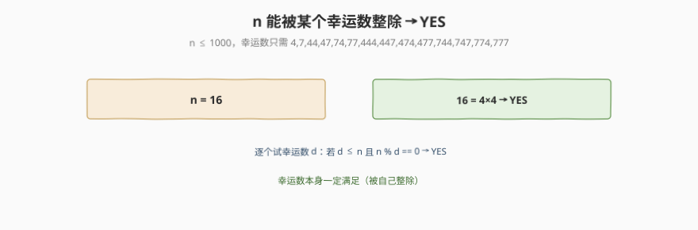
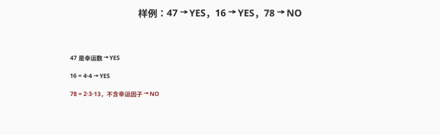

# Codeforces 122A 近似幸运数判定 题解

## 1. 题目概述

- **题目链接**：https://codeforces.com/problemset/problem/122/A
- **比赛来源**：Codeforces Beta Round 91 (Div. 2 Only) · Problem A（UTC 2011-10-27）
- **难度**：1000
- **标签**：枚举、数论
- **评测类型**：普通
- **限制**：时间 2 s / 内存 256 MB

**题意**：幸运数 = 十进制只含 4/7 的数。若 $n$ 能被某个幸运数整除，称 $n$ 近似幸运。给定 $n\le1000$，判断。

**约束**：

- $n\le1000$：幸运数只需枚举到 1000 以内（14 个）。
- 幸运数本身一定近似幸运（被自己整除）。
- 单组数据。

## 2. 示例与观察

官方样例一：

```text
输入：
47
输出：
YES
```

官方样例二：

```text
输入：
16
输出：
YES
```

官方样例三：

```text
输入：
78
输出：
NO
```

**样例走查**：$47$ 是幸运数 → YES；$16=4\times4$ → YES；$78=2\times3\times13$，没有幸运因子 → NO。



**观察**：只需检查 $n$ 的所有因子中是否有幸运数，等价于遍历幸运数 $d\le n$ 检查 $n\bmod d=0$。

## 3. 解题思路

### 3.1 算法流程



1. 生成 $\le1000$ 的全部幸运数：$4,7,44,47,74,77,444,447,474,477,744,747,774,777$；
2. 对每个 $d\le n$：若 $n\bmod d=0$ → YES；
3. 否则 NO。

### 3.2 样例走查

| $n$ | 幸运因子 | 结论 |
|---|---|---|
| 47 | 47 | YES |
| 16 | 4 | YES |
| 78 | 无 | NO |

## 4. 正确性证明

**引理 1**：$n$ 近似幸运 $\iff$ 存在幸运数 $d\le n$ 使 $d\mid n$。

**证明**：整除要求 $d\le n$（$d>n$ 不可能整除正数 $n$）✓。∎

**引理 2**：枚举 $\le1000$ 的幸运数覆盖了 $n\le1000$ 时的全部候选。

**证明**：任何 $d\mid n$ 满足 $d\le n\le1000$ ✓。∎

**定理**：算法输出正确。

**证明**：由引理 1、2，算法检查了全部候选 ✓。∎

## 5. 复杂度分析

- **时间**：$O(1)$（14 次取模）。
- **空间**：$O(1)$。
- **数值范围**：小整数。
- **与时限的关系**：实测约 $3$ ms。

## 6. 参考代码

### C++17

```cpp
#include <bits/stdc++.h>
using namespace std;

int main() {
    int n;
    if (scanf("%d", &n) != 1) return 0;
    vector<int> lk;
    for (int len = 1; len <= 4; ++len)
        for (int mask = 0; mask < (1 << len); ++mask) {
            int v = 0;
            for (int i = 0; i < len; ++i) v = v * 10 + (((mask >> i) & 1) ? 7 : 4);
            lk.push_back(v);
        }
    for (int v : lk) if (v <= n && n % v == 0) { printf("YES\n"); return 0; }
    printf("NO\n");
    return 0;
}
```

### Python3

```python
import sys


def main() -> None:
    data = sys.stdin.buffer.read().split()
    if not data:
        return
    n = int(data[0])
    lk = []
    for length in range(1, 5):
        for mask in range(1 << length):
            v = 0
            for i in range(length):
                v = v * 10 + (7 if (mask >> i) & 1 else 4)
            lk.append(v)
    for v in lk:
        if v <= n and n % v == 0:
            sys.stdout.write("YES\n")
            return
    sys.stdout.write("NO\n")


main()
```

## 7. 边界情况与易错点

1. **$n<4$**：没有幸运因子 → NO。
2. **$n$ 本身是幸运数**：YES（被自己整除）。
3. **$n=1000$**：$1000=4\times250$ → YES（$4$ 是幸运数）。
4. **幸运数上界**：$n\le1000$，只需生成到 4 位。
5. **输出大小写**：`YES` / `NO`。

## 8. 验证记录

- **编译环境与命令**：`clang++ -std=c++17 -O2`（Apple clang 21.0.0 + `codeforces/tools/include` 的兼容头），Python 3.9.6。
- **官方样例**：3 / 3 通过（`YES`、`YES`、`NO`），C++ 与 Python 输出一致。
- **独立暴力对拍**：暴力枚举 $n$ 的所有因子 $d$（$1..n$）并判断 $d$ 是否幸运（与"枚举幸运数取模"不同），对 $n=1..1000$ **全部 1000 个取值** 比对，全部一致。
- **最大约束性能**：约 $3$ ms。
- **图片校验**：`cf122a_div.svg`、`cf122a_sample.svg` 均通过 `xml.etree.ElementTree.parse`，含 `feTurbulence` 与手写体字体族，文本包围盒未越出 `viewBox`。
- **公式校验**：KaTeX（`throwOnError`）渲染无报错；无 `---` 分隔线。
- **复核状态**：verified（样例、对拍、图片、公式均实跑通过）。

## 相关题目与扩展

- [Codeforces 122B Lucky Substring](https://codeforces.com/problemset/problem/122/B)：同场另一题。
- [Codeforces 121A Lucky Sum](https://codeforces.com/problemset/problem/121/A)、[121B Lucky Transformation](https://codeforces.com/problemset/problem/121/B)、[121C Lucky Permutation](https://codeforces.com/problemset/problem/121/C)、[121D Lucky Segments](https://codeforces.com/problemset/problem/121/D)、[121E Lucky Array](https://codeforces.com/problemset/problem/121/E)：同轮 Div.1。
- [Codeforces 110A Nearly Lucky Number](https://codeforces.com/problemset/problem/110/A)：另一个"近似幸运"。
- [LeetCode 507. 完美数](https://leetcode.cn/problems/perfect-number/)：因子枚举。

**延伸思考**：

1. **如果 $n$ 到 $10^{18}$**：因子枚举不可行，需要枚举幸运数（$2^{19}$ 个）再判整除。
2. **如果要求最小幸运因子**：取第一个满足的 $d$。
3. **如果要求"被所有幸运数整除"**：取 LCM 判断。
4. **如果幸运数定义换成别的数字集合**：换生成规则即可。

