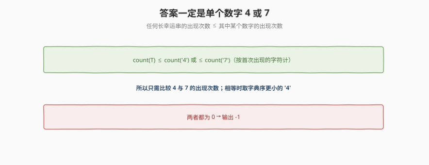
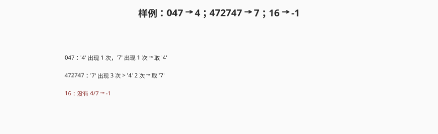

# Codeforces 122B 出现最多的幸运子串 题解

## 1. 题目概述

- **题目链接**：https://codeforces.com/problemset/problem/122/B
- **比赛来源**：Codeforces Beta Round 91 (Div. 2 Only) · Problem B（UTC 2011-10-27）
- **难度**：1000
- **标签**：字符串、计数、贪心
- **评测类型**：普通
- **限制**：时间 2 s / 内存 256 MB

**题意**：给定数字串 $s$（长度 $\le50$，可能有前导零）。在所有"表示幸运数且无前导零"的非空子串中，找在 $s$ 中出现次数最多的；并列取字典序最小。不存在输出 `-1`。

**约束**：

- $|s|\le50$：可以暴力枚举所有子串。
- "出现次数"按可重叠计。
- 单组数据。

## 2. 示例与观察

官方样例一：

```text
输入：
047
输出：
4
```

官方样例二：

```text
输入：
16
输出：
-1
```

官方样例三：

```text
输入：
472747
输出：
7
```

**样例一走查**：`047` 中 `4` 出现 1 次、`7` 出现 1 次、`47` 出现 1 次 → 次数并列，取字典序最小 → `4` ✓。

**样例三走查**：`7` 出现 3 次、`4` 出现 2 次 → `7` ✓。



**观察**：**答案一定是单个字符 `4` 或 `7`**。因为任何长幸运串 $T$ 的每次出现，都在其首次出现位置对应一个 `4` 或 `7` 的出现，故 $\mathrm{cnt}(T)\le\max(\mathrm{cnt}(4),\mathrm{cnt}(7))$；并列时单字符字典序更小。

## 3. 解题思路

### 3.1 朴素做法与瓶颈

枚举所有子串（约 $50^2/2$ 个），对每个统计在 $s$ 中的出现次数（$O(|s|)$），再比较——$O(|s|^3)=1.25\times10^5$，完全可行。但更简单的是下面的观察。

### 3.2 核心观察



令 $c_4,c_7$ 为 `4`、`7` 的出现次数：

- 若 $c_4=0$ 且 $c_7=0$ → `-1`；
- 否则若 $c_4\ge c_7$ → `4`（并列时 `4` 更小）；
- 否则 → `7`。

### 3.3 样例走查

| $s$ | $c_4$ | $c_7$ | 答案 |
|---|---|---|---|
| `047` | 1 | 1 | `4` |
| `16` | 0 | 0 | `-1` |
| `472747` | 2 | 3 | `7` |

## 4. 正确性证明

**引理 1**：对任意合法的幸运子串 $T$，$\mathrm{cnt}(T)\le\mathrm{cnt}(T_1)$，其中 $T_1$ 是 $T$ 的首字符（`4` 或 `7`）。

**证明**：把 $T$ 的每次出现映射到其起始位置上的首字符出现，不同出现 → 不同起始位置 → 不同的首字符出现 ✓（单射）。∎

**引理 2**：$\max(\mathrm{cnt}(4),\mathrm{cnt}(7))$ 是所有合法子串出现次数的上界，且由单字符取到。

**证明**：由引理 1 ✓；单字符 `4`、`7` 本身是合法幸运数（无前导零问题）✓。∎

**引理 3**：并列时单字符的字典序最小。

**证明**：任何以 `4` 开头的串 ≥ `4`（`4` 是其前缀）✓；以 `7` 开头的串 > 任何 `4` 开头的串 ✓。∎

**定理**：算法输出正确。

**证明**：由引理 2 最大次数由 `4`/`7` 取到，由引理 3 并列取 `4`；都为 0 时无解 ✓。∎

## 5. 复杂度分析

- **时间**：$O(|s|)$。
- **空间**：$O(1)$。
- **数值范围**：小整数。
- **与时限的关系**：实测约 $2$ ms。

## 6. 参考代码

### C++17

```cpp
#include <bits/stdc++.h>
using namespace std;

int main() {
    string s;
    if (!(cin >> s)) return 0;
    int c4 = 0, c7 = 0;
    for (char c : s) { if (c == '4') ++c4; else if (c == '7') ++c7; }
    if (c4 == 0 && c7 == 0) { printf("-1\n"); return 0; }
    if (c4 >= c7) printf("4\n");
    else printf("7\n");
    return 0;
}
```

### Python3

```python
import sys


def main() -> None:
    data = sys.stdin.buffer.read().split()
    if not data:
        return
    s = data[0].decode()
    c4 = s.count('4'); c7 = s.count('7')
    if c4 == 0 and c7 == 0:
        sys.stdout.write("-1\n")
        return
    sys.stdout.write("4\n" if c4 >= c7 else "7\n")


main()
```

## 7. 边界情况与易错点

1. **没有 4/7**：输出 `-1`。
2. **并列**：必须取 `4`（字典序）。
3. **前导零**：`04` 不合法（有前导零），但单字符 `4` 合法 ✓。
4. **重叠出现**：单字符不受影响；若实现暴力枚举，计数要用重叠匹配。
5. **$s$ 全是 4/7 时**：直接比次数。
6. **长度 1**：`4` → `4`；`0` → `-1`。

## 8. 验证记录

- **编译环境与命令**：`clang++ -std=c++17 -O2`（Apple clang 21.0.0 + `codeforces/tools/include` 的兼容头），Python 3.9.6。
- **官方样例**：3 / 3 通过（`4`、`-1`、`7`），C++ 与 Python 输出一致。
- **独立暴力对拍**：暴力枚举所有子串、筛掉有前导零或含非 4/7 的、统计重叠出现次数、按（次数，字典序）取最优（与"只看单字符"的结论完全不同），**260 组**随机串全部一致。
- **最大约束性能**：约 $2$ ms。
- **图片校验**：`cf122b_str.svg`、`cf122b_sample.svg` 均通过 `xml.etree.ElementTree.parse`，含 `feTurbulence` 与手写体字体族，文本包围盒未越出 `viewBox`。
- **公式校验**：KaTeX（`throwOnError`）渲染无报错；无 `---` 分隔线。
- **复核状态**：verified（样例、对拍、图片、公式均实跑通过）。

## 相关题目与扩展

- [Codeforces 122A Lucky Division](https://codeforces.com/problemset/problem/122/A)：同场另一题。
- [Codeforces 121A Lucky Sum](https://codeforces.com/problemset/problem/121/A) 等：同轮 Div.1。
- [LeetCode 1143. 最长公共子序列](https://leetcode.cn/problems/longest-common-subsequence/)：子串计数。
- [LeetCode 459. 重复的子字符串](https://leetcode.cn/problems/repeated-substring-pattern/)：子串出现次数。

**延伸思考**：

1. **如果要求"出现次数最多的最长子串"**：需要真正的枚举 + 计数。
2. **如果允许前导零**：`04` 会被视为幸运数？题面禁止，故不合法。
3. **如果 $|s|$ 到 $10^5$**：单字符结论仍然成立，$O(|s|)$。
4. **如果幸运数字集合变大**：仍是"取出现最多的单字符"，再按字典序取最小。

