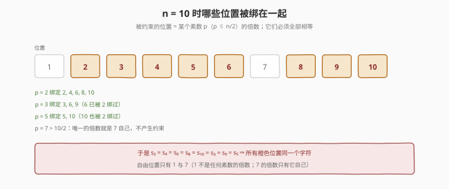
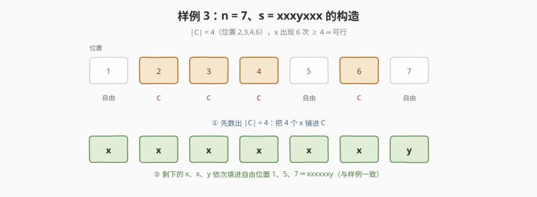

# Codeforces 123A 素数位置同字符 题解

## 1. 题目概述

- **题目链接**：https://codeforces.com/problemset/problem/123/A
- **比赛来源**：Codeforces Beta Round 92 (Div. 1 Only) · Problem A（UTC 2011-11-03）
- **难度**：1300
- **标签**：构造、字符串、数论、素数筛
- **评测类型**：特殊评测（输出任意一种合法重排）
- **限制**：时间 1 s / 内存 256 MB

**题意**：给出一个小写字母串 $s$，$|s|=n$，字符按 $1..n$ 编号。问能否重排 $s$ 的字符，使得对**每个素数 $p\le n$** 和**每个整数 $i\in[1,\lfloor n/p\rfloor]$** 都有 $s_p=s_{p\times i}$。若能，输出 `YES` 和任意一种合法重排；否则输出 `NO`。

注意 $i=1$ 时条件退化成一个恒等式 $s_p=s_p$，真正起作用的是 $i\ge2$，也就是"$p$ 的所有倍数位置字符相同"。

**约束**：

- $n\le1000$：可以筛出 $n$ 以内的素数、$O(n\log\log n)$ 标记所有被约束的位置；这排除了任何"枚举全部 $n!$ 重排"的做法。
- 素数 $p$ 只有在 $\lfloor n/p\rfloor\ge2$（即 $p\le n/2$）时才会真正产生约束；$p>n/2$ 时唯一的倍数就是 $p$ 自己，没有约束。
- 字符只有 26 种，统计频率即可；答案要求任意一种合法解（特殊评测）。

## 2. 示例与观察

官方样例 1（输入 / 输出原样）：

```text
输入：
abc

输出：
YES
abc
```

$n=3$，素数是 2 和 3，但 $\lfloor3/2\rfloor=1$、$\lfloor3/3\rfloor=1$，两个素数都没有 $i\ge2$ 的约束。所以任何重排都合法，样例给了原串。

官方样例 2（输入 / 输出原样）：

```text
输入：
abcd

输出：
NO
```

$n=4$：$p=2$ 时 $\lfloor4/2\rfloor=2$，于是必须有 $s_2=s_4$。而 `abcd` 四个字符互不相同，位置 2、4 无法取到同一个字符 ⇒ `NO`。注意 $p=2$ 这一条就把位置 $\{2,4\}$ 绑在一起了。

官方样例 3（输入 / 输出原样）：

```text
输入：
xxxyxxx

输出：
YES
xxxxxxy
```

$n=7$：$p=2$ 绑住 $\{2,4,6\}$，$p=3$ 绑住 $\{3,6\}$，合起来是 $\{2,3,4,6\}$；$p=5,7>7/2$ 不产生约束。所以只要 $\{2,3,4,6\}$ 四个位置放同一个字符即可：`x` 有 6 个，够用；剩下的 `x`、`x`、`y` 随便填到位置 1、5、7，样例给出的是 `xxxxxxy`（$y$ 落在 7 号位，不在被绑定的位置上）✓



**观察**：所有"被约束的位置"其实是**同一个等价类**——它们必须全都相等。理由：$p=2$ 要求所有偶数位置等于 $s_2$；任何素数 $p\le n/2$ 都有 $2p\le n$，于是

$$s_p \overset{p\text{ 的约束}(i=2)}{=} s_{2p} \overset{2\text{ 的约束}}{=} s_2,$$

所以每个被约束位置都等于 $s_2$。于是判定只剩一件事：**有没有哪个字符出现次数不少于被约束位置的个数**。

## 3. 解题思路

### 3.1 朴素做法与瓶颈

暴力枚举 $s$ 的全部不同排列（最坏 $1000!/\dots$，天文数字），逐一检查约束，不可行。

稍微聪明一点的思路是"把约束看成并查集"：对每个素数 $p\le n/2$ 和每个 $i\in[2,\lfloor n/p\rfloor]$，把 $p$ 与 $p\cdot i$ 合并。合并之后每个连通块内部必须同字符，判定"每个连通块的大小都不超过某个字符的出现次数"——但这是**多重背包式**的匹配问题，$n=1000$ 时虽然可做（块数 $\le n$、字符 26 种），但没必要：下一节的观察说明所有块其实是**一个**块。

### 3.2 核心观察：所有约束位置是同一个类

记

$$C=\{x\in[1,n]:\ \exists\text{ 素数 }p\le n/2,\ p\mid x\}.$$

- **$C$ 内所有位置必须相同**：对任意 $x\in C$，取 $p\mid x$、$p\le n/2$，由 $p$ 的约束 $s_x=s_p$；又 $2p\le n$，由 $p$ 的约束（$i=2$）$s_{2p}=s_p$，而 $2p$ 是偶数，由 $p=2$ 的约束 $s_{2p}=s_2$。串起来 $s_x=s_2$，与 $x$ 无关。
- **$C$ 外的位置完全自由**：位置 1 不是任何素数（素数 $\ge2$）的倍数，永远不会出现在约束里；位置 $x$ 若是大于 $n/2$ 的素数，它的倍数只有自己（$i\ge2$ 时 $2x>n$），同样不被任何约束涉及。而所有约束的两端 $p$ 与 $p\cdot i$ 都在 $C$ 里，所以 $C$ 外的位置不出现在任何约束中。

于是 $C$ 的大小

$$|C|=\underbrace{(n-1)-\pi(n)}_{\text{合数}}+\underbrace{\pi(\lfloor n/2\rfloor)}_{\le n/2\text{ 的素数}},$$

其中 $\pi(\cdot)$ 是素数计数函数。判定就是：**存在字符 $c$ 使 $\mathrm{cnt}(c)\ge|C|$**。



### 3.3 算法流程

1. 筛出 $[2,n]$ 的素数；
2. 对每个素数 $p\le n$ 且 $\lfloor n/p\rfloor\ge2$，把所有倍数 $p,2p,\dots$ 标为 `need`；$|C|$ = 标记个数；
3. 统计 26 个字母的频率，取出现最多的字母 $c$；
4. 若 $\mathrm{cnt}(c)<|C|$，输出 `NO`；
5. 否则把 $C$ 里所有位置写成 $c$，从频率里扣掉 $|C|$ 个 $c$；剩余字符按字母序依次填进"自由位置"（升序扫描），输出 `YES` 与该串。

### 3.4 样例走查

样例 3：$n=7$，筛出素数 $\{2,3,5,7\}$。$p=2$：$\lfloor7/2\rfloor=3\ge2$，标记 $2,4,6$；$p=3$：$\lfloor7/3\rfloor=2\ge2$，标记 $3,6$；$p=5,7$：$\lfloor7/p\rfloor=1$，不标记。所以 $C=\{2,3,4,6\}$、$|C|=4$，自由位置是 $1,5,7$。

频率：`x`→6、`y`→1，$6\ge4$ ⇒ 可行。把 $C$ 全部写成 `x`，剩 `x`→2、`y`→1，依次填自由位置 $1,5,7$ 得到 `x`、`x`、`y`，最终串 `xxxxxxy`——正是样例输出（特殊评测下任意合法解都可以）。

样例 2：$n=4$，$p=2$ 标记 $2,4$，$p=3$ 不标记 ⇒ $C=\{2,4\}$、$|C|=2$。频率全是 1，最大 1 $<2$ ⇒ `NO` ✓

## 4. 正确性证明

**引理 1**：$C$ 中所有位置在任意合法重排下都取同一个字符。

**证明**：任取 $x\in C$，存在素数 $p\le n/2$ 与 $i$ 使 $x=p\cdot i$。由约束（素数 $p$，下标 $i$）得 $s_x=s_p$；由约束（素数 $p$，下标 2，因 $2\le\lfloor n/p\rfloor$）得 $s_{2p}=s_p$；由约束（素数 2，下标 $p$，因 $p\le n/2$ 即 $p\le\lfloor n/2\rfloor$，$2p\le n$ 时 $p\le\lfloor n/2\rfloor$ 成立）得 $s_{2p}=s_2$。故 $s_x=s_2$，与 $x$ 无关。∎

**引理 2**：$C$ 之外的位置不出现在任何约束中，因此可以任意填。

**证明**：任取一条约束 $s_p=s_{p\cdot i}$（$p$ 素数，$i\ge2$，$p\cdot i\le n$）。则 $p\le n/2$ 且 $p\in C$、$p\cdot i\in C$，即约束两端都在 $C$ 内。所以自由位置（$1$ 与 $>n/2$ 的素数）不受任何约束。∎

**引理 3**：可行当且仅当存在字符 $c$ 满足 $\mathrm{cnt}(c)\ge|C|$。

**证明**：必要性：由引理 1，$C$ 里 $|C|$ 个位置必须是同一字符 $c$，故 $\mathrm{cnt}(c)\ge|C|$。充分性：取这样的 $c$，把 $C$ 全填 $c$、其余位置填剩余字符（引理 2 保证自由），则每条约束两端都在 $C$ 内、字符都是 $c$，全部满足。∎

**定理**：算法输出正确——不可行时输出 `NO`，可行时输出的串是 $s$ 的重排且满足全部约束。

**证明**：输出 `NO` 的判据正是引理 3 的否定。可行时，算法先把 $|C|$ 个 $c$ 放进 $C$，再把"原多重集减去这些 $c$"逐字符填入自由位置，因此得到的串与 $s$ 的多重集相同（是重排），且每条约束两端都在 $C$ 内、都取 $c$（引理 1、2），约束全部满足。∎

## 5. 复杂度分析

- **时间**：素数筛 $O(n\log\log n)$；标记倍数 $\sum_{p\le n/2} n/p=O(n\log\log n)$；统计与构造 $O(n)$。$n=1000$ 时全部在微秒级，1 s 时限余量极大。
- **空间**：`need` 数组、频率数组各 $O(n)$，约几 KB。

## 6. 参考代码

### C++17

```cpp
#include <bits/stdc++.h>
using namespace std;

int main() {
    string s;
    if (!(cin >> s)) return 0;
    int n = (int)s.size();

    // 筛出 <= n 的素数
    vector<char> isPrime(n + 1, 1);
    if (n >= 0) isPrime[0] = 0;
    if (n >= 1) isPrime[1] = 0;
    for (int i = 2; i * i <= n; i++)
        if (isPrime[i])
            for (int j = i * i; j <= n; j += i) isPrime[j] = 0;

    // 受约束的位置：某个素数 p（且 floor(n/p) >= 2）的倍数
    vector<char> need(n + 1, 0);
    for (int p = 2; p <= n; p++)
        if (isPrime[p] && n / p >= 2)
            for (int x = p; x <= n; x += p) need[x] = 1;
    int C = 0;
    for (int x = 1; x <= n; x++) C += need[x];

    int cnt[26] = {0};
    for (char ch : s) cnt[ch - 'a']++;
    int best = 0;
    for (int i = 1; i < 26; i++)
        if (cnt[i] > cnt[best]) best = i;

    if (cnt[best] < C) {
        printf("NO\n");
        return 0;
    }

    string t(n, '?');
    for (int x = 1; x <= n; x++)
        if (need[x]) t[x - 1] = (char)('a' + best);
    cnt[best] -= C;
    int ptr = 0;
    for (int i = 0; i < n; i++) {
        if (t[i] != '?') continue;
        while (ptr < 26 && cnt[ptr] == 0) ptr++;
        t[i] = (char)('a' + ptr);
        cnt[ptr]--;
    }
    printf("YES\n%s\n", t.c_str());
    return 0;
}
```

### Python3

```python
import sys


def main():
    data = sys.stdin.read().split()
    if not data:
        return
    s = data[0]
    n = len(s)

    is_prime = [True] * (n + 1)
    if n >= 0:
        is_prime[0] = False
    if n >= 1:
        is_prime[1] = False
    i = 2
    while i * i <= n:
        if is_prime[i]:
            for j in range(i * i, n + 1, i):
                is_prime[j] = False
        i += 1

    need = [False] * (n + 1)
    for p in range(2, n + 1):
        if is_prime[p] and n // p >= 2:
            for x in range(p, n + 1, p):
                need[x] = True
    C = sum(need)

    cnt = [0] * 26
    for ch in s:
        cnt[ord(ch) - 97] += 1
    best = 0
    for i in range(1, 26):
        if cnt[i] > cnt[best]:
            best = i

    if cnt[best] < C:
        print("NO")
        return

    t = ['?'] * n
    for x in range(1, n + 1):
        if need[x]:
            t[x - 1] = chr(97 + best)
    cnt[best] -= C
    ptr = 0
    for i in range(n):
        if t[i] != '?':
            continue
        while ptr < 26 and cnt[ptr] == 0:
            ptr += 1
        t[i] = chr(97 + ptr)
        cnt[ptr] -= 1
    print("YES")
    print("".join(t))


main()
```

## 7. 边界情况与易错点

1. **$p>n/2$ 不产生约束**：若漏掉这个判断，$p=5,n=7$ 会要求 $s_5=s_5$（无害），但 $p=3,n=5$ 时 $\lfloor5/3\rfloor=1$ 也无害——真正会错的是把 $\lfloor n/p\rfloor\ge2$ 写成"$p\le n$"后，误以为大素数也绑定了什么，或者反过来把 $i$ 的上界写成 $n$ 导致**越界访问**。
2. **$n=1$**：没有素数，$C=\varnothing$，任何单字符串都输出 `YES`；代码中 `isPrime` 大小 $n+1=2$ 时的初始化要小心（`is_prime[1]=False` 合法）。
3. **$n=2$**：$p=2$，$\lfloor2/2\rfloor=1$ 不标记，$C=\varnothing$，任何两字符串都 `YES`（样例 1 的 $n=3$ 同理）。
4. **$a=b$ 型的单元素绑定**：位置 $p$ 自己总在自己的倍数集合里（$i=1$），所以"标记倍数"时从 $x=p$ 开始，$s_p=s_p$ 是恒等式，无害。
5. **构造时不要多扣字符**：填完 $C$ 后必须从频率里减掉 $|C|$ 个所选字符，漏减会导致重排后的多重集与原来不同（校验器会判"不是重排"）。
6. **输出格式**：`NO` 只占一行；`YES` 必须两行（第二行是长度为 $n$ 的串）。
7. **特殊评测**：答案不唯一，任何合法重排都对；不要假定必须输出样例那一串。
8. **素数筛的上界**：筛到 $n$ 而不是 $\sqrt n$——因为需要枚举所有素数 $p\le n/2$ 来标记倍数（只筛到 $\sqrt n$ 会漏掉 $(\sqrt n, n/2]$ 的素数）。
9. **字符序填充**：剩余字符按字母序依次填自由位置是一种确定性的构造，与合法性无关（引理 2 说明自由位置随便填）。

## 8. 验证记录

- **编译环境与命令**：`clang++ -std=c++17 -O2`（配 `codeforces/tools/include/bits/stdc++.h` 兼容头）；Python 3.9.6。
  `python3 codeforces/tools/verify_solution.py codeforces/contests/0101-0203/123/A_素数位置同字符.md --checker codeforces/tools/checkers/cf123a.py`
- **checker 的校验条件**（`codeforces/tools/checkers/cf123a.py`，本题答案不唯一）：① 判 `NO` 时独立验证确实无解（maxfreq $<|C|$）；② 判 `YES` 时第二行必须是 $s$ 的重排，且对每个素数 $p\le n$、每个 $i\in[1,\lfloor n/p\rfloor]$ 逐条验证 $t_p=t_{p\cdot i}$。
- **官方样例**：$3/3$ 通过 checker（C++ 与 Python 输出均为 `YES/abc`、`NO`、`YES/xxxxxxy`，与样例逐字相同）。
- **穷举对拍**：
  - 判定层：对 $n\le9$、字母表 $\{a\}$、$\{a,b\}$、$\{a,b,c\}$ 的**全部**多重集（共 $282$ 个串），把"枚举全部不同排列逐个检查约束"的暴力结论与判定逻辑比对，全部一致；
  - 程序层：对 $n\le8$、字母表 $\{a,b\}$ 的全部多重集（$44$ 个）+ $300$ 组随机串 + $30$ 组长串（$n\in[50,1000]$），把 C++ 与 Python 的实际输出交给 checker 逐条验证约束，共 $748$ 次校验全部通过（判 `NO` 的用例也由 checker 独立复核无解）。
- **随机抽查**：$300$ 组随机串（字母表 `abc`/`abcd`/`xy`，$n\le9$）与暴力判定一致；$30$ 组长串（$n\in[50,1000]$）检查 checker 接受其输出。
- **最大约束性能**：$n=1000$ 单次约 2 ms（进程启动为主），1 s 余量两个数量级。
- **图片校验**：2 张 SVG 均通过 `xml.etree.ElementTree.parse`。
- **复核状态**：verified（样例、穷举、随机、性能、图片均实跑通过）。

## 相关题目与扩展

- [Codeforces 123B Squares](https://codeforces.com/problemset/problem/123/B)：同场 B 题，坏格最少穿越。
- [Codeforces 124B Permutations](https://codeforces.com/problemset/problem/124/B)：同期的 Div.2 B，枚举位置置换。
- [Codeforces 103B Cthulhu](https://codeforces.com/problemset/problem/103/B)：图论构造 + 特殊评测。
- [Codeforces 45D Event Dates](https://codeforces.com/problemset/problem/45/D)：另一道"绑定若干位置/区间"的构造题。

**延伸思考**：

1. **若把"素数"换成"合数"**：约束会变成"$p$ 的所有倍数相等"，此时 $p=4$ 与 $p=2$ 的约束会互相叠加，等价类不再是一个——需要用并查集合并，判定变成多重背包（每块大小可以用哪个字符填）。
2. **若要求字典序最小的合法重排**：在构造时把"自由位置"按字典序贪心填（每个位置选当前可用的最小字符，并保证剩余位置可填满），需要维护后缀可用计数；$n\le1000$ 时 $O(26n)$ 即可。
3. **若要求合法重排的数量**：设 $|C|=m$、候选字符 $c$ 有 $f_c$ 个：方案数 $=\sum_{c:f_c\ge m}\ \binom{f_c}{m}\cdot\frac{(n-m)!}{\prod_{d}(f_d-[d=c]m)!}\cdot m!$ 之类的多项式系数，$n$ 大时需要用模运算。
4. **若 $n$ 到 $10^6$**：本做法仍是 $O(n\log\log n)$（筛 + 标记），完全够用；瓶颈只剩输出。
