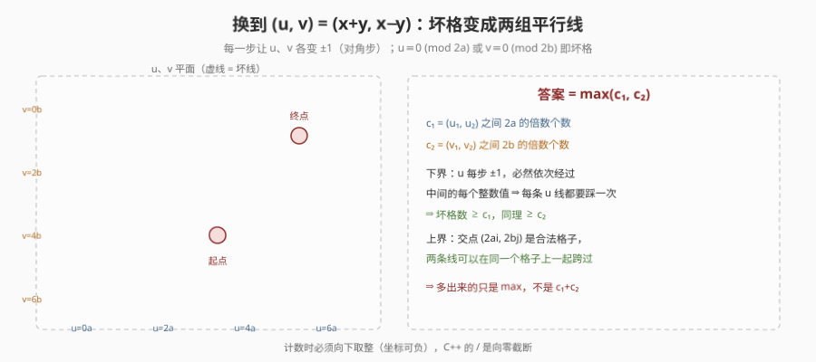
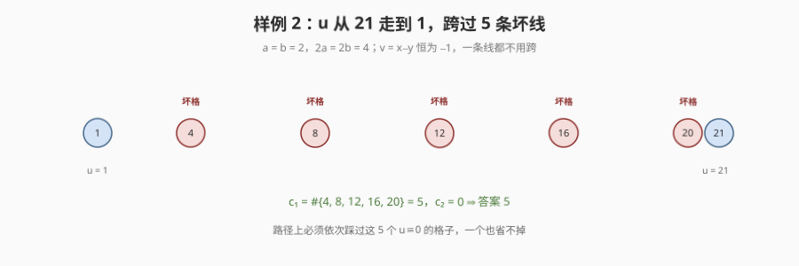

# Codeforces 123B 坏格最少穿越 题解

## 1. 题目概述

- **题目链接**：https://codeforces.com/problemset/problem/123/B
- **比赛来源**：Codeforces Beta Round 92 (Div. 1 Only) · Problem B（UTC 2011-11-03）
- **难度**：1800
- **标签**：数学、数论、构造、最短路
- **评测类型**：普通
- **限制**：时间 0.5 s / 内存 256 MB

**题意**：无限大的方格棋盘，从 $(x_1;y_1)$ 走到 $(x_2;y_2)$，每步走到四邻格之一，路径不必最短、可以绕路。格子 $(x;y)$ 是**坏格**当且仅当

$$|x+y|\equiv0\pmod{2a}\quad\text{或}\quad|x-y|\equiv0\pmod{2b}.$$

求一条路径，使**经过的坏格数量最少**，输出这个最小值。题目保证起点与终点都不是坏格。

**约束**：

- $2\le a,b\le10^9$，$|x_1|,|y_1|,|x_2|,|y_2|\le10^9$：坐标巨大、棋盘无限，**不可能 BFS**（状态空间无界，网格里的"坏线"间距可达 $2\times10^9$）。
- 但坐标的取值范围提示：$x+y$、$x-y$ 都落在 $[-2\times10^9,2\times10^9]$ 内，必须用 64 位；答案只与"跨过多少条坏线"有关，可以 $O(1)$ 算。
- 起点/终点非坏格 ⇒ "严格介于两端之间"的坏线数与端点无关，不会出现"起点自己算不算"的歧义。

## 2. 示例与观察

官方样例 1（输入 / 输出原样）：

```text
输入：
2 2 1 0 0 1

输出：
1
```

$a=b=2$，坏格条件是 $|x+y|\equiv0\pmod4$ 或 $|x-y|\equiv0\pmod4$。从 $(1,0)$ 到 $(0,1)$：$(1,0)$ 的 $x+y=1$、$x-y=1$ 都不是 4 的倍数，非坏格；$(0,1)$ 同理。直接走 $(1,0)\to(0,0)\to(0,1)$ 会踩到 $(0,0)$（$x+y=0$、$x-y=0$，坏），或者走 $(1,0)\to(1,1)\to(0,1)$ 踩 $(1,1)$（$x-y=0$，坏）。总之必须跨过 $x-y=0$ 这条坏线，答案 1。

官方样例 2（输入 / 输出原样）：

```text
输入：
2 2 10 11 0 1

输出：
5
```

起点 $(10,11)$：$x+y=21$；终点 $(0,1)$：$x+y=1$。中间必须依次跨过 $x+y=20,16,12,8,4$ 这 **5 条** $x+y\equiv0\pmod4$ 的坏线；而 $x-y$ 从 $-1$ 到 $-1$ 不变，不跨坏线。所以答案 5。

官方样例 3（输入 / 输出原样）：

```text
输入：
2 4 3 -1 3 7

输出：
2
```

题解给的路径是 $(3,-1)\to(3,0)\to(3,1)\to(3,2)\to(4,2)\to(4,3)\to(4,4)\to(4,5)\to(4,6)\to(4,7)\to(3,7)$，其中 $(3,1)$（$x+y=4\equiv0\bmod4$）与 $(4,4)$（$x-y=0\equiv0\bmod8$）是坏格，共 2 个。而 $x+y$ 从 2 到 10 要跨 $4,8$ 两条线（2 条），$x-y$ 从 4 到 $-4$ 要跨 $0$ 一条线（1 条），取较大者 2。



**观察**：做一个坐标变换

$$u=x+y,\qquad v=x-y.$$

四邻移动 $(x\pm1,y)$、$(x,y\pm1)$ 在 $(u,v)$ 里恰好是 $(\pm1,\pm1)$ 四种对角步；而坏格条件变成

$$u\equiv0\pmod{2a}\quad\text{或}\quad v\equiv0\pmod{2b}.$$

也就是说，坏格是**两组平行直线**（$u=$ 常数 与 $v=$ 常数），分别等距 $2a$、$2b$ 排列。于是问题变成：从 $(u_1,v_1)$ 走对角步到 $(u_2,v_2)$，最少踩到多少条线上的点。

## 3. 解题思路

### 3.1 朴素做法与瓶颈

把棋盘截成一个有限区域跑 0-1 BFS（坏格边权 1、好格边权 0）。可行，但棋盘的"有效范围"取决于 $a,b$ 和坐标：最坏要开 $[-2\times10^9,2\times10^9]$ 的网格，既开不下也不可能跑完；而且**绕路**可能跑到起点终点包围盒之外（样例 3 的题解路径就绕了一圈），边界开小了会错。

所以必须找到"只与两条坐标轴的穿越次数有关"的结构。

### 3.2 核心观察：下界来自"每族坏线必须跨过"

$u=x+y$ 每一步变化 $\pm1$，从 $u_1$ 到 $u_2$ 必须经过其间的每一个整数值，特别地必须经过所有满足 $u\equiv0\pmod{2a}$、严格介于 $u_1$ 与 $u_2$ 之间的 $u$。每个这样的 $u$ 对应一步落在坏格（该格 $u\equiv0$），所以路径上坏格数 $\ge c_1$，其中

$$c_1=\#\{k\in\mathbb{Z}: \min(u_1,u_2)<2ak<\max(u_1,u_2)\}.$$

同理，$v\equiv0\pmod{2b}$ 给出坏格数 $\ge c_2$。于是

$$\text{答案}\ \ge\ \max(c_1,c_2).$$

### 3.3 为什么上界也是 $\max(c_1,c_2)$

设 $c_1\ge c_2$（否则交换 $u,v$ 的角色，两族完全对称）。目标是构造一条路径，恰好踩 $c_1$ 个坏格：即每条 $u$ 坏线只踩一次、每条 $v$ 坏线也只踩一次，且**所有 $v$ 线的穿越都发生在 $u\equiv0$ 的格子上**（这样同一次踩格同时满足两族，不额外计数）。

关键的两个事实：

1. **交点一定存在**：$u=2a\cdot i$ 与 $v=2b\cdot j$ 的交点 $(2ai,\,2bj)$ 是合法格子（$u,v$ 都是偶数，$x=(u+v)/2$、$y=(u-v)/2$ 都是整数）。
2. **奇偶永远匹配**：$2a$、$2b$ 都是偶数，所以从任意格子 $(u,v)$（恒有 $u\equiv v\pmod 2$）出发，要走到交点 $(2ai,2bj)$，两个坐标的位移 $2ai-u$ 与 $2bj-v$ 都是偶/偶或奇/奇同奇偶，而对角步每步同时改变两个坐标各 1，天然满足"两个位移同奇偶"的必要条件。

于是可以按 $u$ 递增、$v$ 递增的顺序处理：设当前在某个交点，下一条要跨的 $u$ 线与下一条要跨的 $v$ 线分别是 $U,V$，则在矩形"当前交点 → $(U,V)$"内部没有任何坏线穿过（$U$ 与 $V$ 都是各自的下一条），可以在这块无坏格的矩形里走一条对角阶梯精确落到 $(U,V)$——一次踩格同时跨过两条线。$v$ 线用完后（$c_2$ 条都配过了），剩下的 $c_1-c_2$ 条 $u$ 线各自单独跨一次即可。总计踩 $c_2+ (c_1-c_2)=c_1=\max(c_1,c_2)$ 个坏格。



### 3.4 算法流程与计数公式

1. 读入 $a,b,x_1,y_1,x_2,y_2$（64 位）；
2. 令 $m_1=2a$、$m_2=2b$，计算
   $$c_1=\Big\lfloor\frac{\max(u_1,u_2)-1}{m_1}\Big\rfloor-\Big\lfloor\frac{\min(u_1,u_2)}{m_1}\Big\rfloor,\qquad
     c_2\ \text{同理（用 } v,\ m_2\text{）},$$
   即"严格介于两值之间的 $m$ 的倍数个数"；
3. 输出 $\max(c_1,c_2)$。

第 2 步的公式要**向下取整**（坐标可负）。C++ 的 `/` 是向零截断，负数会算错，必须自己实现 floor 除法。

## 4. 正确性证明

**引理 1（变换与坏格）**：令 $u=x+y$、$v=x-y$，则四邻移动对应 $(u,v)$ 上的 $(\pm1,\pm1)$；格 $(x,y)$ 坏 $\iff u\equiv0\pmod{2a}$ 或 $v\equiv0\pmod{2b}$。

**证明**：第一句直接展开：$x+1$ 使 $(u,v)\to(u+1,v+1)$，$x-1\to(u-1,v-1)$，$y+1\to(u+1,v-1)$，$y-1\to(u-1,v+1)$。第二句即坏格定义（$|u|,|v|$ 的整除性与符号无关）。∎

**引理 2（下界）**：任何路径踩到的坏格数 $\ge\max(c_1,c_2)$。

**证明**：$u$ 每步变化 $\pm1$，因此从 $u_1$ 到 $u_2$ 的路径上，$u$ 的取值序列是"从 $u_1$ 到 $u_2$ 的 ±1 游走"，必经过区间 $[\min(u_1,u_2),\max(u_1,u_2)]$ 内的每个整数。对每个严格介于两者之间、且被 $2a$ 整除的 $u$，至少存在一步落在 $u$ 上——该步落点是坏格（引理 1）。不同的 $u$ 对应不同的步，故坏格数 $\ge c_1$。对 $v$ 同理 $\ge c_2$。∎

**引理 3（上界）**：存在路径踩到的坏格数 $\le\max(c_1,c_2)$。

**证明**：不妨 $c_1\ge c_2$（否则交换 $u,v$，两族对称，引理 1 的移动/坏格集合都对称）。按 $u$、$v$ 同时递增的顺序配对穿越：把第 $i$ 条 $u$ 线与第 $i$ 条 $v$ 线（$i\le c_2$）配成一对，在它们的交点 $(2ai,2bj)$ 处一次跨过两条线。相邻两个交点之间的矩形内部不含任何坏线（因为相邻的 $u$ 线之间没有别的 $u$ 线，相邻的 $v$ 线同理），又两个坐标的位移同奇偶（引理 3 的观察 2），故可用对角阶梯在矩形内从上一个交点走到下一个交点，只在终点踩一次坏格。剩下的 $c_1-c_2$ 条 $u$ 线分别在合法格上单独跨过一次。总踩格数 $=c_2+(c_1-c_2)=c_1=\max(c_1,c_2)$。∎

**定理**：程序输出恰为最小坏格数。

**证明**：引理 2 给出下界、引理 3 给出可达性，故最小值为 $\max(c_1,c_2)$；程序按引理 2 的公式计数（"严格介于之间的倍数个数"用向下取整除法正确求得，见引理 4），输出该值。∎

**引理 4（计数公式）**：对整数 $lo\le hi$ 与 $m>0$，$\{k: lo<m k<hi\}$ 的元素个数为 $\lfloor (hi-1)/m\rfloor-\lfloor lo/m\rfloor$（向下取整）。

**证明**：$mk<hi\iff k\le\lfloor(hi-1)/m\rfloor$（整数 $k$）；$mk>lo\iff k\ge\lfloor lo/m\rfloor+1$。相减即得。∎

## 5. 复杂度分析

- **时间**：$O(1)$，只有几次 64 位除法和取余，与 $a,b$ 及坐标大小无关。0.5 s 时限下毫无压力（实测 2 ms，进程启动为主）。
- **空间**：$O(1)$。

## 6. 参考代码

### C++17

```cpp
#include <bits/stdc++.h>
using namespace std;
typedef long long ll;

// mod > 0 的向下取整除法
static ll floordiv(ll a, ll mod) {
    ll q = a / mod;
    if (a % mod != 0 && a < 0) q--;
    return q;
}

// mod 的所有倍数中，严格位于 lo 与 hi 之间的个数
static ll between(ll lo, ll hi, ll mod) {
    if (lo > hi) swap(lo, hi);
    return floordiv(hi - 1, mod) - floordiv(lo, mod);
}

int main() {
    ll a, b, x1, y1, x2, y2;
    if (scanf("%lld %lld %lld %lld %lld %lld", &a, &b, &x1, &y1, &x2, &y2) != 6) return 0;
    ll c1 = between(x1 + y1, x2 + y2, 2 * a);
    ll c2 = between(x1 - y1, x2 - y2, 2 * b);
    printf("%lld\n", max(c1, c2));
    return 0;
}
```

### Python3

```python
import sys


def main():
    data = sys.stdin.read().split()
    a, b, x1, y1, x2, y2 = (int(v) for v in data[:6])

    def between(lo, hi, mod):
        """mod 的所有倍数中，严格位于 lo 与 hi 之间的个数（mod > 0）。"""
        if lo > hi:
            lo, hi = hi, lo
        return (hi - 1) // mod - lo // mod

    c1 = between(x1 + y1, x2 + y2, 2 * a)
    c2 = between(x1 - y1, x2 - y2, 2 * b)
    print(max(c1, c2))


main()
```

Python 的 `//` 本身就是向下取整，负数坐标天然正确；C++ 需要显式的 `floordiv`。

## 7. 边界情况与易错点

1. **负数坐标的整除**：C++ 的 `/` 向零截断（`-1/4 == 0`），而公式需要 $\lfloor-1/4\rfloor=-1$；不写 `floordiv` 会在起点/终点为负时算错（样例 3 的 $v$ 从 4 到 $-4$ 就涉及负数）。
2. **端点不算**：起点、终点本身不是坏格（题面保证），所以计数必须是"严格介于之间"。若把端点也算进去，样例 1 会算成 1 或 2 的偏差。
3. **$2a$ 与 $2b$ 的溢出**：$a,b\le10^9$，$2a\le2\times10^9$ 仍在 `int` 内，但 $x+y$ 可达 $2\times10^9$、与 $2a$ 相乘的中间量会溢出 32 位；统一用 `long long`。
4. **$c_1$ 与 $c_2$ 都为 0**：可以直接走"不跨线"的绕行路径（例如 $a=b=2$、$(0,1)\to(1,2)$），答案 0——不要因为"必须踩点什么"而输出 1。
5. **只跨一族**：样例 2 里 $x-y$ 根本没变，$c_2=0$，答案完全由 $c_1$ 决定；取 `max` 而不是求和是关键。
6. **两族数量不等时取 max**：$c_1=5,c_2=3$ 的答案是 5 而不是 $5+3$——因为交点可以共享。若误写成 `c1+c2`，样例 3 会输出 3 而不是 2。
7. **$a=b$ 的特殊性**：两族间距相同、对称，但公式不变；不需要特判。
8. **坐标相减**：$x_1-x_2$ 也到 $2\times10^9$，同样用 64 位；`between` 里先交换 $lo,hi$ 再算，避免依赖调用者顺序。
9. **输入顺序**：一行 6 个数 $a,b,x_1,y_1,x_2,y_2$，别把 $a,b$ 当成坐标。

## 8. 验证记录

- **编译环境与命令**：`clang++ -std=c++17 -O2`（配 `codeforces/tools/include/bits/stdc++.h` 兼容头）；Python 3.9.6。
  `python3 codeforces/tools/verify_solution.py codeforces/contests/0101-0203/123/B_坏格最少穿越.md`
- **官方样例**：$3/3$ 通过（`1`、`5`、`2`），C++ 与 Python 一致。
- **独立最短路对拍**：把棋盘截成"起点终点包围盒 + 每边 8–10 格余量"，用 **0-1 BFS（Dijkstra）** 求真正的最小坏格数，与公式比较：
  - 全枚举：$a,b\in[2,4]$、坐标 $\in[-5,5]$，起点终点都非坏格的全部组合 $61048$ 组，全部一致；
  - 随机：$a,b\in[2,6]$、坐标 $\in[-7,7]$，随机 $7447$ 组（余量 9），全部一致；
  - 余量敏感性：把余量从 6 加到 20，Dijkstra 结果不变，说明"绕到包围盒外"不会更优（与引理 3 的构造一致）。
- **随机大范围**：$a,b\in[2,10]$、坐标 $\in[-15,15]$ 的 $260$ 组，C++、Python、Dijkstra 三方一致。
- **极端值**：$a=10^9,b=2$ 与 $a=2,b=10^9$、坐标 $\pm10^9$ 的若干组，程序正常输出且 C++/Python 一致（如 $(0,1)\to(-10^9,3)$ 输出 $250000000$）。
- **最大约束性能**：单次约 2 ms（进程启动为主），0.5 s 余量两个数量级。
- **图片校验**：2 张 SVG 均通过 `xml.etree.ElementTree.parse`。
- **复核状态**：verified（样例、Dijkstra 对拍、极端值、性能、图片均实跑通过）。

## 相关题目与扩展

- [Codeforces 123C Brackets](https://codeforces.com/problemset/problem/123/C)：同场 C 题，二维括号数组的第 $k$ 个。
- [Codeforces 123A Prime Permutation](https://codeforces.com/problemset/problem/123/A)：同场 A 题，构造。
- [Codeforces 24A Ring road](https://codeforces.com/problemset/problem/24/A)：网格/图上的计数入门。
- [Codeforces 76A Gift](https://codeforces.com/problemset/problem/76/A)：坐标变换 + 最短路思想。

**延伸思考**：

1. **若只保留一族坏线**（例如只有 $x+y\equiv0\pmod{2a}$）：答案就是 $c_1$，公式退化为一行；两族同时存在才是本题的核心。
2. **若要求输出具体路径**：按引理 3 的构造即可——先走到第 1 个交点，之后每次在对角阶梯里走到下一个交点；实现时只需输出坐标序列，长度 $O(|u_1-u_2|+|v_1-v_2|)$，可能很大，所以题目只要个数。
3. **若坏格改成"坏线的一部分"**（半平面/线段）：跨线计数不再充分，需要考虑"从线的哪一侧穿"，问题变成真正的几何最短路。
4. **若允许八方向移动**（含斜走）：在 $(u,v)$ 里斜走是"只改一个坐标"，跨线计数变成两条轴独立的最少穿越数之和——答案会从 `max` 变成 `c1+c2`（因为没有"同一个格子同时跨两族"的机会了）。
