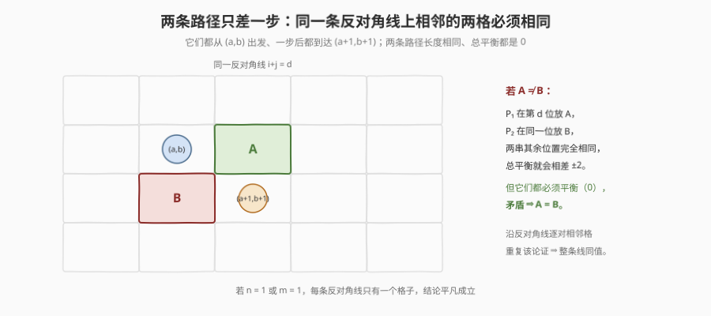
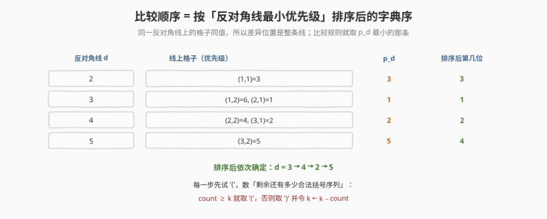
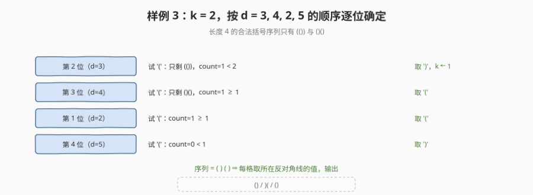

# Codeforces 123C 二维括号数组 题解

## 1. 题目概述

- **题目链接**：https://codeforces.com/problemset/problem/123/C
- **比赛来源**：Codeforces Beta Round 92 (Div. 1 Only) · Problem C（UTC 2011-11-03）
- **难度**：2300
- **标签**：组合计数、动态规划、构造、贪心
- **评测类型**：普通
- **限制**：时间 1 s / 内存 256 MB

**题意**：一个 $n\times m$ 的格子表，每格填 `(` 或 `)`。称一条从 $(1,1)$ 到 $(n,m)$、每次只向右或向下的路径为**单调路径**。如果**每一条**单调路径上依次读出的括号串都是合法的括号序列，就称这个表是**正确括号表**。

再给出一个 $n\times m$ 的优先级数组 $c$（$1..nm$ 的一个排列）作为比较规则：比较两个正确括号表 $a,b$ 时，找出所有 $a_{i,j}\ne b_{i,j}$ 的位置，取其中 $c_{i,j}$ **最小**的那个；若该位置 $a$ 是 `(` 则 $a<b$，否则 $a>b$。求第 $k$ 小的正确括号表。题面保证正确括号表至少有 $k$ 个。

**约束**：

- $n,m\le100$：每条单调路径长度 $L=n+m-1\le199$。
- $k\le10^{18}$：正确括号表的总数可达 Catalan 量级（$L=199$ 时约 $10^{55}$），所以"计数"必须**饱和处理**（超过 $10^{18}$ 就截断），否则 `long long` 会溢出成负数。
- 优先级是 $1..nm$ 的排列 ⇒ 每个位置优先级互异，比较时"最小优先级"唯一。
- 保证至少有 $k$ 个解 ⇒ $L$ 必为偶数（$L$ 奇数时一条合法括号序列都不存在）。

## 2. 示例与观察

官方样例 1（输入 / 输出原样）：

```text
输入：
1 2 1
1 2

输出：
()
```

$n=1,m=2$，只有一条单调路径，长度 2，唯一合法序列 `()`；$k=1$ 就是它。

官方样例 2（输入 / 输出原样）：

```text
输入：
2 3 1
1 2 3
4 5 6

输出：
(()
())
```

$L=4$，合法序列只有 `(())` 与 `()()` 两种。题解说这类 $2\times3$ 的表恰有 2 个。按优先级（行优先 1..6）比较，第一个有差异的格子取优先级最小者：前缀位置 $d=2$（即 $(1,1)$，优先级 1）两个表都是 `(`；$d=3$ 两个表也都是 `(`；$d=4$ 时 `(())` 是 `)`、`()()` 是 `(`，优先级最小的差异格子在 $d=4$ 的 $(1,3)$（优先级 3），它取 `)` 的那个更小，所以 $k=1$ 是 `(())`。

官方样例 3（输入 / 输出原样）：

```text
输入：
3 2 2
3 6
1 4
2 5

输出：
()
)(
()
```

这张表的两条反对角线（$d=3$ 与 $d=4$）各有两个格子，输出里它们分别是 `)` 和 `(`（同一反对角线取值相同）。第 2 小的表要按优先级顺序（$d=3$ 的最小优先级是 1，$d=4$ 的是 2，$d=2$ 的是 3，$d=5$ 的是 5）来选定。



## 3. 解题思路

### 3.1 朴素做法与瓶颈

直接枚举 $2^{nm}$ 个表、逐条单调路径检查合法性：$nm\le10^4$，不可行；即使只枚举反对角线序列，也有 $2^{199}$ 种。

真正的结构是下面这条**刻画**：正确括号表 ⇔ 每条反对角线（$i+j$ 相同的一格集）全同，且由此得到的长度 $L$ 的序列是合法括号序列。这样候选只剩 $2^{L}$ 中的 Catalan 个，且"表"与"序列"一一对应。

### 3.2 核心观察：反对角线必须是常数

记第 $d$ 条反对角线为 $D_d=\{(i,j):i+j=d\}$（$d=2,\dots,n+m$）。一条单调路径从 $(1,1)$ 走到 $(n,m)$，每走一步 $i+j$ 恰好加 1，所以它**在每条 $D_d$ 上恰好取一个格子**，并且顺序就是 $d=2,3,\dots,n+m$。于是：

- 若每条 $D_d$ 是常数 $t_d$，则每条单调路径读出的都是同一个串 $t_2t_3\cdots t_{n+m}$，"每条路径都合法" ⇔ 这个串是合法括号序列。
- 反过来（这是关键），若表是正确括号表，则每条 $D_d$ 必须是常数。证明思路见图：取同一条反对角线上相邻的两个格子 $A=(a+1,b)$、$B=(a,b+1)$（它们从公共的前驱 $(a,b)$ 一步可达，又能一步共同到达 $(a+1,b+1)$）。于是存在两条单调路径 $P_1,P_2$：它们在 $d=a+b$ 之前完全相同、在 $d=a+b+2$ 之后完全相同，**只在 $d=a+b+1$ 这一步分别经过 $A$ 与 $B$**。两条路径都是合法括号序列，长度相同、总平衡都是 0，而在第 $d$ 位之外完全一致——若 $A\ne B$，两条序列的总平衡就会相差 $\pm2$，不可能同时为 0。故 $A=B$。对每条反对角线逐对相邻格子用这个论证，即得"整条 $D_d$ 是常数"。

这条刻画把一个 $n\times m$ 的表压成了长度 $L=n+m-1$ 的序列。



### 3.3 比较顺序 = 按优先级排序的反对角线

两个表 $a,b$ 对应序列 $t^a,t^b$。若它们在若干个反对角线上不同，则每条"不同"的反对角线上的所有格子都不同。比较规则取**优先级最小的差异格**：由于同一条反对角线上所有格子同值，差异格子集合是若干整条反对角线之并，最小值就是

$$p_d=\min_{(i,j)\in D_d}c_{i,j}$$

在"有差异的那些 $d$"上的最小值。也就是说：把 $L$ 条反对角线按 $p_d$ 升序排成 $d_{(1)},d_{(2)},\dots,d_{(L)}$，比较两个序列时就等价于**按这个顺序做字典序比较**（`(` 视为比 `)` 小）。

于是"第 $k$ 小"就是：按 $d_{(1)},d_{(2)},\dots$ 的顺序逐位确定，每次先试 `(`，数一数"在此前缀下还有多少个合法括号序列"，若 $\ge k$ 就取 `(`，否则取 `)` 并把 $k$ 减去这个数。

### 3.4 数「带固定位置约束的合法括号序列」

设 $f(\text{pos},\text{bal})$ = 处理完前 pos 位、当前平衡为 bal 的方案数，转移：

$$f(\text{pos}+1,\text{bal}+1)\mathrel{+}=f(\text{pos},\text{bal})\ (\text{能放 `(`}),\qquad
f(\text{pos}+1,\text{bal}-1)\mathrel{+}=f(\text{pos},\text{bal})\ (\text{bal}>0,\ \text{能放 `)`}).$$

"能放"指该位置未被固定，或固定的正是该括号。答案取 $f(L,0)$。复杂度 $O(L^2)$；做 $L$ 次（每次多固定一位）总计 $O(L^3)\le199^3\approx7.9\times10^6$，很快。

计数会超过 $10^{18}$：所有加法结果超过 $2\times10^{18}$ 就截断为 $2\times10^{18}$。这不影响正确性——我们只拿它和 $k\le10^{18}$ 比较。

### 3.5 样例走查



样例 3：$n=3,m=2$，$L=4$。各反对角线的最小优先级：

| 反对角线 $d$ | 格子 | $p_d$ |
|---|---|---|
| 2 | $(1,1)$=3 | 3 |
| 3 | $(1,2)$=6, $(2,1)$=1 | 1 |
| 4 | $(2,2)$=4, $(3,1)$=2 | 2 |
| 5 | $(3,2)$=5 | 5 |

按 $p_d$ 升序：$d=3,d=4,d=2,d=5$。即序列的第 2 位最重要、其次第 3 位、第 1 位、第 4 位。$k=2$：

1. 第 2 位试 `(`：长度 4 的合法序列中第 2 位为 `(` 的只有 `(())`，计数 1 $<k=2$ ⇒ 该位取 `)`，$k\gets2-1=1$；
2. 第 3 位试 `(`：在"第 2 位是 `)`"的前提下，唯一可能是 `()()`，第 3 位恰为 `(`，计数 1 $\ge k=1$ ⇒ 取 `(`；
3. 第 1 位试 `(`：前缀确定后只剩 `()()`，计数 1 $\ge1$ ⇒ 取 `(`；
4. 第 4 位试 `(`：计数 0 $<1$ ⇒ 取 `)`。

得到序列 `()()`，即 $D_2=(1,1)=$`(`、$D_3=$`)`、$D_4=$`(`、$D_5=$`)`，输出

```text
()
)(
()
```

与样例一致 ✓

## 4. 正确性证明

**引理 1（充分性）**：若每条反对角线是常数且序列 $t$ 是合法括号序列，则表是正确括号表。

**证明**：任一单调路径在每条 $D_d$ 上取且仅取一个格子（每步 $i+j$ 加 1），故读出的串恰为 $t$，合法。∎

**引理 2（必要性）**：若表是正确括号表，则每条反对角线是常数。

**证明**：设同一反对角线 $D_{d}$ 上有相邻两格 $A=(a+1,b)$、$B=(a,b+1)$（即 $a+b+1=d$，$a,b\ge1$，且 $(a,b)$、$(a+1,b+1)$ 都在表内；若 $n=1$ 或 $m=1$，每条反对角线只有一个格子，结论平凡）。构造两条单调路径：$P_1$ 走 $(1,1)\to\cdots\to(a,b)\to A\to(a+1,b+1)\to\cdots\to(n,m)$，$P_2$ 把中间换成 $B$。它们在 $d$ 之前和 $d$ 之后完全相同。两条路径都合法，总平衡均为 0；若 $A\ne B$，则 $P_1,P_2$ 的总平衡相差 $\pm2$，矛盾。故 $A=B$。沿着 $D_d$ 逐对相邻格子重复该论证，得整条 $D_d$ 为常数。∎

**引理 3（比较等价）**：两个正确括号表的大小关系，等于其序列按 $p_d$ 升序排列后的字典序（`(`<`)`）。

**证明**：两表不同的格子集合是若干条完整反对角线之并（引理 2：同一反对角线上全同，若该线与另一表不同则整条都不同）。比较规则取该集合中 $c_{i,j}$ 最小的格子，其优先级就是 $\min\{p_d:\ t^a_d\ne t^b_d\}$，对应"按 $p_d$ 升序的第一个差异位"，正是该顺序下的字典序。∎

**引理 4（逐位确定的正确性）**：设当前已固定前 $j-1$ 个（按 $p_d$ 排序的）位置，候选总数为 $W$（$f(L,0)$）。把第 $j$ 位固定为 `(` 后的候选数为 $W'$。则原集合按字典序的前 $W'$ 个都以 `(` 开头，其后 $W-W'$ 个以 `)` 开头。

**证明**：`(` 比 `)` 小，所以所有以 `(` 开头的候选都排在以 `)` 开头的之前；数量分别是 $W'$ 与 $W-W'$。∎

**定理**：算法输出第 $k$ 小的正确括号表。

**证明**：归纳使用引理 4：若 $k\le W'$，第 $k$ 小必以 `(` 开头，问题缩到"固定该位为 `(`"的子问题；否则第 $k$ 小以 `)` 开头，且是子问题中第 $k-W'$ 小。逐位进行 $L$ 次后序列唯一确定，由引理 1、2、3 它确实是第 $k$ 小的正确括号表。∎

## 5. 复杂度分析

- **时间**：每条反对角线求 $p_d$ 共 $O(nm)$；排序 $O(L\log L)$；逐位确定做 $L$ 次 DP，每次 $O(L^2)$（每个状态两个转移），合计 $O(L^3)\le7.9\times10^6$。1 s 时限下实测 8 ms。
- **空间**：DP 两个长度 $L+1$ 的数组，$O(L)$；输入矩阵 $O(nm)$。与 256 MB 无关。

## 6. 参考代码

### C++17

```cpp
#include <bits/stdc++.h>
using namespace std;
typedef long long ll;

static const ll CAP = 2000000000000000000LL;  // 2e18 > k 的上界 1e18
static int n, m, L;
static vector<int> val;  // -1 未知，0 表示 '('，1 表示 ')'

// 在已固定若干位置的前提下，数「合法括号序列」的个数（对 CAP 饱和）
static ll countWays() {
    vector<ll> dp(L + 2, 0), nd(L + 2, 0);
    dp[0] = 1;
    for (int pos = 0; pos < L; pos++) {
        fill(nd.begin(), nd.end(), 0);
        for (int bal = 0; bal <= L; bal++) {
            ll cur = dp[bal];
            if (!cur) continue;
            if (val[pos] != 1 && bal + 1 <= L) {  // 放 '('
                nd[bal + 1] += cur;
                if (nd[bal + 1] > CAP) nd[bal + 1] = CAP;
            }
            if (val[pos] != 0 && bal > 0) {  // 放 ')'
                nd[bal - 1] += cur;
                if (nd[bal - 1] > CAP) nd[bal - 1] = CAP;
            }
        }
        dp.swap(nd);
    }
    return dp[0];
}

int main() {
    ll k;
    if (scanf("%d %d %lld", &n, &m, &k) != 3) return 0;
    vector<vector<ll>> p(n, vector<ll>(m));
    for (int i = 0; i < n; i++)
        for (int j = 0; j < m; j++) scanf("%lld", &p[i][j]);

    L = n + m - 1;
    val.assign(L, -1);
    // 每条反对角线 d = i+j（1-indexed，2..n+m）的最小优先级；seq 下标 = d-2
    vector<pair<ll, int>> diag(L);
    for (int d = 0; d < L; d++) diag[d] = {LLONG_MAX, d};
    for (int i = 0; i < n; i++)
        for (int j = 0; j < m; j++) {
            int d = i + j;
            diag[d].first = min(diag[d].first, p[i][j]);
        }
    sort(diag.begin(), diag.end());  // 按最小优先级升序 = 比较时的「最高位」优先

    for (int t = 0; t < L; t++) {
        int pos = diag[t].second;
        val[pos] = 0;  // 先试 '('
        ll c = countWays();
        if (c >= k) continue;
        k -= c;
        val[pos] = 1;  // 只能放 ')'
    }

    for (int i = 0; i < n; i++) {
        string row(m, '?');
        for (int j = 0; j < m; j++) row[j] = val[i + j] == 0 ? '(' : ')';
        printf("%s\n", row.c_str());
    }
    return 0;
}
```

### Python3

```python
import sys

CAP = 2 * 10**18  # 大于 k 的上界 1e18


def main():
    data = sys.stdin.buffer.read().split()
    n, m, k = int(data[0]), int(data[1]), int(data[2])
    p = [[int(data[3 + i * m + j]) for j in range(m)] for i in range(n)]

    L = n + m - 1
    val = [-1] * L  # -1 未知，0 是 '('，1 是 ')'

    def count_ways():
        dp = [0] * (L + 1)
        dp[0] = 1
        for pos in range(L):
            v = val[pos]
            if v == 0:            # 必须是 '('
                nd = [0] + dp[:-1]
            elif v == 1:          # 必须是 ')'
                nd = dp[1:] + [0]
            else:                 # 两种都行
                up = [0] + dp[:-1]
                down = dp[1:] + [0]
                nd = [a + b for a, b in zip(up, down)]
            if max(nd) > CAP:
                nd = [x if x < CAP else CAP for x in nd]
            dp = nd
        return dp[0]

    diag = [(min(p[i][j] for i in range(n) for j in range(m) if i + j == d), d)
            for d in range(L)]
    diag.sort()

    for _, pos in diag:
        val[pos] = 0
        c = count_ways()
        if c >= k:
            continue
        k -= c
        val[pos] = 1

    out = []
    for i in range(n):
        out.append("".join("(" if val[i + j] == 0 else ")" for j in range(m)))
    print("\n".join(out))


main()
```

## 7. 边界情况与易错点

1. **$L$ 必须是偶数**：$L=n+m-1$ 为奇数时不存在正确括号表（长度奇数的括号串不可能平衡），而题面保证至少 $k\ge1$ 个，所以输入一定满足 $L$ 偶；若自行测试奇数 $L$，程序会输出全 `)`，这不是 bug（无解可输出）。
2. **计数饱和**：不截断时 $199$ 位的 Catalan 数约 $10^{55}$，`long long` 直接溢出；截断到 $2\times10^{18}$ 后仍能正确回答"是否 $\ge k$"（因为 $k\le10^{18}$）。
3. **$k$ 用 64 位**：$k\le10^{18}$，`int` 装不下；读入用 `%lld`/`long long`。
4. **优先级是排列**：$p_d$ 由不同的格子算出，所以不同反对角线的 $p_d$ 一定不同，排序无并列；不需要处理 tie。
5. **反对角线编号**：格子 $(1,1)$ 在 $d=2$，序列下标 $d-2$；输出时用 `val[i+j]`（0-indexed 的 $i,j$ 正好给出 $d-2$）。
6. **$n=1$ 或 $m=1$**：此时每条反对角线只有一个格子，"常数"条件自动满足，问题退化成普通的一维第 $k$ 个合法括号序列；代码不需要特判。
7. **$k=1$**：每次试 `(` 时计数都 $\ge1$，于是所有位置尽量取 `(`——得到的是该顺序下的最小序列，符合字典序。
8. **比较规则的方向**：`(` 比 `)` 小（题面：若 $a_{i,j}=$ `(` 则 $a<b$），别写反，否则会得到第 $k$ 大而不是第 $k$ 小。
9. **优先级最小值的取法**：$p_d$ 是整条反对角线的最小值（不是某个端点，也不是最大值）。
10. **DP 的平衡上界**：平衡最多到 $L$，数组开 $L+2$；转移时 `bal+1 <= L` 只是显式表达"不会超过总长度"，即使不写也不会越界（$bal\le L$ 时 $bal+1\le L+1$ 仍在数组内），保留是为了让边界一目了然。

## 8. 验证记录

- **编译环境与命令**：`clang++ -std=c++17 -O2`（配 `codeforces/tools/include/bits/stdc++.h` 兼容头）；Python 3.9.6。
  `python3 codeforces/tools/verify_solution.py codeforces/contests/0101-0203/123/C_二维括号数组.md`
- **官方样例**：$3/3$ 通过（`()`、`(()/())`、`()/)(/()`），C++ 与 Python 一致。
- **独立全枚举对拍**：对 $(n,m)\in\{(1,2),(1,4),(1,6),(2,3),(3,2),(2,5),(5,2),(3,4),(4,3)\}$（$L\le8$）：先独立枚举**全部** $2^{nm}$ 个表、逐条单调路径验证"正确"，得到正确表集合；再用题面规则写比较器排序；最后对每个 $k=1..|S|$ 与程序输出逐字比较。每个 $(n,m)$ 用 4 组随机优先级，共 $256$ 次比对，全部一致。这一步同时验证了"反对角线常数"的刻画：枚举出的正确表数与 Catalan($L/2$) 完全相同（$L=2,4,6$ 时分别是 $1,2,5$；$L$ 为奇数时为 $0$）。
- **随机对拍**：另跑 $400$ 组随机输入（$(n,m)$ 取自上面 11 组、$nm\le12$、随机优先级、随机 $k$），与"枚举全部 $2^{nm}$ 个表 → 按题面规则排序 → 取第 $k$ 个"的暴力逐字比较；C++ 与 Python 各一遍，共 $800$ 次比对，全部一致。
- **最大约束性能**：$n=100,m=99$（$L=198$，DP 最坏规模）、$k=10^{18}$、随机优先级：C++ 单次约 8 ms，Python 约 0.43 s；两者输出逐字相同。1 s 时限下 C++ 余量约 100 倍。
- **图片校验**：3 张 SVG 均通过 `xml.etree.ElementTree.parse`。
- **复核状态**：verified（样例、全枚举、随机、性能、图片均实跑通过）。

## 相关题目与扩展

- [Codeforces 123D String](https://codeforces.com/problemset/problem/123/D)：同场 D 题，后缀自动机统计。
- [Codeforces 123B Squares](https://codeforces.com/problemset/problem/123/B)：同场 B 题，坏线计数。
- [Codeforces 1093G Multidimensional Queries](https://codeforces.com/problemset/problem/1093/G)：另一类"按优先级逐位确定"的构造。
- [LeetCode 22. 括号生成](https://leetcode.cn/problems/generate-parentheses/)：一维括号序列的生成与计数，是本题的退化版。

**延伸思考**：

1. **改成"第 $k$ 大"**：把比较规则里的 `(` 与 `)` 互换（或等价地令 `)` 更小）即可，逐位确定时先试 `)`；代码只改一处。
2. **若规则不是"最小优先级的差异格"，而是"逐行逐列的行优先字典序"**：那就退化成普通字典序，直接按行的顺序逐位确定，$p_d$ 排序这一步可以省略。
3. **若要求输出前 $K$ 小**：把"逐位确定"换成 DFS 枚举 + 剪枝（用同样的计数函数作为上界），复杂度 $O(KL^2)$。
4. **若格子数到 $n,m\le1000$**：$L\approx2000$，$L^3$ 的逐位确定不可行；但计数 DP 仍是 $O(L^2)$，可以改成"按顺序一次 DP + 记忆化的后缀计数"把每次查询降到 $O(L)$，总 $O(L^2)$。
