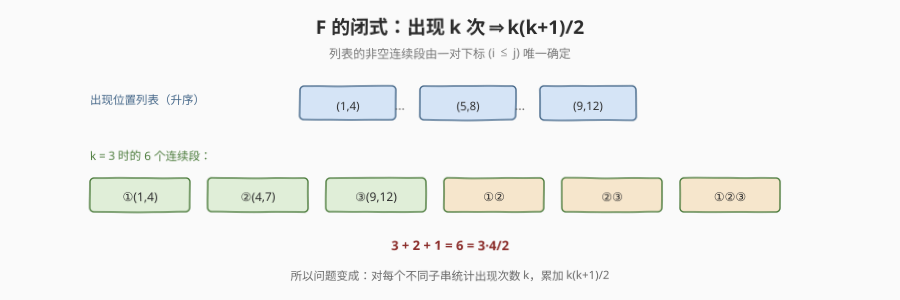
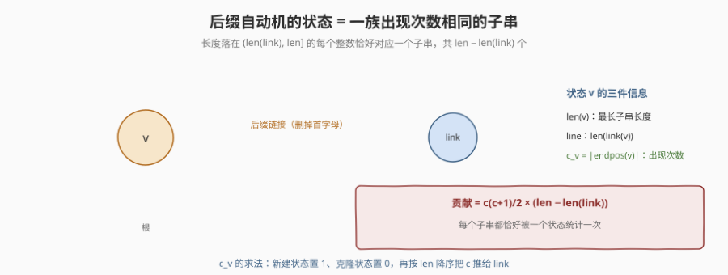
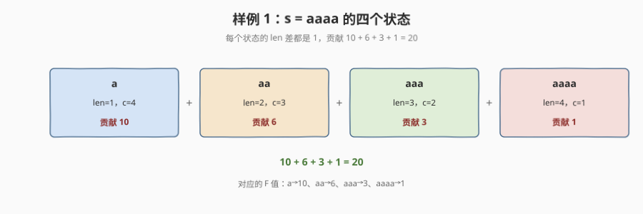

# Codeforces 123D 子串出现次数和 题解

## 1. 题目概述

- **题目链接**：https://codeforces.com/problemset/problem/123/D
- **比赛来源**：Codeforces Beta Round 92 (Div. 1 Only) · Problem D（UTC 2011-11-03）
- **难度**：2300
- **标签**：字符串、后缀自动机、后缀数组、计数
- **评测类型**：普通
- **限制**：时间 2 s / 内存 256 MB

**题意**：给出串 $s$。每个区间 $1\le l\le r\le|s|$ 对应一个子串 $s[l..r]$。定义 $F(x,y)$：把 $x$ 中所有等于 $y$ 的子串对应的区间按左端点升序排成一个列表，$F$ 等于这个列表里**非空连续段**的个数。例如 $F(\texttt{babbabbababbab},\texttt{babb})=6$：出现区间是 $(1,4),(4,7),(9,12)$，长度为 3 的列表的非空连续段共有 $3+2+1=6$ 个。

求 $\sum_x F(s,x)$，其中 $x$ 取遍 $s$ 的**所有不同子串**。

**约束**：

- $|s|\le10^5$：枚举全部 $O(n^2)$ 个子串并统计出现次数是 $O(n^2)$ 起步（哈希也要 $10^{10}$），必须用后缀结构做到 $O(n)$ 或 $O(n\log n)$。
- 答案规模：最坏 $s=\texttt{a}^{10^5}$ 时 $\sum_{k=1}^{n}\frac{k(k+1)}{2}\approx\frac{n^3}{6}\approx1.67\times10^{14}$，必须 64 位。
- 不同子串可达 $O(n^2)$ 个，但"出现次数相同的子串族"可以整族合并——这正是后缀自动机（SAM）的强项。

## 2. 示例与观察

官方样例 1（输入 / 输出原样）：

```text
输入：
aaaa

输出：
20
```

不同子串只有 `a`、`aa`、`aaa`、`aaaa`，出现次数分别是 $4,3,2,1$，于是 $F$ 分别是 $\frac{4\cdot5}{2}=10$、$\frac{3\cdot4}{2}=6$、$\frac{2\cdot3}{2}=3$、$\frac{1\cdot2}{2}=1$，和 $20$ ✓（题解也给了这四个值）。

官方样例 2（输入 / 输出原样）：

```text
输入：
abcdef

输出：
21
```

所有字符互不相同：$s$ 的不同子串共 $\frac{6\cdot7}{2}=21$ 个，每个只出现一次 ⇒ 每个 $F=1$ ⇒ 答案 21 ✓

官方样例 3（输入 / 输出原样）：

```text
输入：
abacabadabacaba

输出：
188
```



**观察 1（$F$ 的闭式）**：设 $x$ 在 $s$ 中出现 $k$ 次。"列表的非空连续段"就是从这个长度为 $k$ 的列表里任取一段连续下标，个数为

$$F(s,x)=k+(k-1)+\cdots+1=\frac{k(k+1)}{2}.$$

样例 1 完全对上（$10,6,3,1$），样例 2 因为 $k\equiv1$ 所以每个都是 1。

**观察 2（按"出现次数相同的子串族"合并）**：SAM 的一个状态 $v$ 恰好代表一族子串，它们的**右端点集合（endpos）完全相同**，因此出现次数相同、等于 $|\mathrm{endpos}(v)|$；族的大小是 $\mathrm{len}(v)-\mathrm{len}(\mathrm{link}(v))$。于是

$$\text{答案}=\sum_{v\ne\text{root}}\frac{c_v(c_v+1)}{2}\cdot\big(\mathrm{len}(v)-\mathrm{len}(\mathrm{link}(v))\big),\qquad c_v=|\mathrm{endpos}(v)|.$$

## 3. 解题思路

### 3.1 朴素做法与瓶颈

枚举所有位置区间 $(l,r)$（$O(n^2)$ 个），用字典/哈希把"内容 → 出现次数"统计出来，再对每种内容累加 $k(k+1)/2$。时间 $O(n^2)$（哈希）到 $O(n^3)$（暴力比较），空间 $O(n^2)$，$n=10^5$ 时完全不可行。

换个角度：不同子串有 $O(n^2)$ 个，**但不需要逐个枚举**——同一状态的子串"出现次数相同"，只差长度，可以整族一次算完。

### 3.2 核心观察：SAM 状态的三重信息

对 SAM 的状态 $v$：

- $\mathrm{len}(v)$：该状态能表示的**最长**子串长度；
- $\mathrm{link}(v)$：后缀链接，指向"$v$ 的最长串删掉首字母后"所属的等价类；
- 状态 $v$ 表示的子串恰为"长度在 $(\mathrm{len}(\mathrm{link}(v)),\ \mathrm{len}(v)]$ 之间、且都是 $v$ 最长串的后缀"的那些，共 $\mathrm{len}(v)-\mathrm{len}(\mathrm{link}(v))$ 个**互不相同**的子串；它们的 endpos 集合都等于 $v$ 的 endpos 集合，所以出现次数都等于 $c_v$。

于是每个状态贡献

$$\frac{c_v(c_v+1)}{2}\times\big(\mathrm{len}(v)-\mathrm{len}(\mathrm{link}(v))\big),$$

所有非根状态的贡献之和就是答案（每个不同子串恰好被一个状态统计一次）。



### 3.3 出现次数怎么算

构造 SAM 时，每个"新建状态"（对应一个前缀）令 $c=1$，"克隆状态"令 $c=0$。后缀链接构成一棵树（link 树），$v$ 的 endpos 大小等于它 link 子树里"前缀状态"的个数。因此按 $\mathrm{len}$ **从大到小**把 $c$ 上推给父节点即可：

$$c_{\mathrm{link}(v)}\mathrel{+}=c_v\qquad(\text{按 }\mathrm{len}\text{ 降序处理}).$$

用计数排序（$\mathrm{len}\le n$）可以做到 $O(n)$。

### 3.4 算法流程与样例走查

1. 对 $s$ 建后缀自动机（小写字母 26，用数组转移）；
2. 按 $\mathrm{len}$ 计数排序得到降序状态序列，把 $c$ 沿 `link` 上推；
3. 对每个非根状态累加 $\frac{c_v(c_v+1)}{2}\cdot(\mathrm{len}(v)-\mathrm{len}(\mathrm{link}(v)))$；
4. 输出。



样例 1 `aaaa`：非根状态依次表示 `a`($\mathrm{len}=1$)、`aa`($2$)、`aaa`($3$)、`aaaa`($4$)，$c$ 分别为 $4,3,2,1$，每个状态的 $\mathrm{len}-\mathrm{len}(\mathrm{link})=1$，贡献 $10+6+3+1=20$ ✓

样例 2 `abcdef`：所有子串互不相同，答案应为 21 个"$F=1$"之和 = 21。SAM 只有 6 个非根状态，但第 $k$ 个状态覆盖的是一整段后缀：最长串是 `abcde…`（长 $k$），它更短的后缀（`bcde…`、`cde…`、…）的 endpos 完全相同（都只出现一次），所以都在**同一个状态**里，$\mathrm{link}$ 直接指向根。于是该状态贡献 $\frac{1\cdot2}{2}\cdot k=k$，总和 $1+2+\cdots+6=21$ ✓

注意：**不能**假设每个状态的 $\mathrm{len}-\mathrm{len}(\mathrm{link})$ 都是 1——那只是"所有字符都相同"这类输入下的巧合。

## 4. 正确性证明

**引理 1（$F$ 的闭式）**：若子串 $x$ 在 $s$ 中出现 $k$ 次，则 $F(s,x)=\frac{k(k+1)}{2}$。

**证明**：按左端点升序排列后得到长度为 $k$ 的列表。列表的非空连续段由一对下标 $(i,j)$（$1\le i\le j\le k$）唯一确定，共 $\frac{k(k+1)}{2}$ 个。∎

**引理 2（SAM 的划分）**：SAM 的非根状态集合与 $s$ 的不同子串集合之间存在划分关系：每个状态 $v$ 恰好对应 $\mathrm{len}(v)-\mathrm{len}(\mathrm{link}(v))$ 个不同子串，且这些子串的出现次数都等于 $c_v=|\mathrm{endpos}(v)|$。

**证明**：这是后缀自动机的基本性质（endpos 等价类）：状态 $v$ 的 endpos 集合确定了一个等价类，类中所有子串都是 $v$ 最长串的后缀、长度覆盖 $(\mathrm{len}(\mathrm{link}(v)),\mathrm{len}(v)]$ 的每个整数，且不同长度的后缀互不相同；endpos 相同则出现次数相同。不同状态的 endpos 不同，故子串集合互不相交，并集为全部不同子串。∎

**引理 3（$c_v$ 的计算）**：按 $\mathrm{len}$ 降序执行 $c_{\mathrm{link}(v)}\mathrel{+}=c_v$ 之后，每个状态的 $c_v$ 等于 $|\mathrm{endpos}(v)|$。

**证明**：初始时每个前缀状态（每次 `extend` 新建的状态）的 endpos 含"当前前缀末尾"这一个位置，克隆状态的 endpos 是其后继状态的并集（在 link 树上），初值 0 正确。link 树上 $v$ 的子树中的前缀状态恰对应 endpos(v) 的每个位置（标准结论），且父的 $\mathrm{len}$ 小于子的 $\mathrm{len}$，故按 $\mathrm{len}$ 降序累加时，子先于父完成，父最终收到整个子树的计数。∎

**定理**：程序输出的数等于 $\sum_x F(s,x)$。

**证明**：由引理 2、3，程序对每个状态累加的 $\frac{c_v(c_v+1)}{2}\cdot(\mathrm{len}(v)-\mathrm{len}(\mathrm{link}(v)))$ 正好是"该状态代表的每个子串的 $F$ 值之和"（每个子串的 $F$ 都是 $\frac{c_v(c_v+1)}{2}$，共 $\mathrm{len}(v)-\mathrm{len}(\mathrm{link}(v))$ 个）；由引理 2 的划分，所有状态加起来恰为全部不同子串的 $F$ 之和。∎

## 5. 复杂度分析

- **时间**：SAM 构造 $O(26n)$（转移复制是 26 个整数，常数小）；计数排序 $O(n)$；上推与统计 $O(n)$。总计 $O(n)$，$n=10^5$ 时实测 20 ms，2 s 时限余量约 100 倍。
- **空间**：$2n$ 个状态，每个存 26 个转移（$2\times10^5\times26\times4\ \text{B}\approx21\ \text{MB}$），加上 `link/len/cnt`，约 25 MB，远低于 256 MB。若字符集更大，改 `map` 或"邻接表 + 全局字符池"可省内存。

## 6. 参考代码

### C++17

```cpp
#include <bits/stdc++.h>
using namespace std;
typedef long long ll;

// 后缀自动机：每个状态代表一族「出现次数相同」的子串
struct SAM {
    vector<array<int, 26>> nxt;
    vector<int> link, len;
    vector<ll> cnt;
    int last, sz;
    SAM(int n) {
        nxt.assign(2 * n + 5, {});
        for (auto &a : nxt) a.fill(-1);
        link.assign(2 * n + 5, -1);
        len.assign(2 * n + 5, 0);
        cnt.assign(2 * n + 5, 0);
        last = 0;
        sz = 0;
    }
    void extend(int c) {
        int cur = ++sz;
        len[cur] = len[last] + 1;
        cnt[cur] = 1;  // 新前缀自身算一次出现
        int p = last;
        while (p != -1 && nxt[p][c] == -1) {
            nxt[p][c] = cur;
            p = link[p];
        }
        if (p == -1) {
            link[cur] = 0;
        } else {
            int q = nxt[p][c];
            if (len[p] + 1 == len[q]) {
                link[cur] = q;
            } else {
                int clone = ++sz;
                nxt[clone] = nxt[q];
                len[clone] = len[p] + 1;
                link[clone] = link[q];
                cnt[clone] = 0;  // 克隆态不直接对应前缀
                while (p != -1 && nxt[p][c] == q) {
                    nxt[p][c] = clone;
                    p = link[p];
                }
                link[q] = link[cur] = clone;
            }
        }
        last = cur;
    }
};

int main() {
    string s;
    if (!(cin >> s)) return 0;
    int n = (int)s.size();
    SAM sam(n);
    for (char ch : s) sam.extend(ch - 'a');

    int m = sam.sz + 1;
    // 按 len 计数排序，保证父亲先于儿子被处理（从大到小累加 endpos 大小）
    vector<int> bucket(n + 1, 0), order(m);
    for (int i = 0; i < m; i++) bucket[sam.len[i]]++;
    for (int i = 1; i <= n; i++) bucket[i] += bucket[i - 1];
    for (int i = m - 1; i >= 0; i--) order[--bucket[sam.len[i]]] = i;
    for (int i = m - 1; i > 0; i--) {
        int v = order[i];
        if (sam.link[v] >= 0) sam.cnt[sam.link[v]] += sam.cnt[v];
    }

    ll ans = 0;
    for (int v = 1; v < m; v++) {
        ll c = sam.cnt[v];
        ans += c * (c + 1) / 2 * (ll)(sam.len[v] - sam.len[sam.link[v]]);
    }
    printf("%lld\n", ans);
    return 0;
}
```

### Python3

```python
import sys


def main():
    data = sys.stdin.read().split()
    if not data:
        return
    s = data[0]
    n = len(s)

    # 后缀自动机（字典存转移）
    nxt = [{}]
    link = [-1]
    ln = [0]
    cnt = [0]
    last = 0
    for ch in s:
        cur = len(nxt)
        nxt.append({})
        ln.append(ln[last] + 1)
        link.append(-1)
        cnt.append(1)
        p = last
        while p != -1 and ch not in nxt[p]:
            nxt[p][ch] = cur
            p = link[p]
        if p == -1:
            link[cur] = 0
        else:
            q = nxt[p][ch]
            if ln[p] + 1 == ln[q]:
                link[cur] = q
            else:
                clone = len(nxt)
                nxt.append(dict(nxt[q]))
                ln.append(ln[p] + 1)
                link.append(link[q])
                cnt.append(0)
                while p != -1 and nxt[p].get(ch) == q:
                    nxt[p][ch] = clone
                    p = link[p]
                link[q] = clone
                link[cur] = clone
        last = cur

    m = len(nxt)
    order = sorted(range(m), key=lambda v: ln[v], reverse=True)
    for v in order:
        if link[v] != -1:
            cnt[link[v]] += cnt[v]

    ans = 0
    for v in range(1, m):
        c = cnt[v]
        ans += c * (c + 1) // 2 * (ln[v] - ln[link[v]])
    print(ans)


main()
```

## 7. 边界情况与易错点

1. **`long long` 溢出**：$s=\texttt{a}^{10^5}$ 时答案是 $1.67\times10^{14}$，`int` 必然溢出；$c(c+1)/2$ 的乘法也要在 64 位下做（先除 2 再乘，或 `(ll)c*(c+1)/2`）。
2. **克隆状态的 $c$ 初值必须是 0**：克隆态不对应任何前缀，初值给 1 会让所有经过它的子串出现次数多算（`a` 这类输入会明显错）。
3. **上推顺序**：必须按 $\mathrm{len}$ **降序**（子先父后）；按状态编号倒序是错的，因为克隆状态编号可能比它的"子"还小。
4. **`len - len(link)` 不能假设为 1**：只有"字符全同"时才是 1；`abcdef` 的第 $k$ 个状态差是 $k$，漏算会得到 6 而不是 21（样例 2）。
5. **根节点不统计**：根代表空串，$F$ 只对非空子串求和；从 $v=1$ 开始循环。
6. **去重**：不同子串只算一次——SAM 的划分天然保证（引理 2），不要再用哈希去重（会退化成 $O(n^2)$）。
7. **$n=1$**：一个状态，$c=1$，差 1，答案 1（唯一子串出现 1 次，$F=1$）。
8. **字符集**：题面只有小写字母，数组开 26；若换成大写/数字要改 `extend` 的参数与数组大小。
9. **计数排序的桶大小**：`len` 最大为 $n$，桶开 $n+1$；`order` 长度是状态数 $m\le2n$。
10. **Python 常数**：$n=10^5$ 时 Python 版约 0.1 s（字典转移），可过；若字符集更大建议仍用字典。

## 8. 验证记录

- **编译环境与命令**：`clang++ -std=c++17 -O2`（配 `codeforces/tools/include/bits/stdc++.h` 兼容头）；Python 3.9.6。
  `python3 codeforces/tools/verify_solution.py codeforces/contests/0101-0203/123/D_子串出现次数和.md`
- **官方样例**：$3/3$ 通过（`20`、`21`、`188`），C++ 与 Python 一致。
- **独立暴力对拍**：另写 $O(n^2)$ 的暴力（把所有子串 `s[i:j]` 塞进 `Counter`，再对每个计数累加 $\frac{k(k+1)}{2}$），对
  - $150$ 组随机串（$n\le40$，字母表 `ab`/`abc`/`a`/`abcd`，含前导重复结构），
  - $20$ 组中等规模随机串（$n\in[100,400]$，字母表 `ab`/`abc`/`abcdef`），
  - 以及 `"a"*40`、`"ab"*20`、`"abc"*13`、`"aabbaabb"`、`"z"`、`"zzzzzzzzzz"` 等边界，
  与 C++、Python 两份实现全部一致（共 176 组）。
- **闭式校验**：`"a"*100000` 时答案应为 $\frac{n(n+1)(2n+1)}{12}+\frac{n(n+1)}{4}=166671666700000$，程序输出与之逐位相同；`"ab"*50000`、随机 26 字母串（$n=10^5$）也都在 64 位内正常输出。
- **最大约束性能**：$n=10^5$ 单次约 20 ms（C++）、约 0.1 s（Python），2 s 时限余量约 100 倍 / 20 倍。
- **图片校验**：3 张 SVG 均通过 `xml.etree.ElementTree.parse`。
- **复核状态**：verified（样例、暴力对拍、闭式校验、性能、图片均实跑通过）。

## 相关题目与扩展

- [Codeforces 123C Brackets](https://codeforces.com/problemset/problem/123/C)：同场 C 题，组合计数 + 逐位确定。
- [Codeforces 123B Squares](https://codeforces.com/problemset/problem/123/B)：同场 B 题，坐标变换。
- [Codeforces 452E Three Strings](https://codeforces.com/problemset/problem/452/E)：后缀自动机 + 三串公共子串计数。
- [Codeforces 204E Little Elephant and Strings](https://codeforces.com/problemset/problem/204/E)：后缀自动机统计"出现在至少 $k$ 个串中"的子串。

**延伸思考**：

1. **若 $F$ 改成"不同出现位置的数量"**：答案就是 $\sum_v c_v(\mathrm{len}(v)-\mathrm{len}(\mathrm{link}(v)))$，代码只改一项。
2. **若要求输出每个不同子串的 $F$ 而不是总和**：需要按长度/字典序枚举 SAM 的每条路径（$O(n^2)$ 个串），输出量本身就有 $O(n^2)$，必须换后缀数组 + 逐段枚举。
3. **若字符串是"多串拼接"**：把多个串用不同分隔符拼起来建广义 SAM，$c_v$ 要按串分别统计（每个串的前缀状态覆盖的 endpos 计数分开累加），可以回答"每个子串在每个串中出现几次"。
4. **若 $n$ 到 $10^6$**：SAM 的 $26n$ 转移内存约 100 MB 且构造常数大，改用后缀数组 + LCP 单调栈统计（同样 $O(n\log n)$ 或 $O(n)$），空间只用 $O(n)$ 个整数。
