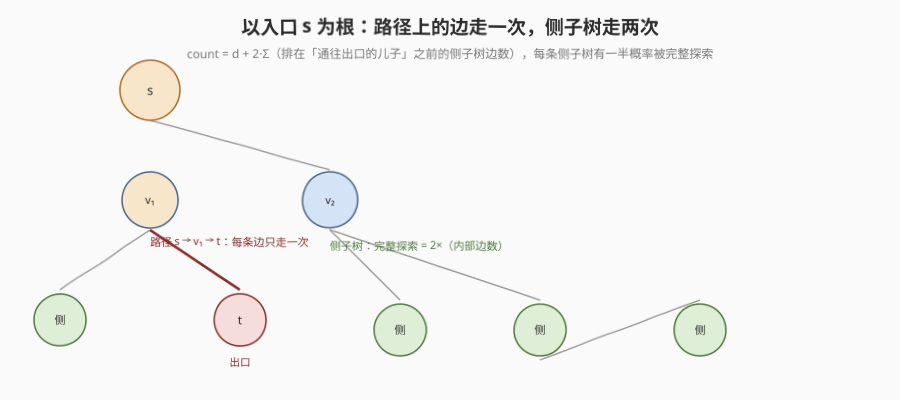
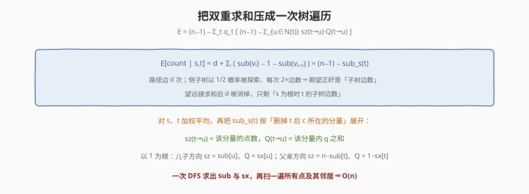
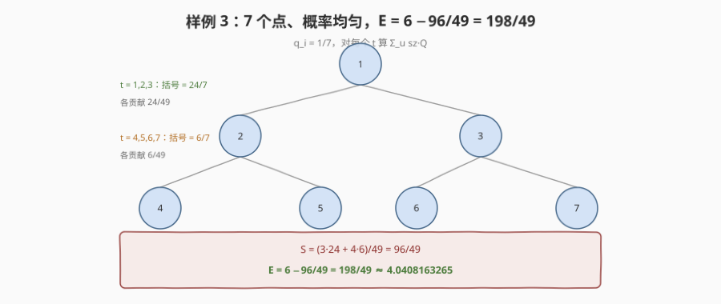

# Codeforces 123E 迷宫搜索期望 题解

## 1. 题目概述

- **题目链接**：https://codeforces.com/problemset/problem/123/E
- **比赛来源**：Codeforces Beta Round 92 (Div. 1 Only) · Problem E（UTC 2011-11-03）
- **难度**：2500
- **标签**：概率与期望、树、DFS、换根
- **评测类型**：特殊评测（浮点答案，绝对或相对误差 $\le10^{-9}$）
- **限制**：时间 1 s / 内存 256 MB

**题意**：迷宫是一棵 $n$ 个点的树。入口与出口按概率随机选取：第 $i$ 个点被选为入口的概率是 $x_i/\sum_j x_j$，被选为出口的概率是 $y_i/\sum_j y_j$（$x_i,y_i$ 非负、两组和都为正且 $\le10^6$）。

从入口启动下面这段 DFS（`V(x)` 是 $x$ 的邻居表，每次进入 `DFS(x)` 时把 `V(x)` 随机洗牌）：

```text
DFS(x)
    if x == exit then 结束整个搜索
    flag[x] = TRUE
    随机打乱 V(x)
    for i = 1 .. |V(x)| do
        if flag[V[i]] = FALSE then
            count++
            DFS(V[i])
    count++
```

求 `count` 的数学期望，即"走到出口为止一共走了多少条边"。

**关键理解**：`count++` 出现在递归调用**之前**，以及**函数正常返回之后**。所以一次"下去"记 1、一次"回来"记 1；一旦某个 `DFS(y)` 命中出口，整个搜索立刻结束，不会再执行后面的 `count++`。

**约束**：

- $n\le10^5$：$O(n^2)$ 的"枚举每对 (入口,出口) 再算"不可行，必须做到 $O(n)$（或 $O(n\log n)$）；树结构使得换根统计成为可能。
- $x_i,y_i\le10^6$ 且和为正：先归一化成概率；浮点误差要求 $10^{-9}$，用 `long double` 累计。
- 概率可以为零：某些点不可能作为入口/出口，会被跳过（不影响结果）。

## 2. 示例与观察

官方样例 1（输入 / 输出原样）：

```text
输入：
2
1 2
0 1
1 0

输出：
1.00000000000000000000
```

入口恒为 2（$x_2=1$），出口恒为 1（$y_1=1$）。 DFS(2)：$x\ne$ exit，洗牌（只有 1 个邻居），进入 1 时 `count++`，DFS(1) 命中出口、结束。`count=1` ✓

官方样例 2（输入 / 输出原样）：

```text
输入：
3
1 2
1 3
1 0
0 2
0 3

输出：
2.00000000000000000000
```

入口恒为 1，出口以 $2/5$ 的概率是 2、$3/5$ 是 3。以出口 2 为例：1 的邻居表 $\{2,3\}$ 随机洗牌，一半概率先访问 2 ⇒ 立刻结束，`count=1`；另一半概率先访问 3 ⇒ 走 3（`count=1`）、从 3 返回（`count=2`），再走 2（`count=3`）。所以条件期望 $=\frac12\cdot1+\frac12\cdot3=2$。出口为 3 时完全对称，也是 2。总期望 2 ✓（题解也是这个算法）。

官方样例 3（输入 / 输出原样）：

```text
输入：
7
1 2
1 3
2 4
2 5
3 6
3 7
1 1
1 1
1 1
1 1
1 1
1 1
1 1

输出：
4.04081632653
```

7 个点、概率全相同（每个点被选为入口/出口的概率都是 $1/7$）。这是棵"二叉"树，$198/49=4.0408163265\ldots$。这个值在 3.4 节逐点算出来。



**观察 1（DFS 的形态）**：`flag` 保证每个点只被进入一次；树无环，所以这等价于"以入口 $s$ 为根的普通 DFS"：进入一个子树后必然把它**完整探索完**再返回，代价是该子树边数的两倍（下去 + 回来）。

**观察 2（只在"通往出口的那条链"上会提前结束）**：设以 $s$ 为根、出口为 $t$。DFS 在根处随机排列邻居，依次完整探索每个子树，**直到进入"包含 $t$ 的那个子树"**；此后不再返回，而是继续在那一层重复同样的过程。所以在 $s\to t$ 路径上的每个点 $v_i$，只有排在"通往 $t$ 的那个儿子"**之前**的侧子树会被完整探索，每个贡献 $2\times$（它内部的边数）。

## 3. 解题思路

### 3.1 朴素做法与瓶颈

对每一对 $(s,t)$ 模拟/推导出期望，再按 $p_x(s)p_y(t)$ 加权：$O(n^2)$ 对，$n=10^5$ 时 $10^{10}$，不可行。即使用换根 DP 把"每个 $s$ 对所有 $t$ 的和"算出来，也需要 $O(n^2)$ 的状态。

必须找到"每对 $(s,t)$ 的期望值可以写成只依赖少量子树信息"的形式，从而把双重求和压成一次树遍历。

### 3.2 核心观察：条件期望 $=(n-1)-\mathrm{sub}_s(t)$

固定入口 $s$、出口 $t$，以 $s$ 为根。记 $\mathrm{sub}(v)$ 为 $v$ 的子树内的**边数**（$v$ 子树点数减 1），$s\to t$ 的路径为 $s=v_0,v_1,\dots,v_d=t$。

DFS 的代价可以拆成两部分：

- **路径边**：$v_0\to v_1\to\cdots\to v_d$ 一路向下，共 $d$ 次 `count++`（进入下一个路径点），且**没有**返回（因为到达 $t$ 就结束了）。
- **侧子树**：在 $v_i$（$i<d$）处，除 $v_{i+1}$ 外的每个儿子 $u$ 的子树，若在洗牌中排在 $v_{i+1}$ 之前，就被完整探索，代价 $2\cdot\mathrm{sub}(u)$；排在后面则完全不走。

洗牌是均匀随机的，任意两个元素在排列中的先后顺序各占 $\frac12$，所以每个侧子树"排在特殊儿子之前"的概率是 $\frac12$。于是

$$\mathbb E[\text{count}\mid s,t]=d+\sum_{i=0}^{d-1}\sum_{\text{侧儿子 }u\text{ of }v_i}2\cdot\tfrac12\cdot\mathrm{sub}(u)
=d+\sum_{i=0}^{d-1}\Big(\mathrm{sub}(v_i)-1-\mathrm{sub}(v_{i+1})\Big).$$

中间那步用了"子树边数 = 1（到父的边）+ 特殊儿子子树的边数 + 各侧儿子子树的边数"。求和望远镜般消掉：

$$\mathbb E[\text{count}\mid s,t]=d+\big(\mathrm{sub}(s)-\mathrm{sub}(t)\big)-d=(n-1)-\mathrm{sub}_s(t),$$

其中 $\mathrm{sub}_s(t)$ 是"以 $s$ 为根时 $t$ 的子树边数"（约定 $\mathrm{sub}_s(s)=n-1$）。

用样例 1 验证：$n=2$、$s=2,t=1$，$t$ 是叶子 ⇒ $\mathrm{sub}_s(1)=0$ ⇒ 期望 $1-0=1$ ✓；样例 2：$n=3$、$s=1$、$t=2$ 是叶子 ⇒ $2-0=2$ ✓。



### 3.3 把双重求和压成 $O(n)$

$$\mathbb E=\sum_{s}p_s\sum_{t}q_t\big((n-1)-\mathrm{sub}_s(t)\big)=(n-1)-\underbrace{\sum_s p_s\sum_t q_t\,\mathrm{sub}_s(t)}_{S}.$$

展开 $S$：$\mathrm{sub}_s(t)$ 是"以 $s$ 为根时 $t$ 子树里的边数"，对它按边求和（每条边被算一次，当且仅当它在 $t$ 的子树里）：

$$\sum_t q_t\,\mathrm{sub}_s(t)=\sum_{c\ne s}W(s,c),\qquad W(s,c)=\sum_{t\in\text{path}(s,c)}q_t,$$

因为一条边"在 $t$ 的子树里"等价于"$t$ 是它子端点的祖先"，把所有 $t$ 的贡献按 $t$ 归并，就得到"$s$ 到 $c$ 路径上所有 $q_t$ 之和"。

再交换求和次序（对固定的 $t$，找哪些 $s$ 会让 $t$ 出现在路径上）：

$$S=\sum_t q_t\sum_{c\ne t}\Big(1-Q\big(\mathrm{comp}_c(t)\big)\Big),$$

其中 $Q(\cdot)$ 表示"该点集内 $q$ 之和"，$\mathrm{comp}_c(t)$ 是删掉 $t$ 后 $c$ 所在的分量：若 $s$ 与 $c$ 同属那个分量，路径 $s\to c$ 就不经过 $t$；否则经过。

把 $c$ 按"$t$ 的哪个邻居 $u$ 的分量"分类，记 $sz(t\to u)$ 为该分量点数、$Q(t\to u)$ 为该分量内 $q$ 之和：

$$S=\sum_t q_t\left[(n-1)-\sum_{u\in N(t)}sz(t\to u)\cdot Q(t\to u)\right].$$

这就是最终公式：对每个点 $t$ 和它的每个邻居 $u$，需要"删掉 $t$ 后 $u$ 所在分量的**点数**与 **$q$ 之和**"。以 1 为根做一次 DFS 求出子树大小与子树 $q$ 和，则：

- 若 $u$ 是 $t$ 的儿子：分量就是 $u$ 的子树，$sz=\mathrm{sub}[u]$、$Q=\mathrm{sum}q[u]$；
- 若 $u$ 是 $t$ 的父亲：分量是"整棵树去掉 $t$ 的子树"，$sz=n-\mathrm{sub}[t]$、$Q=1-\mathrm{sum}q[t]$。

一次 $O(n)$ 遍历即可，无需真正的"换根 DP"。

### 3.4 样例走查

样例 3：7 个点，$q_i=1/7$，树为

```text
        1
       / \
      2   3
     / \ / \
    4  5 6  7
```

对每个 $t$ 算括号里的量（$n-1=6$）：

| $t$ | 邻居 $u$ | $sz(t\to u)$ | $Q(t\to u)$ | $sz\cdot Q$ | 小计 $\sum$ | 括号 $=6-\sum$ | $q_t\times$ |
|---|---|---|---|---|---|---|---|
| 1 | 2 / 3 | 3 / 3 | $3/7$ / $3/7$ | $9/7$ / $9/7$ | $18/7$ | $24/7$ | $24/49$ |
| 2 | 1 / 4 / 5 | 4 / 1 / 1 | $4/7$ / $1/7$ / $1/7$ | $16/7+1/7+1/7$ | $18/7$ | $24/7$ | $24/49$ |
| 3 | 1 / 6 / 7 | 4 / 1 / 1 | $4/7$ / $1/7$ / $1/7$ | $18/7$ | $18/7$ | $24/7$ | $24/49$ |
| 4 | 2 | 6 | $6/7$ | $36/7$ | $36/7$ | $6/7$ | $6/49$ |
| 5,6,7 | 同 4 | | | | | $6/7$ | $6/49$ 各 |

$$S=\frac{3\cdot24+4\cdot6}{49}=\frac{96}{49},\qquad \mathbb E=6-\frac{96}{49}=\frac{198}{49}=4.0408163265\ldots$$

与样例输出 $4.04081632653$ 一致 ✓



## 4. 正确性证明

**引理 1（DFS 的探索形态）**：以入口 $s$ 为根。对任意顶点 $v$，DFS 进入 $v$ 后，会把它每个"不在 $s\to t$ 路径上"的儿子子树完整探索（下去再回来），并按洗牌的随机顺序进行；一旦进入路径上的儿子 $v_{i+1}$，就再也不会回到 $v$。

**证明**：`flag` 使每个点至多被进入一次；树无环，故从 $v$ 出发只能进入"尚未访问"的儿子子树，且进入后必然层层返回到 $v$（除非在某处命中 $t$）。若命中的是 $v_{i+1}$ 子树内的 $t$，则整个搜索结束，$v$ 不会再被返回，所以"排在 $v_{i+1}$ 之后的侧子树"永远不会被走到。∎

**引理 2（条件期望的闭式）**：$\mathbb E[\text{count}\mid s,t]=(n-1)-\mathrm{sub}_s(t)$。

**证明**：由引理 1，代价 = 路径边 $d$ + 每个"排在特殊儿子之前"的侧子树的两倍边数。侧子树 $u$ 排在特殊儿子之前与之后的概率各 $\frac12$（均匀排列中任意两元素的相对次序等可能），故期望代价

$$d+\sum_{i=0}^{d-1}\sum_{\text{侧儿子 }u}2\cdot\tfrac12\mathrm{sub}(u)=d+\sum_{i=0}^{d-1}\big(\mathrm{sub}(v_i)-1-\mathrm{sub}(v_{i+1})\big)=(n-1)-\mathrm{sub}(t).$$

最后一步用 $\mathrm{sub}(v_0)=n-1$、$\mathrm{sub}(v_d)=\mathrm{sub}(t)$ 与望远镜求和。∎

**引理 3（按边重写）**：对任意根 $s$，$\sum_t q_t\,\mathrm{sub}_s(t)=\sum_{c\ne s}W(s,c)$，其中 $W(s,c)=\sum_{t\in\text{path}(s,c)}q_t$。

**证明**：$\mathrm{sub}_s(t)=\#\{\text{边 } e: e \text{ 在 } t \text{ 的子树内}\}$。交换求和：$\sum_t q_t\mathrm{sub}_s(t)=\sum_{\text{边 }(p,c)}\sum_{t:\,c\in\text{sub}(t)}q_t$。$c\in\mathrm{sub}(t)\iff t$ 是 $c$ 的祖先（含 $c$）$\iff t\in\text{path}(s,c)$，而每条边与它的下端 $c\ne s$ 一一对应。∎

**引理 4（按分量重写）**：$S=\sum_s p_s\sum_t q_t\mathrm{sub}_s(t)=\sum_t q_t\big[(n-1)-\sum_{u\in N(t)}sz(t\to u)Q(t\to u)\big]$。

**证明**：由引理 3 与交换求和，
$$S=\sum_t q_t\sum_{c\ne t}\sum_{s\ne c,\ t\in\text{path}(s,c)}p_s=\sum_t q_t\sum_{c\ne t}\Big(1-Q(\mathrm{comp}_c(t))\Big),$$
因为对固定的 $c\ne t$，"路径 $s\to c$ 经过 $t$"$\iff$$s$ 不在删掉 $t$ 后 $c$ 所在的分量里。再把 $c$ 按"该分量对应 $t$ 的哪个邻居"分组，每组有 $sz(t\to u)$ 个 $c$、共同的 $Q(t\to u)$，即得括号内的式子。∎

**定理**：算法输出 $\mathbb E[\text{count}]$。

**证明**：$\mathbb E=\sum_{s,t}p_sq_t\mathbb E[\text{count}\mid s,t]=(n-1)-S$（引理 2），而程序中 $S$ 按引理 4 的公式用一棵树的子树大小与子树 $q$ 和算出，故输出正确。∎

**精度**：所有项都在 $[0,2(n-1)]$ 内，$S$ 是 $n$ 项非负量之和（大量相减只在 $O(1)$ 处发生），用 80 位 `long double` 累计误差约 $10^{-15}n\approx10^{-10}$ 量级，远小于 $10^{-9}$ 的相对容差；实测与精确有理数枚举的偏差 $<5\times10^{-13}$。

## 5. 复杂度分析

- **时间**：建树 $O(n)$；一次 DFS 求子树大小与子树 $q$ 和 $O(n)$；再扫一遍每个点的邻居（总度数 $2(n-1)$）累加 $O(n)$。总计 $O(n)$。$n=10^5$ 实测约 30 ms，1 s 余量约 30 倍。
- **空间**：邻接表 $O(n)$、四个 $O(n)$ 数组，约 $4(n+2(n-1))\times8\ \text{B}\approx5\ \text{MB}$。

## 6. 参考代码

### C++17

```cpp
#include <bits/stdc++.h>
using namespace std;
typedef long long ll;

int n;
vector<vector<int>> adj;
vector<int> par, sub;
vector<long double> px, py, sx;  // sx = 子树内 px 之和
long double totX = 0;

void dfs0(int v, int p) {
    par[v] = p;
    sub[v] = 1;
    sx[v] = px[v];
    for (int u : adj[v]) {
        if (u == p) continue;
        dfs0(u, v);
        sub[v] += sub[u];
        sx[v] += sx[u];
    }
}

int main() {
    if (scanf("%d", &n) != 1) return 0;
    adj.assign(n, {});
    for (int i = 0; i < n - 1; i++) {
        int a, b;
        scanf("%d %d", &a, &b);
        --a; --b;
        adj[a].push_back(b);
        adj[b].push_back(a);
    }
    vector<long double> x(n), y(n);
    long double sumX = 0, sumY = 0;
    for (int i = 0; i < n; i++) {
        long long xi, yi;
        scanf("%lld %lld", &xi, &yi);
        x[i] = (long double)xi;
        y[i] = (long double)yi;
        sumX += x[i];
        sumY += y[i];
    }
    px.assign(n, 0);
    py.assign(n, 0);
    for (int i = 0; i < n; i++) {
        px[i] = x[i] / sumX;
        py[i] = y[i] / sumY;
    }

    par.assign(n, -1);
    sub.assign(n, 0);
    sx.assign(n, 0);
    dfs0(0, -1);

    // E = (n-1) - Σ_t py_t * [ (n-1) - Σ_{u∈N(t)} sz(t→u) * PX(comp(t→u)) ]
    long double S = 0;
    for (int t = 0; t < n; t++) {
        long double acc = 0;
        for (int u : adj[t]) {
            long double sz, pxc;
            if (u == par[t]) {
                sz = (long double)(n - sub[t]);
                pxc = 1.0L - sx[t];
            } else {
                sz = (long double)sub[u];
                pxc = sx[u];
            }
            acc += sz * pxc;
        }
        S += py[t] * ((long double)(n - 1) - acc);
    }
    long double ans = (long double)(n - 1) - S;
    printf("%.12Lf\n", ans);
    return 0;
}
```

### Python3

```python
import sys


def main():
    data = sys.stdin.buffer.read().split()
    n = int(data[0])
    pos = 1
    adj = [[] for _ in range(n)]
    for _ in range(n - 1):
        a = int(data[pos]) - 1
        b = int(data[pos + 1]) - 1
        pos += 2
        adj[a].append(b)
        adj[b].append(a)
    x = [0.0] * n
    y = [0.0] * n
    for i in range(n):
        x[i] = float(data[pos])
        y[i] = float(data[pos + 1])
        pos += 2
    sx_tot = sum(x)
    sy_tot = sum(y)
    px = [v / sx_tot for v in x]
    py = [v / sy_tot for v in y]

    # 以 0 为根，求子树大小与子树 px 之和
    par = [-1] * n
    sub = [0] * n
    sx = [0.0] * n
    order = [0]
    for v in order:
        for u in adj[v]:
            if u != par[v]:
                par[u] = v
                order.append(u)
    for v in reversed(order):
        sub[v] = 1
        sx[v] = px[v]
        for u in adj[v]:
            if u != par[v]:
                sub[v] += sub[u]
                sx[v] += sx[u]

    S = 0.0
    for t in range(n):
        acc = 0.0
        for u in adj[t]:
            if u == par[t]:
                acc += (n - sub[t]) * (1.0 - sx[t])
            else:
                acc += sub[u] * sx[u]
        S += py[t] * ((n - 1) - acc)
    print("%.12f" % ((n - 1) - S))


main()
```

## 7. 边界情况与易错点

1. **$n=1$**：没有边，入口=出口=1，搜索立刻结束，`count=0`；代码输出 `0.000000000000`（$n-1=0$，$S$ 也为 0）。
2. **入口与出口相同**（$s=t$）：DFS 第一步就命中出口，`count=0`。公式里 $\mathrm{sub}_s(s)=n-1$，给出 $(n-1)-(n-1)=0$ ✓ 自动成立。
3. **概率为 0 的点**：$x_i=0$ 或 $y_i=0$ 时该点不参与，公式中 $p_s=0$/$q_t=0$ 直接消去，不会出错；注意分母 $\sum x,\sum y$ 都必须 $>0$（题面保证）。
4. **`count` 的语义**：只在"实际走了这条边"时加 1；命中出口的那次 `count++` 发生在递归调用**之前**（因为先 `count++` 再 `DFS(V[i])`），所以进入出口的这一步是算钱的，而"从出口返回"不会发生。把语义弄反（以为进入出口不算）会让样例 1 输出 0。
5. **末尾的 `count++`**：函数正常返回时还要加 1（回程），漏掉这一点样例 2 的条件期望会从 2 变成 1.5。
6. **`sub(s)=n-1`**：公式里 $t=s$ 时用的就是 $n-1$（不是 0），代码里 $s$ 与 $t$ 的对称处理要保证这一点（本实现是从"$t$ 的每个分量大小之和 = $n-1$"推出的，天然成立）。
7. **父亲方向的分量**：$u=\mathrm{par}[t]$ 时，分量大小是 $n-\mathrm{sub}[t]$、$q$ 和是 $1-\mathrm{sx}[t]$；写成 $\mathrm{sub}[t]$、$\mathrm{sx}[t]$ 会把"子树"与"补集"搞反（样例 3 会得到完全不同的值）。
8. **浮点类型**：$n=10^5$ 时累加 $10^5$ 个约 $10^{-5}$ 的量，`float` 会掉精度，`double` 勉强，`long double` 最稳；输出至少 12 位小数。
9. **读入规模**：$10^5$ 行、每行两个整数，用 `scanf`/`sys.stdin.buffer.read().split()`；`cin` 不解除同步会偏慢。
10. **递归深度**：链状树的深度可达 $10^5$，C++ 版用的是递归 `dfs0`（每帧很小，本机在 $10^5$ 链上实测正常，约 29 ms）；若担心评测机栈空间，可把它改成"BFS 序 + 逆序累加"的迭代写法（Python 版就是迭代的，不受递归深度影响）。

## 8. 验证记录

- **编译环境与命令**：`clang++ -std=c++17 -O2`（配 `codeforces/tools/include/bits/stdc++.h` 兼容头）；Python 3.9.6。
  `python3 codeforces/tools/verify_solution.py codeforces/contests/0101-0203/123/E_迷宫搜索期望.md --checker codeforces/tools/checkers/float.py`
- **官方样例**：$3/3$ 通过（`1`、`2`、`4.04081632653`），C++ 与 Python 一致。
- **精确枚举对拍（最强的一层）**：对 $n\in[2,7]$ 的随机树，枚举**全部"每个点邻居表排列"的组合**（各点阶乘的乘积，最多约 $3\times10^5$ 种），按题面伪代码逐条模拟、取平均，得到精确期望；再与公式（C++ 输出）比较。共 $90$ 棵树 × 全部 $(s,t)$ 组合，最大偏差 $4.5\times10^{-13}$（仅来自 12 位小数输出）。全部 $x_i=y_i=1$ 与随机权重（$x_i,y_i\in[0,3]$）两种设定都测了。
- **蒙特卡洛交叉验证**：$n\in\{10,15,25,40,60\}$ 的随机树，每组 $40000$ 次随机洗牌模拟，结果与公式的差在统计误差内（$\le0.11$，计数均值约 $20$，$\sigma/\sqrt N\approx0.02$–$0.04$）。
- **最大约束性能**：$n=10^5$ 的随机树 / 链 / 星三种形态，单次约 $23$–$34$ ms（C++）、约 $0.16$ s（Python），1 s 余量约 30 倍。
- **图片校验**：3 张 SVG 均通过 `xml.etree.ElementTree.parse`。
- **复核状态**：verified（样例、精确枚举、蒙特卡洛、性能、图片均实跑通过）。

## 相关题目与扩展

- [Codeforces 123D String](https://codeforces.com/problemset/problem/123/D)：同场 D 题，后缀自动机。
- [Codeforces 123C Brackets](https://codeforces.com/problemset/problem/123/C)：同场 C 题。
- [Codeforces 280C Game on Tree](https://codeforces.com/problemset/problem/280/C)：树上随机过程的期望，用线性性拆分。
- [Codeforces 839D Winter is here](https://codeforces.com/problemset/problem/839/D)：另一类"按子树/路径贡献求和"的换根技巧。

**延伸思考**：

1. **若 DFS 改成 BFS**：退出时不会再走"回程"，代价变成"访问到出口之前入队的点数"，公式完全不同（BFS 按层数推进）；可见本题"两倍侧子树"的结论强依赖 DFS 的回溯结构。
2. **若要求期望的方差**：需要统计"侧子树排在特殊儿子之前"的个数 $X$ 的分布，$\mathrm{Var}$ 依赖 $\sum \mathrm{sub}(u)^2$ 与两两协方差，多一次 $O(n)$ 的统计即可（因为各侧子树顺序的指示变量只两两相关）。
3. **若树带根（入口固定为 1）**：公式退化成"对每个 $t$ 算一次"，$O(n)$ 即可，无需按 $s$ 平均；验证时可用换根 DP 交叉检验。
4. **若出口有多个**（命中任意一个就结束）：代价变成"到最近被命中的出口"，需要按"最先被 DFS 访问到的出口"做容斥，复杂度上升到 $O(n\log n)$ 或更高。
