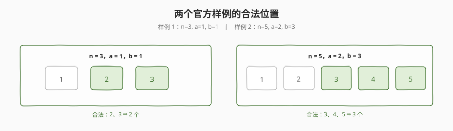

# Codeforces 124A 可能的排队位置 题解

## 1. 题目概述

- **题目链接**：https://codeforces.com/problemset/problem/124/A
- **比赛来源**：Codeforces Beta Round 92 (Div. 2 Only) · Problem A（UTC 2011-11-03）
- **难度**：1000
- **标签**：数学、枚举
- **评测类型**：普通
- **限制**：时间 0.5 s / 内存 256 MB

**题意**：Petr 站在 $n$ 个人的队伍里，但不知道自己排第几。他只知道：**前面至少有 $a$ 个人**，**后面至多有 $b$ 个人**。问他的位置（从 1 开始编号）有多少种可能。

**约束**：

- $0\le a,b<n\le100$：规模极小，$O(n)$ 逐个位置检查或直接推公式都行；这里给出 $O(1)$ 的闭式，顺便说明"枚举也没问题"。
- 位置从 1 编号到 $n$，若 Petr 在第 $p$ 位，则前面恰有 $p-1$ 人、后面恰有 $n-p$ 人。
- 单组输入，没有多测。

## 2. 示例与观察

官方样例 1（输入 / 输出原样）：

```text
输入：
3 1 1

输出：
2
```

$n=3$，前面至少 1 人 ⇒ $p\ge2$；后面至多 1 人 ⇒ $n-p\le1\Rightarrow p\ge2$。所以 $p\in\{2,3\}$，共 2 个，与样例一致（题解也说可能的位置是 2 和 3）。

官方样例 2（输入 / 输出原样）：

```text
输入：
5 2 3

输出：
3
```

前面至少 2 人 ⇒ $p\ge3$；后面至多 3 人 ⇒ $5-p\le3\Rightarrow p\ge2$。取更紧的 $p\ge3$，于是 $p\in\{3,4,5\}$，共 3 个 ✓。


**观察**：两个条件都只是"对 $p$ 的一个下界"，没有上界——因为排在越后面，前面的人越多、后面的人越少，两个条件就都更满足。所以合法位置一定是**从某个下界 $p_0$ 一直到 $n$ 的一段后缀**，答案就是 $n-p_0+1$。

## 3. 解题思路

### 3.1 朴素做法与瓶颈

枚举 $p=1,2,\dots,n$，检查 $p-1\ge a$ 且 $n-p\le b$，数满足的个数。$O(n)$、$n\le100$，完全没问题。但本题的条件可以一步化成闭式，写出来更快也更不容易看错方向（比如把"后面至多 $b$"错当成 $n-p\le b$ 的反面）。

### 3.2 核心观察

设 Petr 在第 $p$ 位（$1\le p\le n$）。

- 前面的人数是 $p-1$，"至少 $a$ 人" ⇒ $p-1\ge a\iff p\ge a+1$；
- 后面的人数是 $n-p$，"至多 $b$ 人" ⇒ $n-p\le b\iff p\ge n-b$。

两个条件同时成立当且仅当

$$p\ \ge\ p_0=\max(a+1,\ n-b).$$

又 $p\le n$，所以

$$\text{答案}=n-p_0+1=\min(n-a,\ b+1).$$

（第二个等号：$n-\max(a+1,n-b)+1=\min(n-a-1+1,\ n-(n-b)+1)=\min(n-a,b+1)$。）

### 3.3 算法流程

1. 读入 $n,a,b$；
2. 输出 $\min(n-a,\ b+1)$（等价写法：$n-\max(a+1,n-b)+1$，再对 0 取 $\max$）。

### 3.4 样例走查



- 样例 1：$n=3,a=1,b=1$，$p_0=\max(2,2)=2$，答案 $3-2+1=2$；也就是 $\min(2,2)=2$ ✓；
- 样例 2：$n=5,a=2,b=3$，$p_0=\max(3,2)=3$，答案 $5-3+1=3$；也就是 $\min(3,4)=3$ ✓；
- 自造：$n=5,a=0,b=0$ ⇒ $p_0=\max(1,5)=5$，答案 1——"后面 0 人"意味着 Petr 必须排最后 ✓；
- 自造：$n=5,a=4,b=4$ ⇒ $p_0=\max(5,1)=5$，答案 1——前面至少 4 人 ⇒ 只能第 5 位 ✓。

## 4. 正确性证明

**引理 1**：Petr 在第 $p$ 位时，"前面至少 $a$ 人"等价于 $p\ge a+1$，"后面至多 $b$ 人"等价于 $p\ge n-b$。

**证明**：前面人数为 $p-1$（位置从 1 开始，$p=1$ 时前面 0 人），$p-1\ge a\iff p\ge a+1$。后面人数为 $n-p$，$n-p\le b\iff p\ge n-b$。$1\le p\le n$ 由位置本身的范围给出。∎

**引理 2**：满足两条限制的 $p$ 的集合恰为整数区间 $[\max(a+1,n-b),\ n]$。

**证明**：由引理 1，条件是 $p\ge a+1$ 且 $p\ge n-b$ 且 $p\le n$，即 $p\ge\max(a+1,n-b)$ 且 $p\le n$。集合非空：$a+1\le n$（因为 $a<n$）、$n-b\le n$，故 $\max\le n$。∎

**定理**：答案等于 $n-\max(a+1,n-b)+1=\min(n-a,b+1)$。

**证明**：由引理 2，区间长度即所求；代数化简得 $\min(n-a,b+1)$。∎

## 5. 复杂度分析

- **时间**：$O(1)$（三次整数运算），与 $n$ 无关；即使改成逐个枚举也只 $O(n)\le100$ 次。0.5 s 时限绰绰有余。
- **空间**：$O(1)$。

## 6. 参考代码

### C++17

```cpp
#include <bits/stdc++.h>
using namespace std;

int main() {
    int n, a, b;
    if (scanf("%d %d %d", &n, &a, &b) != 3) return 0;
    // 前面至少 a 人 -> 位置 p >= a+1；后面至多 b 人 -> p >= n-b
    int lo = max(a + 1, n - b);
    printf("%d\n", n - lo + 1 > 0 ? n - lo + 1 : 0);
    return 0;
}
```

### Python3

```python
import sys


def main():
    data = sys.stdin.read().split()
    n, a, b = int(data[0]), int(data[1]), int(data[2])
    # 前面至少 a 人 -> p >= a+1；后面至多 b 人 -> p >= n-b
    lo = max(a + 1, n - b)
    print(max(0, n - lo + 1))


main()
```

## 7. 边界情况与易错点

1. **$a=0$**：前面可以一个人都没有，$p\ge1$，此时上界由 $n-b$ 决定。
2. **$b=0$**：后面不许有人，$p\ge n$，又 $p\le n$，答案只能是 1（Petr 排最后）。
3. **$a=n-1$**：前面至少 $n-1$ 人 ⇒ 只能排第 $n$ 位，答案 1。
4. **$b=n-1$**：后面至多 $n-1$ 人，这条限制永远成立，答案由 $a$ 决定：$n-a$。
5. **方向别写反**："后面至多 $b$ 人"是 $n-p\le b$（不是 $n-p\ge b$）；把不等号方向弄反会得到"前面一段"而不是"后缀"，样例 2 立刻能测出来。
6. **位置从 1 开始**：$p-1$ 才是前面的人数，写成 $p\ge a$ 会多算一个位置（样例 1 会输出 3 而不是 2）。
7. **答案不会为负**：题面保证 $a,b<n$，所以 $p_0\le n$；代码里仍保留一次 `max(0, …)` 防御。
8. **多测**：本题只有一组；若改成多组，直接循环同一段公式即可（无状态）。

## 8. 验证记录

- **编译环境与命令**：`clang++ -std=c++17 -O2`（配 `codeforces/tools/include/bits/stdc++.h` 兼容头）；Python 3.9.6。
  `python3 codeforces/tools/verify_solution.py codeforces/contests/0101-0203/124/A_可能的排队位置.md`
- **官方样例**：$2/2$ 通过（`2`、`3`），C++ 与 Python 一致。
- **穷举对拍**：对所有 $1\le n\le60$、$0\le a,b<n$（共 $\sum_{n=1}^{60}n^2=73810$ 组），与"逐个 $p$ 检查两个不等式"的直接枚举比对，全部一致；另外 $n\le100$ 的随机 $200$ 组同样一致。
- **最大约束性能**：$n=100$ 单次约 2 ms（进程启动为主），0.5 s 余量两个数量级。
- **图片校验**：2 张 SVG 通过 `xml.etree.ElementTree.parse`。
- **复核状态**：verified（样例、穷举、性能、图片均实跑通过）。

## 相关题目与扩展

- [Codeforces 124B Permutations](https://codeforces.com/problemset/problem/124/B)：同场 B 题，枚举数字的排列使极差最小。
- [Codeforces 123A Prime Permutation](https://codeforces.com/problemset/problem/123/A)：同一场的 Div.1 A，构造题。
- [Codeforces 1A Theatre Square](https://codeforces.com/problemset/problem/1/A)：同样是一行公式的入门题。
- [Codeforces 467A George and Accommodation](https://codeforces.com/problemset/problem/467/A)：更简单的计数入门。

**延伸思考**：

1. **若条件改成"前面恰有 $a$ 人"**：答案是 $n-p+1$ 只在 $p=a+1$ 时非零，即"至多 1 个位置"，与本题的"区间长度"形成对比——"至少/至多"给出区间，"恰有"给出单点。
2. **若条件是区间形式**（前面人数在 $[a_1,a_2]$、后面在 $[b_1,b_2]$）：设 $S=[a_1+1,n-b_2]$ 与 $T=[n-b_1+1,n]$… 交集还是区间，答案 $=\max(0,\min(a_2+1,n-b_2)-\max(a_1+1,n-b_1)+1)$，仍是 $O(1)$。
3. **若要知道具体位置而不是个数**：直接输出区间 $[\max(a+1,n-b),n]$ 即可，枚举或公式都行。
4. **二维推广**（$n\times m$ 的座位表，给出"前面/左面至少多少"）：两个方向的约束独立，合法位置数是两个一维区间的长度之积——这是"约束可分解"的典型例子。
