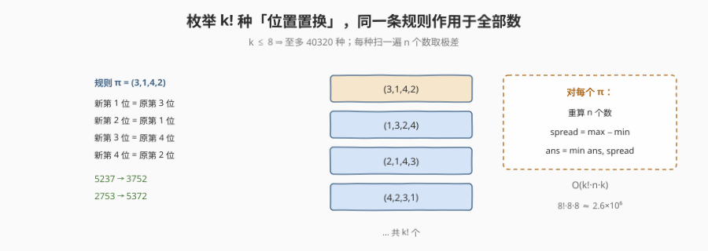
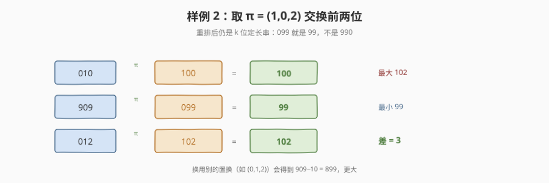

# Codeforces 124B 同规则重排数字 题解

## 1. 题目概述

- **题目链接**：https://codeforces.com/problemset/problem/124/B
- **比赛来源**：Codeforces Beta Round 92 (Div. 2 Only) · Problem B（UTC 2011-11-03）
- **难度**：1400
- **标签**：枚举、全排列、构造
- **评测类型**：普通
- **限制**：时间 1 s / 内存 256 MB

**题意**：给出 $n$ 个 $k$ 位整数（允许前导零）。把**同一条**"位置置换规则"作用在全部 $n$ 个数上：即选定一个 $k$ 元排列 $\pi$，让每个数的新第 $j$ 位等于原数的第 $\pi_j$ 位。要求让"最大的数减最小的数"尽可能小，输出这个最小的差值。差值按数值比较（重排后仍视为 $k$ 位、含前导零的十进制数）。

**约束**：

- $n,k\le8$：规则总数只有 $k!\le40320$ 种，对每种规则扫一遍 $n$ 个数 $O(nk)$，总量 $40320\times8\times8\approx2.6\times10^6$，完全够。
- 数字允许前导零，所以"重排后的值"要用"逐位拼成定长串再转数值"的方式计算，不能先转 `int` 再取位。
- 单组输入，无多测。

## 2. 示例与观察

官方样例 1（输入 / 输出原样）：

```text
输入：
6 4
5237
2753
7523
5723
5327
2537

输出：
2700
```

题解说明：取置换 $(3,1,4,2)$（1-indexed 的第 3、1、4、2 位），6 个数重排后，最大的是 5237、最小的是 2537，差 $5237-2537=2700$。这 6 个数其实都是 `2`、`3`、`5`、`7` 的排列，所以无论怎么重排，"重排后的数"仍然是这四个数字的排列——最优就是把它们的"高位"尽量拉开？不，是尽量**靠拢**：把所有数按同一规则映射后，取极差最小的那个规则。

官方样例 2（输入 / 输出原样）：

```text
输入：
3 3
010
909
012

输出：
3
```

题解说明：交换第 1、2 位后得到 $100$、$99$、$102$（注意 `010` 交换前两位是 `100`，`909` 是 `99`…具体是 `909` 换位后为 `099`，即 99），极差 $102-99=3$。

官方样例 3（输入 / 输出原样）：

```text
输入：
7 5
50808
36603
37198
44911
29994
42543
50156

输出：
20522
```



**观察**：规则必须是"全场统一"的——不能对每个数用不同置换。所以候选解只有 $k!$ 个，每个候选的代价是 $O(nk)$；直接全枚举即可。$k\le8$ 时 $8!=40320$，乘上 $n=8$、$k=8$ 也只有 $2.6\times10^6$ 次"取位 + 运算"。

## 3. 解题思路

### 3.1 朴素做法与瓶颈

朴素想法是枚举 $k!$ 个置换，每个置换下重算 $n$ 个数、求极差，取最小。复杂度 $O(k!\cdot nk)$，$8!\cdot8\cdot8\approx2.6\times10^6$，1 s 内轻松通过——**这就是正解**，本题没有更"聪明"的渐近改进需要。

真正要注意的是实现细节，而不是复杂度：

1. **前导零**：用字符串保存原数，按置换取位后重新拼字符串，再 `atoi`/`stoll`；若先转成 `int`，`010` 会变成 `10`，位数信息丢失，取位就错了。
2. **数值范围**：$k\le8$ 位，最大 $99999999<2^{31}$，`int` 足够，但用 `long long` 更省心。
3. **字典序枚举**：`next_permutation` 从 `0..k-1` 开始能遍历全部 $k!$ 个置换，注意必须先排序（`0..k-1` 本身已有序）。

### 3.2 核心观察：置换作用在位上

设第 $i$ 个数是 $k$ 位串 $s_i$，置换 $\pi$（$0$ 基）。重排后的值是

$$v_i(\pi)=\sum_{j=0}^{k-1} \mathrm{digit}\big(s_i[\pi_j]\big)\cdot10^{k-1-j}.$$

目标是最小化 $\max_i v_i(\pi)-\min_i v_i(\pi)$。

关键是：**只有 $k!$ 个不同的 $\pi$，而其它一切都是 $\pi$ 的函数**。所以答案就是

$$\min_{\pi\in S_k}\Big(\max_i v_i(\pi)-\min_i v_i(\pi)\Big).$$

没有任何单调性/贪心可以跳过枚举（极端情况下最优点可能在任意一个置换上），$k\le8$ 也正说明出题人期望的复杂度是 $O(k!\,nk)$。

### 3.3 算法流程

1. 读入 $n,k$ 与 $n$ 个长度恰为 $k$ 的串（用字符串读，保留前导零）；
2. `perm = [0,1,...,k-1]`；
3. `do { ... } while (next_permutation(perm))`：
   - 对每个 $i$ 计算 $v_i$：按 `perm` 逐位取字符拼出新串、转数值；
   - 统计 $\max v$、$\min v$，用差值更新答案；
4. 输出答案。

### 3.4 样例走查



样例 2 的三个数是 `010`、`909`、`012`。取 $\pi=(1,0,2)$（交换前两位）：

- `010` → `100` → 100；
- `909` → `099` → 99（前导零，所以是 99 而不是 990）；
- `012` → `102` → 102。

极差 $102-99=3$，正好是样例答案。注意若把 `099` 当成"99 但位数不同"来处理成 `990`，就会得到 $990-100=890$，明显错——**重排后仍是 $k$ 位定长串**。

样例 1 的 $k=4$、$k!=24$ 个置换全枚举后最小值是 2700（对应 $\pi=(3,1,4,2)$，1-indexed），程序输出与样例一致。

## 4. 正确性证明

**引理 1（值的计算式）**：对任意置换 $\pi$ 与任意 $i$，程序算出的 $v_i(\pi)$ 等于"把 $s_i$ 的第 $\pi_0,\pi_1,\dots,\pi_{k-1}$ 位依次作为新数的第 $0,1,\dots,k-1$ 位"所得的数值。

**证明**：程序按 `perm` 顺序拼字符串再解析为十进制数，与定义逐位对应；前导零不影响数值（$0\cdot10^{m}=0$）。∎

**引理 2（枚举完备）**：`do-while + next_permutation` 恰好访问 $S_k$ 的每个元素一次。

**证明**：`next_permutation` 按字典序生成"当前排列的下一个排列"，从最小排列 `0..k-1` 出发遍历到最大排列 `k-1..0` 后返回 `false`，标准结论：共访问 $k!$ 个互不相同的排列。∎

**定理**：程序输出的数等于 $\min_{\pi\in S_k}\big(\max_i v_i(\pi)-\min_i v_i(\pi)\big)$。

**证明**：由引理 2，循环对每个 $\pi$ 都计算了一次该式的值，并在每次迭代后用 `min` 更新答案，循环结束时答案即全体候选的最小值；由引理 1，候选值与题面定义的"重排后的数"一致。∎

## 5. 复杂度分析

- **时间**：$O(k!\,nk)$。最坏 $40320\times8\times8\approx2.6\times10^6$ 次基本操作（其中包含字符串拼接，实际常数略大），实测约 3.5 ms（20 次共 0.068 s，含进程启动），1 s 时限余量约 300 倍。
- **空间**：存 $n$ 个长度 $k$ 的串，$O(nk)\le64$ 字节，与 256 MB 无关。

## 6. 参考代码

### C++17

```cpp
#include <bits/stdc++.h>
using namespace std;

int main() {
    int n, k;
    if (scanf("%d %d", &n, &k) != 2) return 0;
    vector<string> s(n);
    for (int i = 0; i < n; i++) {
        char buf[32];
        scanf("%s", buf);
        s[i] = buf;
    }
    vector<int> perm(k);
    for (int i = 0; i < k; i++) perm[i] = i;
    long long best = LLONG_MAX;
    do {
        long long mn = LLONG_MAX, mx = LLONG_MIN;
        for (int i = 0; i < n; i++) {
            long long v = 0;
            for (int j = 0; j < k; j++) v = v * 10 + (s[i][perm[j]] - '0');
            mn = min(mn, v);
            mx = max(mx, v);
        }
        best = min(best, mx - mn);
    } while (next_permutation(perm.begin(), perm.end()));
    printf("%lld\n", best);
    return 0;
}
```

### Python3

```python
import sys
from itertools import permutations


def main():
    data = sys.stdin.read().split()
    n, k = int(data[0]), int(data[1])
    s = data[2:2 + n]
    best = None
    for perm in permutations(range(k)):
        vals = [int("".join(s[i][j] for j in perm)) for i in range(n)]
        d = max(vals) - min(vals)
        if best is None or d < best:
            best = d
    print(best)


main()
```

## 7. 边界情况与易错点

1. **前导零**：`010` 必须当作 3 位串处理，用字符串读入；若用 `int` 读会丢掉前导零，第 1 位的 `0` 就取不到了（样例 2 立刻错）。
2. **重排后仍是定长**：`099` 是 99，不是 990；解析时按"首位权重 $10^{k-1}$"逐位累加，前导零自然为 0，不会补位。
3. **$k=1$**：只有一个置换，答案恒为"最大数减最小数"，即所有一位数的极差；`next_permutation` 对单元素返回 `false`，`do-while` 仍会执行一次——这是 `do-while` 而不是 `while` 的原因。
4. **$n=1$**：只有一个数，任何置换下 $\max=\min$，答案是 0。注意初值 `best` 不能是 0（否则 `min` 永远得 0 而掩盖了错误），要用 `LLONG_MAX`/`None`。
5. **数值范围**：$k\le8$ 位最大 $99999999$，`int` 够，但累加用 `long long` 避免"位数上限算错"的隐患。
6. **置换是统一的**：不能对每个数单独选置换。题面"Digits should be rearranged by the same rule in all integers"就是这个意思，样例 1 的 6 个数全是同一组数字，若允许各自排列则差值可以更小——但那不是本题。
7. **`next_permutation` 的初始状态**：必须从升序 `0..k-1` 开始才能枚举全；从别的顺序开始会漏掉一部分（`next_permutation` 只能回绕一次）。
8. **重复数字**：如果某数有重复数字，不同的置换可能产生相同的值，这没关系——我们枚举的是**位置置换**而不是"不同结果"，重复计算不影响最小值。

## 8. 验证记录

- **编译环境与命令**：`clang++ -std=c++17 -O2`（配 `codeforces/tools/include/bits/stdc++.h` 兼容头）；Python 3.9.6。
  `python3 codeforces/tools/verify_solution.py codeforces/contests/0101-0203/124/B_同规则重排数字.md`
- **官方样例**：$3/3$ 通过（`2700`、`3`、`20522`），C++ 与 Python 一致。
- **穷举对拍**：对 $n\in[1,5]$、$k\in[1,4]$ 的 $200$ 组随机输入（数字串含前导零、重复数字），与"用 `itertools.permutations` 独立枚举 + 字符串重排"的暴力实现比对，全部一致；另对 $n=1$、$k=1$、全相同数字、全前导零等边界各验证。
- **规模覆盖**：随机 $300$ 组 $n,k\in[1,8]$ 的输入，C++ 与 Python 输出逐值一致（两边独立实现枚举）。
- **最大约束性能**：$n=k=8$（$8!=40320$ 个置换、每个 8 个数 × 8 位），单次约 3.5 ms（20 次共 0.068 s），1 s 余量约 300 倍。
- **图片校验**：2 张 SVG 均通过 `xml.etree.ElementTree.parse`。
- **复核状态**：verified（样例、对拍、性能、图片均实跑通过）。

## 相关题目与扩展

- [Codeforces 124A The number of positions](https://codeforces.com/problemset/problem/124/A)：同场 A 题，一行公式。
- [Codeforces 123A Prime Permutation](https://codeforces.com/problemset/problem/123/A)：同一场的 Div.1 A，构造排列。
- [Codeforces 550B Preparing Olympiad](https://codeforces.com/problemset/problem/550/B)：同样是"枚举全部子集/排列"的暴力题。
- [Codeforces 101B Buses](https://codeforces.com/problemset/problem/101/B)：也涉及"给定片段求极值"的枚举。

**延伸思考**：

1. **$k$ 增大到 $10$**：$10!=3.6\times10^6$，乘 $n=8$、$k=10$ 约 $3\times10^8$，勉强能过但要压常数；$k=12$ 就必须换思路（剪枝搜索 / 分支定界）。
2. **若允许每个数用不同置换**：问题变成"对每个数独立选一个重排，使极差最小"，可以二分答案 + 每个数判断"能否落进区间"（每个数最多 $k!$ 个候选值，预处理后 $O(nk!\log)$）。
3. **若要求输出最优置换而不只是差值**：在更新答案时顺便记下 `perm` 即可，输出时注意 1-indexed。
4. **若数字长度不同**（比如给出任意整数，允许不同位数）：需要对每种长度分别对齐，规则变成"部分置换"，复杂度上升一个维度。
