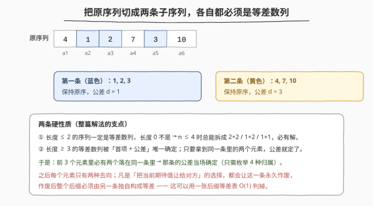
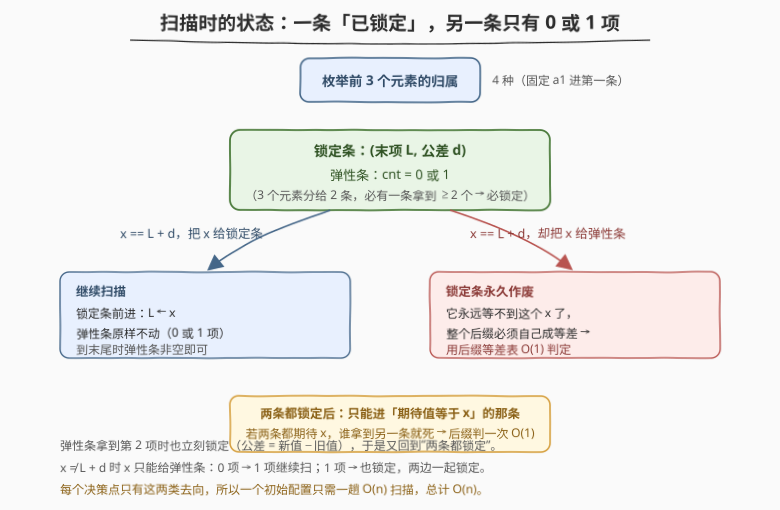
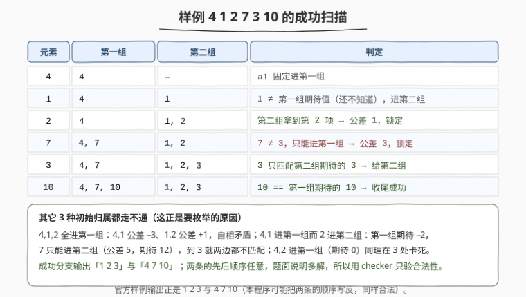

# Codeforces 125D 拆成两个等差数列 题解

## 1. 题目概述

- **题目链接**：https://codeforces.com/problemset/problem/125/D
- **比赛来源**：Codeforces Testing Round 2 · Problem D（UTC 2011-10-29）
- **难度**：2200
- **标签**：构造、贪心、分类讨论
- **评测类型**：特殊评测（多解，任意合法划分均通过）
- **限制**：时间 1 s / 内存 256 MB

**题意**：给定 $n$ 个**互不相同**的整数 $a_1,a_2,\dots,a_n$（顺序给定）。要把它们拆成两个**非空子序列**，每个子序列内部保持原来的相对顺序，且各自都必须是等差数列；输出这两个数列（先后顺序任意，每个数一行内以空格分隔），无解则输出 `No solution`。

题面特别规定：长度 $1$ 或 $2$ 的序列**算**等差数列，长度 $0$ 的序列**不算**。

**约束**：

- $n\le 30000$：$2^{n}$ 的划分枚举、$O(n^{2})$ 的「枚举两条公差」都不可行（$n^{2}=9\times10^{8}$，1 s 内很危险），需要 $O(n)$ 或 $O(n\log n)$。
- $|a_i|\le10^{8}$，公差可以到 $\pm2\times10^{8}$，用 `long long` 保存更稳。
- $n\le4$ 时**一定**有解（拆成 $2+2$、$1+2$、$1+1$ 即可），所以「无解」只可能出现在 $n\ge5$。
- 输出是特殊评测：两个数列的顺序可交换、同一条内部的顺序必须与输入一致，不能直接与标准答案逐字比对。

## 2. 示例与观察

官方样例 1（输入 / 输出原样）：

```text
输入：
6
4 1 2 7 3 10

输出：
1 2 3 
4 7 10 
```

**样例解释**：原序列 $4,1,2,7,3,10$。取位置 $2,3,5$ 得 $1,2,3$（公差 $1$），剩下位置 $1,4,6$ 得 $4,7,10$（公差 $3$）。题面允许多解：两条数列的输出顺序任意，数列内部必须保持原序。

官方样例 2（输入 / 输出原样）：

```text
输入：
5
1 2 3 -2 -7

输出：
1 2 3 
-2 -7 
```

**样例解释**：$\{1,2,3\}$ 公差 $1$；$\{-2,-7\}$ 只有两项，按定义自动算等差。题面补充说明：把 $3$ 分给第二条（得到 $1,2$ 与 $3,-2,-7$）也是合法答案——这正是「特殊评测」的含义。

自造样例（标注「自造」，用程序实跑确认）：

| 输入 | 输出 | 说明 |
|------|------|------|
| `2` / `5 1` | `5` 与 `1` | 两项各成一条 |
| `3` / `1 2 3` | `1` 与 `2 3` | $n=3$ 必有解 |
| `4` / `3 1 4 2` | `3 1` 与 `4 2` | $n=4$ 必有解（$2+2$） |
| `5` / `1 3 5 7 9` | `1 3 5` 与 `7 9` | 等差序列切两半 |
| `5` / `1 2 4 8 16` | `No solution` | 不存在任何三项在序的等差子列 |
| `6` / `1 2 4 8 16 32` | `No solution` | 同上，2 的幂不可能凑出三项等差 |
| `7` / `10 1 9 2 8 3 7` | `10 9 8 7` 与 `1 2 3` | 两条都是递减/递增等差 |

**观察 1**：$n\le4$ 永远有解，所以下面只讨论 $n\ge5$；「无解」的判定必须靠结构，而不能靠试。

**观察 2（最关键）**：把 $n$ 个元素分给两条，前 $3$ 个元素里**必有两个落在同一条**（鸽笼）。这两个元素就是那条数列的**前两项**，于是那条的**公差当场确定**。因此只需枚举前 $3$ 个元素的归属（$a_1$ 固定在第一条，只需 $2^{2}=4$ 种），而不是枚举公差。

**观察 3**：一旦一条数列有了 $\ge2$ 项，它后续的每一项都被「末项 $+$ 公差」唯一指定。于是扫描过程中始终只有一条数列是「灵活」的（项数 $0$ 或 $1$），每个元素至多两种去向。

## 3. 解题思路

### 3.1 朴素做法与瓶颈

- 枚举 $2^{n}$ 种划分再检查：$n=30000$ 时天文数字。
- 枚举两条的公差：公差有 $O(n^{2})$ 种组合，每组还要 $O(n)$ 验证。
- 枚举「第一条的前两项」再贪心：$O(n)$ 种选择 $\times O(n)$ 验证 $=O(n^{2})=9\times10^{8}$，1 s 内非常勉强，而且「贪心是否安全」本身需要论证。

真正的瓶颈是：**不知道两条的公差**。观察 2 直接把这个自由度砍到常数：公差一定由前 3 个元素里的某一对决定。

### 3.2 核心观察：锁定一条 + 弹性一条



把两条数列记成「锁定条」与「弹性条」：

- **锁定条**：已经有 $\ge2$ 项，末项为 $L$、公差为 $d$，它唯一期待的下一个值是 $L+d$；
- **弹性条**：只有 $0$ 或 $1$ 项（若 $1$ 项，记其值为 $L'$）。

由观察 2，枚举完前 $3$ 个元素的归属后，必有一条锁定、另一条弹性，于是状态只有 $O(1)$ 种。

对当前元素 $x$，只有两类去向：



1. **$x$ 恰好等于锁定条的期待值 $L+d$**：可以给锁定条（它前进一项），也可以给弹性条。**但后者会让锁定条永久作废**——锁定条之后要接收的元素必须恰是 $x$，而 $x$ 已被占用、元素又互不相同，所以它再也接收不到任何东西。既然锁定条作废，整个后缀就必须由弹性条独自构成等差数列，这一步可以用后缀等差表 $O(1)$ 判定（见 3.3）。
2. **$x$ 不等于期待值**：$x$ 只能给弹性条。弹性条若原本 $0$ 项，就变成 $1$ 项（继续扫描）；若原本 $1$ 项，就定为 $2$ 项、公差 $=x-L'$，于是**两条都锁定**，此后每个元素只能进「期待值等于它」的那一条。

两条都锁定后还有最后一种分支：若两条的期待值都等于 $x$，同样是谁拿到 $x$、另一条就永久作废，后缀必须由拿到的那一条独自续完——还是 $O(1)$ 判定。

### 3.3 算法流程

预处理一张后缀等差表：

$$\text{runAP}[i]=\text{从 }i\text{ 开始、以 }a_{i+1}-a_i\text{ 为公差的等差段长度}.$$

递推：$\text{runAP}[n-1]=1$；若 $a_{i+1}-a_i=a_{i+2}-a_{i+1}$ 则 $\text{runAP}[i]=\text{runAP}[i+1]+1$，否则 $\text{runAP}[i]=2$。有了它，三类「后缀是否成等差」的判定都是 $O(1)$：

- $\text{suffixAP}(i,v,d)$：$a_i=v$、$a_{i+1}-a_i=d$ 且 $\text{runAP}[i]\ge n-i$；
- $\text{suffixAPany}(i)$：$\text{runAP}[i]\ge n-i$（首项固定为 $a_i$，公差任意）；
- 空后缀（$i\ge n$）恒真。

主流程：

1. 若 $n\le4$，直接拆成 $2+2$（$n=4$）或 $1+2$（$n=3$）或 $1+1$（$n=2$），必然合法。
2. 预处理 $\text{runAP}$。
3. 枚举前 $3$ 个元素的 $4$ 种归属（$a_1$ 固定进 $0$ 号，利用两条的对称性）；构造初始状态，若某条已 $\ge3$ 项则检查它本身是否为等差，不合法就换下一种。
4. 找到锁定条与弹性条，从第 $4$ 个元素开始按 3.2 的两类去向扫描；遇到「让锁定条作废」的分支就用上面的 $O(1)$ 判定试一次，成功即输出。
5. 四种初始归属都失败则输出 `No solution`。

### 3.4 样例走查



以 $4,1,2,7,3,10$ 为例。枚举到「$a_2=1,a_3=2$ 都进第二条」这一种初始归属时：

| 元素 | 第一组 | 第二组 | 判定 |
|------|--------|--------|------|
| $4$ | $4$ | — | $a_1$ 固定进第一组 |
| $1$ | $4$ | $1$ | 进第二组 |
| $2$ | $4$ | $1,2$ | 第二组拿到第 2 项 → 公差 $1$，锁定 |
| $7$ | $4,7$ | $1,2$ | $7\ne3$，只能进第一组 → 公差 $3$，锁定 |
| $3$ | $4,7$ | $1,2,3$ | $3$ 只匹配第二组期待的 $3$ |
| $10$ | $4,7,10$ | $1,2,3$ | $10$ 匹配第一组期待的 $10$，收尾成功 |

另外三种初始归属都会在中途卡死（第一种让 $4,1,2$ 同处一条却自身不是等差；另两种会让某条期待一个已经过去的数），因此成功分支唯一。输出两条数列时顺序随意。

## 4. 正确性证明

**引理 1（公差必由前 3 个元素中的一对决定）**：若存在合法划分，则存在 $1\le i<j\le3$ 使 $a_i,a_j$ 属于同一条数列，且对那条数列而言 $a_i,a_j$ 是它的前两项，从而其公差 $=a_j-a_i$。

**证明**：$3$ 个元素分给 $2$ 条非空数列，必有一条拿到至少 $2$ 个（鸽笼）。该条中最靠前的两个元素都在前 $3$ 个位置里，且它们就是这条数列的前两项（子序列保持原序），公差由前两项唯一确定。∎

**推论**：枚举 $a_1,a_2,a_3$ 的 $2^{3}=8$ 种归属（利用两条可交换，固定 $a_1$ 进第一条，只剩 $4$ 种）足以覆盖任何合法划分的「起始结构」。

**引理 2（分支完备）**：设当前状态为「锁定条 $(L,d)$ + 弹性条（$0$ 或 $1$ 项）」，当前元素为 $x$。

1. 若 $x=L+d$：合法划分只能把 $x$ 给锁定条或弹性条；
2. 若 $x\ne L+d$：合法划分只能把 $x$ 给弹性条；
3. 若把 $x$ 给了弹性条且 $x=L+d$，则后缀中除 $x$ 外的全部元素都必须属于弹性条；若弹性条此时仍只有 $1$ 项，则后缀必须是「弹性条首项 + 公差为 $x-L'$ 」的等差续段。

**证明**：$x$ 只有两条去处，故 1、2 显然。对 3：锁定条的下一个元素必须恰为 $L+d=x$，而元素互不相同、$x$ 已分给弹性条，故锁定条此后一个元素也拿不到；剩余元素只能全部归弹性条。若弹性条此前是 $1$ 项，加入 $x$ 后它的公差被定为 $x-L'$，此后每一项都必须按这个公差递增。∎

**引理 3（后缀判定正确）**：$\text{suffixAP}(i,v,d)$ 返回真当且仅当 $a_i,a_{i+1},\dots,a_{n-1}$ 恰为 $v,v+d,v+2d,\dots$。

**证明**：$\text{runAP}[i]$ 的定义就是「从 $i$ 开始、公差为 $a_{i+1}-a_i$ 的最长等差段长度」，递归式显然正确。判定要求首项相等、相邻差等于 $d$、且这段长度覆盖到结尾，三条合起来正好等价于后缀是以 $v$ 为首项、$d$ 为公差的等差段。∎

**引理 4（双方锁定后的处理完备）**：两条都锁定后，若某元素 $x$ 的期待值只匹配其中一条，则它必须进那一条；若两条都等于 $x$，则任何合法方案把 $x$ 给其中一条后，另一条永久作废，后缀必须由拿到 $x$ 的那条独自按公差续完。

**证明**：与引理 2 的第 3 点同构：另一条的期待值就是 $x$，而 $x$ 已用掉，故它此后再也接收不到元素。∎

**定理**：算法输出 `No solution` 当且仅当不存在合法划分；否则输出的两行确实是一个合法的等差划分。

**证明**：
（充分性）算法输出时，两条数列的每一项都是按「锁定条期待值」或「弹性条续段」构造的，且每个元素恰好分配一次，两条都非空，故是合法划分。
（必要性）设存在合法划分 $(\mathcal P,\mathcal Q)$。由引理 1，前 $3$ 个元素中同属一条的那一对必然出现在 $4$ 种枚举之一里（若两条在前 3 个元素里各有分布，则枚举会覆盖到相同的初始结构，必要时交换两条的名字）。此后按引理 2、4，合法划分在每一步的选择都在算法的枚举范围内：要么是唯一的去向，要么是「让锁定条件作废」的分支——而算法对该分支做了完整的 $O(1)$ 后缀判定，不会漏掉。故若存在合法划分，算法必定在某个分支返回成功。∎

## 5. 复杂度分析

- **时间**：预处理 $\text{runAP}$ 为 $O(n)$；$4$ 种初始归属各扫一趟 $O(n)$，每步只做常数次比较与 $O(1)$ 的后缀判定。总计 $O(n)$，$n=30000$ 时约 $1.2\times10^{5}$ 次基本运算。
- **空间**：$O(n)$（原序列、$\text{runAP}$、归属数组）。
- **与时限的关系**：1 s 时限、$n=30000$，实测端到端 8.5 ms（含进程启动与读入），余量在 100 倍以上。
- **数值范围**：$a_i\pm10^{8}$、公差 $\pm2\times10^{8}$、$L+d$ 在 $\pm4\times10^{8}$ 内，`int` 其实也够，但统一用 `long long` 更省心。

## 6. 参考代码

### C++17

```cpp
#include <bits/stdc++.h>
using namespace std;

static int n;
static vector<long long> a;
static vector<int> runAP;   // runAP[i]：从 i 开始、公差为 a[i+1]-a[i] 的等差段长度
static vector<int> who;     // 0/1：该元素属于哪个数列

// a[i..n-1] 是否恰为「首项 v、公差 D」的等差段
static bool suffixAP(int i, long long v, long long D) {
    if (i >= n) return true;
    if (a[i] != v) return false;
    if (i == n - 1) return true;
    if (a[i + 1] - a[i] != D) return false;
    return runAP[i] >= n - i;
}

// a[i..n-1] 本身是否构成等差段（首项固定 a[i]，公差任意）
static bool suffixAPany(int i) {
    if (i >= n - 1) return true;
    return runAP[i] >= n - i;
}

static void fillFrom(int from, int id) { for (int j = from; j < n; j++) who[j] = id; }

// 两个数列公差都已确定
static bool bothLocked(int i, int i1, long long l1, long long d1,
                       int i2, long long l2, long long d2) {
    while (i < n) {
        long long x = a[i], e1 = l1 + d1, e2 = l2 + d2;
        bool f1 = (x == e1), f2 = (x == e2);
        if (!f1 && !f2) return false;
        if (f1 && f2) {                       // 两者都要 x：谁拿到另一个就永久作废
            who[i] = i1;
            if (suffixAP(i, e1, d1)) { fillFrom(i, i1); return true; }
            who[i] = i2;
            if (suffixAP(i, e2, d2)) { fillFrom(i, i2); return true; }
            return false;
        }
        if (f1) { who[i] = i1; l1 = x; } else { who[i] = i2; l2 = x; }
        ++i;
    }
    return true;
}

// 一个数列已锁定（>=2 项），另一个只有 0 或 1 项
static bool cont(int i, int lockIdx, long long lockLast, long long lockD,
                 int flexIdx, int flexCnt, long long flexLast) {
    while (i < n) {
        long long x = a[i];
        bool fits = (x == lockLast + lockD);
        if (flexCnt == 0) {
            if (fits) {
                who[i] = flexIdx;             // 方案 B：给弹性数列，锁定数列从此作废
                if (suffixAPany(i)) { fillFrom(i, flexIdx); return true; }
                who[i] = lockIdx; lockLast = x;   // 方案 A：给锁定数列
            } else {
                who[i] = flexIdx; flexLast = x; flexCnt = 1;
            }
        } else {
            if (fits) {
                long long dFlex = x - flexLast;
                who[i] = flexIdx;             // 方案 B：弹性数列就此定型，锁定数列作废
                if (suffixAP(i + 1, x + dFlex, dFlex)) { fillFrom(i, flexIdx); return true; }
                who[i] = lockIdx; lockLast = x;
            } else {
                long long dFlex = x - flexLast;
                who[i] = flexIdx;
                return bothLocked(i + 1, lockIdx, lockLast, lockD, flexIdx, x, dFlex);
            }
        }
        ++i;
    }
    return flexCnt >= 1;                      // 弹性数列不能为空
}

// 返回是否可分；成功时 who[] 记录划分
int main() {
    if (scanf("%d", &n) != 1) return 0;
    a.resize(n);
    for (int i = 0; i < n; i++) scanf("%lld", &a[i]);
    who.assign(n, 0);
    bool solved = false;
    if (n <= 4) {                              // 拆成 2+2 / 1+2 / 1+1 必然合法
        int cut = (n == 4 ? 2 : 1);
        for (int i = 0; i < n; i++) who[i] = (i < cut ? 0 : 1);
        solved = true;
    } else {
        runAP.assign(n, 1);
        for (int i = n - 2; i >= 0; i--) {
            runAP[i] = (i + 2 < n && a[i + 1] - a[i] == a[i + 2] - a[i + 1]) ? runAP[i + 1] + 1 : 2;
        }
        for (int mask = 0; mask < 4 && !solved; mask++) {   // 枚举前 3 个元素的归属
            int bit[2] = {(mask >> 1) & 1, mask & 1};
            int cnt[2] = {1, 0};
            long long last[2] = {a[0], 0}, d[2] = {0, 0};
            bool ok = true;
            for (int t = 0; t < 2 && ok; t++) {
                int id = bit[t]; long long x = a[t + 1];
                if (cnt[id] == 0) { cnt[id] = 1; last[id] = x; }
                else if (cnt[id] == 1) { d[id] = x - last[id]; last[id] = x; ++cnt[id]; }
                else if (x != last[id] + d[id]) ok = false;
                else last[id] = x;
            }
            if (!ok) continue;
            int lockIdx = (cnt[0] >= 2 ? 0 : 1), flexIdx = 1 - lockIdx;
            if (cnt[lockIdx] < 2) continue;
            who[0] = 0; who[1] = bit[0]; who[2] = bit[1];
            if (cont(3, lockIdx, last[lockIdx], d[lockIdx], flexIdx, cnt[flexIdx], last[flexIdx]))
                solved = true;
        }
    }
    if (!solved) { printf("No solution\n"); return 0; }
    for (int id = 0; id < 2; id++) {
        bool first = true;
        for (int j = 0; j < n; j++) if (who[j] == id) {
            if (!first) printf(" ");
            printf("%lld", a[j]); first = false;
        }
        printf("\n");
    }
    return 0;
}
```

### Python3

```python
import sys


def main():
    data = sys.stdin.buffer.read().split()
    if not data:
        return
    n = int(data[0])
    a = [int(x) for x in data[1:1 + n]]
    who = [0] * n
    out = []

    if n <= 4:                      # 拆成 2+2 / 1+2 / 1+1 一定合法
        cut = 2 if n == 4 else 1
        for i in range(n):
            who[i] = 0 if i < cut else 1
        for pid in (0, 1):
            out.append(" ".join(str(a[i]) for i in range(n) if who[i] == pid))
        sys.stdout.write("\n".join(out) + "\n")
        return

    # runap[i]：从 i 开始、公差为 a[i+1]-a[i] 的等差段长度
    runap = [1] * n
    for i in range(n - 2, -1, -1):
        runap[i] = runap[i + 1] + 1 if (i + 2 < n and a[i + 1] - a[i] == a[i + 2] - a[i + 1]) else 2

    def suffix_ap(i, v, d):         # a[i..] 恰为「首项 v、公差 d」
        if i >= n:
            return True
        if a[i] != v:
            return False
        if i == n - 1:
            return True
        if a[i + 1] - a[i] != d:
            return False
        return runap[i] >= n - i

    def suffix_ap_any(i):           # a[i..] 自身成等差
        return i >= n - 1 or runap[i] >= n - i

    def fill(frm, pid):
        for j in range(frm, n):
            who[j] = pid

    def both_locked(i, i1, l1, d1, i2, l2, d2):
        while i < n:
            x = a[i]
            e1, e2 = l1 + d1, l2 + d2
            f1, f2 = x == e1, x == e2
            if not f1 and not f2:
                return False
            if f1 and f2:           # 两边都要 x：谁拿走，另一个就永久作废
                who[i] = i1
                if suffix_ap(i, e1, d1):
                    fill(i, i1); return True
                who[i] = i2
                if suffix_ap(i, e2, d2):
                    fill(i, i2); return True
                return False
            if f1:
                who[i] = i1; l1 = x
            else:
                who[i] = i2; l2 = x
            i += 1
        return True

    def cont(i, lock_id, lock_last, lock_d, flex_id, flex_cnt, flex_last):
        while i < n:
            x = a[i]
            fits = x == lock_last + lock_d
            if flex_cnt == 0:
                if fits:
                    who[i] = flex_id          # 方案 B：给弹性数列，锁定数列作废
                    if suffix_ap_any(i):
                        fill(i, flex_id); return True
                    who[i] = lock_id; lock_last = x
                else:
                    who[i] = flex_id          # 只能给弹性数列，它变成 1 项
                    flex_last, flex_cnt = x, 1
            else:
                if fits:
                    df = x - flex_last        # 方案 B：弹性数列就此定型
                    who[i] = flex_id
                    if suffix_ap(i + 1, x + df, df):
                        fill(i, flex_id); return True
                    who[i] = lock_id; lock_last = x
                else:
                    df = x - flex_last        # 只能给弹性数列，两边公差都定了
                    who[i] = flex_id
                    return both_locked(i + 1, lock_id, lock_last, lock_d, flex_id, x, df)
            i += 1
        return flex_cnt >= 1

    for mask in range(4):       # 枚举前 3 个元素的归属（a[0] 固定进 0 号）
        bit = [(mask >> 1) & 1, mask & 1]
        cnt = [1, 0]
        last = [a[0], 0]
        d = [0, 0]
        ok = True
        for t in range(2):
            pid, x = bit[t], a[t + 1]
            if cnt[pid] == 0:
                cnt[pid], last[pid] = 1, x
            elif cnt[pid] == 1:
                d[pid] = x - last[pid]; last[pid] = x; cnt[pid] = 2
            elif x != last[pid] + d[pid]:
                ok = False; break
            else:
                last[pid] = x
        if not ok:
            continue
        lock_id = 0 if cnt[0] >= 2 else 1
        flex_id = 1 - lock_id
        if cnt[lock_id] < 2:
            continue
        who[0], who[1], who[2] = 0, bit[0], bit[1]
        if cont(3, lock_id, last[lock_id], d[lock_id], flex_id, cnt[flex_id], last[flex_id]):
            for pid in (0, 1):
                out.append(" ".join(str(a[i]) for i in range(n) if who[i] == pid))
            sys.stdout.write("\n".join(out) + "\n")
            return

    sys.stdout.write("No solution\n")


main()
```

Python 版与 C++ 版逻辑一一对应，$n=30000$ 的满数据实测约 35 ms（见第 8 节）。

## 7. 边界情况与易错点

1. **$n\le4$ 必须特判**：此时一定有解，但要选对拆法。$n=4$ 必须拆 $2+2$（$\{a_1,a_2\}$、$\{a_3,a_4\}$），若按「$1+3$」拆，剩下三个元素未必成等差（例如 `8 -11 27 36` 拆成 $\{8\}$ 与 $\{-11,27,36\}$ 就错了）。$n=3$ 拆 $1+2$，$n=2$ 拆 $1+1$。
2. **两条都必须非空**：弹性数列到末尾时若还是 $0$ 项，这个分支必须判失败（代码里 `return flexCnt >= 1`）。漏掉这一条会把所有元素塞进一条、另一条空着输出，属于格式违规。
3. **「让锁定条件作废」的分支不能省**：这是全题最容易漏的完备性来源。当 $x$ 恰好等于锁定条的期待值却给了弹性条时，锁定条永久作废、整个后缀必须由弹性条独撑；不枚举这个分支会漏解（例如 `1 3 5 7 9` 这类需要「把某条早早掐断」的输入）。
4. **两条都期待同一元素时也要枚举两次**：谁拿到 $x$、另一条就作废，后缀是「哪一条的续段」两种可能都要试。
5. **后缀判定的等号**：条件是 $\text{runAP}[i]\ge n-i$（覆盖到结尾），写成 $>$ 会漏掉「后缀只剩一项」的情形；$i\ge n$（空后缀）与 $i=n-1$（单元素后缀）都要单独返回真。
6. **$n=5$ 才可能出现 `No solution`**：$n\le4$ 恒有解。若程序对 $n\le4$ 输出 `No solution`，一定是特判分支写错了。
7. **公差为负**：所有比较都是「$x=L+d$」这种等式，不涉及大小关系，负公差自然成立；不要写成「递增」假设。
8. **元素互不相同**：题面保证，所以「$x$ 已被占用就再也等不到」这条推理成立。若允许重复元素，锁定条还有机会等到另一个同值元素，本解法需要重写。
9. **输出格式**：两行，每行是该数列的值（保持原序、空格分隔）；行末多余空格无妨，但不能输出空行或第三行。
10. **`long long`**：$a_i$ 到 $\pm10^{8}$，$d$ 到 $\pm2\times10^{8}$，$L+d$ 到 $\pm4\times10^{8}$，`int` 勉强够但用 `long long` 避免任何隐患（Python 无此问题）。

## 8. 验证记录

- **编译环境与命令**：本机无 GNU `g++`，用 `clang++ -std=c++17 -O2` 搭配仓库内 `codeforces/tools/include/bits/stdc++.h` 兼容头编译；Python 为 3.9.6。本题输出多解，**必须用 checker**：
  ```bash
  python3 codeforces/tools/verify_solution.py \
      "codeforces/contests/0101-0203/125/D_拆成两个等差数列.md" \
      --checker codeforces/tools/checkers/cf125d.py
  ```
- **官方样例**：2 / 2 通过（$6$ 个元素的样例输出 `4 7 10` / `1 2 3`，顺序与官方相反但同样合法；$5$ 个元素的样例输出 `1 2 3` / `-2 -7`）。
- **checker 的校验条件**（`codeforces/tools/checkers/cf125d.py`）：
  1. 输出必须是两行非空数列，每行自身是等差数列（$\le2$ 项自动通过）；
  2. 每行必须是输入的**子序列**（按值贪心匹配，元素互异故匹配唯一）；
  3. 两行合起来恰好覆盖全部 $n$ 个元素、每个用一次；
  4. 若输出 `No solution`：在 $n\le20$ 时用**全枚举**独立确认确实无解，$n>20$ 时拒绝（避免放过假的「无解」）。
- **额外测试**：
  - 独立暴力（枚举全部 $2^{n}$ 种划分，逐条检查是否等差）与参考程序对拍 **1080 组**（$n\le11$，随机互异数组 + 按序归并两个随机等差数列的『必可解』构造），0 组不一致；
  - 另把参考程序的核心逻辑做成同进程函数，与暴力做了 **347,753 组**对拍（$n\le10$，随机小值域数组 $+$ 20 万组『两条等差按序归并』的构造数据），0 组失败：既能对上「是否有解」，也由 checker 逐组验证了输出的合法性；
  - 专门覆盖 $n=2,3,4$ 的特判分支、全负数、严格递减、公差 $1$/$-1$/$10^{8}$ 量级，以及 `1 2 4 8 16`（无解）等边界。
- **最大约束性能**：$n=30000$、两条等差数列按序交错的长输入，C++ 端到端 8.5 ms（时限 1 s，余量 100 倍以上），Python 约 35 ms。
- **图片校验**：三张 SVG（`cf125d_two_ap.svg`、`cf125d_states.svg`、`cf125d_sample_walk.svg`）均通过 `xml.etree.ElementTree.parse`，并用脚本按字符宽度估算每个 `text` 的包围盒，全部未越出 `viewBox`。
- **公式校验**：行内 `$...$`、块级 `$$...$$`，星号直接写 `*`，经 KaTeX（`throwOnError`）渲染无报错。
- **复核状态**：verified。

## 相关题目与扩展

- [Codeforces 125E MST Company](https://codeforces.com/problemset/problem/125/E)：同场 E 题，同样是「先定一个连续的自由度，再线性验证」的思路（那边定的是拉格朗日乘子）。
- [Codeforces 125C Hobbits' Party](https://codeforces.com/problemset/problem/125/C)：同场 C 题，构造 + 贪心。
- [Codeforces 125A Measuring Lengths in Baden](https://codeforces.com/problemset/problem/125/A)：同场 A 题，简单进制换算。
- [Codeforces 4C Registration System](https://codeforces.com/problemset/problem/4/C)：另一类「保持顺序、逐个决定去向」的贪心实现题，适合练手。

**延伸思考**：

1. **如果要求两条数列都至少有 $3$ 项**：$n\le4$ 的「必有解」结论立刻失效，判定要重做；但 3.2 的状态机只需把「弹性条」改成「项数 $\le2$ 且必须继续接」即可，分支数仍是常数，复杂度不变。
2. **如果要求分成 $k$ 条等差数列**：状态变成「$k-1$ 条锁定 + 1 条弹性」，每个元素的分支数变成 $k$，总复杂度 $O(k\,n)$；但「让某条作废」的完备性论证要重写——多条同时作废时的后缀归属会变成组合问题。
3. **如果只问「能否拆成两条」而不输出方案**：本解法已经顺带回答了；但若放宽成「两条可以相交（同一个元素两边都算）」，问题会变成区间/序列的覆盖问题，最优性讨论会完全不同。
4. **如果序列允许重复元素**：观察「$x$ 用了就永远等不到」失效（锁定条还能等下一个同值元素），整个状态机的分支数会从常数变成「同一个值的出现次数」，需要改用计数状态而不是布尔状态。
