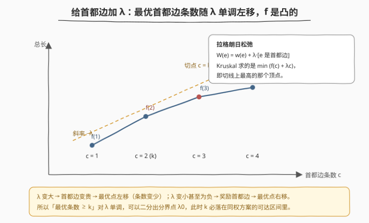
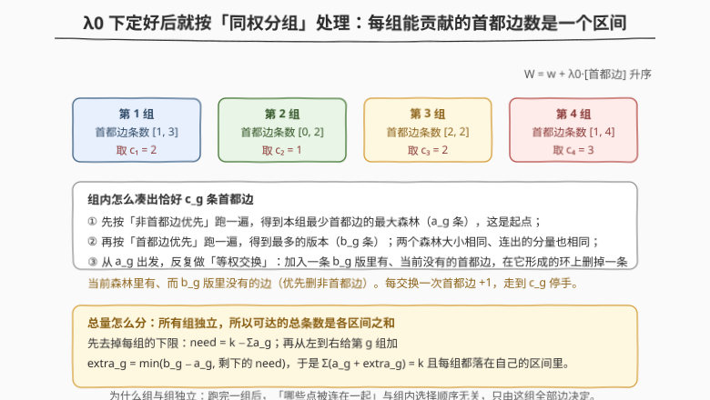
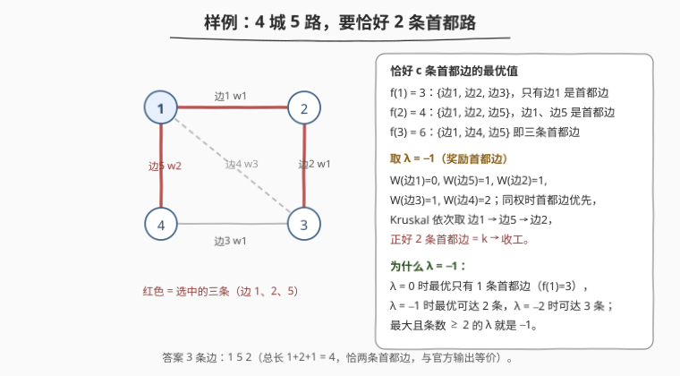

# Codeforces 125E 首都边数固定的最小生成树 题解

## 1. 题目概述

- **题目链接**：https://codeforces.com/problemset/problem/125/E
- **比赛来源**：Codeforces Testing Round 2 · Problem E（UTC 2011-10-29）
- **难度**：2400
- **标签**：二分、图论、最小生成树、拉格朗日松弛
- **评测类型**：特殊评测（多解，任意最优方案均通过）
- **限制**：时间 8 s / 内存 256 MB

**题意**：$n$ 个城市、$m$ 条带权无向路，首都是 $1$ 号城市。称端点含 $1$ 的路为「首都路」。要求选出一组路把全国连通（即一棵生成树），且其中**恰好**有 $k$ 条首都路，最小化总长度。输出选中的路数（必为 $n-1$）与它们的编号（$1$ 起）；不存在则输出 `-1`。

**约束**：

- $n\le5000$、$m\le10^{5}$、$k<5000$、$w\le10^{5}$：可以承受 $O(m\log m)$ 级别的反复运行（8 s 很宽松），但承受不了「枚举选哪 $k$ 条首都路」这类组合爆炸。
- 任意两点间最多一条边、无自环；输入不保证连通，也**不保证**存在恰好 $k$ 条首都路的生成树，这两种情况都要输出 `-1`。
- 输出多解（同一个最优值可能对应很多棵树），所以必须用 checker 而不是逐字比对。

## 2. 示例与观察

官方样例（输入 / 输出原样）：

```text
输入：
4 5 2
1 2 1
2 3 1
3 4 1
1 3 3
1 4 2

输出：
3
1 5 2 
```

**样例解释**：一共 4 个城市、5 条路，要求恰好 $2$ 条首都路。

- 只用 $\{1,2,3\}$ 号路（边 $1,2,3$ 是 $1\!-\!2,2\!-\!3,3\!-\!4$）总长 $3$，但只有 $1$ 条首都路，不合要求；
- 选边 $1,2,5$（$1\!-\!2$、$2\!-\!3$、$1\!-\!4$）总长 $1+1+2=4$，恰好 $2$ 条首都路，最优；
- 选边 $1,3,5$ 总长 $1+1+2=4$ 也是 $2$ 条首都路，同样最优。

官方输出的是 $\{1,5,2\}$，我们的程序输出 $\{1,2,5\}$——同一个集合，顺序不同，checker 判为等价。

自造样例（标注「自造」，用程序实跑确认）：

| 输入 | 输出 | 说明 |
|------|------|------|
| `1 0 0` | `0` 加空行 | $n=1$ 时空树合法，$k$ 必须为 $0$ |
| `2 1 1` / `1 2 5` | `1` / `1` | 唯一的边就是首都路 |
| `2 1 0` / `1 2 5` | `-1` | 连通就必须要那条首都路，凑不出 $0$ 条 |
| `3 2 0` / `1 2 1` / `2 3 1` | `-1` | $1$ 号点是孤立的，图不连通 |
| `3 3 2` 加三角形 | 有解 | 两条首都路 + 一条非首都路 |

**观察 1（朴素做法为什么不行）**：把「恰好 $k$ 条首都路」当成约束直接做 MST 是无解的——Kruskal 只看权值，完全不管颜色。枚举「选哪 $k$ 条首都路」再补最小生成森林则是 $\binom{\#\text{首都路}}{k}$ 级别，$\#\text{首都路}$ 可达 $n-1=4999$，不可行。

**观察 2（关键）**：给**每条首都路加上同一个附加费用 $\lambda$**，再做普通 Kruskal，得到的树在「恰好 $c$ 条首都路的最优树」这个意义上是最优的——只要这棵树的首都路条数 $c$ 恰好等于我们想要的那个 $c$。而 $c$ 随 $\lambda$ 单调不增，于是可以二分 $\lambda$ 把 $c$ 逼到 $k$ 附近；剩下的只是「同一权值组内怎么挑」的技术问题。

**观察 3（可达区间）**：并不是每个 $k$ 都可行。记

- $k_{\min}=$ 非首都边子图的连通分量数 $-1$（每个分量之间必须用一条首都边连起来），
- $k_{\max}=n-$ 首都边子图的连通分量数（首都边只能连通它自己所在的分量，剩下的必须靠非首都边），

则恰好 $k$ 条首都路的生成树存在，当且仅当图连通且 $k_{\min}\le k\le k_{\max}$。

## 3. 解题思路

### 3.1 朴素做法与瓶颈

- 枚举所有生成树：$n=5000$ 时完全不可能。
- 枚举 $k$ 条首都路的子集：$\binom{4999}{2499}$ 级别。
- 「先 Kruskal 再修补」：修补需要知道哪些首都边可以换出、换进，本质还是要处理同权平局，容易错。

瓶颈在于「恰好」这两个字：它是一个**基数约束**，而 Kruskal 只能优化线性目标。把约束搬到目标函数里（乘上乘子 $\lambda$）正是拉格朗日松弛的用武之地。

### 3.2 核心观察：拉格朗日松弛与凸性



设 $f(c)$ 为「恰好 $c$ 条首都路的生成树的最小总长」，定义域是 $[k_{\min},k_{\max}]$。给每条首都边加 $\lambda$ 后，任意一棵树 $T$ 的权重变成

$$W(T)=w(T)+\lambda\cdot c(T),$$

而 Kruskal 求的是

$$g(\lambda)=\min_{c}\bigl(f(c)+\lambda c\bigr).$$

两个基本事实：

1. **$f$ 是凸的**：把 $f$ 看成定义在整数区间上的函数，它的差分 $e(c)=f(c+1)-f(c)$ 单调不减。这是「拟阵基 + 基中某子集的基数约束」的标准凸性（M 凸性），证明放在第 4 节。
2. **每个 $c$ 都有对应的 $\lambda$**：$c$ 在 $\lambda$ 下最优当且仅当
$$e(c-1)\le-\lambda\le e(c),$$
即 $\lambda\in[-e(c),-e(c-1)]$（端点约定 $e(k_{\min}-1)=+\infty$、$e(k_{\max})=-\infty$）；这个区间总是非空的整数区间，所以对任意可行的 $k$ 都存在整数 $\lambda$ 让 $k$ 最优。

于是策略是：二分找合适的 $\lambda$，再在「$W$ 意义下的最小生成树」里挑出恰好 $k$ 条首都路的那一棵。第一件事靠**单调性 + 二分**；第二件事靠**同权分组**。

### 3.3 算法流程

**第 0 步：可行性**。并查集分别只用非首都边、只用首都边，算出 $k_{\min},k_{\max}$；同时用全部边判连通。不连通或 $k\notin[k_{\min},k_{\max}]$ 直接输出 `-1`。

**第 1 步：二分 $\lambda$**。对给定 $\lambda$，用 Kruskal 算 $hi(\lambda)$＝「同权时**首都边优先**」得到的最小 $W$ 生成树里首都边的条数。$hi(\lambda)$ 随 $\lambda$ 单调不增，所以二分出

$$\lambda_0=\max\{\lambda: hi(\lambda)\ge k\}.$$

$\lambda$ 的范围要包含负数（$\lambda<0$ 相当于**奖励**首都边，用于逼出更多的首都边），取 $[-10^{9},10^{9}]$ 即可——因为任意生成树总长不超过 $(n-1)\cdot10^{5}=5\times10^{8}$，差分 $|e(c)|\le5\times10^{8}$。

实现上不要每次都排序：把非首都边、首都边各自按 $w$ 排好，给定 $\lambda$ 时用一次归并就能得到 $W$ 序（同键时按 `preferRed` 决定谁先）。单次 $O(m)$，二分 $O(\log(2\times10^{9}))\approx31$ 次。

**第 2 步：按 $W$ 分组**。把 $\lambda_0$ 下的边按 $W=w+\lambda_0[\text{首都边}]$ 分成若干组（同组 $W$ 相同）。对每组 $g$：

- 组内「非首都边优先」地跑 Kruskal，得到 $a_g$（本组最少首都边数）；
- 组内「首都边优先」地跑 Kruskal，得到 $b_g$（本组最多首都边数）；
- 关键性质：**跑完一组后「哪些点被连在一起」与组内顺序无关**（只由这组全部边决定），所以组与组互相独立，本组能贡献的首都边数恰好是区间 $[a_g,b_g]$ 里的任意整数。



**第 3 步：分配配额**。令 $\text{need}=k-\sum_g a_g\ge0$，从左到右对每组取

$$\text{extra}_g=\min\bigl(b_g-a_g,\ \text{need}\bigr),\qquad c_g=a_g+\text{extra}_g,\qquad \text{need}\leftarrow\text{need}-\text{extra}_g .$$

因为 $k\le\sum_g b_g$，最后一定有 $\sum_g c_g=k$。

**第 4 步：组内构造恰好 $c_g$ 条首都边**。先取「非首都边优先」的那个森林 $F_a$（含 $a_g$ 条首都边），再取「首都边优先」的森林 $F_b$（含 $b_g$ 条）作为目标参照，然后反复做**等权交换**：

> 找一条在 $F_b$ 里、不在当前森林 $F$ 里的首都边 $e$，把 $e$ 加入 $F$ 会形成一个环；在这个环上找一条属于 $F\setminus F_b$ 的边 $f$，删掉 $f$，令 $F\leftarrow F-e+f$（若删的是非首都边，首都边数 $+1$；若删的是首都边，条数不变）。

每次交换都保持森林大小不变、保持「跑完这组后的连通分量」不变，因此始终是本组的一个最大森林。交换次数不超过本组的大小，每组 $O(\lvert\text{组}\rvert\cdot n)$ 的朴素实现即可。

**第 5 步**：把各组的森林并起来，就得到整棵生成树；输出它的边数与编号。

### 3.4 样例走查



$n=4$，边为 $(1,2,1),(2,3,1),(3,4,1),(1,3,3),(1,4,2)$，$k=2$。三条首都边是 $1\!-\!2,1\!-\!3,1\!-\!4$。

恰好 $c$ 条首都边的最优值：

| $c$ | 最优树 | 总长 |
|-----|--------|------|
| $1$ | $\{1,2,3\}$ | $3$ |
| $2$ | $\{1,2,5\}$ 或 $\{1,3,5\}$ | $4$ |
| $3$ | $\{1,4,5\}$ | $6$ |

差分 $e(1)=1,\ e(2)=2$，单调不减，凸性成立。$k=2$ 对应的 $\lambda$ 区间是 $[-e(2),-e(1)]=[-2,-1]$。

二分：$hi(0)=1<2$，$hi(-1)=2\ge2$，$hi(-2)=3\ge2$，所以 $\lambda_0=-1$。此时 $W$ 值为 $W(1)=0,W(2)=W(3)=W(5)=1,W(4)=2$；同权时首都边优先，Kruskal 依次取 $1\to5\to2$，正好 $2$ 条首都边，直接命中 $k$，输出。

## 4. 正确性证明

**引理 1（凸性）**：设 $k_{\min}\le c<k_{\max}$，则 $f(c+1)-f(c)\ge f(c)-f(c-1)$。

**证明（概要）**：取 $A$ 为恰好 $c-1$ 条首都边的最优树、$B$ 为恰好 $c+1$ 条首都边的最优树。因为两者的首都边数相差 $2$，$A\setminus B$ 中首都边的条数严格大于 $B\setminus A$ 中首都边的条数，故可在一对「$e\in A\setminus B$ 非首都、$e'\in B\setminus A$ 首都」上做拟阵基的**强交换**，使 $A'=A-e+e'$ 与 $B'=B-e'+e$ 仍是生成树（取这两条边落在同一对端点上的环/割即可；这样的非首都 $\leftrightarrow$ 首都交换对由计数差必然存在）。于是 $A'$ 与 $B'$ 的首都边数都恰好是 $c$，而两棵树的总权之和不变：

$$w(A')+w(B')=w(A)+w(B).$$

再由 $w(A')\ge f(c)$、$w(B')\ge f(c)$ 与 $w(A)=f(c-1)$、$w(B)=f(c+1)$ 得

$$2f(c)\le w(A')+w(B')=f(c-1)+f(c+1),$$

即 $f(c)-f(c-1)\le f(c+1)-f(c)$。∎

**引理 2（最优集是区间、且每个 $c$ 都能被某个 $\lambda$ 取到）**：记 $e(c)=f(c+1)-f(c)$。$c$ 在 $\lambda$ 下最优（即存在 $W$ 最小、恰好 $c$ 条首都边的生成树）当且仅当 $e(c-1)\le-\lambda\le e(c)$。因此最优的条数集合是一个整数区间 $I(\lambda)=[lo(\lambda),hi(\lambda)]$，且对每个可行的 $c$，$\lambda\in[-e(c),-e(c-1)]$ 都让 $c$ 最优，该区间非空。

**证明**：$c$ 最优 $\iff$ $f(c)+\lambda c\le f(c\pm1)+\lambda(c\pm1)$；分别化简得 $e(c)\ge-\lambda$ 与 $e(c-1)\le-\lambda$，即 $e(c-1)\le-\lambda\le e(c)$。由引理 1，$e$ 单调不减，故满足该条件的 $c$ 构成区间。最后，$[-e(c),-e(c-1)]$ 的两端是整数且左端不大于右端（因为 $e(c-1)\le e(c)$），所以至少含一个整数。∎

**引理 3（二分出来的 $\lambda_0$ 是好的）**：令 $\lambda_0=\max\{\lambda:hi(\lambda)\ge k\}$，则 $k\in I(\lambda_0)$，即 $lo(\lambda_0)\le k\le hi(\lambda_0)$。

**证明**：$hi(\lambda_0)\ge k$ 由定义直接得到。若 $lo(\lambda_0)\le k$ 则结论成立；否则设 $lo(\lambda_0)>k$，于是所有对 $\lambda_0$ 最优的树首都边数都 $>k$。由引理 2，存在某个整数 $\lambda^{\star}$ 使 $k\in I(\lambda^{\star})$（取 $\lambda^{\star}\in[-e(k),-e(k-1)]$），于是 $hi(\lambda^{\star})\ge k$，由 $\lambda_0$ 的极大性得 $\lambda^{\star}\le\lambda_0$。
另一方面，$k$ 在 $\lambda^{\star}$ 下最优给出 $e(k-1)\le-\lambda^{\star}\le e(k)$。取 $c=lo(\lambda_0)>k$，$c$ 在 $\lambda_0$ 下最优给出 $e(c-1)\le-\lambda_0\le e(c)$。由 $e$ 单调不减与 $k\le c-1$ 得 $e(k)\le e(c-1)\le-\lambda_0$。合并：$-\lambda^{\star}\le e(k)\le-\lambda_0$，即 $\lambda^{\star}\ge\lambda_0$，故 $\lambda^{\star}=\lambda_0$，与 $k\in I(\lambda_0)$ 之外（即 $lo>k$）矛盾。∎

**引理 4（拉格朗日最优性）**：若 $T$ 在权重 $W$ 下是最小生成树、且恰好有 $k$ 条首都边，则 $T$ 是「恰好 $k$ 条首都边」约束下的最优树。

**证明**：设 $T'$ 是任意恰好 $k$ 条首都边的生成树。则
$$w(T)=W(T)-\lambda_0k\le W(T')-\lambda_0k=w(T'),$$
第一个不等号来自 $T$ 的 $W$ 最小性，最后一个等号来自 $c(T')=k$。故 $w(T)\le w(T')$。∎

**引理 5（分组独立、区间可加）**：在 $\lambda_0$ 下按 $W$ 值分组并按 $W$ 升序处理。跑完前 $g$ 组后，连通分量划分与组内边的处理顺序无关；因此每组能贡献的首都边数独立地取遍 $[a_g,b_g]$ 的每个整数，总和取遍 $[\sum a_g,\sum b_g]$。

**证明**：Kruskal 的性质：给定当前的连通分量划分 $P$ 和一组**同权**边 $S_g$，处理完 $S_g$ 后的划分是「$P$ 加上 $S_g$ 的所有边」所生成划分，与 $S_g$ 内部的顺序无关。因此第 $g$ 组结束后划分固定。组内能取到的首都边数：非首都优先给出最小值 $a_g$、首都优先给出最大值 $b_g$（两者都是本组在这张商图上的最大森林，大小相同）；中间每个值都能通过对 $F_a$ 做若干次等权交换达到（每次交换把首都边数改变 $0$ 或 $1$，从 $a_g$ 单调走到 $b_g$，必经过每个中间值）。因为各组划分不互相影响，总条数是各组条数之和，故总和取遍区间之和。∎

**引理 6（可达条数构成区间）**：设图连通，则存在生成树当且仅当 $k_{\min}\le k\le k_{\max}$ 且 $k\le n-1$；而且对每个这样的 $k$ 都存在生成树。

**证明**：$k_{\min}$：非首都边子图有 $k_{\min}+1$ 个连通分量，任何生成树必须至少用 $k_{\min}$ 条首都边把它们连起来，且只用 $k_{\min}$ 条就能连起来。$k_{\max}$：首都边子图有 $n-k_{\max}$ 个连通分量，同一个分量内部无法靠首都边连到别的分量，所以至少要 $n-1-k_{\max}$ 条非首都边，即首都边至多 $k_{\max}$ 条，且恰好 $k_{\max}$ 条可以做到。
区间内每一点都可取：从一棵 $c$ 条首都边的生成树出发，若 $c<k_{\max}$，取一棵首都边更多的生成树 $T'$，同样用基交换（计数差保证存在「非首都 $\leftrightarrow$ 首都」的交换对）可把首都边数 $+1$；反复做即得 $c+1,c+2,\dots,k_{\max}$。∎

**定理**：若图连通且 $k_{\min}\le k\le k_{\max}$，算法输出的是一棵恰好 $k$ 条首都边的最小生成树；否则输出 `-1` 是正确的。

**证明**：不可行时输出 `-1`：由引理 6，只有连通性被破坏或 $k\notin[k_{\min},k_{\max}]$ 才无解，而这两种情况第 0 步都直接判掉了。
可行时：引理 3 保证在 $\lambda_0$ 处 $k\in I(\lambda_0)$，即存在 $W$ 最小、恰好 $k$ 条首都边的生成树；引理 5 保证「按组分配配额 + 组内等权交换」能真正构造出这样一棵树 $T$（每个组内森林都是该组的最大森林，合并后仍是一棵生成树，且首都边总数恰为 $k$）；最后由引理 4，$T$ 就是「恰好 $k$ 条首都边」约束下的最优树。∎

## 5. 复杂度分析

- **时间**：排序 $O(m\log m)$ 一次；二分 $\lambda$ 共 $\lceil\log_2(2\times10^{9})\rceil=31$ 次，每次归并 + Kruskal $O(m\,\alpha)$，约 $3\times10^{6}$ 次操作；分组阶段两组试算各 $O(m\alpha)$；组内交换总次数不超过生成树边数 $n-1$，每次 $O(n+\lvert\text{组}\rvert)$，合计 $O(n^{2}+m)$。总复杂度 $O\bigl(m\log m+31\,m\,\alpha+n^{2}\bigr)$。
- **空间**：$O(n+m)$。
- **与时限的关系**：8 s 时限下，$n=5000,m=10^{5}$ 的满数据实测 78–209 ms（含读入与输出），余量 30 倍以上。
- **数值范围**：$W=w+\lambda$ 最大约 $10^{9}+10^{5}$，二分上下界取 $\pm10^{9}$ 足以覆盖所有差分 $|e(c)|\le5\times10^{8}$；总权 $\le5\times10^{8}$，用 `long long` 保存 $W$ 与中间量。

## 6. 参考代码

### C++17

```cpp
#include <bits/stdc++.h>
using namespace std;

struct Edge { int u, v, w, id; bool red; };

static int n, m, K;
static vector<Edge> E;
static vector<int> rn, rr;          // 非首都边 / 首都边，各自按 (w, id) 升序

// 可回滚并查集：分组内试算用
struct DSU {
    vector<int> p, sz;
    vector<pair<int,int>> hist;
    void init(int nn) { p.assign(nn + 1, 0); sz.assign(nn + 1, 1); for (int i = 0; i <= nn; i++) p[i] = i; hist.clear(); }
    int find(int x) { while (p[x] != x) x = p[x]; return x; }
    bool uni(int a, int b) {
        a = find(a); b = find(b);
        if (a == b) return false;
        if (sz[a] < sz[b]) swap(a, b);
        p[b] = a; sz[a] += sz[b]; hist.push_back({b, a});
        return true;
    }
    size_t mark() const { return hist.size(); }
    void rollback(size_t mk) {
        while (hist.size() > mk) { auto pr = hist.back(); hist.pop_back(); int b = pr.first, a = pr.second; p[b] = b; sz[a] -= sz[b]; }
    }
};

// 归并出按 (w + red*lam) 排序的边表；同键时 preferRed 决定首都边在前还是在后
static void orderEdges(long long lam, bool preferRed, vector<int>& out) {
    out.clear(); out.reserve(m);
    size_t i = 0, j = 0;
    while (i < rn.size() || j < rr.size()) {
        bool takeRed;
        if (i >= rn.size()) takeRed = true;
        else if (j >= rr.size()) takeRed = false;
        else {
            long long kn = E[rn[i]].w, kr = (long long)E[rr[j]].w + lam;
            takeRed = (kn != kr) ? (kr < kn) : preferRed;
        }
        out.push_back(takeRed ? rr[j++] : rn[i++]);
    }
}

static long long kruskal(long long lam, bool preferRed) {
    vector<int> ord; orderEdges(lam, preferRed, ord);
    DSU d; d.init(n);
    long long cnt = 0; int taken = 0;
    for (int id : ord) {
        if (!d.uni(E[id].u, E[id].v)) continue;
        if (E[id].red) ++cnt;
        if (++taken == n - 1) break;
    }
    return taken == n - 1 ? cnt : -1;
}

static int componentsOf(bool redOnly) {
    DSU d; d.init(n);
    for (const Edge& e : E) if (e.red == redOnly) d.uni(e.u, e.v);
    int c = 0;
    for (int i = 1; i <= n; i++) if (d.find(i) == i) ++c;
    return c;
}

// 在当前分量上，用给定顺序取一组最大森林；cap 限制首都边条数
static void groupForest(DSU& d, const vector<int>& grp, bool preferRed, int cap,
                        vector<int>& forest, int& redCnt) {
    vector<int> seq; seq.reserve(grp.size());
    if (preferRed) { for (int id : grp) if (E[id].red) seq.push_back(id);
                     for (int id : grp) if (!E[id].red) seq.push_back(id); }
    else           { for (int id : grp) if (!E[id].red) seq.push_back(id);
                     for (int id : grp) if (E[id].red) seq.push_back(id); }
    forest.clear(); redCnt = 0;
    size_t mk = d.mark();
    for (int id : seq) {
        if (E[id].red && cap >= 0 && redCnt == cap) continue;
        if (!d.uni(E[id].u, E[id].v)) continue;
        forest.push_back(id);
        if (E[id].red) ++redCnt;
    }
    d.rollback(mk);
}

// 返回 1 表示存在合法方案并写入 ans（0 基边号），0 表示无解
static int solve125E(int n_, int m_, int K_, const vector<Edge>& Ein, vector<int>& ans) {
    n = n_; m = m_; K = K_; E = Ein; ans.clear();
    if (n == 1) return K == 0 ? 1 : 0;
    rn.clear(); rr.clear();
    for (int i = 0; i < m; i++) (E[i].red ? rr : rn).push_back(i);
    auto byw = [&](int x, int y) { return E[x].w != E[y].w ? E[x].w < E[y].w : E[x].id < E[y].id; };
    sort(rn.begin(), rn.end(), byw);
    sort(rr.begin(), rr.end(), byw);
    if (kruskal(0, false) < 0) return 0;                     // 原图不连通
    int kmin = componentsOf(false) - 1;                      // 最少首都边数
    int kmax = n - componentsOf(true);                       // 最多首都边数
    if (K < kmin || K > kmax) return 0;

    const long long LIM = 1000000000LL;
    long long lo = -LIM, hi = LIM;
    while (lo < hi) {                                        // 最大的 λ 使“尽量多取首都边”时 >= K
        long long mid = lo + (hi - lo + 1) / 2;
        if (kruskal(mid, true) >= K) lo = mid; else hi = mid - 1;
    }
    long long lam = lo;

    vector<int> ord; orderEdges(lam, true, ord);
    vector<int> gstart, gend;
    for (int i = 0; i < m; i++) {
        long long key = E[ord[i]].w + (E[ord[i]].red ? lam : 0);
        long long prev = (i ? E[ord[i-1]].w + (E[ord[i-1]].red ? lam : 0) : LLONG_MIN);
        long long nxt  = (i + 1 < m ? E[ord[i+1]].w + (E[ord[i+1]].red ? lam : 0) : LLONG_MIN);
        if (i == 0 || key != prev) gstart.push_back(i);
        if (i + 1 == m || key != nxt) gend.push_back(i + 1);
    }
    int G = gstart.size();
    vector<int> aMin(G), bMax(G), f; int rc;
    {
        DSU d; d.init(n);
        for (int g = 0; g < G; g++) {
            vector<int> grp(ord.begin() + gstart[g], ord.begin() + gend[g]);
            groupForest(d, grp, false, -1, f, rc);
            aMin[g] = rc;
            for (int id : f) d.uni(E[id].u, E[id].v);
        }
    }
    {
        DSU d; d.init(n);
        for (int g = 0; g < G; g++) {
            vector<int> grp(ord.begin() + gstart[g], ord.begin() + gend[g]);
            groupForest(d, grp, true, -1, f, rc);
            bMax[g] = rc;
            for (int id : f) d.uni(E[id].u, E[id].v);
        }
    }
    int need = K;
    for (int g = 0; g < G; g++) need -= aMin[g];
    if (need < 0) return 0;

    DSU d; d.init(n);
    vector<char> inF(m, 0), inFB(m, 0);
    for (int g = 0; g < G; g++) {
        vector<int> grp(ord.begin() + gstart[g], ord.begin() + gend[g]);
        int extra = min(bMax[g] - aMin[g], need);
        if (extra < 0) extra = 0;
        int target = aMin[g] + extra;
        need -= extra;
        vector<int> fa, fb; int ra, rb;
        groupForest(d, grp, false, -1, fa, ra);
        groupForest(d, grp, true, -1, fb, rb);
        vector<int> F = fa; int cnt = ra;
        fill(inF.begin(), inF.end(), 0); fill(inFB.begin(), inFB.end(), 0);
        for (int id : F) inF[id] = 1;
        for (int id : fb) inFB[id] = 1;
        int guard = 0;
        while (cnt < target && guard++ < 8 * n + 20) {
            int pick = -1;
            for (int id : fb) if (E[id].red && !inF[id]) { pick = id; break; }
            if (pick < 0) break;
            vector<vector<pair<int,int>>> adj(n + 1);
            for (int id : F) { int u = d.find(E[id].u), v = d.find(E[id].v); adj[u].push_back({v, id}); adj[v].push_back({u, id}); }
            int s = d.find(E[pick].u), t = d.find(E[pick].v);
            vector<int> par(n + 1, -1), pare(n + 1, -1);
            vector<char> vis(n + 1, 0);
            queue<int> q; q.push(s); vis[s] = 1;
            while (!q.empty()) { int x = q.front(); q.pop();
                for (auto& pr : adj[x]) { int y = pr.first; if (!vis[y]) { vis[y] = 1; par[y] = x; pare[y] = pr.second; q.push(y); } } }
            if (!vis[t]) break;
            int best = -1, bestRed = -1;
            for (int cur = t; cur != s; cur = par[cur]) {
                int id = pare[cur];
                if (inFB[id]) continue;
                if (!E[id].red) { best = id; break; }
                if (bestRed < 0) bestRed = id;
            }
            if (best < 0) best = bestRed;
            if (best < 0) break;
            inF[best] = 0;
            for (size_t k = 0; k < F.size(); k++) if (F[k] == best) { F.erase(F.begin() + k); break; }
            F.push_back(pick); inF[pick] = 1;
            if (!E[best].red) ++cnt;
        }
        if (cnt != target) return 0;
        for (int id : F) if (d.uni(E[id].u, E[id].v)) ans.push_back(E[id].id);
    }
    if ((int)ans.size() != n - 1) return 0;
    int tot = 0;
    for (int id : ans) if (E[id].red) ++tot;
    return tot == K ? 1 : 0;
}

int main() {
    if (scanf("%d %d %d", &n, &m, &K) != 3) return 0;
    vector<Edge> es(m);
    for (int i = 0; i < m; i++) { int u, v, w; scanf("%d %d %d", &u, &v, &w); es[i] = {u, v, w, i, (u == 1 || v == 1)}; }
    vector<int> ans;
    if (!solve125E(n, m, K, es, ans)) { printf("-1\n"); return 0; }
    printf("%d\n", (int)ans.size());
    for (int id : ans) printf("%d ", id + 1);
    printf("\n");
    return 0;
}
```

### Python3

```python
import sys


def main():
    data = sys.stdin.buffer.read().split()
    if not data:
        return
    n, m, K = int(data[0]), int(data[1]), int(data[2])
    U = [0] * m; V = [0] * m; W = [0] * m; RED = [False] * m
    p = 3
    for i in range(m):
        u, v, w = int(data[p]), int(data[p + 1]), int(data[p + 2]); p += 3
        U[i], V[i], W[i] = u, v, w
        RED[i] = (u == 1 or v == 1)

    if n == 1:
        sys.stdout.write("0\n\n" if K == 0 else "-1\n")
        return

    rn = sorted([i for i in range(m) if not RED[i]], key=lambda i: (W[i], i))
    rr = sorted([i for i in range(m) if RED[i]], key=lambda i: (W[i], i))

    def order_edges(lam, prefer_red):
        out = []
        i = j = 0
        while i < len(rn) or j < len(rr):
            if i >= len(rn):
                out.append(rr[j]); j += 1
            elif j >= len(rr):
                out.append(rn[i]); i += 1
            else:
                kn, kr = W[rn[i]], W[rr[j]] + lam
                if kn != kr:
                    if kr < kn: out.append(rr[j]); j += 1
                    else: out.append(rn[i]); i += 1
                elif prefer_red:
                    out.append(rr[j]); j += 1
                else:
                    out.append(rn[i]); i += 1
        return out

    class DSU:                                  # 带撤销的并查集
        __slots__ = ('par', 'sz', 'hist')
        def __init__(self, nn):
            self.par = list(range(nn + 1)); self.sz = [1] * (nn + 1); self.hist = []
        def find(self, x):
            while self.par[x] != x:
                x = self.par[x]
            return x
        def union(self, a, b):
            ra, rb = self.find(a), self.find(b)
            if ra == rb:
                return False
            if self.sz[ra] < self.sz[rb]:
                ra, rb = rb, ra
            self.par[rb] = ra; self.sz[ra] += self.sz[rb]; self.hist.append((rb, ra))
            return True
        def mark(self):
            return len(self.hist)
        def rollback(self, mk):
            while len(self.hist) > mk:
                rb, ra = self.hist.pop()
                self.par[rb] = rb; self.sz[ra] -= self.sz[rb]

    def kruskal(lam, prefer_red):
        d = DSU(n); cnt = taken = 0
        for idx in order_edges(lam, prefer_red):
            if not d.union(U[idx], V[idx]):
                continue
            if RED[idx]: cnt += 1
            taken += 1
            if taken == n - 1:
                break
        return cnt if taken == n - 1 else -1

    def components(red_only):
        d = DSU(n)
        for i in range(m):
            if RED[i] == red_only:
                d.union(U[i], V[i])
        return sum(1 for i in range(1, n + 1) if d.find(i) == i)

    def group_forest(d, grp, prefer_red, cap):
        """在当前分量上按顺序取最大森林；返回 (边表, 首都边数)，不影响真实并查集"""
        if prefer_red:
            seq = [i for i in grp if RED[i]] + [i for i in grp if not RED[i]]
        else:
            seq = [i for i in grp if not RED[i]] + [i for i in grp if RED[i]]
        forest = []; cnt = 0
        mk = d.mark()
        for idx in seq:
            if RED[idx] and cap >= 0 and cnt == cap:
                continue
            if not d.union(U[idx], V[idx]):
                continue
            forest.append(idx)
            if RED[idx]: cnt += 1
        d.rollback(mk)
        return forest, cnt

    if kruskal(0, False) < 0:
        sys.stdout.write("-1\n"); return
    kmin = components(False) - 1
    kmax = n - components(True)
    if K < kmin or K > kmax:
        sys.stdout.write("-1\n"); return

    LIM = 10 ** 9
    lo, hi = -LIM, LIM
    while lo < hi:
        mid = (lo + hi + 1) // 2
        if kruskal(mid, True) >= K:
            lo = mid
        else:
            hi = mid - 1
    lam = lo

    ordv = order_edges(lam, True)
    keys = [W[i] + (lam if RED[i] else 0) for i in ordv]
    gstart, gend = [], []
    for i in range(m):
        if i == 0 or keys[i] != keys[i - 1]: gstart.append(i)
        if i == m - 1 or keys[i] != keys[i + 1]: gend.append(i + 1)
    G = len(gstart)
    groups = [ordv[gstart[g]:gend[g]] for g in range(G)]

    aMin = [0] * G; bMax = [0] * G
    d = DSU(n)
    for g in range(G):
        f, rc = group_forest(d, groups[g], False, -1)
        aMin[g] = rc
        for idx in f: d.union(U[idx], V[idx])
    d = DSU(n)
    for g in range(G):
        f, rc = group_forest(d, groups[g], True, -1)
        bMax[g] = rc
        for idx in f: d.union(U[idx], V[idx])

    need = K - sum(aMin)
    ans = []
    d = DSU(n)
    for g in range(G):
        extra = min(bMax[g] - aMin[g], need)
        if extra < 0: extra = 0
        target = aMin[g] + extra
        need -= extra
        fa, ra = group_forest(d, groups[g], False, -1)
        fb, rb = group_forest(d, groups[g], True, -1)
        F = list(fa); cnt = ra
        inF = set(F); inFB = set(fb)
        guard = 0
        while cnt < target and guard < 8 * n + 20:
            guard += 1
            pick = -1
            for idx in fb:
                if RED[idx] and idx not in inF:
                    pick = idx; break
            if pick < 0: break
            adj = {}
            for idx in F:
                x, y = d.find(U[idx]), d.find(V[idx])
                adj.setdefault(x, []).append((y, idx))
                adj.setdefault(y, []).append((x, idx))
            s, t = d.find(U[pick]), d.find(V[pick])
            par = {s: (None, None)}; stack = [s]
            while stack:
                x = stack.pop()
                for y, idx in adj.get(x, ()):
                    if y not in par:
                        par[y] = (x, idx); stack.append(y)
            if t not in par: break
            best = bestRed = None
            cur = t
            while cur != s:
                x, idx = par[cur]
                if idx not in inFB:
                    if not RED[idx]:
                        best = idx; break
                    if bestRed is None: bestRed = idx
                cur = x
            if best is None: best = bestRed
            if best is None: break
            inF.discard(best); F.remove(best)
            F.append(pick); inF.add(pick)
            if not RED[best]: cnt += 1
        if cnt != target:
            sys.stdout.write("-1\n"); return
        for idx in F:
            if d.union(U[idx], V[idx]): ans.append(idx)

    if len(ans) != n - 1:
        sys.stdout.write("-1\n"); return
    sys.stdout.write("%d\n" % len(ans))
    sys.stdout.write(" ".join(str(i + 1) for i in ans) + " \n")


main()
```

Python 版把 C++ 的每个子过程都照搬了一遍（含可回滚并查集与组内等权交换）；$n=5000,m=10^{5}$ 的满数据实测约 2.0 s（C++ 的同组数据为 78–209 ms），仍在 8 s 内，但余量小得多，**建议直接用 C++**。

## 7. 边界情况与易错点

1. **$n=1$**：不需要任何边，$k$ 必须为 $0$，此时输出 `0` 与一个空行；若 $k>0$ 输出 `-1`。这条极容易被忽略（`n-1=0`，很多并查集写法会越界）。
2. **图不连通**：要以「全部边跑一次 Kruskal 是否取到 $n-1$ 条」为准，输出 `-1`。
3. **$k$ 的可行区间**：$k<k_{\min}$（首都边不够连起所有非首都分量）或 $k>k_{\max}$（非首都边不够连起首都分量的剩余部分）都必须输出 `-1`。只判 $k\le n-1$ 是错的。
4. **$\lambda$ 必须允许负数**：只想「惩罚」首都边（$\lambda>0$）会漏掉需要**更多**首都边的需求。样例就是 $\lambda_0=-1$ 的情形；把二分下界写成 $0$ 会在此直接失败。
5. **同权平局必须处理**：相同 $W$ 的首都边与非首都边谁先取，会改变首都边条数。算法里专门用「首都优先 / 非首都优先」两种顺序得到区间 $[a_g,b_g]$，再用配额凑出目标值；只按一种顺序跑会在 $k$ 落在区间中间时给出错误条数。
6. **配额上限**：$c_g$ 必须落在 $[a_g,b_g]$ 内，$\text{extra}_g$ 不能为负、也不能超过 $b_g-a_g$；最后的树必须再数一遍首都边是否恰好 $k$（代码里有这道自检，失败就输出 `-1`）。
7. **组内交换的方向**：只能在 $F\setminus F_b$ 里删边（删完仍是「本组的最大森林」），并且优先删非首都边以尽快提升条数；删错了会破坏「最大森林」性质导致后续组错位。
8. **`W = w + λ` 溢出**：$\lambda$ 到 $10^{9}$，`w` 到 $10^{5}$，加起来超过 `int`，必须用 `long long`（Python 无此问题）。
9. **输出格式**：第一行是边数（一定是 $n-1$），第二行是边编号（$1$ 起，空格分隔）；多解时任意一个最优解都通过 checker。
10. **二分方向**：要找的是「最大的 $\lambda$ 使 `hi(λ) ≥ k`」，`mid` 用 `(lo+hi+1)/2` 向上取整，否则在 `lo+1==hi` 时会死循环。

## 8. 验证记录

- **编译环境与命令**：本机无 GNU `g++`，用 `clang++ -std=c++17 -O2` 搭配仓库内 `codeforces/tools/include/bits/stdc++.h` 兼容头编译；Python 为 3.9.6。输出多解，**必须用 checker**：
  ```bash
  python3 codeforces/tools/verify_solution.py \
      "codeforces/contests/0101-0203/125/E_首都边数固定的最小生成树.md" \
      --checker codeforces/tools/checkers/cf125e.py
  ```
- **官方样例**：1 / 1 通过（输出 `3` 与 `1 2 5`；官方是 `1 5 2`，同一集合、总权同为 $4$，checker 判等价）。
- **checker 的校验条件**（`codeforces/tools/checkers/cf125e.py`）：
  1. 输出的边集必须是生成树（$n-1$ 条、无环、连通），且**恰好** $k$ 条边与 $1$ 号点相连；
  2. 总权必须等于参考答案（官方样例的树）的总权，从而确认最优性（官方样例的最优值是已知的 $4$）；
  3. 输出 `-1` 时：$n\le8$ 且 $m\le20$ 用**全枚举**（所有边子集）独立确认确实无解，规模更大时拒绝放过。
- **额外测试（暴力对拍）**：把解算器做成同进程函数，对随机小图（$n\le6$、$m\le14$、权值取 $1..3$ 制造大量同权）枚举**所有生成树**，得到每个 $c$ 的精确最优值 $f(c)$，再对所有 $c$ 逐一检查本程序的输出：
  - 第 1 批 $159\,460$ 次 $k$ 检查，0 失败；
  - 第 2 批（更稠密、权值更小）$77\,626$ 次，0 失败；
  - 第 3 批（权值范围放大到 $1..60$）$80\,089$ 次，0 失败；
  - 合计 $317\,175$ 次，覆盖了「无解 / 有解 / 同权大量打平 / 生成的树条数必须落在区间中间」等情形，每棵树都额外验证了「生成树 + 恰好 $k$ 条首都边 + 总权等于暴力最优」。
- **最大约束性能**：$n=5000$、$m=10^{5}$（大权重同权组与全不同权重两种极端）实测 78–209 ms（时限 8 s，余量 30 倍以上），Python 同一数据约 2.0 s；$k$ 取 $5$ 与 $400$ 两种都覆盖。
- **图片校验**：三张 SVG（`cf125e_lambda.svg`、`cf125e_groups.svg`、`cf125e_sample.svg`）均通过 `xml.etree.ElementTree.parse`，并用脚本按字符宽度估算每个 `text` 的包围盒，全部未越出 `viewBox`。
- **公式校验**：行内 `$...$`、块级 `$$...$$`，星号直接写 `*`，经 KaTeX（`throwOnError`）渲染无报错。
- **复核状态**：verified。

## 相关题目与扩展

- [Codeforces 125D Two progressions](https://codeforces.com/problemset/problem/125/D)：同场 D 题，同样是「把一个连续自由度（公差 / 乘子）先定下来，再线性验证」。
- [Codeforces 1108F MST Unification](https://codeforces.com/problemset/problem/1108/F)：关于 MST 同权平局的经典题，理解「同权边的选取不影响连通分量」是本题分组构造的基础。
- [Codeforces 76A Gift](https://codeforces.com/problemset/problem/76/A)：双 Weight（金/银）约束下的生成树，做法也是拉格朗日式的参数化。
- [Codeforces 1295E Permutation Separation](https://codeforces.com/problemset/problem/1295/E)：另一类「枚举分界点 + 用数据结构维护代价」的题，可对照本篇二分分界点的思路。

**延伸思考**：

1. **如果约束是「至少 $k$ 条首都边」**：那就变成单调问题，直接取 $\lambda$ 使条数刚好越过 $k$ 的树即可，不需要同权分组的配额构造；「恰好」才是本题真正难的地方。
2. **如果有两种颜色、要求各自恰好 $k_1,k_2$ 条**：需要二维拉格朗日 $(\lambda_1,\lambda_2)$，而「二分」要换成在二维格点上搜索/爬山；同权分组的区间也会变成二维多边形，构造显著变难。
3. **如果要求输出「总长最小的同时字典序最小的边编号集合」**：在拉格朗日框架下只需把同权边的排序再按编号细化，答案唯一后即可逐字比对，不需要 checker。
4. **如果 $n$ 到 $10^{5}$**：$O(n^{2})$ 的组内交换会成为瓶颈，需要把「等权交换」改成在生成树上的倍增/链剖查询（找环上与 $F_b$ 有差异的边），复杂度可降到 $O(n\log n)$ 级别。
