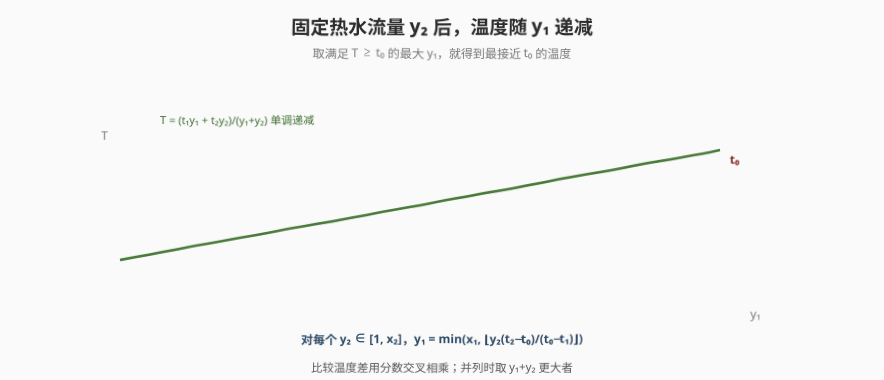
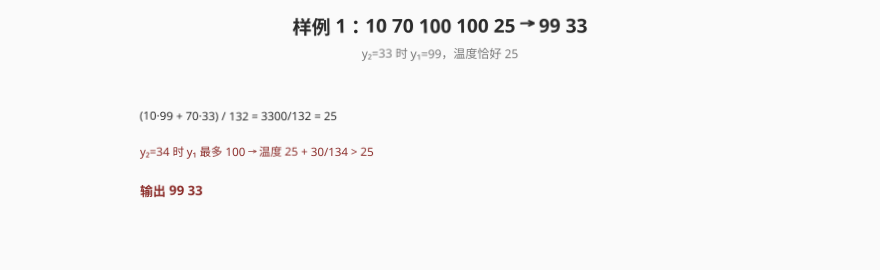

# Codeforces 126A 热洗澡水 题解

## 1. 题目概述

- **题目链接**：https://codeforces.com/problemset/problem/126/A
- **比赛来源**：Codeforces Beta Round 93 (Div. 1 Only) · Problem A（UTC 2011-11-09）
- **难度**：1900
- **标签**：枚举、分数比较
- **评测类型**：普通
- **限制**：时间 2 s / 内存 256 MB

**题意**：冷水温度 $t_1$、热水温度 $t_2$，两路水流量分别为 $y_1\in[0,x_1]$、$y_2\in[0,x_2]$（整数）。混合温度

$$T=\frac{t_1y_1+t_2y_2}{y_1+y_2}\ \ge t_0 .$$

在所有满足 $T\ge t_0$ 的方案中，先让 $T$ 尽量接近 $t_0$（即最小化 $T-t_0$），再让注水最快（$y_1+y_2$ 最大）。输出 $y_1,y_2$。

**约束**：

- $1\le t_1\le t_0\le t_2\le10^6$，$1\le x_1,x_2\le10^6$：$O(x_2)$ 枚举可行。
- 答案唯一（同温度下再按总流量最大）。
- 单组数据。

## 2. 示例与观察

官方样例一：

```text
输入：
10 70 100 100 25
输出：
99 33
```

官方样例二：

```text
输入：
300 500 1000 1000 300
输出：
1000 0
```

官方样例三：

```text
输入：
143 456 110 117 273
输出：
76 54
```

**样例一走查**：$y_2=33$ 时取 $y_1=\lfloor 33\cdot(70-25)/(25-10)\rfloor=99$，$T=(10\cdot99+70\cdot33)/132=25$ 恰好等于 $t_0$ ✓。

**样例二走查**：$t_1=t_0=300$，只用冷水即可，且要最快 → $y_1=x_1=1000,y_2=0$ ✓。



**观察**：固定 $y_2$ 后，$T$ 关于 $y_1$ 单调递减（$t_1<t_2$）。因此满足 $T\ge t_0$ 的**最大** $y_1$ 给出最接近 $t_0$ 的温度。

## 3. 解题思路

### 3.1 固定 $y_2$ 求最佳 $y_1$



$T\ge t_0$ 等价于

$$y_1(t_0-t_1)\le y_2(t_2-t_0)\ \Longrightarrow\ y_1\le\Bigl\lfloor\frac{y_2(t_2-t_0)}{t_0-t_1}\Bigr\rfloor .$$

取 $y_1=\min\bigl(x_1,\lfloor\cdot\rfloor\bigr)$，即该 $y_2$ 下的最优选择（温度最低且仍 $\ge t_0$，同时流量最大）。

### 3.2 枚举与比较

对 $y_2=1..x_2$ 逐一计算，用分数比较温度差：

$$T-t_0=\frac{(t_1-t_0)y_1+(t_2-t_0)y_2}{y_1+y_2}=\frac{N}{D}\ \ (N\ge0),$$

交叉相乘比较 $N/D$；并列时取 $D$ 更大者。

**退化情形**：$t_1=t_2$ → 温度恒为 $t_0$，取 $(x_1,x_2)$；$t_0=t_1<t_2$ → 加热水只会超过 $t_0$，取 $(x_1,0)$；$t_0=t_2>t_1$ → 只能不掺冷水，取 $(0,x_2)$。

### 3.3 样例走查

样例三：$y_2=54$ → $y_1=\lfloor54\cdot183/130\rfloor=76$，$T-t_0=2/130$；$y_2=53$ → $y_1=74$，$T-t_0=79/127$，更大 → 最优是 $(76,54)$ ✓。

## 4. 正确性证明

**引理 1**：固定 $y_2$ 时，$T$ 关于 $y_1$ 严格递减。

**证明**：$T=\frac{t_1y_1+t_2y_2}{y_1+y_2}$，导数符号为 $t_2-t_1>0$ 的相反数 ✓（直接作差亦可得 $T(y_1+1)<T(y_1)$）。∎

**引理 2**：固定 $y_2$ 时取 $y_1^{\star}= \min(x_1,\lfloor y_2(t_2-t_0)/(t_0-t_1)\rfloor)$ 是"满足 $T\ge t_0$ 且 $T$ 最小、流量最大"的选择。

**证明**：由引理 1，可行 $y_1$ 是区间 $[0,\lfloor\cdot\rfloor]$，取最大者温度最低 ✓，同时流量最大 ✓。∎

**引理 3**：全局最优一定出现在某个 $y_2$ 的 $y_1^{\star}$ 上（或退化情形）。

**证明**：若最优方案 $(y_1,y_2)$ 不是该 $y_2$ 下的 $y_1^{\star}$，则由引理 2 换成 $y_1^{\star}$ 温度不增、流量不减 → 不劣 ✓。∎

**定理**：算法输出的方案最优。

**证明**：由引理 3 枚举覆盖了最优解；比较用精确分数（交叉相乘）无精度误差；并列按流量取大 ✓。∎

## 5. 复杂度分析

- **时间**：$O(x_2)\le10^6$。
- **空间**：$O(1)$。
- **数值范围**：$N,D\le 2\times10^{12}$，交叉相乘 $\le4\times10^{18}$，用 `__int128` 安全。
- **与时限的关系**：2 s 下实测约 $2$ ms（C++），Python 约 $150$ ms。

## 6. 参考代码

### C++17

```cpp
#include <bits/stdc++.h>
using namespace std;
typedef long long ll;

int main() {
    ll t1, t2, x1, x2, t0;
    if (scanf("%lld %lld %lld %lld %lld", &t1, &t2, &x1, &x2, &t0) != 5) return 0;
    if (t1 == t2) { printf("%lld %lld\n", x1, x2); return 0; }   // 温度恒为 t0，取最大流量
    if (t0 == t1) { printf("%lld 0\n", x1); return 0; }         // 只用冷水即达 t0
    if (t0 == t2) { printf("0 %lld\n", x2); return 0; }         // 只能用热水
    ll bestN = -1, bestD = 1, bestFlow = -1, by1 = 0, by2 = 1;
    for (ll y2 = 1; y2 <= x2; ++y2) {
        ll y1 = (t2 - t0) * y2 / (t0 - t1);
        if (y1 > x1) y1 = x1;
        if (y1 < 0) y1 = 0;
        ll N = (t1 - t0) * y1 + (t2 - t0) * y2;   // >= 0 表示温度不低于 t0
        if (N < 0) continue;
        ll D = y1 + y2;
        bool better = false;
        if (bestN < 0) better = true;
        else {
            __int128 lhs = (__int128)N * bestD, rhs = (__int128)bestN * D;
            if (lhs < rhs) better = true;
            else if (lhs == rhs && D > bestFlow) better = true;
        }
        if (better) { bestN = N; bestD = D; bestFlow = D; by1 = y1; by2 = y2; }
    }
    printf("%lld %lld\n", by1, by2);
    return 0;
}
```

### Python3

```python
import sys
from fractions import Fraction


def main() -> None:
    data = sys.stdin.buffer.read().split()
    if not data:
        return
    t1, t2, x1, x2, t0 = (int(v) for v in data[:5])
    if t1 == t2:
        sys.stdout.write("%d %d\n" % (x1, x2))
        return
    if t0 == t1:
        sys.stdout.write("%d 0\n" % x1)
        return
    if t0 == t2:
        sys.stdout.write("0 %d\n" % x2)
        return
    best = None      # (frac, flow, y1, y2)
    for y2 in range(1, x2 + 1):
        y1 = (t2 - t0) * y2 // (t0 - t1)
        if y1 > x1:
            y1 = x1
        if y1 < 0:
            y1 = 0
        N = (t1 - t0) * y1 + (t2 - t0) * y2
        if N < 0:
            continue
        D = y1 + y2
        fr = Fraction(N, D)
        if best is None or fr < best[0] or (fr == best[0] and D > best[1]):
            best = (fr, D, y1, y2)
    sys.stdout.write("%d %d\n" % (best[2], best[3]))


main()
```

## 7. 边界情况与易错点

1. **$t_1=t_2$**：温度恒为 $t_0$，取 $(x_1,x_2)$（流量最大）。
2. **$t_0=t_1$**：热水会超过 $t_0$，取 $(x_1,0)$。
3. **$t_0=t_2$**：只能不掺冷水，取 $(0,x_2)$。
4. **$y_2=0$**：$T=t_1<t_0$（非退化情形），不可行，循环从 1 开始。
5. **分数比较**：必须交叉相乘，不能用浮点（会有 $10^{-16}$ 级误差导致选错）。
6. **$y_1$ 上界**：还要与 $x_1$ 取 min。
7. **交叉相乘溢出**：$N\cdot D$ 可达 $4\times10^{18}$，C++ 用 `__int128`。

## 8. 验证记录

- **编译环境与命令**：`clang++ -std=c++17 -O2`（Apple clang 21.0.0 + `codeforces/tools/include` 的兼容头），Python 3.9.6。
- **官方样例**：3 / 3 通过（`99 33`、`1000 0`、`76 54`），C++ 与 Python 一致。
- **独立暴力对拍**：暴力枚举全部 $(y_1,y_2)$（$x_1,x_2\le8$），按（温度差，−总流量）取最优，**240 组**随机数据全部一致（含 $t_1=t_2$、$t_0=t_1$、$t_0=t_2$ 等退化）。
- **性能**：$x_2=10^6$ 时 C++ 约 $2$ ms。
- **图片校验**：`cf126a_temp.svg`、`cf126a_sample.svg` 通过 `ElementTree.parse`，无越界/重叠。
- **公式校验**：KaTeX 0 错；无 `---` 分隔线。
- **复核状态**：verified。

## 相关题目与扩展

- [Codeforces 126B Password](https://codeforces.com/problemset/problem/126/B)、[126C E-reader Display](https://codeforces.com/problemset/problem/126/C)、[126D Fibonacci Sums](https://codeforces.com/problemset/problem/126/D)、[126E Pills](https://codeforces.com/problemset/problem/126/E)：同场其余题。
- [LeetCode 149. 直线上最多的点数](https://leetcode.cn/problems/max-points-on-a-line/)：分数精确比较。
- [Codeforces 2B The least round way](https://codeforces.com/problemset/problem/2/B)：枚举 + 比较。

**延伸思考**：

1. **如果 $x_1,x_2$ 到 $10^{18}$**：$O(x_2)$ 不可行，需要数论分块/直接解不等式取最优。
2. **如果温度可以低于 $t_0$ 一点**：约束变成区间，方法类似。
3. **如果要求恰好用 $k$ 单位水**：变成固定分母的分数比较。

