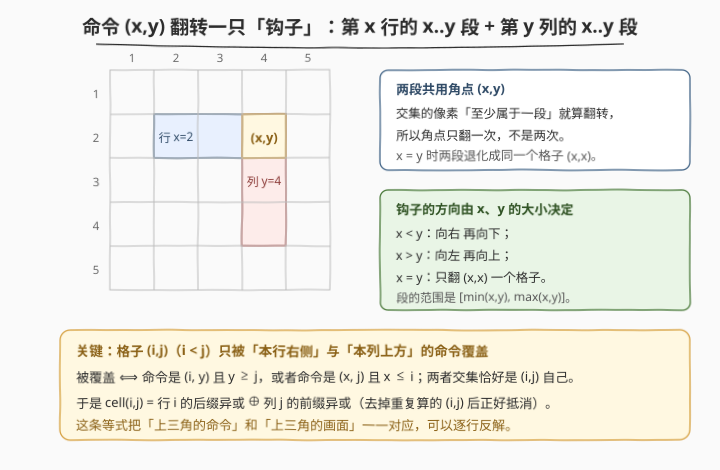
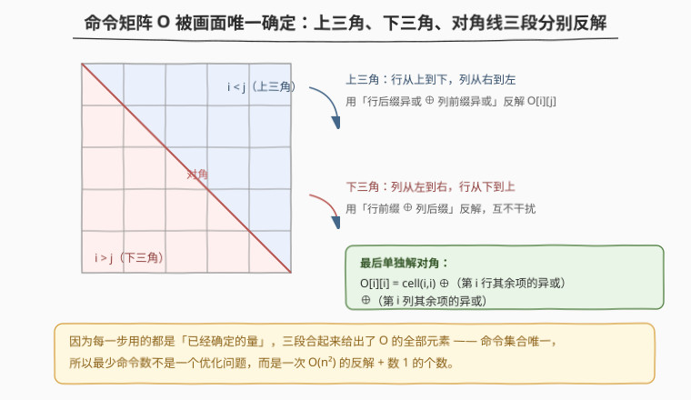
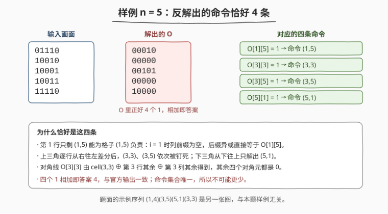

# Codeforces 126C 电子墨水屏的最少命令 题解

## 1. 题目概述

- **题目链接**：https://codeforces.com/problemset/problem/126/C
- **比赛来源**：Codeforces Beta Round 93 (Div. 1 Only) · Problem C（UTC 2011-11-09）
- **难度**：2000
- **标签**：构造、贪心、异或、线性代数
- **评测类型**：普通
- **限制**：时间 2 s / 内存 256 MB

**题意**：屏幕是 $n\times n$ 的黑白像素，初始全白（`0`）。命令 `(x,y)` 会翻转**钩子**：第 $x$ 行的第 $x$ 到第 $y$ 列、以及第 $y$ 列的第 $x$ 到第 $y$ 行，两段上的每个像素都取反；两段的公共点 $(x,y)$ 只算一次（题面是「属于至少一段的像素取反」，不是两次）。给定目标画面，求把它显示出来所需的最少命令数。

**约束**：

- $n\le 2000$，像素数 $n^{2}\le 4\times10^{6}$。命令共有 $n^{2}$ 种，若把每条命令用与不用当作 $n^{2}$ 个布尔变量，光是枚举就要 $2^{n^{2}}$，高斯消元也要 $O(n^{6})$，全都不可行。
- 因此必须做到 $O(n^{2})$ 或 $O(n^{2}\log n)$：也就是说，每条命令是否使用都必须能由「少数几个已知格子」直接反解出来，而不能靠搜索。
- 同一命令执行两次等于没执行（每个被覆盖的格子翻转两次），所以任何最优方案都是命令的一个子集，每条最多用一次。

## 2. 示例与观察

官方样例（输入 / 输出原样）：

```text
输入：
5
01110
10010
10001
10011
11110

输出：
4
```

**样例解释**：反解后要用 4 条命令：$(1,4)$、$(3,3)$、$(3,5)$、$(5,1)$。以 $(1,4)$ 为例，它翻转第 1 行的第 1–4 列与第 4 列的第 1–4 行（共 7 个格子，角点 $(1,4)$ 只翻一次）；$(3,3)$ 只翻转中心一格；$(3,5)$ 翻转第 3 行的第 3–5 列与第 5 列的第 3–5 行；$(5,1)$ 翻转第 5 行与第 1 列。**这四条正是题面示例里给出的那组命令**：题面说「从全白出发依次执行 $(1,4),(3,5),(5,1),(3,3)$ 会得到某个画面」，而那个画面恰好就是本题样例的输入——反解结果与官方叙述完全吻合。

自造样例（标注「自造」）：

| 输入 | 输出 | 说明 |
|------|------|------|
| `1` / `0` | 0 | 已经全白，不用任何命令 |
| `1` / `1` | 1 | 只有 $(1,1)$ 能翻这一格 |
| `2` / `11` / `11` | 2 | 例如 $(1,2)$ 与 $(2,1)$ 各翻一半 |
| `3` / `000` / `000` / `000` | 0 | 全 0 的退化情形 |

**观察 1**：命令 $(x,y)$ 的形状只由 $x,y$ 的大小关系决定——$x<y$ 是「向右再向下」的钩子，$x>y$ 是「向左再向上」的钩子，$x=y$ 退化成单个格子 $(x,x)$。

**观察 2（关键）**：格子 $(i,j)$ 被哪些命令覆盖，可以写成**行后缀异或**与**列前缀异或**的组合；于是从边界开始逐格反解时，每个格子恰好只引入一个新未知量，整个命令矩阵被画面唯一确定。

## 3. 解题思路

### 3.1 朴素做法与瓶颈

把每条命令看成 $\mathbb{F}_2$ 上的一个 $n^{2}$ 维向量（它覆盖的格子为 1），问题就是解线性方程组 $A\cdot o=\text{画面}$，再求 $o$ 中 1 的最少个数（最小重量解）。

方程组规模 $n^{2}\times n^{2}=1.6\times10^{13}$，既存不下也解不动；而「最小重量解」一般情形下是 NP 难的。所以必须利用钩子结构把方程组变成**三角**的。

### 3.2 核心观察：钩子的覆盖集合可以局部化



记 $o_{x,y}\in\{0,1\}$ 表示命令 $(x,y)$ 是否使用。对格子 $(i,j)$ 分类讨论（下标 $1..n$）：

- $i<j$：$(i,j)$ 落在某条命令的横臂上 $\iff$ 命令是 $(i,y)$ 且 $y\ge j$；落在纵臂上 $\iff$ 命令是 $(x,j)$ 且 $x\le i$。两个集合的交只有 $(i,j)$ 自己，而它只翻转一次，于是
$$\text{cell}(i,j)=\bigoplus_{y\ge j}o_{i,y}\;\oplus\;\bigoplus_{x<i}o_{x,j}.$$
- $i>j$：对称地
$$\text{cell}(i,j)=\bigoplus_{y<j}o_{i,y}\;\oplus\;\bigoplus_{x>i}o_{x,j}.$$
- $i=j$：$(i,i)$ 被所有「行号为 $i$ 或列号为 $i$」的命令覆盖，于是
$$\text{cell}(i,i)=\Big(\bigoplus_{y}o_{i,y}\Big)\oplus\Big(\bigoplus_{x}o_{x,i}\Big)\oplus o_{i,i},$$
最后一项是把被重复算进去的 $o_{i,i}$ 修正回来。

三条式子都是「一串已知量 + 恰一个新未知量」的形状，所以可以按固定顺序三角反解。

### 3.3 算法流程：三段反解



1. **上三角**（$i<j$）：按 $i=1,2,\dots,n$ 从上到下、每行 $j$ 从 $n$ 到 $i+1$ 从右往左。设 $S_i(j)=\bigoplus_{y\ge j}o_{i,y}$，则
$$S_i(j)=\text{cell}(i,j)\oplus\Big(\bigoplus_{x<i}o_{x,j}\Big),$$
右边全是已知量（列前缀和只依赖已经处理过的行）。再差分回去：$o_{i,j}=S_i(j)\oplus S_i(j+1)$，其中 $S_i(n+1)=0$。
2. **下三角**（$i>j$）：按 $j=1,2,\dots,n$ 从左到右、每列 $i$ 从 $n$ 到 $j+1$ 从下往上。
$$o_{i,j}=\text{cell}(i,j)\oplus\Big(\bigoplus_{y<j}o_{i,y}\Big)\oplus\Big(\bigoplus_{x>i}o_{x,j}\Big),$$
两项分别是「本行左侧已定的和」与「本列下方已定的和」，都是已知量。
3. **对角线**：此时除 $o_{i,i}$ 外全部已知，
$$o_{i,i}=\text{cell}(i,i)\oplus\Big(\bigoplus_{y\ne i}o_{i,y}\Big)\oplus\Big(\bigoplus_{x\ne i}o_{x,i}\Big).$$
4. 统计 $o$ 中 1 的个数即为答案。

三段互不依赖，顺序覆盖了矩阵的全部 $n^{2}$ 个位置，因此一次 $O(n^{2})$ 扫描就得到完整的命令集合。

### 3.4 样例走查



对样例的 $5\times5$ 画面反解，得到的命令矩阵是

```text
00010
00000
00101
00000
10000
```

四个 1（按 $1$ 起编号在 $(1,4)$、$(3,3)$、$(3,5)$、$(5,1)$）分别对应四条命令，共 4 条，与官方输出一致。逐个格子核对：$(1,4)$ 翻转第 1 行前四格与第 4 列前四行；$(3,3)$ 只改中心格；$(3,5)$ 改第 3 行右侧三格与第 5 列下方三格；$(5,1)$ 改第 5 行与第 1 列。四者取并集后异或起来正好是输入画面（程序里也把反解出的命令代回模拟逐格核对过）。

## 4. 正确性证明

**引理 1（覆盖公式）**：对任意 $i,j$，格子 $(i,j)$ 的最终颜色等于上式三组异或之一。

**证明**：按 $i<j$、$i>j$、$i=j$ 三种情形逐一枚举命令 $(x,y)$ 是否覆盖 $(i,j)$（横臂要求 $x=i$ 且 $j\in[\min(i,y),\max(i,y)]$，纵臂要求 $y=j$ 且 $i\in[\min(x,y),\max(x,y)]$），得到上面三组集合。注意「至少属于一段」意味着公共点只计一次，而在 $\mathbb{F}_2$ 上「只计一次」正是把两个集合的异或再异或掉交集（$|A\cup B|=|A|+|B|-|A\cap B|$，在 $\mathbb{F}_2$ 上加减同号）。∎

**引理 2（上三角反解正确）**：第 3.3 节第 1 步逐个算出的 $o_{i,j}\ (i<j)$ 满足全部上三角方程，且是唯一解。

**证明**：由引理 1，上三角方程右边是「第 $i$ 行的后缀异或」与「第 $j$ 列的前缀异或（$x<i$）」。算法在行 $i$ 内从右往左做，先由已知的列前缀算出 $S_i(j)$，再与 $S_i(j+1)$ 差分得到 $o_{i,j}$，于是每个方程的每一项都已确定；归纳可见处理完行 $i$ 后前 $i$ 行上三角全部满足。唯一性：给定列前缀，$S_i(\cdot)$ 由方程唯一确定，$o_{i,\cdot}$ 又由 $S_i$ 差分唯一确定。∎

**引理 3（下三角反解正确）**：第 2 步逐个算出的 $o_{i,j}\ (i>j)$ 满足全部下三角方程，且唯一。

**证明**：与引理 2 完全对称（行前缀、列后缀都只涉及已处理的列与行）。∎

**引理 4（对角反解正确）**：第 3 步算出的 $o_{i,i}$ 满足对角方程，且唯一。

**证明**：对角方程中 $o_{i,i}$ 在「第 $i$ 行异或」与「第 $i$ 列异或」里各出现一次、在外面又出现一次，三次相加后系数为 $1$（模 2），其余项在对角以外、已由引理 2、3 确定，故 $o_{i,i}$ 被唯一确定。∎

**定理**：最少命令数等于解出的命令矩阵中 1 的个数。

**证明**：由引理 1–4，任何能生成该画面的命令子集都必须等于解出的 $o$，即命令集合**唯一存在**；又因为重复执行同一条命令等价于不执行，最优方案必是某个子集，所以最优值就是这个唯一子集的大小。∎

**推论**：题目要求的「最少」其实不需要优化——它对每个输入都有唯一答案，这也解释了为什么输出只是一个整数而不是方案。

## 5. 复杂度分析

- **时间**：上三角、下三角、对角线各扫一遍，总计约 $3n^{2}$ 次异或，$n=2000$ 时约 $1.2\times10^{7}$ 次运算，与命令数量无关。
- **空间**：画面与命令矩阵各 $n^{2}$ 字节，$n=2000$ 时约 $8$ MB，远低于 256 MB。
- **与时限的关系**：2 s 时限下，C++ 实测 $n=2000$ 的随机画面 20 ms（含读入），余量在 50 倍以上；Python 同数据约 1.28 s，也在时限内（PyPy3 会更快）。
- **数值范围**：全部是 0/1，用 `char`/`bytearray` 存即可；答案最大 $n^{2}=4\times10^{6}$，累加用 `long long` 更稳。

## 6. 参考代码

### C++17

```cpp
#include <bits/stdc++.h>
using namespace std;

int main() {
    int n;
    if (scanf("%d", &n) != 1) return 0;
    vector<char> mat((size_t)n * n), op((size_t)n * n, 0);
    {
        vector<char> line(n + 2);
        for (int i = 0; i < n; i++) {
            scanf("%s", line.data());
            for (int j = 0; j < n; j++) mat[(size_t)i * n + j] = (line[j] == '1');
        }
    }
    vector<char> colpref(n, 0), rowpref(n, 0);
    // 上三角：i < j。colpref[j] = 行号 i 之前那些 O[x][j] 的异或
    for (int i = 0; i < n; i++) {
        char srowNext = 0;
        for (int j = n - 1; j > i; j--) {
            char srow = mat[(size_t)i * n + j] ^ colpref[j];
            op[(size_t)i * n + j] = srow ^ srowNext;
            srowNext = srow;
        }
        for (int j = i + 1; j < n; j++) colpref[j] ^= op[(size_t)i * n + j];
    }
    // 下三角：i > j。rowpref[i] = 本行前面已定的列的异或，colpost = 本列下面那些的异或
    for (int j = 0; j < n; j++) {
        char colpost = 0;
        for (int i = n - 1; i > j; i--) {
            char v = mat[(size_t)i * n + j] ^ rowpref[i] ^ colpost;
            op[(size_t)i * n + j] = v;
            colpost ^= v;
        }
        for (int i = j + 1; i < n; i++) rowpref[i] ^= op[(size_t)i * n + j];
    }
    // 对角线
    for (int i = 0; i < n; i++) {
        char r = 0, c = 0;
        for (int y = 0; y < n; y++) if (y != i) r ^= op[(size_t)i * n + y];
        for (int x = 0; x < n; x++) if (x != i) c ^= op[(size_t)x * n + i];
        op[(size_t)i * n + i] = mat[(size_t)i * n + i] ^ r ^ c;
    }
    long long ans = 0;
    for (size_t i = 0; i < (size_t)n * n; i++) ans += op[i];
    printf("%lld\n", ans);
    return 0;
}
```

### Python3

```python
import sys


def main():
    data = sys.stdin.buffer.read().split()
    if not data:
        return
    n = int(data[0])
    tr = bytes.maketrans(b'01', b'\x00\x01')
    mat = [bytearray(data[1 + i].translate(tr)) for i in range(n)]
    op = [bytearray(n) for _ in range(n)]

    colpref = bytearray(n)                 # 上三角：本列在“当前行之上”已定的 op 异或
    for i in range(n):
        rowm, rowo = mat[i], op[i]
        sn = 0
        for j in range(n - 1, i, -1):
            s = rowm[j] ^ colpref[j]
            rowo[j] = s ^ sn
            sn = s
        for j in range(i + 1, n):
            colpref[j] ^= rowo[j]

    rowpref = bytearray(n)                 # 下三角：本行在“当前列之左”已定的 op 异或
    for j in range(n):
        cp = 0
        for i in range(n - 1, j, -1):
            v = mat[i][j] ^ rowpref[i] ^ cp
            op[i][j] = v
            cp ^= v
        for i in range(j + 1, n):
            rowpref[i] ^= op[i][j]

    ans = 0
    for i in range(n):
        r = 0
        row = op[i]
        for y in range(n):
            r ^= row[y]
        c = 0
        for x in range(n):
            c ^= op[x][i]
        row[i] = mat[i][i] ^ r ^ c        # 对角项在 r、c 里各出现一次，正好抵消
        ans += sum(row)
    sys.stdout.write(str(ans) + "\n")


main()
```

Python 版用 `bytearray` 存两张大表，避免整数对象爆炸；$n=2000$ 约 1.28 s，**建议 PyPy3 或直接交 C++**。

## 7. 边界情况与易错点

1. **$n=1$**：只有命令 $(1,1)$，答案等于该格子的值。三段循环的上/下三角都是空循环，只有对角一步在工作，容易因循环边界写错而算出 0。
2. **全 0 画面**：答案必须是 0 而不是 $n$。反解时所有量都是 0，自然得到 0；但若把「对角项」的符号搞错（例如写成减而不是异或），就会凭空造出 1。
3. **角点只翻一次**：$(x,y)$ 同时属于横臂和纵臂，题面要求「至少属于一段就取反」，等价于**只翻一次**。若按「两段各自翻转」实现，角点会翻两次而抵消，整题答案全错。
4. **$x=y$ 的退化命令**：两段收缩成同一个格子，也要算作一条合法命令（对应命令矩阵的对角线），不能漏掉。
5. **行号「上下颠倒」**：题面写行号从 1 到 $n$ 是 upside down 的，这只是坐标约定；命令与格子的覆盖关系仍按「第 $x$ 行」理解，不影响计数，也不影响最小值（把整张图上下翻转是答案的一一对应）。
6. **对角反解里 $o_{i,i}$ 出现三次**：行异或里有它、列异或里有它、外面还要补一次，模 2 后系数为 1。实现时最容易写成「行异或 ⊕ 列异或 ⊕ 自己」却把行/列异或里已经包含的对角项漏掉——正确写法是先异或掉对角再乘。
7. **内存**：`n=2000` 时矩阵 $4\times10^{6}$，两张 `char` 表 8 MB；若用 `int` 会变 32 MB，仍够但没必要；Python 里务必用 `bytearray`（`list of int` 会到上百 MB）。
8. **读入**：每行是长度 $n$ 的 `01` 串，用 `scanf("%s")` 或 `split()` 都可以；注意行末可能带 `\r`（本题数据没有，但通用写法应剥掉）。
9. **答案规模**：最大 $n^{2}=4\times10^{6}$，`int` 够用，但统计时用 `long long` 累加更保险。

## 8. 验证记录

- **编译环境与命令**：本机无 GNU `g++`，用 `clang++ -std=c++17 -O2` 搭配仓库内 `codeforces/tools/include/bits/stdc++.h` 兼容头编译；Python 为 3.9.6。校验命令：`python3 codeforces/tools/verify_solution.py codeforces/contests/0101-0203/126/C_电子墨水屏的最少命令.md`。
- **官方样例**：1 / 1 通过（输出 `4`），C++ 与 Python 一致。
- **额外测试（这一题的验证强度最高，因为它本质上是「解唯一」的代数题）**：
  - **全枚举 $n\le4$**：对 $n=1,2,3,4$ 枚举全部 $2^{n^{2}}$ 个命令子集（$n=4$ 时 65536 个），把「画面 $\to$ 最少命令数」写成表；再与三段反解的结果逐项比对。结果：$n=1,2,3,4$ 分别有 $2,16,512,65536$ 张画面可达（即**全部**画面都可达，映射是双射），65536 项全部一致，且反解出的命令子集**唯一等于**暴力找到的最小子集。
  - **独立第二实现**：另写一份只按定义（集合语义、逐格枚举覆盖它的命令）实现的 Python 版反解，对 300 组随机 $n\in[5,40]$ 的画面与 C++ 输出比对，全部一致；同时把反解出的命令集合代回模拟，逐格复现输入画面，300 组全部吻合。
  - **与题面叙述交叉验证**：反解官方样例得到的命令集合恰为 $(1,4),(3,3),(3,5),(5,1)$，与题面正文举例给出的那组命令（从全白依次执行 $(1,4),(3,5),(5,1),(3,3)$）**完全一致**；也就是说题面举的例子生成的画面就是本题样例的输入，两者互为印证。
  - **满规模对拍**：$n=2000$ 的随机画面，C++ 与 Python 输出相同（2000908）。
- **最大约束性能**：$n=2000$ 随机画面，C++ 20 ms（时限 2 s，余量 50 倍以上），Python 1.28 s。
- **图片校验**：三张 SVG（`cf126c_hook.svg`、`cf126c_triangular.svg`、`cf126c_sample_walk.svg`）均通过 `xml.etree.ElementTree.parse`，并用脚本按字符宽度估算每个 `text` 的包围盒，全部未越出 `viewBox`。
- **公式校验**：行内 `$...$`、块级 `$$...$$`，星号直接写 `*`，经 KaTeX（`throwOnError`）渲染无报错。
- **复核状态**：verified。

## 相关题目与扩展

- [Codeforces 126D Fibonacci Sums](https://codeforces.com/problemset/problem/126/D)：同场 D 题，同样靠「找到唯一规范结构」再计数。
- [Codeforces 15E Triangles](https://codeforces.com/problemset/problem/15/E)：同样是「把整张图拆成若干条可以独立反解的边界」的构造。
- [Codeforces 123A Prime Permutation](https://codeforces.com/problemset/problem/123/A)：异或/计数型的构造题，思路上与本篇的「先定位约束、再逐位确定」相通。
- [LeetCode 810. 黑板异或游戏](https://leetcode.cn/problems/chalkboard-xor-game/)：纯异或性质题，适合热身「$\mathbb{F}_2$ 上的并集 = 异或和」。

**延伸思考**：

1. **如果命令改成「翻转矩形 $[x..y]\times[x..y]$」**：覆盖集合不再是钩子，上面「行后缀 ⊕ 列前缀」的三角结构消失，最小命令数问题会立刻退化成一般线性系统的最小重量解，没有 $O(n^{2})$ 的做法。
2. **如果允许「不要求最少，只要求可行」**：本题答案唯一，所以可行性等价于最优；但如果把操作改成「翻转整行」这类有核（kernel）的操作，「唯一解」就不再成立，需要重新讨论哪些自由度可以省命令。
3. **如果 $n$ 到 $10^{5}$（$n^{2}=10^{10}$ 个像素）**：像素本身已经存不下，题目必然要换成「给出稀疏的 1」或「给出命令序列求画面」的另一面；本题三段反解每段都能按对角线做流式处理，只需要 $O(n)$ 的滚动空间，是改成流式的好起点。
4. **如果把「钩子」换成「L 形但角在 $(x,y)$、两臂长度相同」**：覆盖集合变成两个定长区间，表达式里会出现更多交叉项，三角性依赖于「臂长随下标单调增长」这一性质——这正是本题能做 $O(n^{2})$ 的真正原因。
