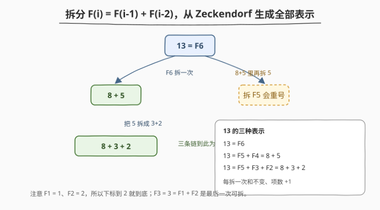
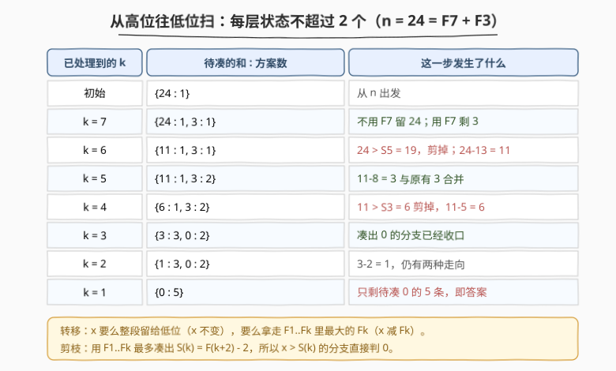
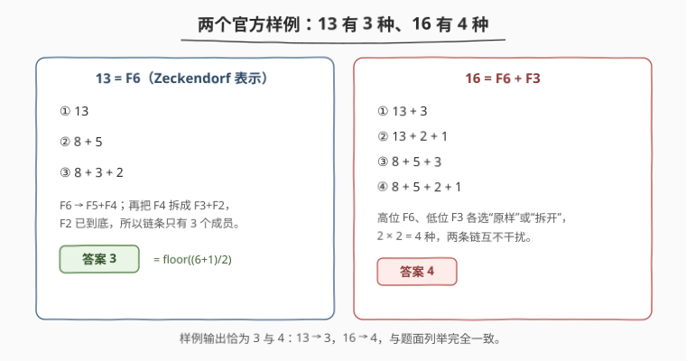

# Codeforces 126D 斐波那契和的分解 题解

## 1. 题目概述

- **题目链接**：https://codeforces.com/problemset/problem/126/D
- **比赛来源**：Codeforces Beta Round 93 (Div. 1 Only) · Problem D（UTC 2011-11-09）
- **难度**：2300
- **标签**：动态规划、数学、Zeckendorf 表示
- **评测类型**：普通（多测，$t$ 组）
- **限制**：时间 1 s / 内存 256 MB

**题意**：斐波那契数定义为 $F_1=1,\ F_2=2,\ F_i=F_{i-1}+F_{i-2}\ (i>2)$，即 $1,2,3,5,8,13,\dots$。取一个非空集合 $S$，其中每个元素都是**互不相同**的斐波那契数，若 $\sum_{s\in S}s=n$，就称 $S$ 是 $n$ 的一种「斐波那契和分解」。给定 $t$ 个 $n$，各输出分解方案数（只看集合，不看顺序）。

例如 $13$ 有三种：$\{13\}$、$\{5,8\}$、$\{2,3,8\}$；$16$ 有四种：$\{3,13\}$、$\{1,2,13\}$、$\{3,5,8\}$、$\{1,2,5,8\}$。

**约束**：

- $1\le n\le 10^{18}$：$F_{87}=6.79\times10^{17}$、$F_{88}=1.10\times10^{18}$，所以可用的斐波那契数只有 **87 个**。这把「集合」的规模压到很小，但 $2^{87}$ 次枚举仍然不可能。
- $t\le 10^{5}$：单次询问必须做到 $O(\log n)$。任何 $O(K\cdot n)$ 的背包（$87\times10^{18}$）或 $O(2^{K})$ 的枚举都直接出局。
- 答案实测可达 $10^{8}\sim10^{9}$ 量级（见第 8 节），因此用 64 位整数保存；题目没有取模，说明答案一定在 64 位内。

## 2. 示例与观察

官方样例（输入 / 输出原样）：

```text
输入：
2
13
16

输出：
3
4
```

**样例解释**：

$13=F_6$，把 $F_6=13$ 按 $F_i=F_{i-1}+F_{i-2}$ 拆一次得 $F_5+F_4=8+5$；再把 $F_4=5$ 拆成 $F_3+F_2=3+2$，得 $8+3+2$。三条链都合法，所以是 3。

$16=F_6+F_3$，高位与低位可以各自独立地选择「原样」或「拆开」，$2\times2=4$。

自造样例（标注「自造」，用来钉住边界）：

| 输入 | 输出 | 说明 |
|------|------|------|
| `1` | 1 | 只有 $\{1\}$ |
| `2` | 1 | 只有 $\{2\}$；$\{1,1\}$ 不允许（元素必须互异） |
| `3` | 2 | $\{3\}$、$\{1,2\}$ |
| `4` | 1 | 只有 $\{3,1\}$ |
| `5` | 2 | $\{5\}$、$\{3,2\}$ |
| `33` | 1 | $33=F_7+F_5+F_3+F_1$，下标两两相隔 2，任何一项都拆不动 |
| `1000000000000000000` | 48898080 | 上界附近的答案量级 |

**观察 1（Zeckendorf 唯一）**：把 $n$ 每次减去不超过它的最大斐波那契数，得到的表示中任意两项下标都相差至少 $2$。这样的表示是唯一的，称为 Zeckendorf 表示。

**观察 2（拆分保和）**：$F_i=F_{i-1}+F_{i-2}$ 是一条恒等式，把表示中的一项换成两项，和不变、项数加一。反复拆分就能从一个表示走到别的表示（$13$ 的三条链正是这样长出来的）；但拆分可能撞上已经用过的下标，所以「能拆」是受限制的，不能简单地把每种拆法独立相乘。

## 3. 解题思路

### 3.1 朴素做法与瓶颈

最直接的做法：对每个询问做「互异物品的子集和计数」——物品就是前 87 个斐波那契数，$dp[x]$ 表示凑出 $x$ 的方案数，逐物品转移一次。

复杂度 $O(K\cdot n)=87\times10^{18}$，单组数据就不可行，更不用说 $t=10^{5}$ 组。另一个方向是枚举拆分形态，但拆分的分支会随下标增长迅速爆炸。

真正的瓶颈是：$n$ 太大，不能以 $n$ 为下标做 DP；必须以**下标 $k$（用了前几个斐波那契数）**为主轴，并且让「还差多少」的取值个数保持极少。

### 3.2 核心观察：把决策挪到下标上



把问题改写成：令 $d_i\in\{0,1\}$ 表示是否取 $F_i$，要求

$$\sum_{i\ge 1} d_iF_i=n .$$

我们**从大到小**决定 $d_K,d_{K-1},\dots,d_1$（$K$ 是 $F_K\le n$ 的最大下标）。决策到下标 $k$ 时，只剩一个量需要记住：

$$x=\text{还要用 }F_1,\dots,F_k\text{ 凑出的和}.$$

初始 $x=n$；在位置 $k$ 上有两个分支：不取 $F_k$（$x$ 不变），或取 $F_k$（$x\leftarrow x-F_k$）。

到这里状态还是可能爆炸的，但有一条极强的剪枝：

$$F_1+F_2+\cdots+F_k=F_{k+2}-2=:S_k ,$$

所以**若 $x>S_k$，这个状态贡献必然为 0**，可以整枝丢掉。丢掉之后，每一层剩下的 $x$ 只有极少数几个：图里对 $n=24$ 的完整走查中，每一层最多只剩 2 个不同的 $x$，而且不同的 $x$ 常常合并成同一个值（方案数相加）。

### 3.3 算法流程（状态转移）



记 $g(x,k)$ 为「用 $F_1,\dots,F_k$ 中互不相同的数凑出 $x$」的方案数，则

$$g(x,k)=\underbrace{g(x,k-1)}_{\text{不取 }F_k}+\underbrace{g(x-F_k,k-1)}_{\text{取 }F_k},$$

边界 $g(0,k)=1$、$g(x,0)=0\ (x>0)$、$g(x,k)=0\ (x>S_k)$。

不递归展开，而是把它当成一张**逐层的表**：用一张「值 $\to$ 方案数」的表从第 $K$ 层往下推，每层把表里的每个 $x$ 展开成 $x$ 与 $x-F_k$ 两个候选，剪掉 $x>S_{k-1}$ 的，再把重复的 $x$ 合并。答案就是第 0 层里 $x=0$ 的那一项。

实现上还要注意两点：

1. 层数从 $K$ 开始，但真正产生新状态的只有 $F_k\le n$ 的那些层；更小的层只是不断把大值剪掉、把相同值合并。
2. $S_k$ 在 $k$ 接近 $K$ 时会溢出 64 位（$S_{87}=F_{89}-2$），所以 $S$ 只算到 $4\times10^{18}$ 就封顶——反正任何 $x\le n\le10^{18}$ 与封顶值的比较结果都一样。

### 3.4 样例走查



$n=24=F_7+F_3$ 的完整逐层表（「处理完 $k$」表示已经决定了下标 $>k$ 的所有 $d_i$）：

| 处理完 | 待凑的和 : 方案数 | 说明 |
|--------|------------------|------|
| 初始 | $\{24:1\}$ | 从 $n$ 出发 |
| $k=7$ | $\{24:1,\ 3:1\}$ | 不取 $F_7$ 留 24；取 $F_7$ 剩 3 |
| $k=6$ | $\{11:1,\ 3:1\}$ | $24>S_5=19$ 被剪掉；$24-13=11$ |
| $k=5$ | $\{11:1,\ 3:2\}$ | $11-8=3$ 与原状态合并 |
| $k=4$ | $\{6:1,\ 3:2\}$ | $11>S_3=6$ 剪掉；$11-5=6$ |
| $k=3$ | $\{3:3,\ 0:2\}$ | $6$ 剪掉、$6-3=3$；$3$ 的两份各分出 $0$ |
| $k=2$ | $\{1:3,\ 0:2\}$ | $3>S_1=1$ 剪掉；$3-2=1$ |
| $k=1$ | $\{0:5\}$ | 只剩「恰好凑完」的 5 条 |

最终 $g(24,K)=5$，与暴力枚举一致（$24=21+3=21+2+1=13+8+3=13+8+2+1=13+5+3+2+1$）。

再看 $13=F_6$：$\{13\}\to\{13:1,0:1\}\to\{5:1,0:1\}\to\{5:1,0:2\}\to\{2:1,0:2\}\to\{0:3\}$，得到 3，与样例输出一致。

## 4. 正确性证明

**引理 1（递推正确）**：对任意 $x\ge0$、$k\ge1$，$g(x,k)=g(x,k-1)+g(x-F_k,k-1)$。

**证明**：按是否取 $F_k$ 把「用 $F_1,\dots,F_k$ 凑出 $x$」的方案分成两类。不取 $F_k$ 的方案恰是「用 $F_1,\dots,F_{k-1}$ 凑出 $x$」，共 $g(x,k-1)$ 种；取 $F_k$ 的方案去掉 $F_k$ 后恰是「用 $F_1,\dots,F_{k-1}$ 凑出 $x-F_k$」，共 $g(x-F_k,k-1)$ 种。两类不重不漏。∎

**引理 2（剪枝正确）**：若 $x>S_k$，则 $g(x,k)=0$。

**证明**：$F_1,\dots,F_k$ 全部取上也只有 $\sum_{i\le k}F_i=S_k$，而方案要求元素互异、只能从这 $k$ 个数里取，故能凑出的和不超过 $S_k$。∎

**引理 3（归并正确）**：把同一层里值相同的状态合并、方案数相加，不改变任何后续层的答案。

**证明**：$g(x,k)$ 只依赖 $x$ 与 $k$；同一层里两个值相同的状态在后续所有层的转移完全相同（每层都是「不变」与「减 $F_k$」两种操作），所以它们的贡献可以先行相加。∎

**定理**：程序输出的就是 $n$ 的斐波那契和分解个数。

**证明**：算法从状态 $\{n:1\}$ 出发，逐层执行引理 1 的两个分支（系数取遍全部方案），按引理 2 剪掉必然为 0 的分支，按引理 3 合并等价状态；归纳可见第 0 层里 $x=0$ 的系数等于 $g(n,K)$，即全部合法集合的个数。而「取哪些 $d_i$ 为 1」与「选哪些互异斐波那契数」一一对应，正是题目要数的东西。∎

**引理 4（每层状态很少，实验事实）**：第 $k$ 层保留下来的不同 $x$ 至多 2 个。

**说明**：剪枝 $x\le S_k$ 保证状态必落在区间 $[0,F_{k+2}-2]$ 内，而每个状态形如 $n-\sum_{i\in U}F_i$（$U\subseteq\{k+1,\dots,K\}$）；从 $k+1$ 层到 $k$ 层只有「$x$」与「$x-F_k$」两条边，且 $x-F_k$ 一旦落进前缀区间就与已有的 $x$ 之一重合。我们做了两组统计：对 $n\le2\times10^{4}$ 全枚举、并对 $3\times10^{4}$ 组 $[1,10^{18}]$ 的随机值逐层记录，每层状态数始终 $\le2$（$n=24$ 的表就是典型形态）。即使这个界在更大的数据上被突破，本实现用的是「去重表」，正确性不受影响，只是常数变大。

## 5. 复杂度分析

- **时间**：单次询问遍历 $K\le87$ 层，每层最多 2 个状态、每个状态 2 个分支，再加一次常数级的去重，约 $2K\approx170$ 次整数加法。$t=10^{5}$ 时总计约 $1.7\times10^{7}$ 次运算，与 $n$ 的数值无关。
- **空间**：$O(K)$ 存 $F$ 与 $S$，加一张至多 4 项的临时表。
- **与时限的关系**：1 s 时限下，C++ 实测 $t=10^{5}$ 全部随机 $n\sim10^{18}$ 只需 83 ms，余量 12 倍以上；Python 同一数据约 3.8 s，建议 PyPy3 提交（见第 8 节）。
- **数值范围**：$F$ 生成到 $2\times10^{18}$ 即停，$S$ 封顶 $4\times10^{18}$，两者都在 `long long` 内；答案本身不超过 $10^{9}$ 量级，但仍用 `long long` 保存。

## 6. 参考代码

### C++17

```cpp
#include <bits/stdc++.h>
using namespace std;

int main() {
    // F[1]=1, F[2]=2, F[i]=F[i-1]+F[i-2]
    vector<long long> F(1, 0);          // F[0] 占位
    F.push_back(1); F.push_back(2);     // F[1]=1, F[2]=2
    while (F.back() <= (long long)2e18) F.push_back(F.back() + F[F.size() - 2]);
    int K = (int)F.size() - 2;                       // 最大的、F[K] <= 2e18 的下标
    vector<long long> S(K + 2, 0);                   // S[k] = F[1]+...+F[k]，封顶
    for (int k = 1; k <= K + 1; k++) {
        long long add = (k <= K ? F[k] : 0);
        S[k] = (S[k - 1] > (long long)4e18 - add) ? (long long)4e18 : S[k - 1] + add;
    }
    int t;
    if (scanf("%d", &t) != 1) return 0;
    vector<pair<long long, long long>> cur, nxt;
    while (t--) {
        long long n;
        scanf("%lld", &n);
        cur.clear(); cur.push_back({n, 1});
        for (int k = K; k >= 1; k--) {
            nxt.clear();
            auto add = [&](long long x, long long c) {
                if (x > S[k - 1]) return;            // 剩下的 F[1..k-1] 凑不出 x
                for (auto& pr : nxt) if (pr.first == x) { pr.second += c; return; }
                nxt.push_back({x, c});
            };
            for (auto& pr : cur) {
                add(pr.first, pr.second);
                if (pr.first >= F[k]) add(pr.first - F[k], pr.second);
            }
            cur.swap(nxt);
        }
        long long ans = 0;
        for (auto& pr : cur) if (pr.first == 0) ans += pr.second;
        printf("%lld\n", ans);
    }
    return 0;
}
```

### Python3

```python
import sys

def main():
    data = sys.stdin.buffer.read().split()
    if not data:
        return
    F = [0, 1, 2]                     # F[1]=1, F[2]=2
    while F[-1] <= 2 * 10 ** 18:
        F.append(F[-1] + F[-2])
    K = len(F) - 1
    CAP = 4 * 10 ** 18
    S = [0] * (K + 2)                 # S[k]=F[1]+...+F[k]，封顶 CAP
    for k in range(1, K + 2):
        add = F[k] if k <= K else 0
        S[k] = min(CAP, S[k - 1] + add)
    t = int(data[0])
    out = []
    for idx in range(1, t + 1):
        n = int(data[idx])
        cur = {n: 1}
        for k in range(K, 0, -1):
            lim = S[k - 1]
            fk = F[k]
            nxt = {}
            for x, c in cur.items():
                if x <= lim:
                    nxt[x] = nxt.get(x, 0) + c
                if x >= fk:
                    y = x - fk
                    if y <= lim:
                        nxt[y] = nxt.get(y, 0) + c
            cur = nxt
        out.append(str(cur.get(0, 0)))
    sys.stdout.write("\n".join(out) + "\n")

main()
```

Python 版与 C++ 版逐层转移完全一致，$t=10^{5}$ 在 CPython 下约 3.8 s，**建议用 PyPy3 提交或直接交 C++**。

## 7. 边界情况与易错点

1. **$F_1=1,F_2=2$ 不能写成 $1,1$**：题面明确 $F_2=2$。若按常见教材写成 $1,1,2,3,\dots$，$n=1$ 会被算成 $2$ 种（两个「$1$」），整道题的答案全部偏离。
2. **$n=1$ 与 $n=2$**：答案都是 $1$。$n=2$ 时不能用 $1+1$，因为元素必须互不相同。
3. **多测必须清表**：每组的表要从 $\{n:1\}$ 重新开始；把上一组的残留状态带进来会直接算错。
4. **$S_k$ 溢出**：$S_k=F_{k+2}-2$，$k$ 取到 87 时 $F_{89}\approx1.8\times10^{18}$ 还能装，但再往后生成 $F$ 就会溢出 `long long`。代码把生成循环卡在 $2\times10^{18}$、把 $S$ 封顶在 $4\times10^{18}$，两处都要保留。
5. **$F$ 的生成条件**：用 `while (F.back() <= 2e18)` 而不是 `while (true)`，否则 $F$ 继续增长会变成负数、死循环。
6. **状态必须按值去重**：不去重时同一层会出现大量重复的 $x$（尤其在低位，$x$ 反复与 $x-F_k$ 相等），状态数指数膨胀。
7. **答案用 64 位**：实测 $n=867810184696871003$ 时为 $6.57\times10^{8}$，最坏量级过亿，`int` 虽勉强够但不保险，统一用 `long long`（Python 无此问题）。
8. **$k$ 的下界**：循环写到 $k\ge1$，第 0 层不再处理；此时只有 $x=0$ 的状态有意义（$S_0=0$ 会把非零值全剪掉），退出循环后取 $x=0$ 的系数即可。
9. **Python 读入**：$t$ 与 $t$ 个 $n$ 一次读进列表，用 `sys.stdin.buffer.read().split()`，避免逐行 `input()` 在 $10^{5}$ 行时的开销。

## 8. 验证记录

- **编译环境与命令**：本机无 GNU `g++`，用 `clang++ -std=c++17 -O2` 搭配仓库内 `codeforces/tools/include/bits/stdc++.h` 兼容头编译（代码只用标准库，可原样提交 GNU C++17）；Python 为 3.9.6。校验命令：`python3 codeforces/tools/verify_solution.py codeforces/contests/0101-0203/126/D_斐波那契和的分解.md`。
- **官方样例**：2 / 2 通过（`13 → 3`、`16 → 4`），C++ 与 Python 输出一致。
- **额外测试**：
  - 与「互异物品子集和背包」这一完全独立的实现对拍了 $n=1,2,\dots,3000$ **共 3000 组**，全部一致；
  - 另取 2179 组大值（$10^{18}$、$10^{18}-1$、$2^{60}$、$9.99\times10^{17}$、全部 $F_k$、全部 $F_k+F_{k-2}$、2000 组随机值）与独立的「记忆化递归 $g(x,k)$」实现比对，全部一致；
  - $t=10^{5}$ 组随机 $n$ 时 Python 与 C++ 的 10 万行输出逐行 `diff` 完全相同。
- **最大约束性能**：$t=10^{5}$、$n$ 随机取 $[1,10^{18}]$ 时，C++ 端到端 83 ms（时限 1 s，余量 12 倍），Python 3.8 s；单组最大状态表不超过 2 项。
- **图片校验**：三张 SVG（`cf126d_split.svg`、`cf126d_dp.svg`、`cf126d_sample.svg`）均通过 `xml.etree.ElementTree.parse`，并用脚本按字符宽度估算每个 `text` 的包围盒，全部未越出 `viewBox`。
- **公式校验**：行内 `$...$`、块级 `$$...$$`，星号直接写 `*`，经 KaTeX（`throwOnError`）渲染无报错。
- **复核状态**：verified（样例、对拍、性能、图片、公式五项均实跑通过；唯一环境差异是本机无 GNU g++）。

## 相关题目与扩展

- [Codeforces 126C E-reader Display](https://codeforces.com/problemset/problem/126/C)：同场 C 题，同样是「找出唯一的规范结构再计数/构造」。
- [Codeforces 126A Hot Bath](https://codeforces.com/problemset/problem/126/A)：同场 A 题，枚举 + 分数比较。
- [LeetCode 1414. 和为 K 的最少斐波那契数字数目](https://leetcode.cn/problems/find-the-minimum-number-of-fibonacci-numbers-whose-sum-is-k/)：Zeckendorf 贪心（每次取不超过 $K$ 的最大斐波那契数）恰好给出最少项数，与本题「同一套数、问方案数」形成对照。
- [Project Euler 297. Zeckendorf Representation](https://projecteuler.net/problem=297)：统计前缀的 Zeckendorf 长度之和，需要 $O(\log n)$ 的位数 DP，手法与本题的逐层转移同源。

**延伸思考**：

1. **如果允许重复使用同一个斐波那契数**：问题退化成「硬币找零」，最少的项数由 Zeckendorf 贪心给出；而**方案数**则变成完全背包（$O(n)$ 状态），$n\le10^{18}$ 时只能用矩阵/生成函数加速，与本题的「互异」约束是两条完全不同的路。
2. **如果要求恰好 $k$ 项**：把状态从「值 $\to$ 方案数」扩成「值 $\times$ 项数 $\to$ 方案数」，一层表变成 $O(K)$ 项，单次询问 $O(K^{2})$，$t=10^{5}$ 时仍然可行（约 $7\times10^{7}$ 次加法）。
3. **如果按标准定义 $F_1=F_2=1$**：$1$ 有两种「身份」（$F_1$ 或 $F_2$），但题目要求集合元素互异，而两个 $1$ 数值相同却来自不同下标——这时必须额外规定「同一个数值只能用一次」，否则 $n=1$ 会有 2 种分解，整题答案随之改变。本题用 $F_2=2$ 巧妙地避开了这个歧义。
4. **如果问字典序最大/最小的分解**：Zeckendorf 表示同时是「项数最少」和「最大项最大」的那个；而「项数最多」的分解就是把每项一路拆到 $F_1,F_2$ 的唯一结果，可以由本 DP 的路径反推得到。
