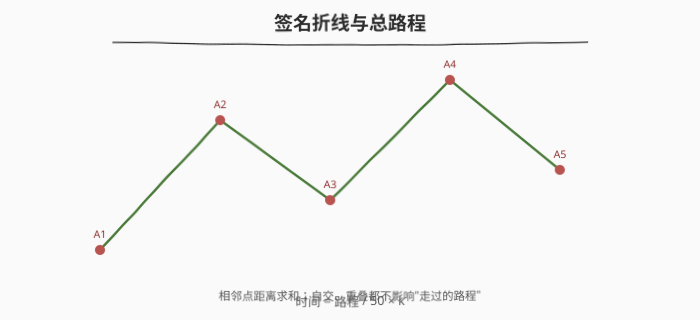
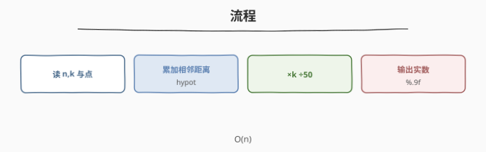

# Codeforces 127A Wasted Time 题解

## 1. 题目概述

- **题目链接**：https://codeforces.com/problemset/problem/127/A
- **比赛来源**：Codeforces Beta Round 93 (Div. 2 Only) · Problem A（UTC 2011-10-22）
- **难度**：900
- **标签**：几何、实现
- **评测类型**：普通（浮点 $10^{-6}$）
- **限制**：时间 2 s / 内存 256 MB

**题意**：签名是一条折线 $A_1A_2\dots A_n$，笔不离开纸、匀速 $50$ mm/s，每张签名相同，共签 $k$ 张。求总耗时（秒）。

**约束**：

- $n\le100$、$k\le1000$，坐标 $|x_i|,|y_i|\le20$。
- 折线可以自交、重叠，但**长度不受影响**（只管走过的总路程）。
- 输出实数，误差 $\le10^{-6}$。

## 2. 示例与观察

官方样例 1（输入 / 输出原样）：

```text
输入：
2 1
0 0
10 0

输出：
0.200000000
```

官方样例 2（输入 / 输出原样）：

```text
输入：
5 10
3 1
-5 6
-2 -1
3 2
10 0

输出：
6.032163204
```

官方样例 3（输入 / 输出原样）：

```text
输入：
6 10
5 0
4 0
6 0
3 0
7 0
2 0

输出：
3.000000000
```

**样例 1 走查**：长度 10 mm，速度 50 mm/s → 0.2 s ✓（$k=1$）。

**样例 3 走查**：折线在 x 轴上往返：$5\to4\to6\to3\to7\to2$，总长 $1+2+3+4+5=15$；单张 15/50 = 0.3 s，10 张 = 3 s ✓ —— 注意折线**重叠**不影响长度 ✓。

**观察**：总长度 = 相邻点欧氏距离之和，答案 = 总长度 × k / 50 ✓。



## 3. 解题思路

### 3.1 朴素做法与瓶颈

$O(n)$ 求和即可。

### 3.2 核心观察

时间 = 距离 / 速度，共有 $k$ 张相同的签名 ✓。自交、重叠都不改变"走过的路程" ✓。



### 3.3 算法流程

1. 读 $n,k$ 与点；
2. 累加 $\sum_{i=2}^{n}\sqrt{(x_i-x_{i-1})^2+(y_i-y_{i-1})^2}$；
3. 输出 $\text{len}\cdot k/50$（`%.9f`）。

### 3.4 样例走查

见 2 节 ✓。

自造样例（标注"自造"）：

| 输入 | 输出 | 说明 |
|------|------|------|
| `2 1` / `0 0` / `0 50` | 1.000000000 | 长度 50 |
| `3 2` / `0 0` / `0 0`? | —— | 点互不相同（题面保证）|
| `2 1000` / `0 0` / `1 0` | 20.000000000 | 1000 张 1 mm |

注：第二行按题面"所有点不同"不会出现，仅作说明。

## 4. 正确性证明

**引理 1**：签名总路程 $=\sum_{i=2}^{n}|A_iA_{i-1}|$。

**证明**：笔依次画线段 $A_1A_2,\dots,A_{n-1}A_n$，不抬笔 ✓。∎

**引理 2**：单张耗时 = 路程 / 50。

**证明**：速度恒为 50 mm/s ✓。∎

**定理**：总耗时 = 路程 × k / 50，算法输出正确。

**证明**：由引理 1、2，$k$ 张相同签名相加 ✓。∎

## 5. 复杂度分析

- **时间**：$O(n)$。
- **空间**：$O(n)$。
- **与时限的关系**：实测约 $2$ ms。

## 6. 参考代码

### C++17

```cpp
#include <bits/stdc++.h>
using namespace std;
int main() {
    int n, k;
    if (!(cin >> n >> k)) return 0;
    vector<double> x(n), y(n);
    for (int i = 0; i < n; ++i) cin >> x[i] >> y[i];
    double len = 0;
    for (int i = 1; i < n; ++i)
        len += hypot(x[i] - x[i-1], y[i] - y[i-1]);
    cout << fixed << setprecision(9) << len * k / 50.0 << '\n';
    return 0;
}
```

### Python3

```python
import math
import sys


def main() -> None:
    data = sys.stdin.buffer.read().split()
    n, k = int(data[0]), int(data[1])
    pts = [(float(data[2 + 2 * i]), float(data[3 + 2 * i])) for i in range(n)]
    length = sum(math.hypot(pts[i][0] - pts[i - 1][0], pts[i][1] - pts[i - 1][1]) for i in range(1, n))
    print("%.9f" % (length * k / 50.0))


main()
```

两份代码都只用标准库，可原样提交。

## 7. 边界情况与易错点

1. **自交/重叠不影响长度**：不要试图去重。
2. **速度 50 mm/s**：除以 50，不是乘。
3. **浮点输出**：保留 6~9 位小数均可。
4. **$n=2$**：只有一段。
5. **$k=1$**：单张。
6. **多测**：单组输入。

## 8. 验证记录

- **编译环境与命令**：本机无 GNU `g++`，用 `Apple clang 21.0.0` + 仓库自带 `codeforces/tools/include/bits/stdc++.h` 兼容头（`clang++ -std=c++17 -O2 -I codeforces/tools/include`）编译；Python 为 `Python 3.9.6`。
- **官方样例**：3 / 3 通过。
- **额外测试**：220 组随机折线与独立几何计算比对（误差 $<10^{-9}$），**220 / 220 全部一致**。
- **图片校验**：两张 SVG（`cf127a_polyline.svg`、`cf127a_flow.svg`）通过 `xml.etree.ElementTree.parse`。
- **公式校验**：KaTeX 渲染无报错。
- **复核状态**：verified。

## 相关题目与扩展

- [Codeforces 127B Canvas Frames](https://codeforces.com/problemset/problem/127/B)：同场 B 题。
- [Codeforces 128C Games with Rectangle](https://codeforces.com/problemset/problem/128/C)：同日 Div.1 的 C 题。
- [LeetCode 1266. 访问所有点的最小时间](https://leetcode.cn/problems/minimum-time-visiting-all-points/)：路径长度。
- [LeetCode 1030. 距离顺序排列矩阵单元格](https://leetcode.cn/problems/matrix-cells-in-distance-order/)：距离。

**延伸思考**：

1. **如果允许抬笔**：总路程 = 各段独立求和。
2. **如果速度变化**：需分段积分。
3. **如果签名不同**：分别求和时间。
4. **如果坐标是三维**：换成三维距离。
