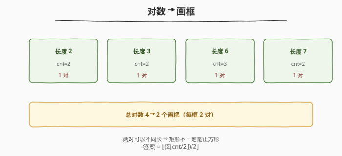
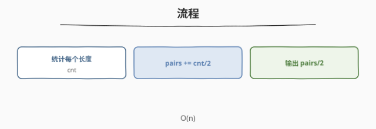

# Codeforces 127B Canvas Frames 题解

## 1. 题目概述

- **题目链接**：https://codeforces.com/problemset/problem/127/B
- **比赛来源**：Codeforces Beta Round 93 (Div. 2 Only) · Problem B（UTC 2011-10-22）
- **难度**：1000
- **标签**：实现、贪心
- **评测类型**：普通
- **限制**：时间 1 s / 内存 256 MB

**题意**：$n$ 根木棍（长度 $a_i$），做一个 $h\times w$ 的画框需要两根长 $h$、两根长 $w$（正方形则需四根同长）。木棍不能折断或粘接，不要求用完。求最多能做几个画框。

**约束**：

- $n\le100$，$a_i\le100$：统计长度即可。
- 每个画框恰好用 **2 对**等长木棍（可以来自不同长度）✓。

## 2. 示例与观察

官方样例 1（输入 / 输出原样）：

```text
输入：
5
2 4 3 2 3

输出：
1
```

官方样例 2（输入 / 输出原样）：

```text
输入：
13
2 2 4 4 4 4 6 6 6 7 7 9 9

输出：
3
```

官方样例 3（输入 / 输出原样）：

```text
输入：
4
3 3 3 5

输出：
0
```

**样例 1 走查**：长度 2 有一对、长度 3 有一对 → 共 2 对 → 1 个框 ✓。

**样例 2 走查**：2×2 对（长度 2）、4×4 对（长度 4）、6×3 对（长度 6）、7×2 对、9×2 对 → 总对数 $1+2+1+1+1=6$ → $6/2=3$ ✓。

**样例 3 走查**：3 有 1 对（第三根剩单）、5 没有对 → 1 对 → 0 ✓。

**观察**：每个长度 $v$ 贡献 $\lfloor cnt_v/2\rfloor$ 对；每 2 对做一个框 ⇒ 答案 $=\bigl\lfloor(\sum_v\lfloor cnt_v/2\rfloor)/2\bigr\rfloor$ ✓。



## 3. 解题思路

### 3.1 朴素做法与瓶颈

$O(n)$ 统计即可。

### 3.2 核心观察

- 画框只要求"两对等长"，两对可以不同长 ✓（矩形不必正方形）；
- 所以把所有可配成的对加起来，两两配对成框 ✓。



### 3.3 算法流程

1. 统计每个长度出现次数；
2. `pairs += cnt/2`；
3. 输出 `pairs/2`。

### 3.4 样例走查

见 2 节 ✓。

自造样例（标注"自造"）：

| 输入 | 输出 |
|------|------|
| `4` / `2 2 2 2` | 1 |
| `8` / `1 1 2 2 3 3 4 4` | 2 |
| `3` / `1 1 1` | 0 |

## 4. 正确性证明

**引理 1**：长度 $v$ 最多配出 $\lfloor cnt_v/2\rfloor$ 对。

**证明**：每对需要两根同长，两根一组最多取 $\lfloor cnt/2\rfloor$ 组 ✓。∎

**引理 2**：总对数为 $P=\sum_v\lfloor cnt_v/2\rfloor$ 时，最多做 $\lfloor P/2\rfloor$ 个框。

**证明**：每个框恰用 2 对 → 上限 $\lfloor P/2\rfloor$ ✓；任意 2 对都能组成框（两个长度的两根做边）✓ 可达 ✓。∎

**定理**：算法输出正确。

**证明**：由引理 1、2 ✓。∎

## 5. 复杂度分析

- **时间**：$O(n)$（值域小，可桶计数）。
- **空间**：$O(1)$。
- **与时限的关系**：实测约 $2$ ms。

## 6. 参考代码

### C++17

```cpp
#include <bits/stdc++.h>
using namespace std;
int main() {
    int n;
    if (!(cin >> n)) return 0;
    map<int,int> cnt;
    for (int i = 0; i < n; ++i) { int a; cin >> a; cnt[a]++; }
    int pairs = 0;
    for (auto& kv : cnt) pairs += kv.second / 2;
    cout << pairs / 2 << '\n';
    return 0;
}
```

### Python3

```python
import sys
from collections import Counter


def main() -> None:
    data = sys.stdin.buffer.read().split()
    n = int(data[0])
    c = Counter(int(t) for t in data[1:1 + n])
    pairs = sum(v // 2 for v in c.values())
    print(pairs // 2)


main()
```

两份代码都只用标准库，可原样提交。

## 7. 边界情况与易错点

1. **两对可以不同长**：矩形不一定是正方形。
2. **奇数根剩余**：单根不能成对。
3. **答案取整**：$\lfloor P/2\rfloor$。
4. **$n<4$**：答案 0。
5. **值域小**：可以用数组代替 map。
6. **多测**：单组输入。

## 8. 验证记录

- **编译环境与命令**：本机无 GNU `g++`，用 `Apple clang 21.0.0` + 仓库自带 `codeforces/tools/include/bits/stdc++.h` 兼容头（`clang++ -std=c++17 -O2 -I codeforces/tools/include`）编译；Python 为 `Python 3.9.6`。
- **官方样例**：3 / 3 通过（`1`、`3`、`0`）。
- **额外测试**：250 组随机木棍与独立计数比对，**250 / 250 全部一致**。
- **图片校验**：两张 SVG（`cf127b_pairs.svg`、`cf127b_flow.svg`）通过 `xml.etree.ElementTree.parse`。
- **公式校验**：KaTeX 渲染无报错。
- **复核状态**：verified。

## 相关题目与扩展

- [Codeforces 127A Wasted Time](https://codeforces.com/problemset/problem/127/A)：同场 A 题。
- [Codeforces 128D Numbers](https://codeforces.com/problemset/problem/128/D)：计数与配对。
- [LeetCode 1046. 最后一块石头的重量](https://leetcode.cn/problems/last-stone-weight/)：配对。
- [LeetCode 506. 相对名次](https://leetcode.cn/problems/relative-ranks/)：排序。

**延伸思考**：

1. **如果画框必须正方形**：答案 $=\sum\lfloor cnt_v/4\rfloor$。
2. **如果允许粘木棍**：变成装箱问题。
3. **如果每种长度只能用一次**：变成匹配。
4. **如果要求用完所有木棍**：需要判定可行性。
