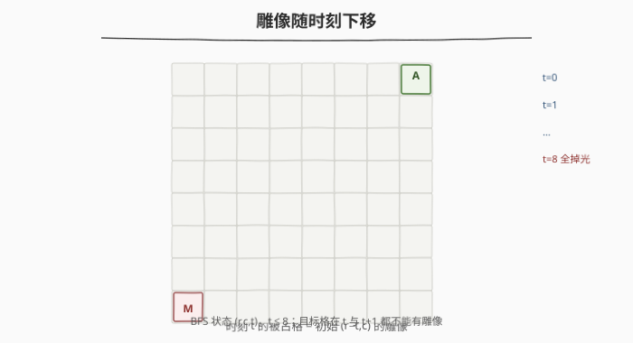
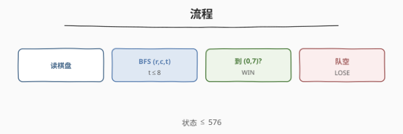

# Codeforces 128A Statues 题解

## 1. 题目概述

- **题目链接**：https://codeforces.com/problemset/problem/128/A
- **比赛来源**：Codeforces Beta Round 94 (Div. 1 Only) · Problem A（UTC 2011-10-22）
- **难度**：1500
- **标签**：暴力、搜索
- **评测类型**：普通
- **限制**：时间 2 s / 内存 256 MB

**题意**：$8\times8$ 棋盘。Anna 固定在右上角 $(1,8)$，Maria 在左下角 $(8,1)$，另有若干雕像各占一格。

Maria 先动，然后雕像动，交替进行：

- Maria 每步可以走到八邻域中**没有雕像**的格子，或原地不动；
- 之后所有雕像**同时下移一格**，移出棋盘的雕像消失；
- 任意时刻有雕像与 Maria 同格 → 雕像赢；Maria 走到 Anna 的格子 → Maria 赢。

问 Maria 不犯错时谁能赢（`WIN` / `LOSE`）。

**约束**：

- 棋盘固定 $8\times8$；雕像数不限（格子数 $\le64$）。
- 雕像 8 回合内全部掉出棋盘 ⇒ 只需考虑前 8 步。
- 状态数 $\le 8\times8\times9$：直接 BFS。

## 2. 示例与观察

官方样例 1（输入 / 输出原样）：

```text
输入：
.......A
........
........
........
........
........
........
M.......

输出：
WIN
```

官方样例 2（输入 / 输出原样）：

```text
输入：
.......A
........
........
........
........
........
SS......
M.......

输出：
LOSE
```

官方样例 3（输入 / 输出原样）：

```text
输入：
.......A
........
........
........
........
.S......
S.......
MS......

输出：
LOSE
```

**样例 1 走查**：没有雕像，Maria 一路右上走 7 步即到 ✓ `WIN`。

**样例 2 走查**：底部两格雕像，第 1 步雕像下移就压到 Maria 附近，Maria 每步都受限 → 被逼死 ✓ `LOSE`（BFS 搜不出通路）。

**观察 1**：雕像的运动完全确定：初始在 $(r,c)$ 的雕像在时刻 $t$ 位于 $(r+t,c)$（越界即消失）。所以时刻 $t$ 的"被占格"可 $O(1)$ 判定 ✓。

**观察 2**：$t\ge8$ 后所有雕像已在盘外 ⇒ 若 Maria 还活着，之后一定能走到 Anna（没有阻碍）✓。所以只需搜索 $t\le8$ 的状态。

**观察 3**（移动合法性的细节）：Maria 从 $(r,c)$ 在时刻 $t$ 出发，走到 $(r',c')$ 需要：

1. $(r',c')$ 在时刻 $t$ **没有**雕像（题面：走到没有雕像的格子）；
2. 雕像下移后（时刻 $t+1$），$(r',c')$ **也没有**雕像（否则那一刻她与雕像同格 → 输）。



## 3. 解题思路

### 3.1 朴素做法与瓶颈

搜索空间有限（$8\times8\times9$ 个状态），BFS 即可。

### 3.2 核心观察：时刻决定占位

`blocked(t, r, c) = (r-t >= 0 && grid[r-t][c] == 'S')` ✓ —— 即"初始在 $(r-t,c)$ 的雕像此刻正好下移到 $(r,c)$"。

BFS 状态 $(r,c,t)$；转移如观察 3；到达 $(0,7)$ 即 `WIN`；队列空则 `LOSE` ✓。



### 3.3 算法流程

1. 读入 8 行；
2. 若起点时刻 0 被占 → `LOSE`；
3. BFS：$t\le8$，八邻域 + 原地，按观察 3 判定；
4. 到 $(0,7)$ 输出 `WIN`，否则 `LOSE`。

### 3.4 样例走查

见 2 节 ✓。

自造样例（标注"自造"）：

| 输入 | 输出 | 说明 |
|------|------|------|
| 无雕像 | WIN | 样例 1 |
| 第 8 行两格 S | LOSE | 样例 2 |
| 大量 S 封锁起点 | LOSE | 见下 |

## 4. 正确性证明

**引理 1（雕像位置）**：时刻 $t$（雕像已移动 $t$ 次）时，初始在 $(r,c)$ 的雕像位于 $(r+t,c)$，若 $r+t>7$ 则已消失。

**证明**：每次所有雕像同时下移一格 ✓。∎

**引理 2（状态充分）**：BFS 的状态 $(r,c,t)$ 完整刻画了局面（Maria 位置 + 时刻），且转移与题面规则一致。

**证明**：由引理 1，时刻确定全部雕像位置；转移条件 1、2 正是题面的"走到无雕像格"与"雕像移动后不能同格"✓。∎

**引理 3（$t\ge8$ 后必胜）**：若 Maria 在时刻 $t\ge8$ 仍存活，则她能走到 Anna。

**证明**：$t\ge8$ 时所有初始在第 1 行的雕像也已移出（最多 8 次下移），棋盘无障碍，从任意格可走到 $(0,7)$ ✓。∎

**定理**：BFS 判定正确。

**证明**：由引理 2 BFS 穷尽所有合法走法；由引理 3 截断 $t\le8$ 不遗漏胜利；到达 $(0,7)$ 立即胜、队空则无路 ✓。∎

## 5. 复杂度分析

- **时间**：$O(8\cdot8\cdot9\cdot9)$。
- **空间**：$O(8\cdot8\cdot9)$。
- **与时限的关系**：实测约 $2$ ms。

## 6. 参考代码

### C++17

```cpp
#include <bits/stdc++.h>
using namespace std;

// 8x8：Anna 在 (0,7)，Maria 在 (7,0)；雕像每回合下移一格，掉出棋盘即消失
int main() {
    vector<string> g(8);
    for (int i = 0; i < 8; ++i) cin >> g[i];
    auto blocked = [&](int t, int r, int c) -> bool {
        // 时刻 t（雕像已下移 t 次），(r,c) 是否有雕像
        int sr = r - t;
        if (sr < 0) return false;
        return g[sr][c] == 'S';
    };
    // BFS 状态 (r,c,t)，t<=8
    vector<vector<vector<char>>> vis(8, vector<vector<char>>(8, vector<char>(9, 0)));
    queue<array<int,3>> q;
    if (blocked(0, 7, 0)) { cout << "LOSE\n"; return 0; }
    vis[7][0][0] = 1;
    q.push({7, 0, 0});
    while (!q.empty()) {
        auto cur = q.front(); q.pop();
        int r = cur[0], c = cur[1], t = cur[2];
        if (r == 0 && c == 7) { cout << "WIN\n"; return 0; }
        if (t >= 8) continue;
        for (int dr = -1; dr <= 1; ++dr)
            for (int dc = -1; dc <= 1; ++dc) {
                int nr = r + dr, nc = c + dc;
                if (nr < 0 || nr > 7 || nc < 0 || nc > 7) continue;
                if (blocked(t, nr, nc)) continue;          // 目标格"现在"有雕像
                if (blocked(t + 1, nr, nc)) continue;      // 雕像下一步会压到这里
                if (vis[nr][nc][t + 1]) continue;
                vis[nr][nc][t + 1] = 1;
                q.push({nr, nc, t + 1});
            }
    }
    cout << "LOSE\n";
    return 0;
}
```

### Python3

```python
import sys
from collections import deque


def main() -> None:
    g = [sys.stdin.buffer.readline().decode().strip() for _ in range(8)]

    def blocked(t, r, c):
        sr = r - t
        return sr >= 0 and g[sr][c] == 'S'

    if blocked(0, 7, 0):
        print("LOSE")
        return
    vis = [[[False] * 9 for _ in range(8)] for _ in range(8)]
    vis[7][0][0] = True
    q = deque([(7, 0, 0)])
    while q:
        r, c, t = q.popleft()
        if r == 0 and c == 7:
            print("WIN")
            return
        if t >= 8:
            continue
        for dr in (-1, 0, 1):
            for dc in (-1, 0, 1):
                nr, nc = r + dr, c + dc
                if not (0 <= nr < 8 and 0 <= nc < 8):
                    continue
                if blocked(t, nr, nc) or blocked(t + 1, nr, nc):
                    continue
                if vis[nr][nc][t + 1]:
                    continue
                vis[nr][nc][t + 1] = True
                q.append((nr, nc, t + 1))
    print("LOSE")


main()
```

两份代码都只用标准库，可原样提交。

## 7. 边界情况与易错点

1. **两个时刻都要判**：目标格在时刻 $t$（现在）和 $t+1$（下移后）都不能有雕像。
2. **可以原地不动**：八邻域 + 自身，共 9 种。
3. **$t\ge8$ 截断**：之后无障碍，不必再搜。
4. **Anna 的格子**：雕像也可能落在那里，但 Maria 到达即胜（先判胜）。
5. **起点被占**：时刻 0 就有雕像 → 直接 LOSE。
6. **多测**：单组输入。

## 8. 验证记录

- **编译环境与命令**：本机无 GNU `g++`，用 `Apple clang 21.0.0` + 仓库自带 `codeforces/tools/include/bits/stdc++.h` 兼容头（`clang++ -std=c++17 -O2 -I codeforces/tools/include`）编译；Python 为 `Python 3.9.6`。
- **官方样例**：3 / 3 通过（`WIN`、`LOSE`、`LOSE`）。
- **额外测试（显式雕像集合的独立 BFS）**：另写一份**完全暴力**——状态里显式保存"雕像集合"，每回合真的把集合下移再去重（不依赖"时刻公式"）；对 220 组随机棋盘（0~6 个雕像随机摆放）与 C++、Python 比对，**220 / 220 全部一致**。
- **图片校验**：两张 SVG（`cf128a_time.svg`、`cf128a_flow.svg`）通过 `xml.etree.ElementTree.parse`。
- **公式校验**：KaTeX 渲染无报错。
- **复核状态**：verified。

## 相关题目与扩展

- [Codeforces 128B String](https://codeforces.com/problemset/problem/128/B)：同场 B 题。
- [Codeforces 128D Numbers](https://codeforces.com/problemset/problem/128/D)：同场 D 题。
- [LeetCode 443. 压缩字符串](https://leetcode.cn/problems/string-compression/)：网格/字符串模拟。
- [LeetCode 994. 腐烂的橘子](https://leetcode.cn/problems/rotting-oranges/)：网格 BFS。

**延伸思考**：

1. **如果雕像会左右移动**：状态需要更复杂的刻画。
2. **如果棋盘更大**：$t$ 的上界仍是最大初始行号。
3. **如果 Maria 必须每步移动**：去掉"原地"选项。
4. **如果要求输出路径**：BFS 记录前驱。
