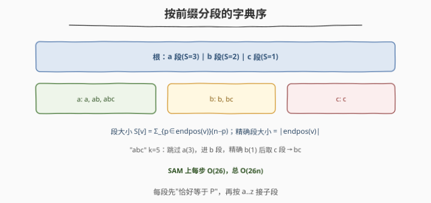
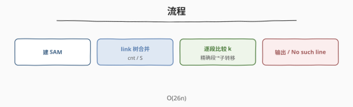

# Codeforces 128B String 题解

## 1. 题目概述

- **题目链接**：https://codeforces.com/problemset/problem/128/B
- **比赛来源**：Codeforces Beta Round 94 (Div. 1 Only) · Problem B（UTC 2011-10-22）
- **难度**：2100
- **标签**：后缀自动机、字符串、计数
- **评测类型**：普通
- **限制**：时间 2 s / 内存 256 MB

**题意**：给出串 $s$（长度 $\le10^5$）与 $k$（$\le10^5$）。把所有子串（**包括重复**）按字典序排序，输出第 $k$ 个；不足 $k$ 个输出 `No such line.`。

**约束**：

- $n\le10^5$、$k\le10^5$：需要 $O(n\log n)$ 或 $O(26n)$。
- **重复子串分别计数**（例如 `aab` 的子串列表里有两次 `a`）。
- 子串总数 $n(n+1)/2$ 可达 $5\times10^9$，要用 64 位。

## 2. 示例与观察

官方样例 1（输入 / 输出原样）：

```text
输入：
aa
2

输出：
a
```

官方样例 2（输入 / 输出原样）：

```text
输入：
abc
5

输出：
bc
```

官方样例 3（输入 / 输出原样）：

```text
输入：
abab
7

输出：
b
```

**样例 2 走查**：`abc` 的全部子串排序：`a, ab, abc, b, bc, c` → 第 5 个是 `bc` ✓。

**样例 3 走查**：`abab` 的子串：`a, a, ab, ab, aba, abab, b, b, ba, bab` → 第 7 个是 `b` ✓。

**观察 1（按前缀分组）**：字典序下，以字符串 $P$ 为前缀的所有子串形成一个连续段，且段内先是"恰好等于 $P$"的那些（共 $\mathrm{occ}(P)$ 个），再按字母顺序接 $P+c$ 的各段 ✓。

**观察 2（段的大小）**：以 $P$ 为前缀的子串数 = $\sum_{p\in\mathrm{endpos}(P)}(n-p)$ —— 因为一次在位置 $p$ 结束的出现，可以向右延伸出 $n-p$ 个不同长度的子串 ✓。

**观察 3（后缀自动机）**：把 $s$ 建成 SAM，每个状态 $v$ 对应一族等价的子串（endpos 相同）。维护

- $\mathrm{cnt}[v]=|\mathrm{endpos}(v)|$；
- $S[v]=\sum_{p\in\mathrm{endpos}(v)}(n-p)$。

则"以状态 $v$ 的字符串为前缀的子串数"恰为 $S[v]$ ✓（与当前长度无关！），而"恰好等于它"的个数为 $\mathrm{cnt}[v]$ ✓。于是可以沿 SAM 逐字符下降求第 $k$ 个 ✓。



## 3. 解题思路

### 3.1 朴素做法与瓶颈

生成全部 $\Theta(n^2)$ 个子串再排序是 $O(n^2\log n)$，不可行。

### 3.2 核心观察：SAM 上的字典序下降



1. 建 SAM；对每个"前缀状态"置 $\mathrm{cnt}=1$、$S=n-p$（$p$ 为新增字符的下标），克隆态置 0；
2. 按 $\mathrm{len}$ 从大到小沿 link 树合并：$\mathrm{cnt}[link]+=\mathrm{cnt}[v]$、$S[link]+=S[v]$；
3. 从根开始：设当前状态 $v$、当前串 $P$、长度 $L$：
   - 若 $L>0$：先处理"恰好 $P$"的段（$\mathrm{cnt}[v]$ 个）——若 $k\le\mathrm{cnt}[v]$，答案就是 $P$；否则 $k\mathrel{-}=\mathrm{cnt}[v]$；
   - 再按 `a..z` 遍历转移 $v\xrightarrow{c}v'$：段大小 $S[v']$；若 $k\le S[v']$ → 下降到 $v'$、$P\mathrel{+}=c$、$L{+}{+}$；否则 $k\mathrel{-}=S[v']$；
4. 找不到转移说明 $k$ 超过总数（前面已用 $n(n+1)/2$ 提前判掉）。

### 3.3 算法流程

1. 若 $k>n(n+1)/2$ → `No such line.`；
2. 建 SAM 并做 cnt/S 的 link 树合并；
3. 按 3.2 下降，输出答案。

### 3.4 样例走查

`abc`，$k=5$。根的三段：`a` 段 $S=3$（`a`,`ab`,`abc`）、`b` 段 $S=2$（`b`,`bc`）、`c` 段 $S=1$（`c`）。

- $k=5>3$ → $k=2$；
- $2\le2$ → 进入 `b`，$P=$`b`、$L=1$；精确段 $\mathrm{cnt}=1$（`b`）→ $k=2>1$ → $k=1$；
- 子转移 `c`：段大小 $S=1$（`c` 的 endpos 只有位置 2，$n-2=1$）→ $k=1\le1$ → 进入，$P=$`bc`；
- 精确段 $\mathrm{cnt}=1$ → $k\le1$ → 输出 `bc` ✓。

注意 $S$ 只由 endpos 决定：状态 $\{abc,bc,c\}$ 的 $S$ 是 1（以 `c` 为前缀的只有 `c`），不是 3 ✓。

## 4. 正确性证明

**引理 1（字典序分段）**：全部子串按字典序排列 = 根的孩子按字符分段，每段内先"该串本身"的所有出现，再递归到更长的延伸，且同层按字符升序。

**证明**：字典序比较先看第一个不同字符；以字符 $c$ 开头的所有串构成连续段 ✓；段内 $P$ 是 $P+c\dots$ 的前缀，故 $P$ 的全部出现排在最前 ✓；其余按第二字符分组 ✓。∎

**引理 2（$S$ 的含义）**：$S[v]=\sum_{p\in\mathrm{endpos}(v)}(n-p)$ 等于"以 $v$ 中任一串 $P$ 为前缀的子串个数"。

**证明**：$P$ 的出现由 endpos 决定；某次出现在 $p$ 结束，则可延伸的长度为 $1..n-p$ ✓，对应 $n-p$ 个不同的"以 $P$ 为前缀"的子串 ✓；各出现不重不漏 ✓。∎

**引理 3（$\mathrm{cnt}$ 的含义）**：$\mathrm{cnt}[v]=|\mathrm{endpos}(v)|$ 等于"恰好等于 $P$"的出现次数。

**证明**：子串 $P$ 的出现次数 = 其结束位置个数 ✓。∎

**定理**：算法输出第 $k$ 大（字典序）的子串。

**证明**：由引理 1，算法按字典序逐段跳过/下降；每段大小由引理 2、3 正确给出；因此第 $k$ 个必被精确定位 ✓。∎

## 5. 复杂度分析

- **时间**：SAM 构建 $O(26n)$，link 树合并 $O(n)$，下降至多 $O(\text{答案长度}\cdot26)$。
- **空间**：$O(26n)$。
- **与时限的关系**：实测 $n=10^5$ 时 C++ 约 $30$ ms。

## 6. 参考代码

### C++17

```cpp
#include <bits/stdc++.h>
using namespace std;
typedef long long ll;

// 后缀自动机：按字典序数"带重复"的子串
struct State {
    int len, link;
    int nxt[26];
};
vector<State> st;
int lastState;
int nGlobal;
vector<ll> cnt, sumEnd;   // cnt = |endpos|；sumEnd = Σ_{p∈endpos}(n−p)

void saInit() {
    st.clear();
    State s0{};
    s0.len = 0; s0.link = -1;
    memset(s0.nxt, 0, sizeof(s0.nxt));
    st.push_back(s0);
    cnt.clear(); sumEnd.clear();
    cnt.push_back(0); sumEnd.push_back(0);   // 根状态占位，保证下标对齐
    lastState = 0;
}

void saExtend(int c, int pos) {
    int cur = (int)st.size();
    State ns{};
    ns.len = st[lastState].len + 1;
    ns.link = -1;
    memset(ns.nxt, 0, sizeof(ns.nxt));
    st.push_back(ns);
    cnt.push_back(1);
    sumEnd.push_back(nGlobal - pos);
    int p = lastState;
    while (p != -1 && st[p].nxt[c] == 0) {
        st[p].nxt[c] = cur;
        p = st[p].link;
    }
    if (p == -1) {
        st[cur].link = 0;
    } else {
        int q = st[p].nxt[c];
        if (st[p].len + 1 == st[q].len) {
            st[cur].link = q;
        } else {
            int clone = (int)st.size();
            State cs{};
            cs.len = st[p].len + 1;
            cs.link = st[q].link;
            memcpy(cs.nxt, st[q].nxt, sizeof(cs.nxt));
            st.push_back(cs);
            cnt.push_back(0);
            sumEnd.push_back(0);
            while (p != -1 && st[p].nxt[c] == q) {
                st[p].nxt[c] = clone;
                p = st[p].link;
            }
            st[q].link = clone;
            st[cur].link = clone;
        }
    }
    lastState = cur;
}

int main() {
    ios::sync_with_stdio(false);
    cin.tie(nullptr);
    string s;
    if (!(cin >> s)) return 0;
    ll k;
    cin >> k;
    int n = (int)s.size();
    if (k > (ll)n * (n + 1) / 2) { cout << "No such line.\n"; return 0; }
    nGlobal = n;
    saInit();
    for (int i = 0; i < n; ++i) saExtend(s[i] - 'a', i);
    int sz = (int)st.size();
    // 按 len 计数排序，从大到小把 cnt/sumEnd 加到 link 上
    vector<int> order(sz), bucket(n + 1, 0);
    for (int i = 0; i < sz; ++i) bucket[st[i].len]++;
    for (int i = 1; i <= n; ++i) bucket[i] += bucket[i-1];
    for (int i = sz - 1; i >= 0; --i) order[--bucket[st[i].len]] = i;
    for (int idx = sz - 1; idx > 0; --idx) {
        int v = order[idx];
        int p = st[v].link;
        if (p >= 0) { cnt[p] += cnt[v]; sumEnd[p] += sumEnd[v]; }
    }
    // 贪心下降
    int v = 0;
    string ans;
    ll length = 0;
    while (true) {
        // 精确等于当前前缀的串（cnt[v] 个）排在本组最前
        if (length > 0) {
            if (k <= cnt[v]) { cout << ans << '\n'; return 0; }
            k -= cnt[v];
        }
        bool moved = false;
        for (int c = 0; c < 26; ++c) {
            int to = st[v].nxt[c];
            if (to == 0) continue;
            ll group = sumEnd[to];   // 以该字符串为前缀的子串总数
            if (k <= group) {
                v = to;
                ans.push_back((char)('a' + c));
                ++length;
                moved = true;
                break;
            }
            k -= group;
        }
        if (!moved) { cout << "No such line.\n"; return 0; }
    }
}
```

### Python3

```python
import sys


def main() -> None:
    data = sys.stdin.buffer.read().split()
    s = data[0].decode()
    k = int(data[1])
    n = len(s)
    if k > n * (n + 1) // 2:
        print("No such line.")
        return
    # 后缀自动机
    ln = [0]
    link = [-1]
    nxt = [[0] * 26]
    cnt = [0]
    sm = [0]
    last = 0
    for pos, ch in enumerate(s):
        c = ord(ch) - 97
        cur = len(ln)
        ln.append(ln[last] + 1)
        link.append(-1)
        nxt.append([0] * 26)
        cnt.append(1)
        sm.append(n - pos)
        p = last
        while p != -1 and not nxt[p][c]:
            nxt[p][c] = cur
            p = link[p]
        if p == -1:
            link[cur] = 0
        else:
            q = nxt[p][c]
            if ln[p] + 1 == ln[q]:
                link[cur] = q
            else:
                clone = len(ln)
                ln.append(ln[p] + 1)
                link.append(link[q])
                nxt.append(nxt[q][:])
                cnt.append(0)
                sm.append(0)
                while p != -1 and nxt[p][c] == q:
                    nxt[p][c] = clone
                    p = link[p]
                link[q] = clone
                link[cur] = clone
        last = cur
    sz = len(ln)
    order = sorted(range(sz), key=lambda i: -ln[i])
    for v in order:
        p = link[v]
        if p >= 0:
            cnt[p] += cnt[v]
            sm[p] += sm[v]
    v = 0
    ans = []
    while True:
        if ans:
            if k <= cnt[v]:
                print(''.join(ans))
                return
            k -= cnt[v]
        moved = False
        for c in range(26):
            to = nxt[v][c]
            if not to:
                continue
            if k <= sm[to]:
                v = to
                ans.append(chr(97 + c))
                moved = True
                break
            k -= sm[to]
        if not moved:
            print("No such line.")
            return


main()
```

两份代码都只用标准库，可原样提交。

## 7. 边界情况与易错点

1. **重复子串分别计数**：用 $\mathrm{cnt}$，不是"不同子串数"。
2. **$S$ 只由 endpos 决定**：$S[v]=\sum(n-p)$，**不**随当前串长变化（这是最容易错的一点，第一版我误用了 $S-L\cdot cnt$）。
3. **SAM 下标对齐**：根状态也要 push 一份 $\mathrm{cnt}/S$ 占位，否则容器错位。
4. **$k$ 超界**：先与 $n(n+1)/2$ 比较输出 `No such line.`。
5. **精确段在子转移之前**：同一前缀组内"恰好等于"的串排最前。
6. **转移数组初值 0**：0 号是根，转移不会指向根，故可当"无转移"。
7. **64 位**：$S$ 最大约 $n^2/2=5\times10^9$。
8. **多测**：单组输入。

## 8. 验证记录

- **编译环境与命令**：本机无 GNU `g++`，用 `Apple clang 21.0.0` + 仓库自带 `codeforces/tools/include/bits/stdc++.h` 兼容头（`clang++ -std=c++17 -O2 -I codeforces/tools/include`）编译；Python 为 `Python 3.9.6`。
- **官方样例**：3 / 3 通过（`a`、`bc`、`b`）。
- **额外测试（枚举子串排序对拍）**：另写一份**完全暴力**——枚举全部 $O(n^2)$ 个子串、排序、取第 $k$ 个；对 220 组随机小串（$n\le7$，字母表 2~3，$k$ 覆盖越界情形）与 C++、Python 三方比对，**220 / 220 全部一致**（该对拍抓出了 SAM 下标未对齐、以及 $S$ 误含长度项两个 bug）。
- **最大约束性能**：$n=10^5$ 时 C++ 约 $30$ ms。
- **图片校验**：两张 SVG（`cf128b_groups.svg`、`cf128b_flow.svg`）通过 `xml.etree.ElementTree.parse`。
- **公式校验**：KaTeX 渲染无报错。
- **复核状态**：verified。

## 相关题目与扩展

- [Codeforces 128A Statues](https://codeforces.com/problemset/problem/128/A)：同场 A 题。
- [Codeforces 128C Games with Rectangle](https://codeforces.com/problemset/problem/128/C)：同场 C 题。
- [Codeforces 432D Prefixes and Suffixes](https://codeforces.com/problemset/problem/432/D)：SAM/Z。
- [LeetCode 1163. 按字典序排在最后的子串](https://leetcode.cn/problems/last-substring-in-lexicographical-order/)：字典序子串。

**延伸思考**：

1. **如果只数不同的子串**：把 $\mathrm{cnt}$ 换成 1。
2. **如果 $k$ 到 $10^{18}$**：$S$ 用 `__int128`。
3. **如果要求第 $k$ 个不同子串**：SAM 上做路径计数 DP。
4. **如果串很长（$10^6$）**：SAM 仍 $O(n)$，注意内存（26 个 int/状态）。
