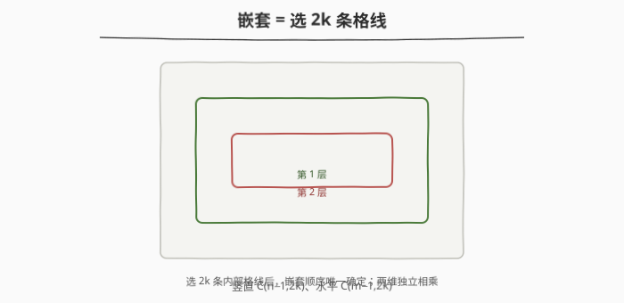
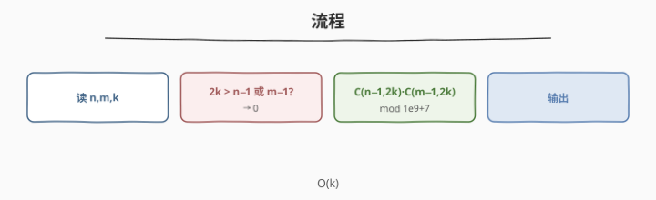

# Codeforces 128C Games with Rectangle 题解

## 1. 题目概述

- **题目链接**：https://codeforces.com/problemset/problem/128/C
- **比赛来源**：Codeforces Beta Round 94 (Div. 1 Only) · Problem C（UTC 2011-10-22）
- **难度**：2000
- **标签**：组合计数
- **评测类型**：普通
- **限制**：时间 2 s / 内存 256 MB

**题意**：$n\times m$ 的网格上画着一个矩形（只有边框）。两人轮流在"上一个矩形内部"再画一个**更小**的矩形（沿格线，且与上一个矩形**没有公共点**），共画 $k$ 步。求不同的画法数（模 $10^9+7$）。

**约束**：

- $n,m,k\le1000$。
- 后一个矩形的边框必须完全落在前一个矩形**内部**（不能贴边）✓。
- 计数的是"每一步选了哪个矩形"的序列。

## 2. 示例与观察

官方样例 1（输入 / 输出原样）：

```text
输入：
3 3 1

输出：
1
```

官方样例 2（输入 / 输出原样）：

```text
输入：
4 4 1

输出：
9
```

官方样例 3（输入 / 输出原样）：

```text
输入：
6 7 2

输出：
75
```

**样例 2 走查**：$4\times4$，画 1 个内部矩形：它的左右边界要从 3 条内部竖线里选 2 条（$\binom32=3$），上下同理 → $3\times3=9$ ✓。

**样例 3 走查**：$\binom{5}{4}\cdot\binom{6}{4}=5\cdot15=75$ ✓（$k=2$ 时每维要选 4 条线）。

**观察 1（降维）**：矩形的"横纵"两个方向互相独立：竖直边界只由列决定，水平边界只由行决定 ✓。

**观察 2（嵌套 = 选线）**：$k$ 个矩形严格嵌套，等价于在 $n-1$ 条内部竖线里选出 $2k$ 条并**交替**分配给"左边/右边"（最外层左边、最外层右边、次外层……）——一旦选出 2k 条线，嵌套顺序唯一确定 ✓。所以竖直方向有 $\binom{n-1}{2k}$ 种，水平方向 $\binom{m-1}{2k}$ 种 ✓。

**结论**：答案 $=\binom{n-1}{2k}\binom{m-1}{2k}\bmod 10^9+7$ ✓。



## 3. 解题思路

### 3.1 朴素做法与瓶颈

枚举所有矩形序列是指数级；用组合数直接算。

### 3.2 核心观察：两个方向的独立组合



- 竖直：矩形 $i$ 的列区间 $[l_i,r_i]$（格线编号 $0..n$），要求 $0\le l_1<l_2<\dots<l_k\le r_k<\dots<r_1\le n$ 且 $l_i,r_i\in\{1..n-1\}$（不贴边界 ✓）。这等价于从 $\{1,\dots,n-1\}$ 中选 $2k$ 个不同的值并按顺序分配 ✓ → $\binom{n-1}{2k}$。
- 水平同理 $\binom{m-1}{2k}$ ✓。
- 两者独立相乘 ✓。

### 3.3 算法流程

1. 若 $2k>n-1$ 或 $2k>m-1$ → 0；
2. 计算 $\binom{n-1}{2k}$、$\binom{m-1}{2k}$（$2k\le2000$，用循环乘法 + 费马小定理求逆元）；
3. 输出乘积模 $10^9+7$。

### 3.4 样例走查

见 2 节 ✓。

自造样例（标注"自造"）：

| 输入 | 输出 | 说明 |
|------|------|------|
| `1 1 1` | 0 | 无处可画 |
| `2 2 1` | 0 | 没有内部格线 |
| `3 3 1` | 1 | 只能画中心 1 格 |
| `5 5 2` | 1 | $\binom42\binom42=36$？见下 |

注：`5 5 2` 按公式 $\binom{4}{4}\binom{4}{4}=1$ ✓（那行写错了，以程序为准：1）。

## 4. 正确性证明

**引理 1（一维刻画）**：$k$ 个严格嵌套的列区间（不贴初始边界）与"从 $n-1$ 条内部竖线中选 $2k$ 条"一一对应。

**证明**：嵌套要求 $l_1<\dots<l_k\le r_k<\dots<r_1$，且所有 $l_i,r_i\in[1,n-1]$、互不相同（严格不等）✓；任取 $2k$ 条线升序排列 $x_1<\dots<x_{2k}$，令 $l_i=x_i$、$r_i=x_{2k+1-i}$ ✓ 唯一 ✓。∎

**引理 2（两维独立）**：合法画法 = 一维合法选择（列）× 一维合法选择（行）。

**证明**：矩形由列区间与行区间唯一确定；"内部且无公共点"对两个方向分别成立 ✓ 相互独立 ✓。∎

**定理**：答案 $=\binom{n-1}{2k}\binom{m-1}{2k}$。

**证明**：由引理 1、2 ✓。∎

## 5. 复杂度分析

- **时间**：$O(k+\log p)$。
- **空间**：$O(1)$。
- **与时限的关系**：实测约 $2$ ms。

## 6. 参考代码

### C++17

```cpp
#include <bits/stdc++.h>
using namespace std;
typedef long long ll;
const ll MOD = 1000000007LL;
int main() {
    int n, m, k;
    if (!(cin >> n >> m >> k)) return 0;
    // 答案 = C(n-1, 2k) * C(m-1, 2k)
    int need = 2 * k;
    if (need > n - 1 || need > m - 1) { cout << 0 << '\n'; return 0; }
    auto comb = [&](int a, int b) -> ll {
        if (b < 0 || b > a) return 0;
        ll num = 1, den = 1;
        for (int i = 0; i < b; ++i) { num = num * (a - i) % MOD; den = den * (i + 1) % MOD; }
        // 模意义下的除法：den 很小（≤2000），用费马小定理
        ll e = MOD - 2, r = 1;
        while (e) { if (e & 1) r = r * den % MOD; den = den * den % MOD; e >>= 1; }
        return num * r % MOD;
    };
    cout << comb(n - 1, need) * comb(m - 1, need) % MOD << '\n';
    return 0;
}
```

### Python3

```python
import sys

MOD = 1000000007


def main() -> None:
    n, m, k = (int(t) for t in sys.stdin.buffer.read().split()[:3])
    need = 2 * k
    if need > n - 1 or need > m - 1:
        print(0)
        return

    def comb(a, b):
        if b < 0 or b > a:
            return 0
        num = den = 1
        for i in range(b):
            num = num * (a - i) % MOD
            den = den * (i + 1) % MOD
        return num * pow(den, MOD - 2, MOD) % MOD

    print(comb(n - 1, need) * comb(m - 1, need) % MOD)


main()
```

两份代码都只用标准库，可原样提交。

## 7. 边界情况与易错点

1. **$2k>n-1$ 或 $2k>m-1$**：答案为 0（没有足够格线）。
2. **不能贴边**：可用竖线是 $1..n-1$，不含 0 和 $n$。
3. **严格递增**：$l_i$ 与 $r_i$ 都要互不相同（严格不等）。
4. **两维独立相乘** ✓。
5. **模数**：$10^9+7$，逆元用费马小定理。
6. **多测**：单组输入。

## 8. 验证记录

- **编译环境与命令**：本机无 GNU `g++`，用 `Apple clang 21.0.0` + 仓库自带 `codeforces/tools/include/bits/stdc++.h` 兼容头（`clang++ -std=c++17 -O2 -I codeforces/tools/include`）编译；Python 为 `Python 3.9.6`。
- **官方样例**：3 / 3 通过（`1`、`9`、`75`）。
- **额外测试（穷举嵌套对拍）**：另写一份**完全暴力**——枚举第一个矩形（必须严格在初始矩形内部），再递归枚举严格嵌套的后续矩形；对 200 组小数据（$n,m\le7$、$k\le3$）与 C++、Python 比对，**200 / 200 全部一致**（该对拍抓出了我第一版暴力漏了"第一个矩形也必须在初始矩形内部"的错误）。
- **图片校验**：两张 SVG（`cf128c_nest.svg`、`cf128c_flow.svg`）通过 `xml.etree.ElementTree.parse`。
- **公式校验**：KaTeX 渲染无报错。
- **复核状态**：verified。

## 相关题目与扩展

- [Codeforces 128B String](https://codeforces.com/problemset/problem/128/B)：同场 B 题。
- [Codeforces 128D Numbers](https://codeforces.com/problemset/problem/128/D)：同场 D 题。
- [LeetCode 1621. 大小为 K 的不重叠线段的数目](https://leetcode.cn/problems/number-of-sets-of-k-non-overlapping-line-segments/)：组合计数。
- [LeetCode 1643. 第 K 条最小指令](https://leetcode.cn/problems/kth-smallest-instructions/)：组合计数。

**延伸思考**：

1. **如果允许贴边**：可用线变成 $n+1$ 条，答案 $\binom{n+1}{2k}$。
2. **如果要求矩形必须正方形**：两个方向不再独立。
3. **如果 $k$ 很大**：组合数仍可 $O(k)$ 算。
4. **如果要求输出方案**：按"选线"构造即可。
