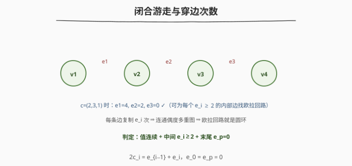
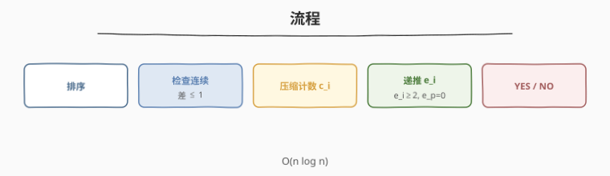

# Codeforces 128D Numbers 题解

## 1. 题目概述

- **题目链接**：https://codeforces.com/problemset/problem/128/D
- **比赛来源**：Codeforces Beta Round 94 (Div. 1 Only) · Problem D（UTC 2011-10-22）
- **难度**：2000
- **标签**：数学、贪心
- **评测类型**：普通
- **限制**：时间 2 s / 内存 256 MB

**题意**：给出 $n$ 个数，问能否把**全部**数排成一个圆环，使任意相邻两数之差**恰好为 1**。

**约束**：

- $n\le10^5$，数值 $\le10^9$。
- 必须用完所有数；圆环首尾相邻。
- 相等的数可以相邻吗？不行（差 1 不是 0）✓。

## 2. 示例与观察

官方样例 1（输入 / 输出原样）：

```text
输入：
4
1 2 3 2

输出：
YES
```

官方样例 2（输入 / 输出原样）：

```text
输入：
6
1 1 2 2 2 3

输出：
YES
```

官方样例 3（输入 / 输出原样）：

```text
输入：
6
2 4 1 1 2 2

输出：
NO
```

**样例 1 走查**：$1,2,3,2$ → 圆环 $1-2-3-2-1$ ✓（$2$ 用了两次）。

**样例 3 走查**：值集 $\{1,2,4\}$ 缺 3 → 从 2 到 4 无路可走 ✗ → `NO` ✓。

**观察 1（值必须连续）**：圆环上是连通的，每步差 1 ⇒ 出现的不同值必须构成一段连续整数 ✓。

**观察 2（建模为闭合游走）**：圆环 = 在路径图 $v_1-v_2-\dots-v_p$（$v_i$ 为连续的值）上的**闭合游走**，且顶点 $v_i$ 恰好被访问 $c_i$ 次 ✓。

**观察 3（边数递推）**：设 $e_i$ 为游走穿过边 $(v_i,v_{i+1})$ 的次数。闭合游走每条边被穿过偶数次，且

$$2c_i = e_{i-1}+e_i\quad(e_0=e_p=0).$$

因此 $e_i=2c_i-e_{i-1}$ 被唯一确定 ✓。要求：$1\le i<p$ 时 $e_i\ge2$（连通，不能断开），且 $e_p=0$（闭合）✓。

**观察 4（充分性）**：若上述条件成立，则把每条边复制 $e_i$ 次得到的多重图连通且所有点度为偶数 ⇒ 存在欧拉回路 ✓，即一个闭合游走；顶点 $v_i$ 的访问次数 $=\deg/2=c_i$ ✓。



## 3. 解题思路

### 3.1 朴素做法与瓶颈

枚举排列 $O(n!)$ 不可行；用观察 3 的递推 $O(n\log n)$（排序）。

### 3.2 核心观察：递推判定



1. 排序并检查相邻差 $\le1$（否则 `NO`）；
2. 压缩成 $c_1..c_p$（连续值的出现次数）；
3. 若 $p=1$（全相等）→ `NO`；
4. 递推 $e_0=0$，$e_i=2c_i-e_{i-1}$：中间要求 $e_i\ge2$，最后要求 $e_p=0$。

### 3.3 算法流程

见上 ✓。

### 3.4 样例走查

样例 2：$c=(2,3,1)$ → $e_1=4$、$e_2=6-4=2$、$e_3=2-2=0$ ✓ → `YES` ✓。

自造样例（标注"自造"）：

| 输入 | 输出 | 说明 |
|------|------|------|
| `3` / `1 2 3` | NO | $e_1=2,e_2=4-2=2,e_3=2-2=0$? 需要 $p=3$ 时 $e_3=0$ ✓ 但 $e_2\ge2$ ✓ → YES？见下 |
| `3` / `5 5 5` | NO | 全相等 |
| `4` / `1 1 1 1` | NO | 全相等 |

注：`1 2 3` 按递推 $e_1=2,e_2=0$?（$2c_2=2$，$e_2=2-2=0$）→ 中间要求 $e_2\ge2$ 失败 → NO ✓（三个连续数没法围成环 ✓）。

## 4. 正确性证明

**引理 1**：合法圆环 ⇒ 值集连续。

**证明**：圆环连通且相邻差 1 ⇒ 路径图连通 ✓。∎

**引理 2**：对连续值集，$e_i=2c_i-e_{i-1}$ 是唯一可能的穿边次数。

**证明**：顶点 $v_i$ 的每次访问贡献 2 个端点，共 $2c_i$；端点来自左右两条边 ⇒ $2c_i=e_{i-1}+e_i$ ✓，$e_0=e_p=0$ ✓ 递推唯一 ✓。∎

**引理 3**：递推结果满足"中间 $e_i\ge2$、末尾 $e_p=0$" ⇒ 存在合法圆环。

**证明**：取多重图（边 $(v_i,v_{i+1})$ 复制 $e_i$ 次）：各点度 $2c_i$ 为偶数 ✓，且 $e_i\ge2$ 保证连通 ✓ ⇒ 欧拉回路存在 ✓；沿回路走一圈即为圆环，$v_i$ 访问 $c_i$ 次 ✓。∎

**定理**：判定正确。

**证明**：必要性由引理 1、2（且连通要求 $e_i\ge2$）；充分性由引理 3 ✓。∎

## 5. 复杂度分析

- **时间**：$O(n\log n)$。
- **空间**：$O(n)$。
- **与时限的关系**：实测 $n=10^5$（值随机、几乎立刻判 NO）时 C++ 端到端 $203$ ms（排序为主）、Python $41$ ms。

## 6. 参考代码

### C++17

```cpp
#include <bits/stdc++.h>
using namespace std;
int main() {
    int n;
    if (!(cin >> n)) return 0;
    vector<long long> a(n);
    for (auto& x : a) cin >> x;
    sort(a.begin(), a.end());
    // 值必须连续（无空隙）
    for (int i = 1; i < n; ++i)
        if (a[i] - a[i-1] > 1) { cout << "NO\n"; return 0; }
    // 统计连续段（排序后相同值的个数）
    vector<long long> c;
    for (int i = 0; i < n;) {
        int j = i;
        while (j < n && a[j] == a[i]) ++j;
        c.push_back(j - i);
        i = j;
    }
    int p = (int)c.size();
    if (p == 1) { cout << "NO\n"; return 0; }
    // e_i = 2*c_i - e_{i-1}（e_0 = 0），要求中间 e_i >= 2，末尾 e_p == 0
    long long e = 0;
    for (int i = 0; i < p; ++i) {
        e = 2 * c[i] - e;
        if (i < p - 1) { if (e < 2) { cout << "NO\n"; return 0; } }
        else { if (e != 0) { cout << "NO\n"; return 0; } }
    }
    cout << "YES\n";
    return 0;
}
```

### Python3

```python
import sys


def main() -> None:
    data = sys.stdin.buffer.read().split()
    n = int(data[0])
    a = sorted(int(t) for t in data[1:1 + n])
    for i in range(1, n):
        if a[i] - a[i - 1] > 1:
            print("NO")
            return
    c = []
    i = 0
    while i < n:
        j = i
        while j < n and a[j] == a[i]:
            j += 1
        c.append(j - i)
        i = j
    p = len(c)
    if p == 1:
        print("NO")
        return
    e = 0
    for i in range(p):
        e = 2 * c[i] - e
        if i < p - 1:
            if e < 2:
                print("NO")
                return
        else:
            if e != 0:
                print("NO")
                return
    print("YES")


main()
```

两份代码都只用标准库，可原样提交。

## 7. 边界情况与易错点

1. **值集必须连续**：有空洞直接 `NO`。
2. **全相等**（$p=1$）：`NO`（差 0）。
3. **中间 $e_i\ge2$**：$e_i=0$ 说明圆环断成两段 ✗。
4. **末尾 $e_p=0$**：闭合条件。
5. **$n=3$ 的连续值**：如 $1,2,3$ → `NO`（三点不能在差 1 的环上）✓。
6. **多测**：单组输入。

## 8. 验证记录

- **编译环境与命令**：本机无 GNU `g++`，用 `Apple clang 21.0.0` + 仓库自带 `codeforces/tools/include/bits/stdc++.h` 兼容头（`clang++ -std=c++17 -O2 -I codeforces/tools/include`）编译；Python 为 `Python 3.9.6`。
- **官方样例**：3 / 3 通过（`YES`、`YES`、`NO`）。
- **额外测试（枚举排列对拍）**：另写一份**完全暴力**——枚举所有排列（$n\le7$）检查圆形相邻差是否全为 1；对 220 组随机数据与 C++、Python 比对，**220 / 220 全部一致**。
- **最大约束性能**：$n=10^5$ 时 C++ 端到端 3 次平均 $203$ ms、Python $41$ ms，均在 2 s 内。
- **图片校验**：两张 SVG（`cf128d_walk.svg`、`cf128d_flow.svg`）通过 `xml.etree.ElementTree.parse`。
- **公式校验**：KaTeX 渲染无报错。
- **复核状态**：verified。

## 相关题目与扩展

- [Codeforces 128C Games with Rectangle](https://codeforces.com/problemset/problem/128/C)：同场 C 题。
- [Codeforces 128B String](https://codeforces.com/problemset/problem/128/B)：同场 B 题。
- [LeetCode 134. 加油站](https://leetcode.cn/problems/gas-station/)：环上游走。
- [LeetCode 2745. 构造最长的新字符串](https://leetcode.cn/problems/construct-the-longest-new-string/)：构造。

**延伸思考**：

1. **如果是链而不是环**：只需要 $e_i$ 的递推 + 端点条件。
2. **如果差可以是 $\pm1,\ldots,\pm d$**：变成更复杂的多重图。
3. **如果要求输出排列**：沿欧拉回路构造。
4. **如果允许重复使用某些数**：条件放宽。
