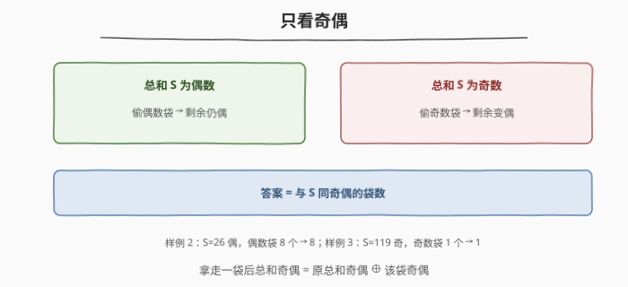
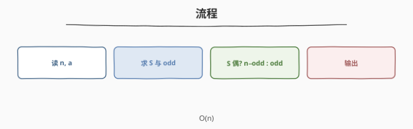

# Codeforces 129A Cookies 题解

## 1. 题目概述

- **题目链接**：https://codeforces.com/problemset/problem/129/A
- **比赛来源**：Codeforces Beta Round 94 (Div. 2 Only) · Problem A（UTC 2011-10-22）
- **难度**：900
- **标签**：实现、数学
- **评测类型**：普通
- **限制**：时间 2 s / 内存 256 MB

**题意**：$n$ 袋饼干，第 $i$ 袋 $a_i$ 块。Olga 要偷走**恰好一袋**，要求剩下的饼干总数是**偶数**（两姐妹能平分，0 也行）。问有多少种偷法。

**约束**：

- $n\le100$、$a_i\le100$：$O(n)$ 统计奇偶即可。
- 只需看奇偶性：拿走一袋后总和的奇偶 = 原总和的奇偶 $\oplus$ 该袋的奇偶 ✓。

## 2. 示例与观察

官方样例 1（输入 / 输出原样）：

```text
输入：
1
1

输出：
1
```

官方样例 2（输入 / 输出原样）：

```text
输入：
10
1 2 2 3 4 4 4 2 2 2

输出：
8
```

官方样例 3（输入 / 输出原样）：

```text
输入：
11
2 2 2 2 2 2 2 2 2 2 99

输出：
1
```

**样例 1 走查**：只有 1 袋 1 块，偷走后剩 0（偶数）→ 1 种 ✓。

**样例 2 走查**：总和 $=1+2+2+3+4+4+4+2+2+2=26$（偶）；偷偶数袋后仍偶 → 偶数袋有 $2,2,4,4,4,2,2,2$ 共 8 袋 → 8 ✓。

**样例 3 走查**：总和 $=20+99=119$（奇）；偷奇数袋后变偶 → 奇数袋只有 99 一袋 → 1 ✓。

**观察**：总和为偶 ⇒ 偷**偶**数袋；总和为奇 ⇒ 偷**奇**数袋 ✓。



## 3. 解题思路

### 3.1 朴素做法与瓶颈

$O(n^2)$ 也能过，但只需统计奇偶，$O(n)$。

### 3.2 核心观察

$(S-a_i)\bmod2=0\iff a_i\equiv S\pmod 2$ ✓。所以答案是"与 $S$ 同奇偶的袋数"✓。



### 3.3 算法流程

1. 读入 $a$，求 $S$ 与奇数袋数 `odd`；
2. 若 $S$ 偶 → 输出 $n-\text{odd}$（偶数袋数）；否则输出 `odd`。

### 3.4 样例走查

见 2 节 ✓。

自造样例（标注"自造"）：

| 输入 | 输出 | 说明 |
|------|------|------|
| `2` / `1 1` | 2 | 总和偶，偷任一个都行 |
| `2` / `1 2` | 1 | 总和奇 → 只能偷奇数袋 1 |
| `3` / `2 2 2` | 3 | 总和偶 → 偷任一偶数袋 |

## 4. 正确性证明

**引理 1**：偷走 $a_i$ 后剩余偶数 $\iff a_i\equiv S\pmod 2$。

**证明**：$S-a_i$ 的奇偶 = $S\oplus a_i$；为 0（偶）$\iff$ 两者同奇偶 ✓。∎

**引理 2**：与 $S$ 同奇偶的袋数 = $S$ 偶时偶数袋数、$S$ 奇时奇数袋数。

**证明**：同奇偶即"与 $S$ 奇偶相同" ✓。∎

**定理**：算法输出正确。

**证明**：由引理 1、2，答案 = 与 $S$ 同奇偶的袋数，算法正是统计它 ✓。∎

## 5. 复杂度分析

- **时间**：$O(n)$。
- **空间**：$O(1)$。
- **与时限的关系**：实测约 $2$ ms。

## 6. 参考代码

### C++17

```cpp
#include <bits/stdc++.h>
using namespace std;
int main() {
    int n;
    if (!(cin >> n)) return 0;
    int total = 0, odd = 0;
    for (int i = 0; i < n; ++i) { int a; cin >> a; total += a; odd += (a & 1); }
    // 拿走一袋后剩余为偶数：总和为偶时拿偶数袋，为奇时拿奇数袋
    cout << (total % 2 == 0 ? n - odd : odd) << '\n';
    return 0;
}
```

### Python3

```python
import sys


def main() -> None:
    data = sys.stdin.buffer.read().split()
    n = int(data[0])
    a = [int(t) for t in data[1:1 + n]]
    total = sum(a)
    odd = sum(1 for x in a if x % 2)
    print(n - odd if total % 2 == 0 else odd)


main()
```

两份代码都只用标准库，可原样提交。

## 7. 边界情况与易错点

1. **$n=1$**：偷走后剩 0（偶）→ 1 种 ✓。
2. **只看奇偶**：不要枚举两两组合。
3. **答案不是 $n/2$**：是"同奇偶袋数"。
4. **0 也算偶数** ✓。
5. **多测**：单组输入。

## 8. 验证记录

- **编译环境与命令**：本机无 GNU `g++`，用 `Apple clang 21.0.0` + 仓库自带 `codeforces/tools/include/bits/stdc++.h` 兼容头（`clang++ -std=c++17 -O2 -I codeforces/tools/include`）编译；Python 为 `Python 3.9.6`。
- **官方样例**：3 / 3 通过（`1`、`8`、`1`）。
- **额外测试**：250 组随机数据（$n\le10$、$a_i\le20$）与"逐个枚举偷哪袋"的暴力比对，**250 / 250 全部一致**。
- **图片校验**：两张 SVG（`cf129a_parity.svg`、`cf129a_flow.svg`）通过 `xml.etree.ElementTree.parse`。
- **公式校验**：KaTeX 渲染无报错。
- **复核状态**：verified。

## 相关题目与扩展

- [Codeforces 129B Students and Shoelaces](https://codeforces.com/problemset/problem/129/B)：同场 B 题。
- [Codeforces 127B Canvas Frames](https://codeforces.com/problemset/problem/127/B)：计数。
- [LeetCode 1523. 在区间范围内统计奇数数目](https://leetcode.cn/problems/count-odd-numbers-in-an-interval-range/)：奇偶计数。
- [LeetCode 136. 只出现一次的数字](https://leetcode.cn/problems/single-number/)：异或/奇偶。

**延伸思考**：

1. **如果要求剩下能被 $k$ 整除**：按模 $k$ 统计。
2. **如果允许偷多袋**：变成子集和/背包。
3. **如果要求两姐妹拿到的袋数也相等**：变成划分问题。
4. **如果数值更大**：仍只看奇偶。
