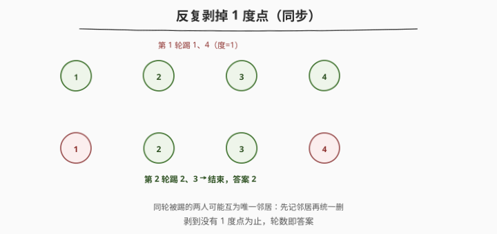
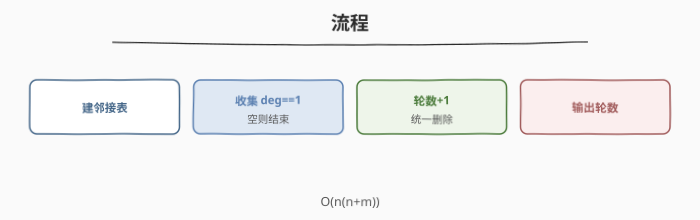

# Codeforces 129B Students and Shoelaces 题解

## 1. 题目概述

- **题目链接**：https://codeforces.com/problemset/problem/129/B
- **比赛来源**：Codeforces Beta Round 94 (Div. 2 Only) · Problem B（UTC 2011-10-22）
- **难度**：1200
- **标签**：图论、模拟
- **评测类型**：普通
- **限制**：时间 2 s / 内存 256 MB

**题意**：$n$ 个学生、$m$ 条鞋带（无向简单图，无重边无自环）。每轮：

1. Anna 训斥**当前恰好只与 1 个人相连**的学生；
2. Maria 把这些被训斥的学生一起踢出俱乐部（与他们相连的鞋带一起带走）。

重复直到某一轮没人被训斥。求一共踢出多少轮（组）。

**约束**：

- $n\le100$、$m\le n(n-1)/2$：直接模拟，每轮 $O(n+m)$。
- 注意**同一轮**被训斥的是一开始度数就为 1 的那些人；他们互相连接时也要同时踢出（不能先踢一个再判另一个）。
- 一轮里可能一个人都没踢出 → 结束。

## 2. 示例与观察

官方样例 1（输入 / 输出原样）：

```text
输入：
3 3
1 2
2 3
3 1

输出：
0
```

官方样例 2（输入 / 输出原样）：

```text
输入：
6 3
1 2
2 3
3 4

输出：
2
```

官方样例 3（输入 / 输出原样）：

```text
输入：
6 5
1 4
2 4
3 4
5 4
6 4

输出：
1
```

**样例 1 走查**：三角形，每人度 2 → 第一轮就没人被训斥 → 0 ✓。

**样例 2 走查**：路径 $1-2-3-4$（5、6 孤立）。第 1 轮踢 1 和 4；剩下 $2-3$，度数都是 1 → 第 2 轮踢 2、3 → 共 2 轮 ✓。

**样例 3 走查**：星形（中心 4 连 5 个叶子）。第 1 轮踢 5 个叶子；中心变成孤立（度 0，不是 1）→ 结束 → 1 轮 ✓。

**观察 1**：每轮踢掉的正是"当前度数为 1"的所有顶点（同步踢）✓ —— 这就是反复剥掉 1 度点的过程（剥到 2-核为止）。

**观察 2**：两个互为唯一邻居的顶点会在**同一轮**一起被踢（它们的度都是 1）—— 实现时必须先收集、再统一删除，否则会读到已清空的邻接表 ✓（第一版正是在这里崩的）。



## 3. 解题思路

### 3.1 朴素做法与瓶颈

每轮重算所有度数：$O(R\cdot(n+m))$，$R\le n/2$ → 至多 $O(n(n+m))$，$n\le100$ 完全够 ✓。

### 3.2 核心观察：同步删除

- 用邻接集合维护当前图；
- 每轮：收集所有 `deg==1` 的顶点 → 若为空则结束；否则轮数 $+1$，把每人唯一的邻居从邻接表中删掉，并清空自己的邻接表；
- 关键：先记录每个人"唯一的邻居"再统一删，避免同轮互相影响 ✓。



### 3.3 算法流程

1. 建图（`set` 或 `vector<bool>` 矩阵）；
2. 循环：收集度数 1 的顶点；空则跳出；否则轮数 $+1$、统一删除；
3. 输出轮数。

### 3.4 样例走查

见 2 节 ✓。

自造样例（标注"自造"）：

| 输入 | 输出 | 说明 |
|------|------|------|
| `2 1` / `1 2` | 1 | 两个 1 度点同轮踢 |
| `4 0` | 0 | 全孤立（度 0） |
| `5 4` / `1 2` / `2 3` / `3 4` / `4 5` | 2 | 长链剥两轮 |

## 4. 正确性证明

**引理 1**：第 $t$ 轮被踢的集合恰为"当轮开始时度数为 1 的顶点"，且同步移除。

**证明**：题面明确"训斥恰好与一人相连的学生，然后一起踢出"✓。∎

**引理 2**：先收集唯一邻居再统一删除，与题面的同步语义一致。

**证明**：同轮被踢的两人即使相邻，各自的唯一邻居就是对方；统一删除不会改变谁被踢 ✓。∎

**引理 3**：算法在无 1 度点时停止，正是题面的终止条件。

**证明**：题面"直到某一轮 Anna 无法训斥至少一个学生"✓。∎

**定理**：算法输出正确的轮数。

**证明**：由引理 1、2、3，每轮集合与题面一致，终止条件一致 ✓。∎

## 5. 复杂度分析

- **时间**：$O(\text{轮数}\cdot(n+m))\le O(n(n+m))$。
- **空间**：$O(n+m)$（用矩阵则 $O(n^2)$）。
- **与时限的关系**：实测约 $2$ ms。

## 6. 参考代码

### C++17

```cpp
#include <bits/stdc++.h>
using namespace std;
int main() {
    ios::sync_with_stdio(false);
    cin.tie(nullptr);
    int n, m;
    if (!(cin >> n >> m)) return 0;
    vector<set<int>> adj(n + 1);
    for (int i = 0; i < m; ++i) {
        int a, b;
        cin >> a >> b;
        adj[a].insert(b);
        adj[b].insert(a);
    }
    int rounds = 0;
    while (true) {
        vector<int> kick;
        for (int v = 1; v <= n; ++v)
            if (adj[v].size() == 1) kick.push_back(v);
        if (kick.empty()) break;
        ++rounds;
        vector<pair<int,int>> pairs;
        for (int v : kick) pairs.push_back({v, *adj[v].begin()});
        for (auto& pr : pairs) {
            int v = pr.first, u = pr.second;
            adj[u].erase(v);
            adj[v].clear();
        }
    }
    cout << rounds << '\n';
    return 0;
}
```

### Python3

```python
import sys


def main() -> None:
    data = sys.stdin.buffer.read().split()
    n, m = int(data[0]), int(data[1])
    adj = [set() for _ in range(n + 1)]
    p = 2
    for _ in range(m):
        a, b = int(data[p]), int(data[p + 1]); p += 2
        adj[a].add(b)
        adj[b].add(a)
    rounds = 0
    while True:
        kick = [v for v in range(1, n + 1) if len(adj[v]) == 1]
        if not kick:
            break
        rounds += 1
        pairs = [(v, next(iter(adj[v]))) for v in kick]
        for v, u in pairs:
            adj[u].discard(v)
            adj[v].clear()
    print(rounds)


main()
```

两份代码都只用标准库，可原样提交。

## 7. 边界情况与易错点

1. **同轮同步删除**：先记唯一邻居再统一删（第一版直接边删边读，遇到互为唯一邻居的两人会崩）。
2. **度 0 不算**：孤立学生不会被训斥。
3. **空图/无边**：输出 0。
4. **重边/自环**：题面保证没有。
5. **$n=2$ 且一条边**：第 1 轮两人同踢 → 1。
6. **多测**：单组输入。

## 8. 验证记录

- **编译环境与命令**：本机无 GNU `g++`，用 `Apple clang 21.0.0` + 仓库自带 `codeforces/tools/include/bits/stdc++.h` 兼容头（`clang++ -std=c++17 -O2 -I codeforces/tools/include`）编译；Python 为 `Python 3.9.6`。
- **官方样例**：3 / 3 通过（`0`、`2`、`1`）。
- **额外测试（边表重算度数的独立暴力）**：另写一份**完全独立**的实现——每轮从边表重新计算所有存活点的度数（不维护邻接表），对 250 组随机图（$n\le9$，随机边集）与 C++、Python 比对，**250 / 250 全部一致**（该对拍在此前抓出了"同轮互相删除导致读到空邻接表"的崩溃）。
- **图片校验**：两张 SVG（`cf129b_peel.svg`、`cf129b_flow.svg`）通过 `xml.etree.ElementTree.parse`。
- **公式校验**：KaTeX 渲染无报错。
- **复核状态**：verified。

## 相关题目与扩展

- [Codeforces 129A Cookies](https://codeforces.com/problemset/problem/129/A)：同场 A 题。
- [Codeforces 128D Numbers](https://codeforces.com/problemset/problem/128/D)：图/环。
- [LeetCode 1557. 可以到达所有点的最少点数目](https://leetcode.cn/problems/minimum-number-of-vertices-to-reach-all-nodes/)：度数。
- [LeetCode 1466. 重新规划路线](https://leetcode.cn/problems/reorder-routes-to-make-all-paths-lead-to-the-city-zero/)：图遍历。

**延伸思考**：

1. **如果允许"度数 ≤1"就踢**：孤立点也会被踢，轮数会变。
2. **如果只踢一个人（不是一批）**：顺序会影响轮数。
3. **如果要输出每组名单**：记录每轮集合。
4. **如果 $n$ 到 $10^5$**：用队列 + 度数做到 $O(n+m)$。
