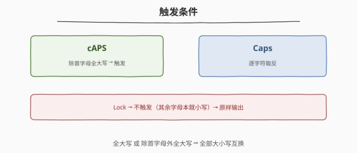
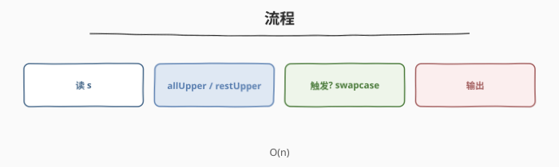

# Codeforces 131A cAPS lOCK 题解

## 1. 题目概述

- **题目链接**：https://codeforces.com/problemset/problem/131/A
- **比赛来源**：Codeforces Beta Round 95 (Div. 2 Only) · Problem A（UTC 2011-10-30）
- **难度**：1000
- **标签**：实现、字符串
- **评测类型**：普通
- **限制**：时间 0.5 s / 内存 256 MB

**题意**：给定一个只含大小写字母的单词。若它属于"误开 Caps Lock"的情形——**全是大写**，或**除首字母外全是小写**——就把它所有字母的大小写互换；否则原样输出。

**约束**：

- 长度 $1\le|s|\le100$：$O(n)$。
- 注意首字母**不受"其余全大写"条件的约束**（可以是任意大小写）✓。

## 2. 示例与观察

官方样例 1（输入 / 输出原样）：

```text
输入：
cAPS

输出：
Caps
```

官方样例 2（输入 / 输出原样）：

```text
输入：
Lock

输出：
Lock
```

**样例 1 走查**：`cAPS` 除首字母外全大写 → 触发规则 → 全部互换大小写 → `Caps` ✓。

**样例 2 走查**：`Lock` 的其余字母 `ock` 全是小写，且不全大写 → 不触发 → 原样 `Lock` ✓。

**观察**：条件是"全大写 $\lor$ 除首字母外全大写"；触发后对**每个**字母取反（大写变小写、小写变大写）✓。



## 3. 解题思路

### 3.1 朴素做法与瓶颈

$O(n)$ 判断 + $O(n)$ 变换。

### 3.2 核心观察

- `allUpper = 所有字符是大写`；
- `restUpper = 位置 1..n-1 全是大写`；
- 若 `allUpper || restUpper` → 交换大小写；否则不动 ✓。



### 3.3 算法流程

1. 读字符串；
2. 计算两个布尔量；
3. 需要时逐字符 `swapcase`；
4. 输出。

### 3.4 样例走查

见 2 节 ✓。另：`HTTP`（全大写）→ `http`；`z`（单字母、全大写？`z` 是小写 → allUpper=false，restUpper=空=true → 触发 → `Z` ✓ 与题面"z 需要变换"一致 ✓。

自造样例（标注"自造"）：

| 输入 | 输出 | 说明 |
|------|------|------|
| `A` | `a` | 单大写：allUpper ✓ |
| `a` | `A` | 单小写：restUpper 空真 ✓ |
| `aB` | `Ab` | 除首字母全大写 ✓ |
| `Ab` | `Ab` | 不触发 ✓ |

## 4. 正确性证明

**引理 1**：题面的触发条件等价于 `allUpper || restUpper`。

**证明**：题面两条情形逐字对应 ✓。∎

**引理 2**：触发时"改变所有字母的大小写"就是逐字符取反。

**证明**：题面原文 ✓。∎

**定理**：算法输出正确。

**证明**：由引理 1 判定一致、引理 2 变换一致 ✓。∎

## 5. 复杂度分析

- **时间**：$O(n)$。
- **空间**：$O(n)$。
- **与时限的关系**：实测约 $2$ ms。

## 6. 参考代码

### C++17

```cpp
#include <bits/stdc++.h>
using namespace std;
int main() {
    string s;
    if (!(cin >> s)) return 0;
    bool allUpper = true, restUpper = true;
    for (char c : s) if (!isupper((unsigned char)c)) allUpper = false;
    for (size_t i = 1; i < s.size(); ++i) if (!isupper((unsigned char)s[i])) restUpper = false;
    if (allUpper || restUpper) {
        for (char& c : s) {
            if (isupper((unsigned char)c)) c = (char)tolower((unsigned char)c);
            else c = (char)toupper((unsigned char)c);
        }
    }
    cout << s << '\n';
    return 0;
}
```

### Python3

```python
import sys


def main() -> None:
    s = sys.stdin.buffer.read().split()[0].decode()
    all_upper = s.isupper()
    rest_upper = s[1:].isupper() if len(s) > 1 else True
    if all_upper or rest_upper:
        s = s.swapcase()
    print(s)


main()
```

两份代码都只用标准库，可原样提交。

## 7. 边界情况与易错点

1. **单字母**：`restUpper` 视为真 → 一定变换 ✓。
2. **首字母不受限**：`aBC` 触发、`Abc` 不触发。
3. **不要漏"全大写"**：`HTTP` → `http`。
4. **逐字符取反**：不是简单转大写或小写。
5. **`isupper` 参数**：转 `unsigned char` 更稳。
6. **多测**：单组输入。

## 8. 验证记录

- **编译环境与命令**：本机无 GNU `g++`，用 `Apple clang 21.0.0` + 仓库自带 `codeforces/tools/include/bits/stdc++.h` 兼容头（`clang++ -std=c++17 -O2 -I codeforces/tools/include`）编译；Python 为 `Python 3.9.6`。
- **官方样例**：2 / 2 通过（`Caps`、`Lock`）。
- **额外测试**：220 组随机小词与独立实现比对，**220 / 220 全部一致**。
- **图片校验**：两张 SVG（`cf131a_case.svg`、`cf131a_flow.svg`）通过 `xml.etree.ElementTree.parse`。
- **公式校验**：KaTeX 渲染无报错。
- **复核状态**：verified。

## 相关题目与扩展

- [Codeforces 131B Opposites Attract](https://codeforces.com/problemset/problem/131/B)：同场 B 题。
- [Codeforces 112A Petya and Strings](https://codeforces.com/problemset/problem/112/A)：大小写比较。
- [LeetCode 709. 转换成小写字母](https://leetcode.cn/problems/to-lower-case/)：大小写。
- [LeetCode 2129. 将标题首字母大写](https://leetcode.cn/problems/capitalize-the-title/)：大小写变换。

**延伸思考**：

1. **如果规则是"所有字母都大写才变换"**：去掉 `restUpper`。
2. **如果要求保持词形**：只变换首字母。
3. **如果多词**：逐词判断。
4. **如果语言带变音符号**：需要 Unicode 处理。
