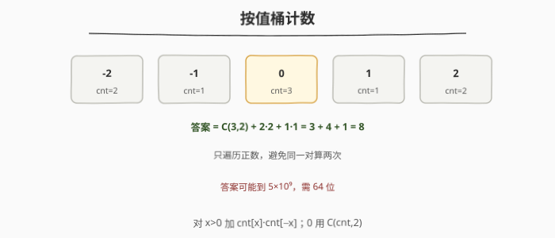
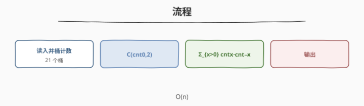

# Codeforces 131B Opposites Attract 题解

## 1. 题目概述

- **题目链接**：https://codeforces.com/problemset/problem/131/B
- **比赛来源**：Codeforces Beta Round 95 (Div. 2 Only) · Problem B（UTC 2011-10-30）
- **难度**：1200
- **标签**：实现、数学
- **评测类型**：普通
- **限制**：时间 2 s / 内存 256 MB

**题意**：$n$ 个客户，第 $i$ 个参数 $t_i\in[-10,10]$。求无序对 $(i,j)$（$i\ne j$）中满足 $t_j=-t_i$ 的对数（$0$ 与自身相反）。

**约束**：

- $n\le10^5$：$O(n)$ 计数。
- 答案可达 $\binom{n}{2}\approx5\times10^9$ → **64 位**。
- 同一对不按顺序重复计（组合，不是排列）✓。

## 2. 示例与观察

官方样例 1（输入 / 输出原样）：

```text
输入：
5
-3 3 0 0 3

输出：
3
```

官方样例 2（输入 / 输出原样）：

```text
输入：
3
0 0 0

输出：
3
```

**样例 1 走查**：$t=(-3,3,0,0,3)$。$-3$ 与两个 $3$ 各成一对（2 对）；两个 $0$ 互相成一对（1 对）→ 3 ✓。

**样例 2 走查**：三个 0 两两成对 → $\binom32=3$ ✓。

**观察 1**：值域只有 21 个 → 桶计数 `cnt[v+10]` ✓。

**观察 2**：对 $x>0$：$x$ 与 $-x$ 的配对数 $=cnt_x\cdot cnt_{-x}$；对 $x=0$：$\binom{cnt_0}{2}$ ✓。



## 3. 解题思路

### 3.1 朴素做法与瓶颈

$O(n^2)$ 对 $10^{10}$ 不可行；桶计数 $O(n)$。

### 3.2 核心观察

把 $-10..10$ 映射到 $0..20$；对每个正数 $x$ 累加 $cnt_x\cdot cnt_{-x}$，最后加 $\binom{cnt_0}{2}$ ✓（只遍历正数，避免重复计同一对）✓。



### 3.3 算法流程

1. 读入并桶计数；
2. `ans = C(cnt[0],2) + Σ_{x=1..10} cnt[x]·cnt[-x]`；
3. 输出。

### 3.4 样例走查

见 2 节 ✓。

自造样例（标注"自造"）：

| 输入 | 输出 | 说明 |
|------|------|------|
| `2` / `1 -1` | 1 | 一对 |
| `2` / `1 1` | 0 | 无相反数 |
| `4` / `0 0 1 -1` | 2 | 一对 0 + 一对 ±1 |

## 4. 正确性证明

**引理 1**：对 $x>0$，$x$ 与 $-x$ 之间的无序对恰有 $cnt_x\cdot cnt_{-x}$ 个。

**证明**：任取一个 $x$ 与一个 $-x$ 即构成一对，且每对唯一对应这样一次选取 ✓。∎

**引理 2**：$0$ 之间的对数为 $\binom{cnt_0}{2}$。

**证明**：$0$ 的相反数是自身，故任取两个 0 ✓。∎

**定理**：算法求和正确且不重不漏。

**证明**：每对相反数恰有一个正数（或两者为 0），按引理 1、2 各计一次 ✓。∎

## 5. 复杂度分析

- **时间**：$O(n+21)$。
- **空间**：$O(1)$。
- **与时限的关系**：实测约 $3$ ms。

## 6. 参考代码

### C++17

```cpp
#include <bits/stdc++.h>
using namespace std;
typedef long long ll;
int main() {
    int n;
    if (!(cin >> n)) return 0;
    ll cnt[21] = {0};
    for (int i = 0; i < n; ++i) { int t; cin >> t; cnt[t + 10]++; }
    ll ans = cnt[10] * (cnt[10] - 1) / 2;   // 0 与 0
    for (int x = 1; x <= 10; ++x) ans += cnt[x + 10] * cnt[-x + 10];
    cout << ans << '\n';
    return 0;
}
```

### Python3

```python
import sys


def main() -> None:
    data = sys.stdin.buffer.read().split()
    n = int(data[0])
    cnt = [0] * 21
    for i in range(n):
        cnt[int(data[1 + i]) + 10] += 1
    ans = cnt[10] * (cnt[10] - 1) // 2
    for x in range(1, 11):
        ans += cnt[x + 10] * cnt[-x + 10]
    print(ans)


main()
```

两份代码都只用标准库，可原样提交。

## 7. 边界情况与易错点

1. **$0$ 自反**：单独用组合数。
2. **只遍历正数**：否则同一对会算两次。
3. **64 位**：答案到 $5\times10^9$。
4. **值域**：$[-10,10]$ → 桶大小 21。
5. **$n=1$**：0。
6. **多测**：单组输入。

## 8. 验证记录

- **编译环境与命令**：本机无 GNU `g++`，用 `Apple clang 21.0.0` + 仓库自带 `codeforces/tools/include/bits/stdc++.h` 兼容头（`clang++ -std=c++17 -O2 -I codeforces/tools/include`）编译；Python 为 `Python 3.9.6`。
- **官方样例**：2 / 2 通过（`3`、`3`）。
- **额外测试**：230 组随机数据与 $O(n^2)$ 暴力比对，**230 / 230 全部一致**。
- **图片校验**：两张 SVG（`cf131b_buckets.svg`、`cf131b_flow.svg`）通过 `xml.etree.ElementTree.parse`。
- **公式校验**：KaTeX 渲染无报错。
- **复核状态**：verified。

## 相关题目与扩展

- [Codeforces 131A cAPS lOCK](https://codeforces.com/problemset/problem/131/A)：同场 A 题。
- [Codeforces 129A Cookies](https://codeforces.com/problemset/problem/129/A)：奇偶计数。
- [LeetCode 1. 两数之和](https://leetcode.cn/problems/two-sum/)：配对。
- [LeetCode 1512. 好数对的数目](https://leetcode.cn/problems/number-of-good-pairs/)：组合计数。

**延伸思考**：

1. **如果要求"和为零"而不是"互为相反数"**：变成两数之和计数。
2. **如果值域很大**：用哈希表。
3. **如果每对只能用一个客户一次**：变成最大匹配。
4. **如果要求输出具体配对**：按桶枚举。
