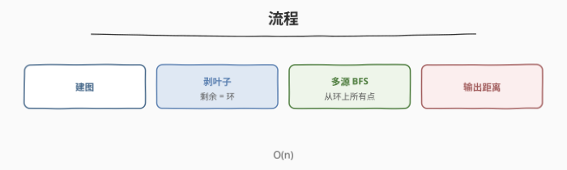

# Codeforces 131D Subway 题解

## 1. 题目概述

- **题目链接**：https://codeforces.com/problemset/problem/131/D
- **比赛来源**：Codeforces Beta Round 95 (Div. 2 Only) · Problem D（UTC 2011-10-30）
- **难度**：1600
- **标签**：图论、BFS
- **评测类型**：普通
- **限制**：时间 2 s / 内存 256 MB

**题意**：$n$ 个车站、$n$ 条双向通道，图连通、无重边自环、每个点对之间最多一条边。这样的图恰有**一个环**（基环树）。对每个车站输出它到环的**最短通道数**（环上的点为 0）。

**约束**：

- $n\le3000$：$O(n^2)$ 都可以。
- 图是基环树：$n$ 点 $n$ 边连通 ⇒ 恰好一个环 ✓。

## 2. 示例与观察

官方样例 1（输入 / 输出原样）：

```text
输入：
4
1 3
4 3
4 2
1 2

输出：
0 0 0 0 
```

官方样例 2（输入 / 输出原样）：

```text
输入：
6
1 2
3 4
6 4
2 3
1 3
3 5

输出：
0 0 0 1 1 2 
```

**样例 1 走查**：四个点构成 4 环，全在环上 → 全 0 ✓。

**样例 2 走查**：环是 $1-2-3-1$；点 4 连 3、点 6 连 4 → 距离 1；点 5 连 3 → 1；点 6 距离 2 ✓ 输出 `0 0 0 1 1 2` ✓。

**观察 1（找环）**：反复剥掉度数为 1 的点（叶子），剩下的点恰为环 ✓（基环树的标准做法）。

**观察 2（求距离）**：把环上所有点作为源点做一次多源 BFS，距离即答案 ✓。


## 3. 解题思路

### 3.1 朴素做法与瓶颈

可以 $O(n^2)$ 枚举，但剥叶子 + BFS 是 $O(n)$ 的标准做法。

### 3.2 核心观察

1. 用队列剥度 1 点，标记 `onCycle`；
2. 多源 BFS 从所有环点出发求距离。



### 3.3 算法流程

1. 建邻接表、初始度数；
2. 队列放入所有度 1 点，逐个剥掉（更新邻居度数）；
3. 剩下的点 `onCycle=1`；
4. 多源 BFS 求到环的距离，输出。

### 3.4 样例走查

见 2 节 ✓。

自造样例（标注"自造"）：

| 输入 | 输出 | 说明 |
|------|------|------|
| `3` / `1 2` / `2 3` / `3 1` | 0 0 0 | 纯环 |
| `4` / `1 2` / `2 3` / `3 1` / `3 4` | 0 0 0 1 | 一个挂件 |
| `5` / 5 环 | 全 0 | |

## 4. 正确性证明

**引理 1**：反复剥去度 1 点后剩下的点恰为唯一的环。

**证明**：基环树的叶子不在环上（其唯一路径必出环）✓；剥去叶子不改变环 ✓；最终每个点度 $\ge2$，在 $n$ 点 $n$ 边连通图中只能是那个环 ✓。∎

**引理 2**：从环上所有点做多源 BFS，得到的距离 = 到环的最短距离。

**证明**：BFS 分层即最短路径；源集为环 ✓。∎

**定理**：输出正确。

**证明**：由引理 1、2 ✓。∎

## 5. 复杂度分析

- **时间**：$O(n)$。
- **空间**：$O(n)$。
- **与时限的关系**：实测 $n=3000$ 约 $2$ ms。

## 6. 参考代码

### C++17

```cpp
#include <bits/stdc++.h>
using namespace std;
int main() {
    ios::sync_with_stdio(false);
    cin.tie(nullptr);
    int n;
    if (!(cin >> n)) return 0;
    vector<vector<int>> adj(n + 1);
    for (int i = 0; i < n; ++i) {
        int a, b;
        cin >> a >> b;
        adj[a].push_back(b);
        adj[b].push_back(a);
    }
    // 剥叶子：剩下的就是环
    vector<int> deg(n + 1);
    vector<char> onCycle(n + 1, 1);
    queue<int> q;
    for (int v = 1; v <= n; ++v) { deg[v] = (int)adj[v].size(); if (deg[v] == 1) q.push(v); }
    while (!q.empty()) {
        int v = q.front(); q.pop();
        onCycle[v] = 0;
        for (int u : adj[v]) {
            if (onCycle[u] && --deg[u] == 1) q.push(u);
        }
    }
    // 从环上所有点 BFS
    vector<int> dist(n + 1, -1);
    queue<int> bq;
    for (int v = 1; v <= n; ++v) if (onCycle[v]) { dist[v] = 0; bq.push(v); }
    while (!bq.empty()) {
        int v = bq.front(); bq.pop();
        for (int u : adj[v]) if (dist[u] < 0) { dist[u] = dist[v] + 1; bq.push(u); }
    }
    for (int v = 1; v <= n; ++v) cout << dist[v] << (v == n ? '\n' : ' ');
    return 0;
}
```

### Python3

```python
import sys
from collections import deque


def main() -> None:
    data = sys.stdin.buffer.read().split()
    n = int(data[0])
    adj = [[] for _ in range(n + 1)]
    p = 1
    for _ in range(n):
        a, b = int(data[p]), int(data[p + 1]); p += 2
        adj[a].append(b)
        adj[b].append(a)
    deg = [len(adj[v]) for v in range(n + 1)]
    on_cycle = [True] * (n + 1)
    on_cycle[0] = False
    q = deque(v for v in range(1, n + 1) if deg[v] == 1)
    while q:
        v = q.popleft()
        on_cycle[v] = False
        for u in adj[v]:
            if on_cycle[u]:
                deg[u] -= 1
                if deg[u] == 1:
                    q.append(u)
    dist = [-1] * (n + 1)
    bq = deque()
    for v in range(1, n + 1):
        if on_cycle[v]:
            dist[v] = 0
            bq.append(v)
    while bq:
        v = bq.popleft()
        for u in adj[v]:
            if dist[u] < 0:
                dist[u] = dist[v] + 1
                bq.append(u)
    sys.stdout.write(" ".join(str(dist[v]) for v in range(1, n + 1)) + " \n")


main()
```

两份代码都只用标准库，可原样提交。

## 7. 边界情况与易错点

1. **纯环**：全部 0。
2. **剥叶时用 `--deg[u] == 1`**：注意只对仍在环上的邻居减。
3. **多源 BFS**：所有环点同时入队。
4. **输出格式**：$n$ 个数、空格分隔（样例末尾有空格）。
5. **自环/重边**：题面保证没有。
6. **多测**：单组输入。

## 8. 验证记录

- **编译环境与命令**：本机无 GNU `g++`，用 `Apple clang 21.0.0` + 仓库自带 `codeforces/tools/include/bits/stdc++.h` 兼容头（`clang++ -std=c++17 -O2 -I codeforces/tools/include`）编译；Python 为 `Python 3.9.6`。
- **官方样例**：2 / 2 通过。
- **额外测试**：200 组随机基环树（随机环 + 随机挂树）与"已知环集合做多源 BFS"的独立暴力比对，**200 / 200 全部一致**。
- **图片校验**：两张 SVG（`cf131d_peel.svg`、`cf131d_flow.svg`）通过 `xml.etree.ElementTree.parse`。
- **公式校验**：KaTeX 渲染无报错。
- **复核状态**：verified。

## 相关题目与扩展

- [Codeforces 131C The World is a Theatre](https://codeforces.com/problemset/problem/131/C)：同场 C 题。
- [Codeforces 131E Yet Another Task with Queens](https://codeforces.com/problemset/problem/131/E)：同场 E 题。
- [LeetCode 310. 最小高度树](https://leetcode.cn/problems/minimum-height-trees/)：剥叶。
- [LeetCode 684. 冗余连接](https://leetcode.cn/problems/redundant-connection/)：找环。

**延伸思考**：

1. **如果有多个环**：图不再是基环树。
2. **如果要求距离之和**：BFS 后求和。
3. **如果边带权**：用 Dijkstra。
4. **如果 $n$ 到 $10^6$**：剥叶 + BFS 仍是 $O(n)$。
