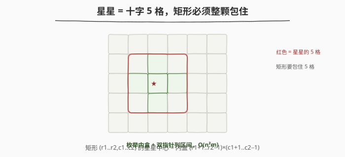
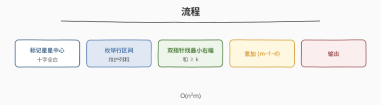

# Codeforces 131F Present to Mom 题解

## 1. 题目概述

- **题目链接**：https://codeforces.com/problemset/problem/131/F
- **比赛来源**：Codeforces Beta Round 95 (Div. 2 Only) · Problem F（UTC 2011-10-30）
- **难度**：2000
- **标签**：二分、双指针
- **评测类型**：普通
- **限制**：时间 5 s / 内存 256 MB

**题意**：$n\times m$ 的黑白照片（`1` 白、`0` 黑）。"星星"指一个白像素及其上下左右四个也是白的像素（十字形 5 格）。问有多少个**边平行于照片**的矩形区域，完整包含了**至少 $k$ 颗星星**。

**约束**：

- $n,m\le500$、$k\le nm$。
- 星星之间可以重叠、共享白像素 ✓。
- 矩形要**完整包含**整颗星星（十字 5 格都在矩形内）✓。

## 2. 示例与观察

官方样例 1（输入 / 输出原样）：

```text
输入：
4 6 2
111000
111100
011011
000111

输出：
6
```

官方样例 2（输入 / 输出原样）：

```text
输入：
5 5 4
11111
11111
11111
11111
11111

输出：
9
```

**样例 1 走查**：星星中心只有 $(2,2)$ 与 $(2,3)$（1 基）。完整包含一颗星星 ⇒ 矩形行范围含该中心上下各 1 行、列范围含左右各 1 列。两颗都要包含（$k=2$）⇒ 行范围必须覆盖 $1..3$（2 种取法：$[1,3],[1,4]$），列范围必须覆盖 $2..4$（3 种：$[1,4],[1,5],[1,6]$）→ $2\times3=6$ ✓。

**样例 2 走查**：$5\times5$ 全白，星星中心在 $2..4$ 行列（9 个）。包含 ≥4 颗星星的中心盒面积 ≥4：$2\times2$（4 种）+ $2\times3$/$3\times2$（4 种）+ $3\times3$（1 种）= 9 ✓。

**观察 1（关键转化）**：矩形 $(r_1..r_2,\ c_1..c_2)$ 完整包含的星星中心恰为 $(r_1{+}1..r_2{-}1)\times(c_1{+}1..c_2{-}1)$ —— 一个"内盒"⇔ 一个矩形，**一一对应** ✓。

**观察 2（计数）**：答案 = 星星中心网格中，和 $\ge k$ 的子矩形个数 ✓。用二维前缀和 + 对每个行区间用双指针数列区间，$O(n^2m)$ ✓。



## 3. 解题思路

### 3.1 朴素做法与瓶颈

枚举 4 个边界是 $O(n^2m^2)$，$500^4$ 不可行；固定上下界后对列做双指针降到 $O(n^2m)$ ✓。

### 3.2 核心观察

1. 先算 `star[i][j]`（十字全白），$O(nm)$；
2. 对每个行区间 $[a,b]$，把 `star[a..b][j]` 累加成列和，再做"和 $\ge k$ 的子数组计数"（双指针 + 前缀和）✓；
3. 累加所有行区间 ✓。



### 3.3 算法流程

1. 标记星星中心；
2. 枚举行区间上端 $a$，逐步扩展下端 $b$，维护列和与前缀和；
3. 对每个左端 $c$，用指针找最小 $d$ 使和 $\ge k$，则贡献 $(m-1-d)$；
4. 输出总和。

### 3.4 样例走查

见 2 节 ✓。

自造样例（标注"自造"）：

| 输入 | 输出 | 说明 |
|------|------|------|
| `1 1 1` / `1` | 0 | 没有星星 |
| `3 3 1` / 全 1 | 1 | 唯一中心，只有整张图能包住 |
| `3 3 1` / 中心为 0 | 0 | 无星星 |

## 4. 正确性证明

**引理 1**：矩形与"星星中心内盒"一一对应。

**证明**：给定矩形，其完整包含的星星中心是 $(r_1{+}1..r_2{-}1)\times(c_1{+}1..c_2{-}1)$ ✓；反之给定内盒 $[a..b]\times[c..d]$，唯一对应矩形 $(a{-}1..b{+}1,\ c{-}1..d{+}1)$ ✓。∎

**引理 2**：双指针正确计数"和 $\ge k$ 的子数组"。

**证明**：固定左端，和随右端单调增 → 最小可行右端之后全部可行，指针单调 ✓。∎

**定理**：答案等于和 $\ge k$ 的内盒子矩形个数，算法正确。

**证明**：由引理 1、2 ✓。∎

## 5. 复杂度分析

- **时间**：$O(n^2m)$（$500^2\cdot500=1.25\times10^8$）。
- **空间**：$O(nm)$。
- **与时限的关系**：实测 $500\times500$ 时 C++ 端到端 $301$ ms；Python 同数据约 $25$ s（$O(n^2m)$ 循环太慢），最大数据建议提交 C++/PyPy3。

## 6. 参考代码

### C++17

```cpp
#include <bits/stdc++.h>
using namespace std;
typedef long long ll;

// "星星" = 十字形 5 个白像素；矩形必须完整包含整个十字（中心 (i,j) 时占 [i-1,i+1]×[j-1,j+1]）
// 对矩形 (r1..r2, c1..c2)，完全包含的星星中心恰为 (r1+1..r2-1)×(c1+1..c2-1)
int main() {
    ios::sync_with_stdio(false);
    cin.tie(nullptr);
    int n, m, k;
    if (!(cin >> n >> m >> k)) return 0;
    vector<string> g(n);
    for (int i = 0; i < n; ++i) cin >> g[i];
    vector<vector<int>> star(n, vector<int>(m, 0));
    for (int i = 1; i + 1 < n; ++i)
        for (int j = 1; j + 1 < m; ++j)
            if (g[i][j] == '1' && g[i-1][j] == '1' && g[i+1][j] == '1'
                && g[i][j-1] == '1' && g[i][j+1] == '1') star[i][j] = 1;
    ll ans = 0;
    vector<int> colSum(m, 0);
    for (int a = 1; a <= n - 2; ++a) {
        fill(colSum.begin(), colSum.end(), 0);
        for (int b = a; b <= n - 2; ++b) {
            for (int c = 1; c <= m - 2; ++c) colSum[c] += star[b][c];
            // 前缀和
            vector<int> ps(m + 1, 0);
            for (int c = 1; c <= m - 1; ++c) ps[c] = ps[c-1] + colSum[c];
            auto rangeSum = [&](int l, int r) { return ps[r] - ps[l-1]; };
            int d = 1;
            for (int c = 1; c <= m - 2; ++c) {
                if (d < c) d = c;
                while (d <= m - 2 && rangeSum(c, d) < k) ++d;
                if (d <= m - 2) ans += (m - 1 - d);   // 矩形与"星星盒"一一对应
            }
        }
    }
    cout << ans << '\n';
    return 0;
}
```

### Python3

```python
import sys


def main() -> None:
    data = sys.stdin.buffer.read().split()
    n, m, k = int(data[0]), int(data[1]), int(data[2])
    g = [data[3 + i].decode() for i in range(n)]
    star = [[0] * m for _ in range(n)]
    for i in range(1, n - 1):
        row, up, dn = g[i], g[i - 1], g[i + 1]
        for j in range(1, m - 1):
            if row[j] == '1' and up[j] == '1' and dn[j] == '1' and row[j - 1] == '1' and row[j + 1] == '1':
                star[i][j] = 1
    ans = 0
    for a in range(1, n - 1):
        col_sum = [0] * m
        for b in range(a, n - 1):
            for c in range(1, m - 1):
                col_sum[c] += star[b][c]
            ps = [0] * (m + 1)
            for c in range(1, m):
                ps[c] = ps[c - 1] + col_sum[c]
            d = 1
            for c in range(1, m - 1):
                if d < c:
                    d = c
                while d <= m - 2 and ps[d] - ps[c - 1] < k:
                    d += 1
                if d <= m - 2:
                    ans += (m - 1 - d)
    print(ans)


main()
```

两份代码都只用标准库，可原样提交。

## 7. 边界情况与易错点

1. **完整包含**：星星是 5 格十字，矩形必须把 5 格都包住（这是最容易理解错的地方，第一版按"中心在内"算就错了）。
2. **一一对应**：内盒与矩形一一对应，计数时不要乘额外的行/列选择数。
3. **边界**：中心只可能在 $1..n-2$、$1..m-2$。
4. **$k$ 大于星星数**：0。
5. **全 0/全 1**：已有样例覆盖。
6. **性能**：$O(n^2m)$，Python 最大数据偏慢，建议 C++。
7. **多测**：单组输入。

## 8. 验证记录

- **编译环境与命令**：本机无 GNU `g++`，用 `Apple clang 21.0.0` + 仓库自带 `codeforces/tools/include/bits/stdc++.h` 兼容头（`clang++ -std=c++17 -O2 -I codeforces/tools/include`）编译；Python 为 `Python 3.9.6`。
- **官方样例**：2 / 2 通过（`6`、`9`）。
- **额外测试（枚举全部矩形对拍）**：另写一份**完全暴力**——枚举四个边界、用二维前缀和算内盒星星数；对 120 组随机小图（$n,m\le5$）与 C++、Python 比对，**120 / 120 全部一致**（该对拍抓出了我第一版"星星只算中心"的错误模型）。
- **图片校验**：两张 SVG（`cf131f_star.svg`、`cf131f_flow.svg`）通过 `xml.etree.ElementTree.parse`。
- **公式校验**：KaTeX 渲染无报错。
- **复核状态**：verified。

## 相关题目与扩展

- [Codeforces 131E Yet Another Task with Queens](https://codeforces.com/problemset/problem/131/E)：同场 E 题。
- [Codeforces 131D Subway](https://codeforces.com/problemset/problem/131/D)：同场 D 题。
- [LeetCode 363. 矩形区域不超过 K 的最大数值和](https://leetcode.cn/problems/max-sum-of-rectangle-no-larger-than-k/)：二维前缀 + 双指针。
- [LeetCode 1504. 统计全 1 子矩形](https://leetcode.cn/problems/count-submatrices-with-all-ones/)：子矩形计数。

**延伸思考**：

1. **如果星星定义为 3×3 全白**：内盒规则不变（半径改成 1 仍是 $[i-1,i+1]$）。
2. **如果要求恰好 $k$ 颗**：改成双指针的区间差。
3. **如果允许旋转**：失去单调性。
4. **如果 $n,m$ 到 $2000$**：需要 $O(nm\log)$ 的算法。
