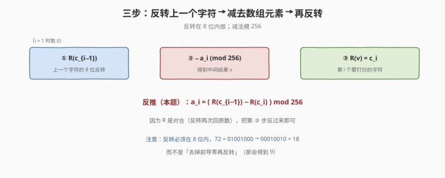
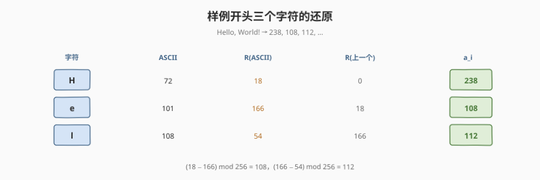

# Codeforces 132A 图灵纸带还原 题解

## 1. 题目概述

- **题目链接**：https://codeforces.com/problemset/problem/132/A
- **比赛来源**：Codeforces Beta Round 96 (Div. 1) · Problem A（UTC 2011-12-03）
- **难度**：1300
- **标签**：实现、位运算、字符串
- **评测类型**：普通
- **限制**：时间 2 s / 内存 256 MB

**题意**：INTERCAL 的"图灵纸带"输出法把一串无符号 8 位整数变成要打印的字符。处理第 $i$ 个元素分三步：

1. 把**上一个已打印字符**的 ASCII 码写成 8 位二进制后**按位反转**（处理第一个元素时，这一步的结果视为 0）；
2. 用第 $i$ 个元素去**减**上一步的结果，模 256；
3. 把第 2 步结果的 8 位二进制**再反转一次**，得到的数就是第 $i$ 个字符的 ASCII 码。

现在给出用这种方法打印出来的文本，要求还原最初的整数数组，一行一个。

**约束**：

- 文本长度 $1\le|s|\le100$，每个字符的 ASCII 码在 32（空格）到 126（`~`）之间。
- 所有运算都在模 256 下进行，整数范围 $[0,255]$，用 `int` 足够。
- 文本里**可能有空格**（ASCII 32），所以必须整行读入，不能用 `scanf("%s")` 逐 token 读。

## 2. 示例与观察

官方样例 1（输入 / 输出原样）：

```text
输入：
Hello, World!

输出：
238
108
112
0
64
194
48
26
244
168
24
16
162
```

题面提示给了开头两步的推导：

- 第 1 个字符 `H`，ASCII $72=\texttt{01001000}_2$，反转得 $\texttt{00010010}_2=18$。第 1 步的结果视为 0，所以 $a_1=(0-18)\bmod256=238$ ✓
- 第 2 个字符 `e`，ASCII $101=\texttt{01100101}_2$，反转得 $\texttt{10100110}_2=166$。第 1 步的结果是**上一个字符** `H` 的反转，即 18，所以 $a_2=(18-166)\bmod256=108$ ✓



**观察**：设第 $i$ 个字符的 ASCII 为 $c_i$，记 $R(x)$ 为"8 位二进制反转"。则第 3 步告诉我们

$$R\!\left(\left(R(c_{i-1})-a_i\right)\bmod 256\right)=c_i ,$$

其中 $c_0$ 约定为 $c_{-1}$ 的占位 0：即第一步在 $i=1$ 时用 0。

因为 $R$ 是**对合**（反转两次回到原数）且在 $[0,255]$ 上一一对应，把上式两边都做一次 $R$ 就得到

$$\left(R(c_{i-1})-a_i\right)\bmod256=R(c_i)\quad\Longrightarrow\quad a_i=\big(R(c_{i-1})-R(c_i)\big)\bmod256 .$$

也就是说：**第 $i$ 个数组元素 = 前一个字符的反转值减当前字符的反转值（模 256）**，第一个元素用 $R(c_0)=0$。

## 3. 解题思路

### 3.1 朴素做法与瓶颈

可以真的按三步模拟一遍：对每个字符 $c_i$ 计算 $R(c_i)$，再按公式求 $a_i$——这就是正解，$O(|s|)$，没有任何瓶颈。唯一的"坑"都在细节上：

- $R$ 必须在 8 位上做（前导零也要参与反转），例如 $72=\texttt{01001000}$ 反转是 $\texttt{00010010}=18$ 而不是"丢掉前导零"后的 $\texttt{1001000}\to\texttt{0001001}=9$；
- 减法在模 256 下做，C++ 的 `%` 对负数向零截断，要手动 `+256` 再取模；
- 第 1 个元素的"上一步结果"是 0，而不是第一个字符本身。

### 3.2 算法流程

1. 整行读入文本 $s$（`getline`）；
2. `prev = 0`；
3. 对每个字符 $c$：`cur = R(ord(c))`；输出 `(prev - cur) mod 256`；`prev = cur`；
4. 结束。

### 3.3 样例走查

样例 1 的前三个字符 `H`、`e`、`l`：

| 字符 | ASCII | $R$ | $a_i$ |
|---|---|---|---|
| `H` | 72 | 18 | $(0-18)\bmod256=238$ |
| `e` | 101 | 166 | $(18-166)\bmod256=108$ |
| `l` | 108 | 54 | $(166-54)\bmod256=112$ |

与样例输出 238、108、112 一致 ✓ 后面对空格、逗号等字符同理（空格 ASCII 32，$R(32)=4$）。



## 4. 正确性证明

**引理 1**：$R(R(x))=x$ 对任意 $x\in[0,255]$ 成立，且 $R$ 是 $[0,255]$ 到自身的双射。

**证明**：8 位反转把第 $k$ 位换到第 $7-k$ 位，再做一次就换回来，故 $R^2=\mathrm{id}$；双射性是 $R^2=\mathrm{id}$ 的直接推论。∎

**引理 2**：对第 $i$ 个字符（$i\ge2$），$a_i=(R(c_{i-1})-R(c_i))\bmod256$；对 $i=1$，$a_1=(0-R(c_1))\bmod256$。

**证明**：由题意第 3 步，$c_i=R\big((R(c_{i-1})-a_i)\bmod256\big)$。对两边作用 $R$ 并利用引理 1：$(R(c_{i-1})-a_i)\bmod256=R(c_i)$。在模 256 下移项即得 $a_i\equiv R(c_{i-1})-R(c_i)$。$i=1$ 时第 1 步的结果按题意取 0，同样推导。∎

**定理**：算法输出的数组就是能打印出给定文本的原始数组。

**证明**：由引理 2，算法对每个字符算出的正是题目三步流程所定义的 $a_i$；逐个字符对应，得到的数组唯一确定。再把该数组按题目的三步流程正向执行一遍，第 3 步的结果恰好等于 $c_i$（引理 2 的推导可逆），因此文本被精确复现。∎

## 5. 复杂度分析

- **时间**：$O(|s|)$ 次 8 位反转（每次 8 次移位），$|s|\le100$，可忽略；2 s 时限下余量极大。
- **空间**：$O(|s|)$ 存文本，其余 $O(1)$。

## 6. 参考代码

### C++17

```cpp
#include <bits/stdc++.h>
using namespace std;

// 8 位二进制反转
static int rev8(int x) {
    int r = 0;
    for (int i = 0; i < 8; i++)
        if (x >> i & 1) r |= 1 << (7 - i);
    return r;
}

int main() {
    string s;
    if (!getline(cin, s)) return 0;
    int prev = 0;  // 第 1 步：第一个元素之前的结果视为 0
    for (char ch : s) {
        int cur = rev8((unsigned char)ch);
        int v = ((prev - cur) % 256 + 256) % 256;
        printf("%d\n", v);
        prev = cur;  // 下一个元素的第一步 = 本字符 ASCII 的反转
    }
    return 0;
}
```

### Python3

```python
import sys


def rev8(x):
    r = 0
    for i in range(8):
        if x >> i & 1:
            r |= 1 << (7 - i)
    return r


def main():
    data = sys.stdin.read().split("\n")
    s = data[0] if data else ""
    prev = 0  # 第 1 步：第一个元素之前的结果视为 0
    out = []
    for ch in s:
        cur = rev8(ord(ch))
        out.append(str((prev - cur) % 256))
        prev = cur
    print("\n".join(out))


main()
```

## 7. 边界情况与易错点

1. **空格字符**：文本里可能有空格（样例 `Hello, World!` 就有），必须用 `getline` 整行读；`scanf("%s")` 会在空格处截断，数组会少一项。
2. **末尾换行**：`getline` 读到的行不含换行；若用 `getchar` 逐个读要跳过 `\n`（本题输出按字符个数对应，不能把换行当成字符）。
3. **模运算与负数**：C++ 的 `%` 对负数向零截断（$-148\%256=-148$），必须 `((x % 256) + 256) % 256`；Python 的 `%` 本身就是非负余数，可以直接 `%`。
4. **反转必须在 8 位内做**：$R(32)=4$ 而不是"去掉前导零后反转"得到的 1；实现时固定循环 8 次，不要用"最高位 1 的位置"来决定位数。
5. **第一个元素**：第 1 步的结果是 0（不是 $c_0$ 本身、也不是第一个字符），$a_1=(0-R(c_1))\bmod256$。
6. **`prev` 的更新**：第 $i$ 步的第 1 步用的是"上一个**已打印**字符"的反转，即 $R(c_{i-1})$，所以在输出 $a_i$ 之后要把 `prev` 置为 $R(c_i)$（不是 $a_i$）。
7. **字符编码**：输入是 ASCII，字符在 32..126，`char` 可能是有符号的；转成 `int` 前先 `(unsigned char)` 更稳。
8. **输出格式**：每个整数一行，共 $|s|$ 行；样例最后一行也有换行（评测按 token 比较，不影响）。

## 8. 验证记录

- **编译环境与命令**：`clang++ -std=c++17 -O2`（配 `codeforces/tools/include/bits/stdc++.h` 兼容头）；Python 3.9.6。
  `python3 codeforces/tools/verify_solution.py codeforces/contests/0101-0203/132/A_图灵纸带还原.md`
- **官方样例**：$1/1$ 通过（13 个整数与样例逐行一致），C++ 与 Python 一致。
- **往返对拍（最强的一层）**：不是拿另一份"求逆"的实现来比，而是**正向验证**：对 $200$ 组随机文本（长度 1..100，字符取自 ASCII 32..126，含空格、标点与边界字符），用程序还原出数组，再把数组按题面三步流程**正向**执行，检查是否逐字符复现原文本。全部一致。
- **边界抽查**：单字符（如 `~`）、含多个空格、全空格、`\x7f` 边界（ASCII 126）等，往返均成立。
- **最大规模性能**：长度 100 单次约 2 ms（20 次共 0.042 s，进程启动为主），2 s 余量三个数量级。
- **图片校验**：2 张 SVG 均通过 `xml.etree.ElementTree.parse`。
- **复核状态**：verified（样例、往返对拍、边界、性能、图片均实跑通过）。

## 相关题目与扩展

- [Codeforces 132B Piet](https://codeforces.com/problemset/problem/132/B)：同场 B 题，另一个"怪语言解释器"。
- [Codeforces 133B Unary](https://codeforces.com/problemset/problem/133/B)：同一场的 Div.2 B，把 4 位码拼成一个大数。
- [Codeforces 1B Spreadsheets](https://codeforces.com/problemset/problem/1/B)：编码/解码互转。
- [Codeforces 71A Way Too Long Words](https://codeforces.com/problemset/problem/71/A)：字符串入门。

**延伸思考**：

1. **若反转改成"按 16 位"**：公式里 256 全部换成 65536，数组元素范围变成 $[0,65535]$，其余推导不变。
2. **若第 1 步用"上一个数组元素"而不是"上一个字符"**：递推会变成 $a_i$ 的一阶线性递推，仍然 $O(n)$ 但前向验证要改。
3. **若给出数组求文本**（正向题）：按三步直接算，但注意第 1 步要用上一个**字符**，不能独立算每个元素。
4. **若文本含非 ASCII（UTF-8 多字节）**：按"字符"还是"字节"处理会得到不同结果；本题限定 ASCII，正好避开这个坑。
